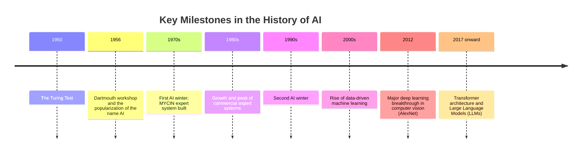

# Session 1: Course Introduction and Getting to Know AI

> **Course:** Introduction to Artificial Intelligence and Its Applications in Biomedical Engineering
> **Suggested duration:** 60 to 90 minutes · **Level:** Introductory; no serious AI background required
> **References for this session:** Ref. 1 (Russell & Norvig, 2016), Ref. 2 (Erickson, 2021), Ref. 9 (Peng et al., 2010), Ref. 11 (instructor content)

---

## Session Objectives
By the end of this session, students will be able to:
1. Define Artificial Intelligence and name several important milestones in its history.
2. Explain the difference between Artificial Intelligence (AI), Machine Learning (ML), and Deep Learning (DL).
3. Specify the input, output, and goal of a system for a medical application.
4. Become familiar with the course structure, the project, and the grading scheme.

---

## 1. What Is Artificial Intelligence?
Artificial intelligence is a branch of computer science whose goal is to build systems that perform tasks that normally require human intelligence, such as learning, reasoning, decision-making, and understanding language or images.

Russell & Norvig introduce four approaches: **thinking / acting** in a **human-like / rational** way. This course focuses mainly on the **Rational Agent**: a system that, given its information and its goal, chooses the action expected to produce the best outcome (not necessarily the correct one every time).

## 2. A Brief History

| Period | Event |
|:--|:--|
| 1950 | The Turing Test |
| 1956 | The Dartmouth workshop and the popularization of the name "Artificial Intelligence" |
| 1970s | The first "AI winter"; reduced expectations and funding. The medical expert system MYCIN was built in the same decade |
| 1980s | Growth and peak of commercial expert systems |
| Late 1980s to early 1990s | The second "AI winter" |
| 2000s | Rise of data-driven machine learning |
| 2012 | Major deep learning breakthrough in computer vision (AlexNet) |
| 2017 to today | The Transformer architecture and the emergence of Large Language Models (LLMs) |

The same events as a timeline:



**Why did the "AI winter" happen?** Overly grand promises, a lack of computing power and data, and the high cost of building and maintaining rule-based systems meant that expectations went unmet and funding shrank.

## 3. AI, ML, and DL

```
Artificial Intelligence (AI)
 └── Machine Learning (ML)  ← learning patterns from data
      └── Deep Learning (DL)  ← multi-layer neural networks
```

| Concept | Core idea | Example |
|:--|:--|:--|
| **AI** | Any method that makes a system "intelligent" | Search, logical rules, learning |
| **ML** | Learning patterns from data instead of hand-writing rules | Predicting disease from a blood test |
| **DL** | Deep neural networks; automatic feature extraction | Detecting a lesion in an MRI image |

> [!NOTE]
> Not every AI system necessarily involves machine learning (for example, a rule-based system), and not every ML model is deep learning.

## 4. Examples of Applications in Medicine
- **Imaging:** Screening for diabetic retinopathy from retinal images, assisting diagnosis in radiology
- **Biosignals:** Detecting arrhythmia from ECG, analyzing EEG
- **Structural biology:** Protein structure prediction (AlphaFold)
- **Clinical systems:** Decision support, patient risk prediction
- **Rehabilitation:** Intelligent robots and prostheses

> [!WARNING]
> The existence of a paper or a successful example does not mean clinical readiness. This topic is revisited many times throughout the course.

---

## 🔬 Connection to Biomedical Engineering
A reference example for the whole course: **a system that assists in reviewing arrhythmia from an electrocardiogram (ECG).**

- **Input:** A patient's digitized ECG signal
- **Output:** A label or probability score for physician review (not a final diagnosis)
- **Goal:** Save review time when the volume of recordings is high
- **Limitations:** Signal noise, imbalanced data, differences between patients

All medical examples in this course are **educational and non-diagnostic** and do not replace a physician's judgment.

---

## ✍️ In-Class Activity
Choose a medical AI system and fill in the table below. If students have little familiarity, pick one shared example (for instance, arrhythmia detection from ECG) for the whole class:

| Item | Answer |
|:--|:--|
| System name / application | |
| Input (what data does it take?) | |
| Output (what does it produce?) | |
| Goal (what problem does it solve?) | |
| AI, ML, or DL? Why? | |
| One possible risk or limitation | |

## 📘 Glossary

| Term | Meaning |
|:--|:--|
| Artificial Intelligence (AI) | The field of making machines intelligent |
| Machine Learning (ML) | Learning patterns from data |
| Deep Learning (DL) | Learning with deep (multi-layer) neural networks |
| Rational Agent | A system that selects the action expected to give the best outcome |
| Turing Test | A test of whether a machine's behavior is indistinguishable from a human's |
| LLM (Large Language Model) | A language model trained on very large amounts of text |

## ❓ Self-Assessment Questions
1. Explain the difference between AI and ML with an example.
2. Why did the "AI winter" happen?
3. For an arrhythmia detection system, what are the input and output?

## 📝 Assignment
Open the Python self-study notebook (`python_selfstudy.ipynb`) in Google Colab and run the cells in order. It takes about 45 to 60 minutes. Complete mastery is not required; the goal is to become familiar with running cells, variables, conditionals, lists, and functions.

## 📚 Suggested Reading
- Russell & Norvig, Chapter 1 (Introduction)
- Erickson (2021), introductory sections: the place of AI in medicine (optional; for a general overview)
