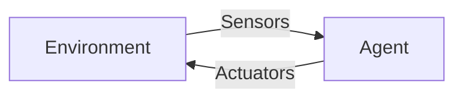

# Session 2: Intelligent Agents and Environments; Introduction to LLMs

> **Course:** Introduction to Artificial Intelligence and Its Applications in Biomedical Engineering
> **Suggested duration:** 60 to 90 minutes · **Level:** Introductory
> **References for this session:** Ref. 1 (Russell & Norvig, 2016), Ref. 11 (instructor content)

---

## Session Objectives
By the end of this session, students will be able to:
1. Explain the concepts of Agent, Sensor, Actuator, and Environment.
2. Write a PEAS description for a system.
3. Analyze the properties of an environment.
4. Become familiar with Large Language Models (LLMs) and simple principles of writing prompts.

---

## 1. The Intelligent Agent
An **Agent** is anything that perceives its environment through **sensors** and acts upon it through **actuators**.

The Perception–Action Loop:

**Rational Agent:** An agent that, given its percepts, knowledge, and performance measure, selects the action expected to produce the best outcome. "Rational" does not mean omniscient or always correct; the agent's decision depends on its information and limitations.

| Example | Sensor | Actuator |
|:--|:--|:--|
| Patient monitoring system | ECG, SpO₂, and pressure sensors | Alarm, message to the nurse |
| Smart insulin pump | Glucose sensor | Insulin injection |
| Rehabilitation robot | Force and joint-angle sensors | Joint motor |

## 2. The PEAS Description
Four components for defining an agent problem:
- **P**erformance: the measure of success
- **E**nvironment: the environment
- **A**ctuators: the actuators
- **S**ensors: the sensors

**Example: ICU patient monitoring**

| Component | Description |
|:--|:--|
| Performance | Quickly detecting critical conditions, minimal false alarms |
| Environment | Patient, nurse, equipment, signal noise |
| Actuators | Alarm, display, warning message |
| Sensors | ECG, pulse oximeter, blood pressure |

## 3. Properties of Environments

| Property | First option | Second option |
|:--|:--|:--|
| Observability | Fully observable | Partially observable |
| Determinism | Deterministic | Stochastic |
| Dependence between steps | Episodic | Sequential |
| Change over time | Static | Dynamic |
| States | Discrete | Continuous |
| Number of agents | Single-agent | Multi-agent |

**Example:** The game of chess is a fully observable and discrete environment. Patient monitoring is partially observable, stochastic, dynamic, and continuous. For this reason, designing agents for medicine is harder.

## 4. Types of Agents (Brief Review)
1. **Simple reflex:** Acts based on the current percept (e.g., if heart rate > limit, sound the alarm)
2. **Model-based:** Has memory or a model of the state of the environment
3. **Goal-based:** Chooses actions based on reaching a goal
4. **Utility-based:** Chooses the best trade-off among multiple goals
5. **Learning:** Improves from experience

## 5. A Brief Introduction to LLMs and Prompt Writing
A **Large Language Model (LLM)** is a model trained on a huge amount of text that generates responses by predicting the continuation of text. These models are useful, but they may give wrong yet convincing answers (Hallucination).

**A simple template for a good prompt:**
1. **Role:** "You are a biomedical engineering instructor."
2. **Context:** State the audience and the goal.
3. **Task:** Write precisely what you want.
4. **Output format:** Table, list, length of the answer.
5. **Constraint:** For example, "If you're not sure, say so."

**Example:** "For an undergraduate biomedical engineering student, explain the concept of a rational agent in 5 sentences with an example from patient monitoring."

> [!WARNING]
> Do not enter real, identifiable, or confidential patient information into public AI tools. For practice, use synthetic data or general examples.

> [!IMPORTANT]
> The examples in this session (such as the insulin pump and patient alarm) are for conceptual analysis of agents only. No treatment rule or clinical decision threshold should be derived from them.

---

## 🔬 Connection to Biomedical Engineering
The three medical examples in this session can be compared with a single template; this template is the basis of this session's PEAS activity:

| System | Key sensor | Key actuator | Why is it hard? |
|:--|:--|:--|:--|
| ICU patient monitoring | ECG, SpO₂ | Alarm | Stochastic and dynamic environment |
| Insulin pump | Glucose sensor | Injection | Errors directly affect the patient |
| Hand rehabilitation robot | Force / joint angle | Joint motor | Physical interaction with a human |

All of these are **educational and non-diagnostic**; the goal is analysis practice, not treatment design.

---

## ✍️ In-Class Activity
1. **PEAS:** Write a PEAS table for a patient monitoring system (or an insulin pump).
2. **Environment:** Determine each environment property for that system and write your reasoning.
3. **LLM (short demo):** The instructor runs a weak prompt and a better prompt on an LLM, and the class examines the difference.

## 📘 Glossary

| Term | Meaning |
|:--|:--|
| Agent | An entity that perceives and acts in an environment |
| Sensor / Actuator | Device for perceiving / device for acting |
| PEAS | Performance measure, Environment, Actuators, Sensors |
| Rational | Choosing the action expected to give the best outcome |
| Prompt | The input text given to the model |
| Hallucination | Generating an incorrect but convincing answer |

## ❓ Self-Assessment Questions
1. Write the PEAS for a smart insulin pump.
2. Why is the "patient monitoring" environment dynamic and stochastic while the "chess" environment is not?
3. Write a weak prompt for "explain the rational agent," then improve it using the session's five-part template.

> The answer key is in the "Instructor's Guide" section at the end of the file.

## 📝 Assignment
Write the PEAS and environment properties for a **hand rehabilitation robot** (maximum one page).

## 📚 Suggested Reading
- Russell & Norvig, Chapter 2 (Intelligent Agents)
