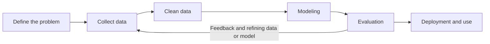

# Session 3: Biological and Health Data; Big Data and Generative AI

> **Course:** Introduction to Artificial Intelligence and Its Applications in Biomedical Engineering
> **Suggested duration:** 60 to 90 minutes · **Level:** Introductory
> **References for this session:** Ref. 2 (Erickson, 2021), Ref. 3 (Pham et al., 2021), Ref. 6 (Khang, 2023), Ref. 11 (instructor content)

---

## Session Objectives
By the end of this session, students will be able to:
1. Explain the types of health data and their characteristics.
2. Name the challenges of data quality, volume, variety, and privacy.
3. Define the concepts of Big Data, Data Science, and Generative AI.
4. Recognize examples of NLP, computer vision, and XAI.
5. Calculate the basic performance measures of a diagnostic test (accuracy, sensitivity, specificity).
6. Practically examine the limitations of LLMs on a medical example.

---

## 1. Types of Health Data

| Data type | Example | Characteristics |
|:--|:--|:--|
| Signal | ECG, EEG, EMG, PPG | Time series, noisy, high sampling rate |
| Image | MRI, CT, radiography, histology | Large volume, dependent on device and center |
| Tabular / laboratory | Blood tests, vital signs | Structured, usually has missing values |
| Text | Physician notes, radiology reports | Unstructured, specialized terminology |
| Genomic / multi-omics | DNA sequences, proteomics | Very high dimensionality |
| Wearable sensors | Smartwatch, glucose monitoring | Continuous, personal, very noisy |

## 2. Challenges of Health Data
- **Quality:** Noise, measurement error, missing values, incorrect labels
- **Volume and variety:** Different formats, devices, and centers
- **Small and imbalanced samples:** Rare diseases, unequal classes
- **Bias:** Data from a single center or a specific population
- **Privacy:** Health data is highly sensitive, and De-identification and consent must be respected
- **Labeling:** Requires experts, is costly, and sometimes involves disagreement

## 3. Key Concepts

| Concept | Short definition |
|:--|:--|
| **Big Data** | Large and varied data that is hard to process with traditional methods (volume, velocity, variety) |
| **Data Science** | Extracting knowledge from data: collection, cleaning, analysis, modeling, interpretation |
| **Generative AI** | Models that generate new content (text, image, audio, code) |
| **NLP** | Natural Language Processing; e.g., extracting information from clinical reports |
| **Computer Vision** | Machine vision; e.g., detecting a lesion in an image |
| **XAI** | Explainable AI; providing explanations about a model's output (not necessarily a complete or definitive explanation) |

## 4. A Simple Data-Driven Project Cycle

A large part of the time in real projects is spent on correctly defining the problem, collecting and cleaning data, and quality control; choosing a model is only one part of the work. The feedback edge shows that evaluation usually sends the project back to collecting or cleaning data again.

## 5. Basic Performance Measures: Accuracy, Sensitivity, Specificity
To evaluate a diagnostic test or a classification model, we compare the model's output with the true condition:

| | Actually positive (patient) | Actually negative (healthy) |
|:--|:--|:--|
| Model prediction: **positive** | TP (true positive) | FP (false positive) |
| Model prediction: negative | FN (false negative) | TN (true negative) |

$$\text{Accuracy} = \frac{TP + TN}{TP + TN + FP + FN}$$

$$\text{Sensitivity} = \frac{TP}{TP + FN}$$

$$\text{Specificity} = \frac{TN}{TN + FP}$$

**Numerical example:** Suppose that among 100 samples, $TP = 40$, $FN = 10$, $TN = 45$, and $FP = 5$. Then accuracy is $\frac{85}{100} = 0.85$, sensitivity is $\frac{40}{50} = 0.80$, and specificity is $\frac{45}{50} = 0.90$.

> [!IMPORTANT]
> In medical applications, the cost of FN (missing a patient) and FP (worry and an extra test for a healthy person) differ; for this reason "accuracy" alone is not enough for judgment. These concepts are educational and are not a criterion for clinical decisions.

---

## 🔬 Connection to Biomedical Engineering
A realistic educational scenario: a person's smartwatch records a PPG (pulse) signal. This data can be used for educational **screening** of irregular heartbeat: the input is the PPG time series; the output is "needs further evaluation"; and because the false positive rate is high in wearable data, the role of sensitivity and specificity (Section 5) becomes important. Such a system does not give a medical diagnosis, and its output is only for referral to specialist evaluation.

---

## ✍️ In-Class Activity

### Activity 1: Comparing Data Types
Complete the table below for three data types:

| | ECG | MRI image | Electronic health record |
|:--|:--|:--|:--|
| Data type | | | |
| Source and how it is recorded | | | |
| Main challenges | | | |
| Privacy risk | | | |
| One AI application | | | |

Answer key for Activity 1 (sample)

| | ECG (electrocardiogram) | MRI image | Electronic Health Record (EHR) |
|:--|:--|:--|:--|
| Data type | Time-varying, one-dimensional biosignal | Two- or three-dimensional image data | Structured and unstructured data, including text, numbers, images, and test results |
| Source and how it is recorded | Recording the electrical activity of the heart with electrodes attached to the skin | Imaging of the body's organs using a magnetic field | Digital recording of patient information by physicians, nurses, laboratories, and other care units |
| Main challenges | Noise, motion artifacts, heart rate variability, and differences between patients | Image noise and artifacts, large data volume, differences between devices, and the need for expert labeling | Incomplete or inconsistent data, differing formats, missing data, and fragmented information |
| Privacy risk | Disclosure of heart health information and the possibility of inferring a person's physical condition | Disclosure of diseases and organ abnormalities and the possibility of re-identifying the patient through information accompanying the image | Extensive disclosure of identity information, medical history, medications, and sensitive patient information |
| One AI application | Automatic detection of cardiac arrhythmia | Identification and segmentation of brain tumors | Predicting a patient's readmission risk from medical history |

### Activity 2: EEG and Radiography
Complete the table below for two data types:

| | EEG signal | Radiography image (X-ray) |
|:--|:--|:--|
| Data type | | |
| Source and how it is recorded | | |
| Main challenges | | |
| Privacy risk | | |
| One AI application | | |

### Activity 3: Examining an LLM's Answers to Two Medical Questions
**Steps:**
1. "What is the difference between accuracy, sensitivity, and specificity in a diagnostic test?"
2. "What factors affect ECG signal noise?"

Compare the LLM's answer with a reliable source (for example, the definitions in Section 5 of this session or the Erickson paper).

**Discussion:**
- What method do you suggest for checking the correctness of, and trusting, an LLM's output?

> [!NOTE]
> Output of Activity 3: a Markdown or PDF file containing the question, the LLM's answer, the comparison source, and the result of the check.

## 📘 Glossary

| Term | Meaning |
|:--|:--|
| Biosignal | A signal originating from a living organism |
| Electronic Health Record (EHR) | A digital record of a patient's health information |
| Imbalanced data | Data in which classes have very unequal sizes |
| Bias | Systematic deviation in data or model results |
| De-identification | Removing identifying information from data |
| Explainable AI (XAI) | AI that can explain its outputs |
| Sensitivity / Specificity | Ability to detect patients / ability to rule out healthy people |

## ❓ Self-Assessment Questions
1. Why is health data more sensitive than much other data?
2. Give an example of imbalanced data in medicine and explain its effect on a model.
3. What is the difference between NLP and computer vision?

> The answer key is in the "Instructor's Guide" section at the end of the file.

## 📝 Assignment
Submit your answer to Activity 3 (examining the LLM's answer) in a Markdown or PDF file; in it write the question, the LLM's answer, the comparison source, and the result of your evaluation.

## 📚 Suggested Reading
- Erickson (2021) from the course reference list: technical foundations of AI in medicine
