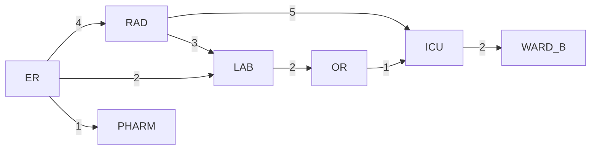
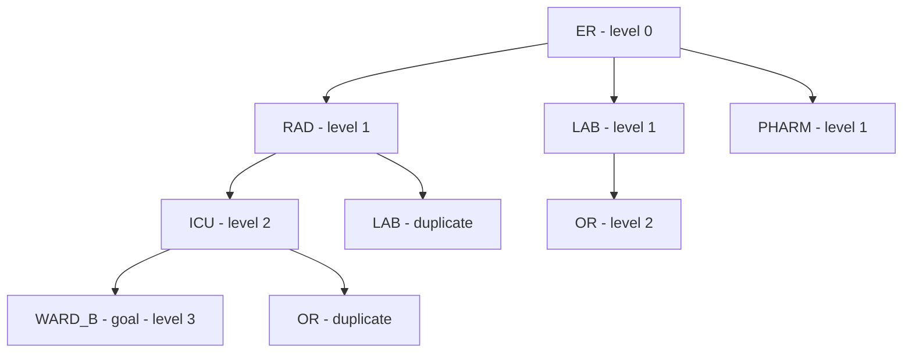

# Session 5: Formulating Search Problems; BFS and DFS

> **Course:** Introduction to Artificial Intelligence and Its Applications in Biomedical Engineering
> **Suggested duration:** 60 to 90 minutes · **Level:** Introductory
> **References for this session:** Ref. 1 (Russell & Norvig, 2016), Ref. 11 (instructor content)

---

## Session Objectives
By the end of this session, students will be able to:
1. Describe a problem using the four components of search formulation (state, action, goal test, path cost).
2. Explain the concepts of state space, search node, and Expansion.
3. Manually run the BFS and DFS algorithms on a small graph.
4. Compare the path found, the number of expanded nodes, and the path cost of both algorithms.
5. Interpret the output of the session's teaching code and reconcile it with their own theoretical analysis.

---

## 1. Formulating Search Problems

To reach a goal, an intelligent agent must decide among options. Search means systematically exploring possible states to find a suitable sequence of actions. Every search problem is formulated with four components:

| Component | Definition | In the "patient transfer" example |
|:--|:--|:--|
| State | A snapshot of the world | The patient's current department |
| Action and transition model | A change of state along an edge | Moving the patient to an adjacent department |
| Goal Test | Is the current state the goal? | Have we reached the destination department? |
| Path Cost | The sum of the step costs | The sum of transfer times (minutes) |

**Case example:** A patient is in the emergency room (ER) and must be transferred to inpatient ward B. The transfer map between departments is a **weighted graph**: nodes are departments and the weight of each edge is the transfer time in minutes (hypothetical data for practice):

| Edge | Time (min) | Edge | Time (min) |
|:--|:-:|:--|:-:|
| ER ↔ RAD | 4 | LAB ↔ OR | 2 |
| ER ↔ LAB | 2 | OR ↔ ICU | 1 |
| ER ↔ PHARM | 1 | RAD ↔ ICU | 5 |
| RAD ↔ LAB | 3 | ICU ↔ WARD_B | 2 |

> [!IMPORTANT]
> This map and all its numbers are hypothetical and for education only; they have no relation to any real patient transfer protocol.

## 2. State Space and the Search Tree

- **State Space:** The set of all possible states; here, all hospital departments.
- **Search Node:** A trace of the path taken, not just a state; it includes the parent for reconstructing the path.
- **Frontier:** Discovered nodes that have not yet been expanded.
- **Expand:** Taking a node off the frontier and adding its children (unseen neighbors).

The graph for this session's example (the same graph the teaching code uses):



The graph is undirected; that is, every transfer is also possible in the reverse direction. Goal: `ER → WARD_B`.

## 3. Breadth-First Search (BFS)

Breadth-First Search manages the frontier as a **FIFO queue**: nodes of the first level, then the second level, and so on. This way we move away from the start node layer by layer.

**Steps of running BFS on the example graph:**
1. Expand `ER`: the children `RAD`, `LAB`, `PHARM` are added to the queue.
2. Expand `RAD`: new child `ICU` (the child `LAB` is a duplicate).
3. Expand `LAB`: new child `OR`.
4. Expand `PHARM`: no new children.
5. Expand `ICU`: new child `WARD_B` — the goal! (The child `OR` is a duplicate.)
6. Expand `OR`: no new children; then `WARD_B` is removed from the queue and the goal test succeeds.
7. Path: `ER → RAD → ICU → WARD_B` with 3 steps and a cost of 4+5+2 = 11 minutes.

The BFS search tree up to reaching the goal:



> [!TIP]
> On a tree, BFS finds the path with the **fewest edges**. If all edges have equal cost, this is the optimal path; in a weighted graph this guarantee does not hold.

## 4. Depth-First Search (DFS)

Depth-First Search manages the frontier as a **LIFO stack**: the most recently discovered node is expanded first; that is, it follows one branch to its deepest point and, if it hits a dead end, goes back (Backtracking).

**Steps of running DFS on the example graph (with the code's neighbor order):**
1. Expand `ER`; stack: `RAD`, `LAB`, `PHARM`.
2. Expand `PHARM` (the top of the stack): it is a dead end.
3. Expand `LAB`: new child `OR`.
4. Expand `OR`: new child `ICU`.
5. Expand `ICU`: new child `WARD_B` — the goal!
6. Path: `ER → LAB → OR → ICU → WARD_B` with 4 steps and a cost of 2+2+1+2 = 7 minutes.

Important point: in this run, DFS never expanded the node `RAD`. So the neighbor order can change the result completely; here DFS happened to find a cheaper path, but this is **coincidence**, not a guarantee.

## 5. Comparing BFS and DFS and Complexity

Notation: the Branching Factor $b$ is the average number of children per node, $d$ is the goal depth, and $m$ is the maximum depth of the tree.

| Property | BFS | DFS |
|:--|:--|:--|
| Frontier structure | Queue (FIFO) | Stack (LIFO) |
| Completeness | Yes (in a finite graph) | Yes, with cycle prevention |
| Optimality | Only with equal-cost edges | No |
| Time | $O(b^d)$ | $O(b^m)$ |
| Memory | $O(b^d)$ — the main bottleneck of BFS | $O(bm)$ |

$$T_{\text{BFS}} = O(b^d) \qquad M_{\text{BFS}} = O(b^d) \qquad M_{\text{DFS}} = O(bm)$$

Because $m$ can be much larger than $d$, DFS can be worse in time but uses far less memory. In our small graph (7 nodes) both algorithms saw nearly all nodes; the real difference appears in large graphs.

> [!WARNING]
> In search, BFS and DFS only see "the existence of an edge" and ignore weights. The costs reported in the code output are the cost of the path found, not the criterion by which the algorithm chooses. The next session introduces the solution to this problem (UCS).

---

## 🔬 Connection to Biomedical Engineering

The inter-department patient transfer scenario: the transport nurse must choose a route from the emergency room to the destination department that passes through intermediate corridors and departments. If the criterion is "the fewest moves between departments," BFS answers; if some routes are busier and each crossing takes a different time, the problem becomes weighted and we will need cost-aware methods (Sessions 6 and 8). The same formulation at a larger scale is used for ambulance routing on an inter-hospital road network. Reminder: this example is purely educational and non-diagnostic, and no clinical decision is made from it.

---

## ✍️ In-Class Activity

### Activity 1: Hospital Maze on Paper
A simple hospital map (3×3); `S` is reception, `G` is the operating room, `X` is a blocked corridor:

| | Column 1 | Column 2 | Column 3 |
|:--|:-:|:-:|:-:|
| Row 1 | S | open | X |
| Row 2 | open | X | open |
| Row 3 | open | open | G |

Movement is only in four directions and between open cells. Neighbor checking order: right, down, left, up. Run it on paper and fill in the table:

| | BFS | DFS |
|:--|:--|:--|
| Path found | | |
| Number of steps | | |
| Number of expanded nodes | | |

<details>
<summary>Answer key for Activity 1</summary>

| | BFS | DFS |
|:--|:--|:--|
| Path found | (1,1)→(2,1)→(3,1)→(3,2)→(3,3) | The same path |
| Number of steps | 4 | 4 |
| Number of expanded nodes | 6 | 5 (cell (1,2) was never expanded) |

Because this maze has only one path, both algorithms found the same path; the difference is in the order and number of expansions. The count of 5 for DFS is for the **stack-based (LIFO)** version, as implemented in this session's code; in a recursive DFS with the same neighbor order, the number of expansions is 6. If a student changes the neighbor order, the DFS answer changes — a good teaching point.

</details>

### Activity 2: Analyzing the Code Output
Run the code `code/session_05_bfs_dfs.py` and answer:
1. Why was the DFS path cheaper than BFS here, even though we said DFS has no optimality guarantee?
2. Which node was never expanded in DFS?
3. If you change the order of `ER`'s neighbor list in the code, how does the output change?

<details>
<summary>Answer key for Activity 2</summary>

1. It is coincidence: the stack order made DFS enter the path `LAB → OR → ICU` earlier, which has a lower cost. With a different neighbor order, DFS could have found a more expensive or much longer path; there is no guarantee.
2. The node `RAD`; because DFS reached the goal after expanding `ICU` and never got to the `RAD` branch.
3. The DFS path (and sometimes the number of expansions) changes; the BFS output does not change, because BFS is not sensitive to neighbor order.

</details>

## 💻 Teaching Code

The file `code/session_05_bfs_dfs.py` (Python standard library only):
- The function `bfs(graph, start, goal)` with `collections.deque` as the queue.
- The function `dfs(graph, start, goal)` with a list as the stack.
- The `GRAPH` graph is the same patient transfer network from Section 2; weights are used only in computing the path cost.
- The program's output for each algorithm: the path, number of steps, path cost, and number of expanded nodes.

Running the program in a terminal or Colab:

```python
!python3 code/session_05_bfs_dfs.py
```

## 📘 Glossary

| Term | Meaning |
|:--|:--|
| State / State Space | The condition of the world / the set of all possible states |
| Action | A move that changes the state |
| Goal Test | A check of whether the state is the goal |
| Path Cost | The total cost of the steps along a path |
| Branching Factor | The average number of children per node |
| Frontier | The set of discovered but unexpanded nodes |
| Expansion | Expanding a node (generating its children) |
| BFS (Breadth-First Search) | Search that expands level by level |
| DFS (Depth-First Search) | Search that expands the deepest node first |
| Completeness / Optimality | Guaranteed to find a solution / guaranteed to find the best solution |

## ❓ Self-Assessment Questions
1. Name the four components of search problem formulation and specify each one for the problem "finding an ambulance route from the station to the incident scene."
2. Why is BFS optimal only when all edges have equal cost?
3. What is the difference between a queue and a stack in the role of the search frontier, and which algorithm's behavior does each produce?
4. If a search tree has branching factor $b=3$ and goal depth $d=4$, what is the worst-case number of nodes expanded by BFS?

The answer key is in the "Instructor's Guide" section at the end of the file.

## 📝 Assignment
1. Write a complete formulation (four components) for one of these two problems: "transferring a lab sample from the laboratory to the microbiology department" or "routing a stretcher from the hospital entrance to the MRI."
2. Run the session's code and, in a table, report the path, cost, and number of expansions for BFS and DFS, and analyze the difference in two sentences.

## 📚 Suggested Reading
- Russell & Norvig (2016), Artificial Intelligence: A Modern Approach, Chapter 3: the sections on problem formulation and uninformed search (up to before the discussion of informed algorithms).
