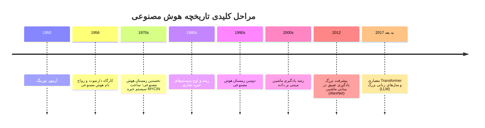

# جلسه ۱: معرفی درس و آشنایی با هوش مصنوعی

> **منابع این جلسه:** منبع ۱ (Russell & Norvig, 2016)، منبع ۲ (Erickson, 2021)، منبع ۹ (Peng et al., 2010)، منبع ۱۱ (محتوای مدرس)

---

## اهداف جلسه
در پایان این جلسه دانشجو می‌تواند:
1. هوش مصنوعی (Artificial Intelligence) را تعریف کند و چند مرحله مهم تاریخچه آن را نام ببرد.
2. تفاوت هوش مصنوعی (AI)، یادگیری ماشین (Machine Learning) و یادگیری عمیق (Deep Learning) را توضیح دهد.
3. برای یک کاربرد پزشکی، ورودی، خروجی و هدف سیستم را مشخص کند.
4. با ساختار درس، پروژه و نحوه نمره‌دهی آشنا شود.

---

## ۱. هوش مصنوعی چیست؟
هوش مصنوعی شاخه‌ای از علوم کامپیوتر است که هدف آن ساخت سیستم‌هایی است که کارهایی را انجام دهند که معمولاً به هوش انسانی نیاز دارند، مانند یادگیری، استدلال، تصمیم‌گیری و درک زبان یا تصویر.

در کتاب Russell & Norvig چهار رویکرد معرفی می‌شود: **فکر کردن / رفتار کردن** به‌صورت **انسانی / منطقی**. در این درس تمرکز اصلی بر **عامل منطقی (Rational Agent)** است، یعنی سیستمی که با توجه به اطلاعات و هدفش، عملی را انتخاب می‌کند که انتظار می‌رود بهترین نتیجه را ایجاد کند (نه لزوماً همیشه درست).

## ۲. تاریخچه کوتاه

<div dir="rtl">

| دوره | رویداد |
|:--|:--|
| ۱۹۵۰ | آزمون تورینگ |
| ۱۹۵۶ | کارگاه دارتموث و رواج نام «هوش مصنوعی» |
| دهه ۱۹۷۰ | نخستین «زمستان هوش مصنوعی»؛ کاهش انتظارات و بودجه. در همین دهه سیستم خبره پزشکی MYCIN ساخته شد |
| دهه ۱۹۸۰ | رشد و اوج سیستم‌های خبره تجاری |
| اواخر دهه ۱۹۸۰ تا اوایل دهه ۱۹۹۰ | دومین «زمستان هوش مصنوعی» |
| دهه ۲۰۰۰ | رشد یادگیری ماشین مبتنی بر داده |
| ۲۰۱۲ | پیشرفت بزرگ یادگیری عمیق در بینایی ماشین (AlexNet) |
| ۲۰۱۷ تا امروز | معماری Transformer و ظهور مدل‌های زبانی بزرگ (LLM) |

</div>

همان رویدادها به‌صورت خط زمانی (Timeline):



**چرا «زمستان هوش مصنوعی» رخ داد؟** وعده‌های بیش‌ازحد بزرگ، کمبود توان محاسباتی و داده، و هزینه بالای ساخت و نگهداری سیستم‌های قاعده‌محور باعث شد انتظارات برآورده نشود و بودجه‌ها کم شود.

## ۳. AI، ML و DL

```
هوش مصنوعی (AI)
 └── یادگیری ماشین (ML)  ← یادگیری الگو از داده
      └── یادگیری عمیق (DL)  ← شبکه‌های عصبی چندلایه
```

<div dir="rtl">

| مفهوم | ایده اصلی | مثال |
|:--|:--|:--|
| **AI** | هر روشی که سیستم را «هوشمند» کند | جست‌وجو، قواعد منطقی، یادگیری |
| **ML** | یادگیری الگو از داده به‌جای نوشتن قواعد دستی | پیش‌بینی بیماری از آزمایش خون |
| **DL** | شبکه عصبی عمیق؛ استخراج خودکار ویژگی | تشخیص ضایعه در تصویر MRI |

</div>

> [!NOTE]
> هر سیستم AI لزوماً یادگیری ماشین ندارد (مثلاً یک سیستم قاعده‌محور)، و هر مدل ML لزوماً یادگیری عمیق نیست.

## ۴. نمونه‌های کاربرد در پزشکی
- **تصویربرداری:** غربالگری رتینوپاتی دیابتی از تصویر شبکیه، کمک به تشخیص در رادیولوژی
- **سیگنال‌های زیستی (Biosignals):** تشخیص آریتمی از ECG، تحلیل EEG
- **زیست‌شناسی ساختاری:** پیش‌بینی ساختار پروتئین (AlphaFold)
- **سیستم‌های بالینی:** پشتیبانی از تصمیم‌گیری، پیش‌بینی خطر بیمار
- **توانبخشی:** ربات‌ها و پروتزهای هوشمند

> [!WARNING]
> وجود یک مقاله یا نمونه موفق به معنی آمادگی بالینی نیست. این موضوع در طول درس بارها بررسی می‌شود.

---

## 🔬 پیوند با مهندسی پزشکی
یک مثال مرجع برای کل درس: **سیستم کمک به بررسی آریتمی از نوار قلب (ECG)**.

- **ورودی:** سیگنال ECG دیجیتال‌شده یک بیمار
- **خروجی:** برچسب یا امتیاز احتمال برای بازبینی پزشک (نه تشخیص نهایی)
- **هدف:** صرفه‌جویی در زمان بازبینی حجم بالای نوارها
- **محدودیت:** نویز سیگنال، داده نامتوازن، تفاوت بیماران

همه مثال‌های پزشکی این درس **آموزشی و غیرتشخیصی (Non-diagnostic)** هستند و جایگزین قضاوت پزشک نمی‌شوند.

---

## ✍️ فعالیت کلاسی
یک سیستم هوش مصنوعی پزشکی را انتخاب کنید و جدول زیر را پر کنید. اگر دانشجویان آشنایی کمی دارند، یک مثال مشترک (مثلاً تشخیص آریتمی از ECG) را برای کل کلاس انتخاب کنید:

<div dir="rtl">

| مورد | پاسخ |
|:--|:--|
| نام سیستم / کاربرد | |
| ورودی (چه داده‌ای می‌گیرد؟) | |
| خروجی (چه چیزی تولید می‌کند؟) | |
| هدف (چه مشکلی را حل می‌کند؟) | |
| AI، ML یا DL؟ چرا؟ | |
| یک خطر یا محدودیت احتمالی | |

</div>

## 📘 واژه‌نامه

<div dir="rtl">

| واژه | معنی |
|:--|:--|
| Artificial Intelligence (AI) | هوش مصنوعی |
| Machine Learning (ML) | یادگیری ماشین |
| Deep Learning (DL) | یادگیری عمیق |
| Rational Agent | عامل منطقی |
| Turing Test | آزمون تورینگ |
| LLM (Large Language Model) | مدل زبانی بزرگ |

</div>

## ❓ پرسش‌های خودآزمون
1. تفاوت AI و ML را با یک مثال توضیح دهید.
2. چرا «زمستان هوش مصنوعی» رخ داد؟
3. برای یک سیستم تشخیص آریتمی، ورودی و خروجی چیست؟

## 📝 تکلیف
نوت‌بوک خودآموز پایتون (`python_selfstudy.ipynb`) را در Google Colab باز کنید و سلول‌ها را به‌ترتیب اجرا کنید. زمان لازم حدود ۴۵ تا ۶۰ دقیقه است. تسلط کامل لازم نیست؛ هدف آشنایی با اجرای سلول‌ها، متغیرها، شرط‌ها، لیست‌ها و تابع است.

## 📚 مطالعه پیشنهادی
- Russell & Norvig، فصل ۱ (مقدمه)
- Erickson (۲۰۲۱)، بخش‌های مقدماتی: جایگاه AI در پزشکی (اختیاری؛ برای دید کلی)
