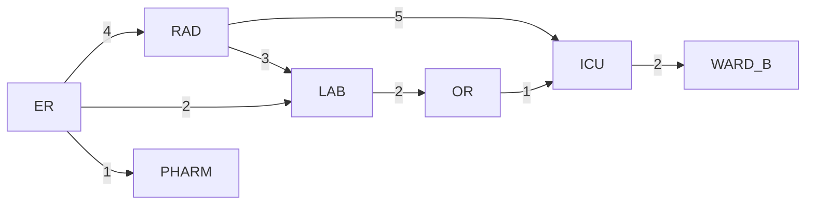
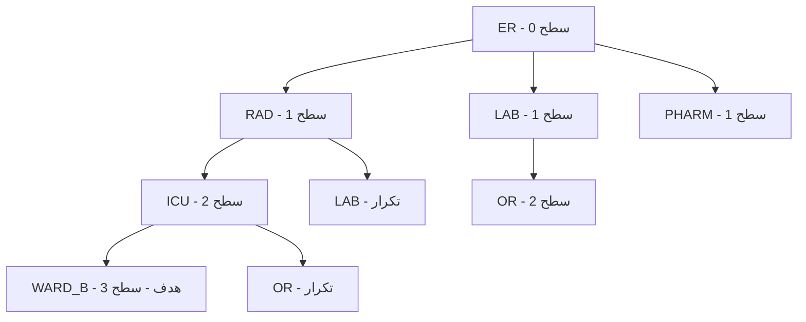

# جلسه ۵: صورت‌بندی مسئله جست‌وجو؛ BFS و DFS

> **درس:** مقدمه‌ای بر هوش مصنوعی و کاربرد آن در مهندسی پزشکی
> **مدت پیشنهادی:** ۶۰ تا ۹۰ دقیقه · **سطح:** مقدماتی
> **منابع این جلسه:** منبع ۱ (Russell & Norvig, 2016)، منبع ۱۱ (محتوای مدرس)

---

## اهداف جلسه
در پایان این جلسه دانشجو می‌تواند:
1. یک مسئله را با چهار جزء صورت‌بندی جست‌وجو (وضعیت، کنش، آزمون هدف، هزینه مسیر) توصیف کند.
2. مفهوم فضای حالت، گره جست‌وجو و بسط دادن (Expansion) را توضیح دهد.
3. الگوریتم‌های BFS و DFS را روی یک گراف کوچک به‌صورت دستی اجرا کند.
4. مسیر یافته‌شده، تعداد گره‌های بسط‌داده‌شده و هزینه مسیر هر دو الگوریتم را مقایسه کند.
5. خروجی کد آموزشی جلسه را تفسیر و با تحلیل نظری خود تطبیق دهد.

---

## ۱. صورت‌بندی مسئله جست‌وجو

عامل هوشمند (Agent) برای رسیدن به هدف، باید میان گزینه‌ها تصمیم بگیرد. جست‌وجو (Search) یعنی مرور نظام‌مند حالت‌های ممکن برای یافتن توالی کنش‌های مناسب. هر مسئله جست‌وجو با چهار جزء صورت‌بندی می‌شود:

<div dir="rtl">

| جزء | تعریف | در مثال «انتقال بیمار» |
|--:|--:|--:|
| وضعیت (State) | عکس فوری از دنیا | بخش فعلی بیمار |
| کنش (Action) و مدل انتقال | تغییر وضعیت از روی یک یال | انتقال بیمار به یک بخش مجاور |
| آزمون هدف (Goal Test) | آیا وضعیت فعلی همان هدف است؟ | رسیده‌ایم به بخش مقصد؟ |
| هزینه مسیر (Path Cost) | جمع هزینه گام‌ها | جمع زمان انتقال‌ها (دقیقه) |

</div>

**مثال موردی:** بیماری در اورژانس (ER) است و باید به بخش بستری B منتقل شود. نقشه انتقال بین بخش‌ها یک **گراف وزن‌دار** است: گره‌ها بخش‌ها هستند و وزن هر یال، زمان انتقال به دقیقه (داده فرضی برای تمرین):

<div dir="rtl">

| یال | زمان (دقیقه) | یال | زمان (دقیقه) |
|--:|--:|--:|--:|
| ER ↔ RAD | ۴ | LAB ↔ OR | ۲ |
| ER ↔ LAB | ۲ | OR ↔ ICU | ۱ |
| ER ↔ PHARM | ۱ | RAD ↔ ICU | ۵ |
| RAD ↔ LAB | ۳ | ICU ↔ WARD_B | ۲ |

</div>

> [!IMPORTANT]
> این نقشه و همه اعداد آن فرضی و صرفاً آموزشی‌اند؛ هیچ رابطه‌ای با پروتکل واقعی انتقال بیمار ندارند.

## ۲. فضای حالت و درخت جست‌وجو

- **فضای حالت (State Space):** مجموعه همه وضعیت‌های ممکن؛ اینجا همه بخش‌های بیمارستان.
- **گره جست‌وجو (Search Node):** ردی از مسیر پیموده‌شده، نه فقط یک وضعیت؛ شامل والد (Parent) برای بازسازی مسیر.
- **مرز جست‌وجو (Frontier):** گره‌های کشف‌شده‌ای که هنوز بسط داده نشده‌اند.
- **بسط دادن (Expand):** برداشتن یک گره از مرز و افزودن فرزندان آن (همسایه‌های دیده‌نشده).

نمای گراف مثال این جلسه (همان گرافی که کد آموزشی استفاده می‌کند):



گراف بی‌جهت است؛ یعنی هر انتقال در جهت برگشت هم ممکن است. هدف: `ER → WARD_B`.

## ۳. جست‌وجوی سطح‌اول (BFS)

جست‌وجوی سطح‌اول (Breadth-First Search) مرز را به‌صورت **صف FIFO** مدیریت می‌کند: گره‌های سطح اول، بعد سطح دوم و تا آخر. با این کار از گره شروع، لایه‌به‌لایه دور می‌شویم.

**مراحل اجرای BFS روی گراف مثال:**
1. بسط `ER`: فرزندان `RAD`، `LAB`، `PHARM` به صف اضافه می‌شوند.
2. بسط `RAD`: فرزند جدید `ICU` (فرزند `LAB` تکراری است).
3. بسط `LAB`: فرزند جدید `OR`.
4. بسط `PHARM`: فرزند جدیدی ندارد.
5. بسط `ICU`: فرزند جدید `WARD_B` — هدف! (فرزند `OR` تکراری است.)
6. بسط `OR`: فرزند جدیدی ندارد؛ سپس `WARD_B` از صف خارج و آزمون هدف با موفقیت انجام می‌شود.
7. مسیر: `ER → RAD → ICU → WARD_B` با ۳ گام و هزینه ۴+۵+۲ = ۱۱ دقیقه.

درخت جست‌وجوی BFS تا رسیدن به هدف:



> [!TIP]
> BFS روی درخت، مسیر با **کمترین تعداد یال** را می‌یابد. اگر همه یال‌ها هزینه برابر داشته باشند، این همان مسیر بهینه است؛ در گراف وزن‌دار این تضمین برقرار نیست.

## ۴. جست‌وجوی عمق‌اول (DFS)

جست‌وجوی عمق‌اول (Depth-First Search) مرز را به‌صورت **پشته LIFO** مدیریت می‌کند: تازه‌ترین گره کشف‌شده زودتر بسط داده می‌شود؛ یعنی یک شاخه را تا عمیق‌ترین نقطه می‌رود و اگر به بن‌بست رسید، به عقب برمی‌گردد (Backtracking).

**مراحل اجرای DFS روی گراف مثال (با ترتیب همسایه‌های کد):**
1. بسط `ER`؛ پشته: `RAD`، `LAB`، `PHARM`.
2. بسط `PHARM` (آخرِ پشته): بن‌بست است.
3. بسط `LAB`: فرزند جدید `OR`.
4. بسط `OR`: فرزند جدید `ICU`.
5. بسط `ICU`: فرزند جدید `WARD_B` — هدف!
6. مسیر: `ER → LAB → OR → ICU → WARD_B` با ۴ گام و هزینه ۲+۲+۱+۲ = ۷ دقیقه.

نکته مهم: در این اجرا، DFS اصلاً گره `RAD` را بسط نداد. پس ترتیب همسایه‌ها می‌تواند نتیجه را کاملاً تغییر دهد؛ اینجا DFS اتفاقی مسیر ارزان‌تری یافت، اما این **تصادف** است، نه تضمین.

## ۵. مقایسه BFS و DFS و پیچیدگی

نمادها: عامل انشعاب (Branching Factor) $b$ یعنی میانگین تعداد فرزند هر گره، عمق هدف $d$ و بیشینه عمق درخت $m$.

<div dir="rtl">

| ویژگی | BFS | DFS |
|--:|--:|--:|
| ساختار مرز | صف (FIFO) | پشته (LIFO) |
| کامل بودن (Completeness) | بله (در گراف متناهی) | بله، با جلوگیری از چرخه |
| بهینه بودن (Optimality) | فقط با یال‌های هم‌هزینه | خیر |
| زمان | $O(b^d)$ | $O(b^m)$ |
| حافظه | $O(b^d)$ — چاه اصلی BFS | $O(bm)$ |

</div>

$$T_{\text{BFS}} = O(b^d) \qquad M_{\text{BFS}} = O(b^d) \qquad M_{\text{DFS}} = O(bm)$$

چون $m$ می‌تواند بسیار بزرگ‌تر از $d$ باشد، DFS در زمان ممکن بدتر شود، اما حافظه‌ی بسیار کمتری مصرف کند. در گراف کوچک ما (۷ گره) هر دو الگوریتم تقریباً همه گره‌ها را دیدند؛ تفاوت واقعی در گراف‌های بزرگ ظاهر می‌شود.

> [!WARNING]
> BFS و DFS در جست‌وجو فقط «وجود یال» را می‌بینند و وزن‌ها را نادیده می‌گیرند. هزینه‌های گزارش‌شده در خروجی کد، هزینه مسیرِ یافته‌شده است، نه معیار انتخاب الگوریتم. جلسه بعد راه‌حل این مشکل (UCS) را معرفی می‌کند.

---

## 🔬 پیوند با مهندسی پزشکی

سناریوی انتقال بین‌بخشی بیمار: پرستار انتقال باید مسیری از اورژانس به بخش مقصد انتخاب کند که از راهروها و بخش‌های میانی عبور کند. اگر معیار «کمترین تعداد جابه‌جایی بین بخش‌ها» باشد، BFS پاسخ می‌دهد؛ اگر برخی مسیرها پرترافیک‌تر باشند و زمان هر عبور متفاوت باشد، مسئله وزن‌دار می‌شود و به روش‌های آگاه به هزینه نیاز خواهیم داشت (جلسه ۶ و ۸). همین صورت‌بندی در مقیاس بزرگ‌تر برای مسیریابی آمبولانس در شبکه جاده‌های بین بیمارستانی استفاده می‌شود. یادآوری: این مثال صرفاً آموزشی و غیرتشخیصی است و هیچ تصمیم بالینی از آن گرفته نمی‌شود.

---

## ✍️ فعالیت کلاسی

### فعالیت ۱: ماز بیمارستانی روی کاغذ
نقشه ساده یک بیمارستان (۳×۳)؛ `S` پذیرش، `G` اتاق عمل، `X` راهروی بسته:

<div dir="rtl">

| | ستون ۱ | ستون ۲ | ستون ۳ |
|--:|--:|--:|--:|
| ردیف ۱ | S | باز | X |
| ردیف ۲ | باز | X | باز |
| ردیف ۳ | باز | باز | G |

</div>

حرکت فقط به چهار جهت و بین خانه‌های باز. ترتیب بررسی همسایه‌ها: راست، پایین، چپ، بالا. روی کاغذ اجرا کنید و جدول را پر کنید:

<div dir="rtl">

| | BFS | DFS |
|--:|--:|--:|
| مسیر یافته‌شده | | |
| تعداد گام‌ها | | |
| تعداد گره‌های بسط‌داده‌شده | | |

</div>

<details>
<summary>کلید پاسخ فعالیت ۱</summary>

<div dir="rtl">

| | BFS | DFS |
|--:|--:|--:|
| مسیر یافته‌شده | (۱،۱)→(۲،۱)→(۳،۱)→(۳،۲)→(۳،۳) | همان مسیر |
| تعداد گام‌ها | ۴ | ۴ |
| تعداد گره‌های بسط‌داده‌شده | ۶ | ۵ (خانه (۱،۲) هرگز بسط داده نشد) |

</div>

چون این ماز فقط یک مسیر دارد، هر دو الگوریتم همان مسیر را یافتند؛ تفاوت در ترتیب و تعداد بسط‌هاست. شمارش ۵ برای DFS **پشته‌ای (LIFO)** است، همان‌گونه که در کد این جلسه پیاده‌سازی شده؛ در نسخه بازگشتی DFS با همین ترتیب همسایه‌ها، تعداد بسط‌ها ۶ می‌شود. اگر دانشجویی ترتیب همسایه‌ها را عوض کند، پاسخ DFS تغییر می‌کند — نکته آموزشی خوبی است.

</details>

### فعالیت ۲: تحلیل خروجی کد
کد `code/session_05_bfs_dfs.py` را اجرا کنید و پاسخ دهید:
1. چرا مسیر DFS اینجا ارزان‌تر از BFS شد، در حالی که گفته‌ایم DFS تضمین بهینگی ندارد؟
2. کدام گره در DFS هرگز بسط داده نشد؟
3. اگر ترتیب لیست همسایه‌های `ER` را در کد عوض کنید، خروجی چه تغییری می‌کند؟

<details>
<summary>کلید پاسخ فعالیت ۲</summary>

1. تصادف است: ترتیب پشته باعث شد DFS زودتر وارد مسیر `LAB → OR → ICU` شود که هزینه‌اش کمتر است. با ترتیب دیگرِ همسایه‌ها، DFS می‌توانست مسیر گران‌تر یا بسیار طولانی‌تری بیابد؛ هیچ تضمینی وجود ندارد.
2. گره `RAD`؛ چون DFS بعد از بسط `ICU` به هدف رسید و هرگز به شاخه `RAD` نرسید.
3. مسیر DFS (و گاهی تعداد بسط‌ها) عوض می‌شود؛ خروجی BFS تغییر نمی‌کند، چون BFS به ترتیب همسایه‌ها حساس نیست.

</details>

## 💻 کد آموزشی

فایل `code/session_05_bfs_dfs.py` (فقط کتابخانه استاندارد پایتون):
- تابع `bfs(graph, start, goal)` با `collections.deque` به‌عنوان صف.
- تابع `dfs(graph, start, goal)` با لیست به‌عنوان پشته.
- گراف `GRAPH` همان شبکه انتقال بیمار بخش ۲؛ وزن‌ها فقط در محاسبه هزینه مسیر به‌کار می‌روند.
- خروجی برنامه برای هر الگوریتم: مسیر، تعداد گام، هزینه مسیر و تعداد گره‌های بسط‌داده‌شده.

اجرای برنامه در ترمینال یا Colab:

```python
!python3 code/session_05_bfs_dfs.py
```

## 📘 واژه‌نامه

<div dir="rtl">

| واژه | معنی |
|--:|--:|
| State / State Space | وضعیت / فضای حالت |
| Action | کنش |
| Goal Test | آزمون هدف |
| Path Cost | هزینه مسیر |
| Branching Factor | عامل انشعاب |
| Frontier | مرز جست‌وجو |
| Expansion | بسط دادن گره |
| BFS (Breadth-First Search) | جست‌وجوی سطح‌اول |
| DFS (Depth-First Search) | جست‌وجوی عمق‌اول |
| Completeness / Optimality | کامل بودن / بهینه بودن |

</div>

## ❓ پرسش‌های خودآزمون
1. چهار جزء صورت‌بندی مسئله جست‌وجو را نام ببرید و برای مسئله «یافتن مسیر آمبولانس از پایگاه به محل حادثه» هر جزء را مشخص کنید.
2. چرا BFS فقط وقتی بهینه است که همه یال‌ها هزینه برابر داشته باشند؟
3. تفاوت صف و پشته در نقش مرز جست‌وجو چیست و هرکدام رفتار کدام الگوریتم را می‌سازد؟
4. اگر درخت جست‌وجو عامل انشعاب $b=3$ و عمق هدف $d=4$ داشته باشد، بدترین حالت تعداد گره‌های بسط‌داده‌شده BFS چند است؟

کلید پاسخ‌ها در بخش «راهنمای مدرس» انتهای فایل آمده است.

## 📝 تکلیف
1. صورت‌بندی کامل (چهار جزء) برای یکی از این دو مسئله بنویسید: «انتقال نمونه آزمایش از آزمایشگاه به بخش میکروب» یا «مسیریابی برانکارد از ورودی بیمارستان به MRI».
2. خروجی کد جلسه را اجرا کنید و در یک جدول، مسیر و هزینه و تعداد بسط‌های BFS و DFS را گزارش دهید و در دو جمله تفاوت را تحلیل کنید.

## 📚 مطالعه پیشنهادی
- Russell & Norvig (۲۰۱۶)، Artificial Intelligence: A Modern Approach، فصل ۳: بخش‌های صورت‌بندی مسئله و جست‌وجوی ناآگاهانه (تا پیش از بحث الگوریتم‌های آگاه).
