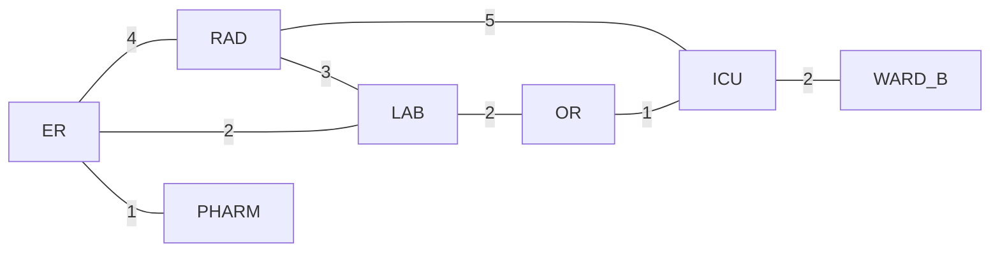
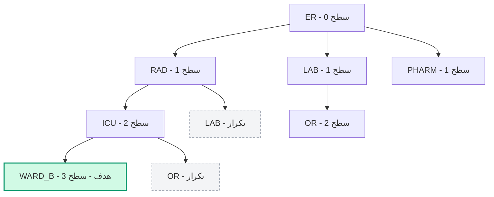
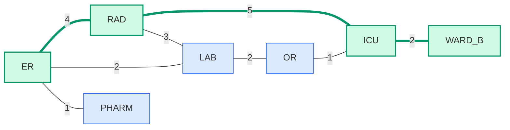
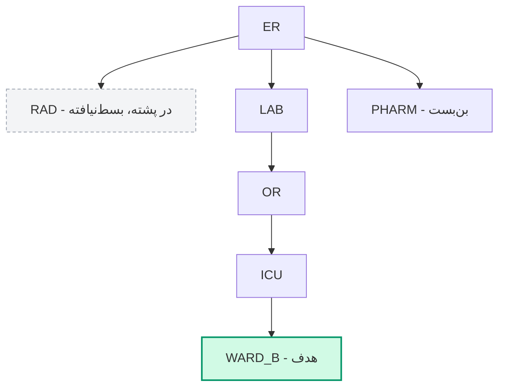
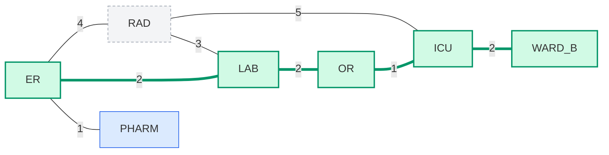

# صورت‌بندی مسئله جست‌وجو؛ BFS و DFS

> **منابع این جلسه:** منبع ۱ (Russell & Norvig, 2016)، منبع ۱۱ (محتوای مدرس)

---

## اهداف جلسه
در پایان این جلسه دانشجو می‌تواند:
1. یک مسئله را با چهار جزء صورت‌بندی جست‌وجو (وضعیت، کنش، آزمون هدف، هزینه مسیر) به‌همراه وضعیت آغازین توصیف کند.
2. مفهوم فضای حالت، گره جست‌وجو، مرز (Frontier)، لیست دیده‌شده‌ها (Visited) و بسط دادن (Expansion) را توضیح دهد.
3. الگوریتم‌های BFS و DFS را روی یک گراف کوچک به‌صورت دستی اجرا کند و در هر گام، محتوای **لیست دیده‌شده‌ها** و **مرز** (صف یا پشته) را بنویسد.
4. مسیر یافته‌شده، تعداد گره‌های بسط‌داده‌شده و هزینه مسیر هر دو الگوریتم را مقایسه کند.
5. توضیح دهد چرا ترتیب همسایه‌ها می‌تواند نتیجه DFS را به‌شدت تغییر دهد.
6. خروجی کد آموزشی جلسه را تفسیر و با تحلیل نظری خود تطبیق دهد.

---

## ۱. صورت‌بندی مسئله جست‌وجو

عامل هوشمند (Agent) برای رسیدن به هدف، باید میان گزینه‌ها تصمیم بگیرد. جست‌وجو (Search) یعنی مرور نظام‌مند حالت‌های ممکن برای یافتن توالی کنش‌های مناسب. رایانه مسئله را به شکلی که ما در ذهن داریم «نمی‌فهمد»؛ باید آن را به ساختاری دقیق و قابل پردازش تبدیل کنیم. به این تبدیل **صورت‌بندی مسئله** می‌گویند. هر مسئله جست‌وجو با چهار جزء صورت‌بندی می‌شود:

<div dir="rtl">

| جزء | تعریف | در مثال «انتقال بیمار» |
|--:|--:|--:|
| وضعیت (State) | عکس فوری از دنیا | بخش فعلی بیمار |
| کنش (Action) و مدل انتقال | تغییر وضعیت از روی یک یال | انتقال بیمار به یک بخش مجاور |
| آزمون هدف (Goal Test) | آیا وضعیت فعلی همان هدف است؟ | رسیده‌ایم به بخش مقصد؟ |
| هزینه مسیر (Path Cost) | جمع هزینه گام‌ها | جمع زمان انتقال‌ها (دقیقه) |

</div>

> [!NOTE]
> علاوه بر این چهار جزء، باید **وضعیت آغازین** (Initial State) هم مشخص باشد؛ در مثال ما `ER`. برخی منابع وضعیت آغازین را جزء پنجم می‌شمارند.

**مثال موردی:** بیماری در اورژانس (ER) است و باید به بخش بستری B منتقل شود. نقشه انتقال بین بخش‌ها یک **گراف وزن‌دار** است: گره‌ها بخش‌ها هستند و وزن هر یال، زمان انتقال به دقیقه (داده فرضی برای تمرین):

<div dir="rtl">

| یال | زمان (دقیقه) | یال | زمان (دقیقه) |
|--:|--:|--:|--:|
| ER ↔ RAD | ۴ | LAB ↔ OR | ۲ |
| ER ↔ LAB | ۲ | OR ↔ ICU | ۱ |
| ER ↔ PHARM | ۱ | RAD ↔ ICU | ۵ |
| RAD ↔ LAB | ۳ | ICU ↔ WARD_B | ۲ |

</div>

> [!IMPORTANT]
> این نقشه و همه اعداد آن فرضی و صرفاً آموزشی‌اند؛ هیچ رابطه‌ای با پروتکل واقعی انتقال بیمار ندارند.

**صورت‌بندی کامل این مثال:**
- **وضعیت آغازین:** `ER`
- **وضعیت‌ها:** هفت بخش `ER`، `RAD`، `LAB`، `PHARM`، `OR`، `ICU`، `WARD_B`
- **کنش‌ها:** رفتن از یک بخش به بخش مجاور (هر یال یک کنش است)
- **آزمون هدف:** وضعیت فعلی برابر `WARD_B` باشد
- **هزینه مسیر:** مجموع وزن یال‌های مسیر (دقیقه)

## ۲. فضای حالت و درخت جست‌وجو

- **فضای حالت (State Space):** مجموعه همه وضعیت‌های ممکن؛ اینجا همه بخش‌های بیمارستان.
- **گره جست‌وجو (Search Node):** ردی از مسیر پیموده‌شده، نه فقط یک وضعیت؛ شامل والد (Parent) برای بازسازی مسیر. دو گره جست‌وجوی متفاوت می‌توانند وضعیت یکسان داشته باشند (مثلاً رسیدن به `LAB` از دو راه مختلف).
- **مرز جست‌وجو (Frontier):** گره‌های کشف‌شده‌ای که هنوز بسط داده نشده‌اند. ساختار داده مرز تعیین می‌کند الگوریتم کدام است: **صف** → BFS، **پشته** → DFS.
- **دیده‌شده‌ها (Visited):** مجموعه گره‌هایی که تاکنون وارد مرز شده‌اند (یا گره شروع‌اند). هر گره فقط یک بار وارد مرز می‌شود.
- **بسط دادن (Expand):** برداشتن یک گره از مرز و افزودن فرزندان آن (همسایه‌های دیده‌نشده).

نمای گراف مثال این جلسه (همان گرافی که کد آموزشی استفاده می‌کند):



گراف بی‌جهت است؛ یعنی هر انتقال در جهت برگشت هم ممکن است. هدف: `ER → WARD_B`.

**فهرست همسایه‌ها** (ترتیبی که در همه جدول‌های این جزوه فرض شده است):

<div dir="rtl">

| گره | همسایه‌ها (به ترتیب بررسی) |
|--:|--:|
| `ER` | `RAD`، `LAB`، `PHARM` |
| `RAD` | `ER`، `ICU`، `LAB` |
| `LAB` | `ER`، `RAD`، `OR` |
| `PHARM` | `ER` |
| `OR` | `LAB`، `ICU` |
| `ICU` | `RAD`، `OR`، `WARD_B` |
| `WARD_B` | `ICU` |

</div>

### چرا به لیست دیده‌شده‌ها نیاز داریم؟
گراف ما چرخه دارد: `ER → RAD → LAB → ER` یک مثلث است. اگر الگوریتم گره‌های قبلی را به خاطر نسپارد، می‌تواند بی‌نهایت دور این مثلث بچرخد (به‌ویژه DFS). لیست دیده‌شده‌ها دو کار می‌کند: جلوی چرخیدن در چرخه‌ها را می‌گیرد و جلوی کار تکراری روی یک وضعیت را.

### الگوی کلی جست‌وجو
BFS و DFS **دقیقاً یک الگوریتم‌اند** و فقط در دو عمل `REMOVE` و `ADD` روی مرز تفاوت دارند:

```text
GRAPH-SEARCH(graph, start, goal):
    frontier <- [start]               # BFS: queue (FIFO)   |  DFS: stack (LIFO)
    visited  <- {start}
    parent   <- { start: None }

    while frontier is not empty:
        node <- REMOVE(frontier)      # BFS: from the front |  DFS: from the top
        if node == goal:              # goal test happens when node leaves the frontier
            return PATH(parent, node)
        for each neighbor in graph[node]:      # in the listed order
            if neighbor not in visited:
                visited.add(neighbor)          # mark when it ENTERS the frontier
                parent[neighbor] <- node
                ADD(frontier, neighbor)        # BFS: at the rear    |  DFS: on the top
    return failure
```

### قراردادهای این جزوه
۱. آزمون هدف هنگام **خروج** گره از مرز انجام می‌شود، نه هنگام تولید آن.
۲. گره هنگام **ورود** به مرز «دیده‌شده» علامت می‌خورد؛ پس هیچ گرهی دو بار وارد مرز نمی‌شود.
۳. همسایه‌ها به ترتیب جدول بالا بررسی می‌شوند.
۴. «**تعداد گره‌های بسط‌داده‌شده**» یعنی تعداد گره‌های خارج‌شده از مرز، **شامل گره هدف** (مطابق کلید فعالیت ۱). تعداد بسط واقعی (بدون هدف) یکی کمتر است و در جدول‌ها جداگانه آمده است.

## ۳. جست‌وجوی سطح‌اول (BFS)

جست‌وجوی سطح‌اول (Breadth-First Search) مرز را به‌صورت **صف FIFO** (اولین ورودی، اولین خروجی) مدیریت می‌کند: گره‌های سطح اول، بعد سطح دوم و تا آخر. با این کار از گره شروع، لایه‌به‌لایه دور می‌شویم؛ مثل موجی که پس از افتادن سنگ در آب، دایره‌وار گسترش می‌یابد. گره‌ای که زودتر کشف شده، زودتر بسط داده می‌شود.

سطح هر گره (کمترین تعداد یال از `ER`):

<div dir="rtl">

| سطح | گره‌ها |
|:-:|:-:|
| ۰ | `ER` |
| ۱ | `RAD`، `LAB`، `PHARM` |
| ۲ | `ICU`، `OR` |
| ۳ | `WARD_B` |

</div>

### اجرای گام‌به‌گام BFS روی گراف مثال

راهنمای جدول: در ستون «صف»، **سمت چپ = سر صف** (خروج از اینجا) و **سمت راست = ته صف** (ورود از اینجا). در ستون «دیده‌شده‌ها»، گره‌های **پررنگ** همان‌هایی‌اند که در این گام تازه کشف شده‌اند.

<div dir="rtl">

| گام | خروج از صف | فرزندان جدید | دیده‌شده‌ها (به ترتیب کشف) | صف (چپ = سر صف) |
|:-:|:-:|:-:|:-:|:-:|
| ۰ | — | — | <span dir="ltr">`ER`</span> | <span dir="ltr">`[ER]`</span> |
| ۱ | `ER` | `RAD`، `LAB`، `PHARM` | <span dir="ltr">`ER,` **`RAD, LAB, PHARM`**</span> | <span dir="ltr">`[RAD, LAB, PHARM]`</span> |
| ۲ | `RAD` | `ICU` | <span dir="ltr">`ER, RAD, LAB, PHARM,` **`ICU`**</span> | <span dir="ltr">`[LAB, PHARM, ICU]`</span> |
| ۳ | `LAB` | `OR` | <span dir="ltr">`ER, RAD, LAB, PHARM, ICU,` **`OR`**</span> | <span dir="ltr">`[PHARM, ICU, OR]`</span> |
| ۴ | `PHARM` | — | <span dir="ltr">`ER, RAD, LAB, PHARM, ICU, OR`</span> | <span dir="ltr">`[ICU, OR]`</span> |
| ۵ | `ICU` | `WARD_B` | <span dir="ltr">`ER, RAD, LAB, PHARM, ICU, OR,` **`WARD_B`**</span> | <span dir="ltr">`[OR, WARD_B]`</span> |
| ۶ | `OR` | — | <span dir="ltr">`ER, RAD, LAB, PHARM, ICU, OR, WARD_B`</span> | <span dir="ltr">`[WARD_B]`</span> |
| ۷ | `WARD_B` ✅ هدف | — | <span dir="ltr">`ER, RAD, LAB, PHARM, ICU, OR, WARD_B`</span> | <span dir="ltr">`[ ]`</span> |

</div>

**توضیح گام‌ها:**
1. `ER` از صف خارج و بسط داده می‌شود؛ سه همسایه‌اش جدید‌اند و به ترتیب به ته صف می‌روند و دیده‌شده علامت می‌خورند.
2. `RAD` خارج می‌شود. همسایه‌هایش `ER` و `LAB` قبلاً دیده شده‌اند (تکراری‌اند) و فقط `ICU` جدید است.
3. `LAB` خارج می‌شود؛ `ER` و `RAD` تکراری‌اند و فقط `OR` جدید است.
4. `PHARM` خارج می‌شود؛ تنها همسایه‌اش `ER` است که قبلاً دیده شده؛ پس چیزی به صف اضافه نمی‌شود.
5. `ICU` خارج می‌شود؛ `RAD` و `OR` تکراری‌اند و `WARD_B` جدید است. توجه کنید هدف همین‌جا **کشف** شد، اما طبق قرارداد ما هنوز آزمون هدف روی آن انجام نشده است.
6. `OR` خارج می‌شود؛ هر دو همسایه‌اش (`LAB`، `ICU`) قبلاً دیده شده‌اند.
7. `WARD_B` از صف خارج می‌شود و آزمون هدف موفق است. صف خالی شد و جست‌وجو پایان می‌یابد.

### بازسازی مسیر از روی والدها
خروجی صف، مسیر نیست! ترتیب خروج (`ER, RAD, LAB, PHARM, ICU, OR, WARD_B`) فقط ترتیب بسط است. مسیر را با دنبال کردن والدها از هدف تا شروع می‌سازیم:

<div dir="rtl">

| گره | `RAD` | `LAB` | `PHARM` | `ICU` | `OR` | `WARD_B` |
|:-:|:-:|:-:|:-:|:-:|:-:|:-:|
| والد | `ER` | `ER` | `ER` | `RAD` | `LAB` | `ICU` |

</div>

`WARD_B ← ICU ← RAD ← ER`، یعنی مسیر `ER → RAD → ICU → WARD_B` با ۳ گام و هزینه ۴+۵+۲ = ۱۱ دقیقه.

**آمار اجرا:** ۷ گره از صف خارج شد (۶ بسط + ۱ آزمون هدف)، همه ۷ گره دیده شدند و بیشینه اندازه صف ۳ بود.

### درخت جست‌وجو و مسیر نهایی

درخت جست‌وجوی BFS تا رسیدن به هدف (گره‌های خاکستری نقطه‌چین، همسایه‌های تکراری‌اند که الگوریتم کنار می‌گذارد):



مسیر یافته‌شده روی گراف اصلی (سبز: روی مسیر؛ آبی: بسط داده شد ولی روی مسیر نیست):



### چرا BFS کم‌یال‌ترین مسیر را می‌یابد؟
چون صف گره‌ها را به ترتیب سطح بسط می‌دهد: همه گره‌های سطح ۱ پیش از هر گره سطح ۲ بسط داده می‌شوند و همین‌طور تا آخر. پس اولین باری که به هدف می‌رسیم، هیچ مسیر کوتاه‌تری (از نظر تعداد یال) وجود ندارد.

> [!TIP]
> BFS روی درخت، مسیر با **کمترین تعداد یال** را می‌یابد. اگر همه یال‌ها هزینه برابر داشته باشند، این همان مسیر بهینه است؛ در گراف وزن‌دار این تضمین برقرار نیست. مثال همین جلسه: مسیر BFS هزینه ۱۱ دارد، در حالی که مسیر `ER → LAB → OR → ICU → WARD_B` هزینه ۷ دارد.

## ۴. جست‌وجوی عمق‌اول (DFS)

جست‌وجوی عمق‌اول (Depth-First Search) مرز را به‌صورت **پشته LIFO** (آخرین ورودی، اولین خروجی) مدیریت می‌کند: تازه‌ترین گره کشف‌شده زودتر بسط داده می‌شود؛ یعنی یک شاخه را تا عمیق‌ترین نقطه می‌رود و اگر به بن‌بست رسید، به عقب برمی‌گردد (Backtracking). مثل کاوش یک هزارتو: تا جایی که می‌شود جلو می‌روی و فقط وقتی راه بسته شد، به نزدیک‌ترین چهارراهی که هنوز مسیر ناپیموده دارد برمی‌گردی. در پشته، آن چهارراه همان گره‌ای است که زیر گره‌های تازه‌تر منتظر مانده است.

### اجرای گام‌به‌گام DFS روی گراف مثال (با ترتیب همسایه‌های جدول بخش ۲)

راهنمای جدول: ستون «پشته» به‌صورت **عمودی** نوشته شده است؛ **بالاترین (پررنگ) = سر پشته** و همان گرهی است که در گام بعد خارج می‌شود. خط پایین هر پشته، ته آن است. فرزندان جدید به همان ترتیب فهرست همسایه‌ها push می‌شوند؛ پس **آخرین همسایه، بالاتر از همه قرار می‌گیرد**.

<div dir="rtl">

| گام | خروج از پشته | فرزندان جدید (ترتیب push) | دیده‌شده‌ها (به ترتیب کشف) | پشته (بالا = سر پشته) |
|:-:|:-:|:-:|:-:|:-:|
| ۰ | — | — | <span dir="ltr">`ER`</span> | **`ER`**<br>━━━━ |
| ۱ | `ER` | `RAD`، `LAB`، `PHARM` | <span dir="ltr">`ER,` **`RAD, LAB, PHARM`**</span> | **`PHARM`**<br>`LAB`<br>`RAD`<br>━━━━ |
| ۲ | `PHARM` | — (بن‌بست) | <span dir="ltr">`ER, RAD, LAB, PHARM`</span> | **`LAB`**<br>`RAD`<br>━━━━ |
| ۳ | `LAB` | `OR` | <span dir="ltr">`ER, RAD, LAB, PHARM,` **`OR`**</span> | **`OR`**<br>`RAD`<br>━━━━ |
| ۴ | `OR` | `ICU` | <span dir="ltr">`ER, RAD, LAB, PHARM, OR,` **`ICU`**</span> | **`ICU`**<br>`RAD`<br>━━━━ |
| ۵ | `ICU` | `WARD_B` | <span dir="ltr">`ER, RAD, LAB, PHARM, OR, ICU,` **`WARD_B`**</span> | **`WARD_B`**<br>`RAD`<br>━━━━ |
| ۶ | `WARD_B` ✅ هدف | — | <span dir="ltr">`ER, RAD, LAB, PHARM, OR, ICU, WARD_B`</span> | **`RAD`**<br>━━━━ |

</div>

**توضیح گام‌ها:**
1. `ER` بسط داده می‌شود و سه فرزندش به ترتیب `RAD`، `LAB`، `PHARM` در پشته قرار می‌گیرند. `PHARM` آخر وارد شد، پس روی پشته است.
2. `PHARM` (سر پشته) خارج می‌شود. تنها همسایه‌اش `ER` دیده شده است؛ پس این شاخه **بن‌بست** است و پشته بدون اضافه شدن چیزی کوچک‌تر می‌شود. همین‌جا عقب‌گرد اتفاق می‌افتد: گام بعد به گره پایین‌تر (`LAB`) برمی‌گردیم.
3. `LAB` خارج می‌شود. `ER` و `RAD` قبلاً دیده شده‌اند (`RAD` هنوز در پشته منتظر است و دوباره اضافه نمی‌شود)؛ فقط `OR` جدید است.
4. `OR` خارج می‌شود؛ `LAB` تکراری است و `ICU` جدید.
5. `ICU` خارج می‌شود؛ `RAD` و `OR` تکراری‌اند و `WARD_B` جدید است.
6. `WARD_B` خارج می‌شود و آزمون هدف موفق است. `RAD` در ته پشته باقی می‌ماند؛ یعنی **دیده شد ولی هرگز بسط داده نشد**.

### بازسازی مسیر از روی والدها

<div dir="rtl">

| گره | `RAD` | `LAB` | `PHARM` | `OR` | `ICU` | `WARD_B` |
|:-:|:-:|:-:|:-:|:-:|:-:|:-:|
| والد | `ER` | `ER` | `ER` | `LAB` | `OR` | `ICU` |

</div>

`WARD_B ← ICU ← OR ← LAB ← ER`، یعنی مسیر `ER → LAB → OR → ICU → WARD_B` با ۴ گام و هزینه ۲+۲+۱+۲ = ۷ دقیقه.

**آمار اجرا:** ۶ گره از پشته خارج شد (۵ بسط + ۱ آزمون هدف)، هر ۷ گره دیده شدند، `RAD` بسط داده نشد و بیشینه اندازه پشته ۳ بود.

### درخت جست‌وجو و مسیر نهایی



مسیر یافته‌شده روی گراف اصلی (سبز: روی مسیر؛ آبی: بسط داده شد ولی روی مسیر نیست؛ خاکستری نقطه‌چین: دیده شد ولی بسط داده نشد):



### نقش ترتیب همسایه‌ها
`PHARM` آخرین همسایه `ER` در فهرست بود، اما در DFS پشته‌ای **اولین** گرهی است که بسط داده شد؛ چون LIFO است. به همین دلیل، ترتیب «واقعی» کاوش DFS پشته‌ای، معکوس ترتیب فهرست همسایه‌هاست.

نکته مهم: در این اجرا، DFS اصلاً گره `RAD` را بسط نداد. پس ترتیب همسایه‌ها می‌تواند نتیجه را کاملاً تغییر دهد؛ اینجا DFS اتفاقی مسیر ارزان‌تری یافت (در واقع هزینه ۷ کمینه‌ی هزینه در کل گراف است)، اما این **تصادف** است، نه تضمین. برای دیدن این موضوع، ترتیب همسایه‌های `ER` را معکوس کنید (`PHARM`، `LAB`، `RAD`) و بقیه چیز را ثابت نگه دارید:

<div dir="rtl">

| گام | خروج از پشته | فرزندان جدید (ترتیب push) | دیده‌شده‌ها (به ترتیب کشف) | پشته (بالا = سر پشته) |
|:-:|:-:|:-:|:-:|:-:|
| ۰ | — | — | <span dir="ltr">`ER`</span> | **`ER`**<br>━━━━ |
| ۱ | `ER` | `PHARM`، `LAB`، `RAD` | <span dir="ltr">`ER,` **`PHARM, LAB, RAD`**</span> | **`RAD`**<br>`LAB`<br>`PHARM`<br>━━━━ |
| ۲ | `RAD` | `ICU` | <span dir="ltr">`ER, PHARM, LAB, RAD,` **`ICU`**</span> | **`ICU`**<br>`LAB`<br>`PHARM`<br>━━━━ |
| ۳ | `ICU` | `OR`، `WARD_B` | <span dir="ltr">`ER, PHARM, LAB, RAD, ICU,` **`OR, WARD_B`**</span> | **`WARD_B`**<br>`OR`<br>`LAB`<br>`PHARM`<br>━━━━ |
| ۴ | `WARD_B` ✅ هدف | — | <span dir="ltr">`ER, PHARM, LAB, RAD, ICU, OR, WARD_B`</span> | **`OR`**<br>`LAB`<br>`PHARM`<br>━━━━ |

</div>

این بار DFS مسیر `ER → RAD → ICU → WARD_B` با هزینه **۱۱** را یافت؛ یعنی با یک تغییر ساده در ترتیب همسایه‌ها، هزینه از ۷ به ۱۱ رسید.

> [!NOTE]
> **DFS بازگشتی یا پشته‌ای؟** DFS را می‌توان با بازگشت (Recursion) هم نوشت. در نسخه بازگشتی، همسایه‌ها واقعاً به ترتیب فهرست کاوش می‌شوند (اول `RAD`) و گره‌ها هنگام ورود به تابع علامت می‌خورند، نه هنگام push. نتیجه و تعداد بسط‌ها ممکن است با نسخه پشته‌ای متفاوت باشد. جزوه و کد این جلسه نسخه پشته‌ای را به‌کار می‌برند.

## ۵. مقایسه BFS و DFS و پیچیدگی

### مقایسه روی مثال این جلسه

<div dir="rtl">

| معیار | BFS | DFS |
|--:|:-:|:-:|
| مسیر یافته‌شده | `ER → RAD → ICU → WARD_B` | `ER → LAB → OR → ICU → WARD_B` |
| تعداد گام (یال) | ۳ | ۴ |
| هزینه مسیر (دقیقه) | ۱۱ | ۷ |
| گره‌های خارج‌شده از مرز (شامل هدف) | ۷ | ۶ |
| گره‌های بسط‌داده‌شده (بدون هدف) | ۶ | ۵ |
| گره‌های دیده‌شده | ۷ | ۷ |
| بیشینه اندازه مرز | ۳ | ۳ |
| باقی‌مانده در مرز هنگام توقف | هیچ | `RAD` |

</div>

نتیجه: BFS کم‌یال‌ترین مسیر را یافت ولی از نظر زمان انتقال گران‌تر بود؛ DFS مسیر طولانی‌تر ولی ارزان‌تری یافت. هیچ‌کدام به وزن‌ها نگاه نکردند. در این گراف کوچک، اندازه مرز هم در هر دو یکسان است؛ تفاوت حافظه فقط در گراف‌های بزرگ دیده می‌شود.

### مقایسه نظری

نمادها: عامل انشعاب (Branching Factor) $b$ یعنی میانگین تعداد فرزند هر گره، عمق هدف $d$ و بیشینه عمق درخت $m$.

<div dir="rtl">

| ویژگی | BFS | DFS |
|--:|--:|--:|
| ساختار مرز | صف (FIFO) | پشته (LIFO) |
| کامل بودن (Completeness) | بله (در گراف متناهی) | بله، در فضای حالت متناهی و با جلوگیری از چرخه؛ در درخت با عمق نامتناهی خیر |
| بهینه بودن (Optimality) | فقط با یال‌های هم‌هزینه | خیر |
| زمان | $O(b^d)$ | $O(b^m)$ |
| حافظه | $O(b^d)$ — چاه اصلی BFS | $O(bm)$ |

</div>

$$T_{\text{BFS}} = O(b^d) \qquad M_{\text{BFS}} = O(b^d) \qquad M_{\text{DFS}} = O(bm)$$

**شهود:** BFS باید تمام یک سطح (حدود $b^d$ گره) را همزمان در صف نگه دارد. DFS فقط یک مسیر از ریشه تا گره فعلی را به‌همراه همسایه‌های ناپیموده هر گره روی آن مسیر نگه می‌دارد؛ یعنی حدود $b$ گره در هر یک از $m$ سطح.

مرتبه بزرگی برای $b = 10$ (با فرض $m = d$):

<div dir="rtl">

| عمق $d$ | کل گره‌های درخت تا عمق $d$ (زمان) | حافظه BFS ≈ $b^d$ | حافظه DFS ≈ $b \cdot m$ |
|:-:|:-:|:-:|:-:|
| ۲ | ۱۱۱ | ۱۰۰ | ۲۰ |
| ۴ | ۱۱٬۱۱۱ | ۱۰٬۰۰۰ | ۴۰ |
| ۶ | ۱٬۱۱۱٬۱۱۱ | ۱٬۰۰۰٬۰۰۰ | ۶۰ |
| ۸ | ۱۱۱٬۱۱۱٬۱۱۱ | ۱۰۰٬۰۰۰٬۰۰۰ | ۸۰ |

</div>

چون $m$ می‌تواند بسیار بزرگ‌تر از $d$ باشد، DFS در زمان ممکن بدتر شود، اما حافظه‌ی بسیار کمتری مصرف کند. در گراف کوچک ما (۷ گره) هر دو الگوریتم همه گره‌ها را دیدند؛ تفاوت واقعی در گراف‌های بزرگ ظاهر می‌شود.

### کدام را کی استفاده کنیم؟
- **BFS:** وقتی هزینه همه گام‌ها برابر است و کمترین تعداد گام می‌خواهیم، یا هدف احتمالاً کم‌عمق است و حافظه مشکل نیست.
- **DFS:** وقتی حافظه محدود است، فضای جست‌وجو عمیق است یا هر پاسخ قابل‌قبولی (نه لزوماً بهینه) کافی است.
- **هیچ‌کدام:** وقتی وزن یال‌ها مهم است؛ به روش‌های آگاه به هزینه نیاز داریم (جلسه بعد).

> [!WARNING]
> BFS و DFS در جست‌وجو فقط «وجود یال» را می‌بینند و وزن‌ها را نادیده می‌گیرند. هزینه‌های گزارش‌شده در خروجی کد، هزینه مسیرِ یافته‌شده است، نه معیار انتخاب الگوریتم. جلسه بعد راه‌حل این مشکل (UCS) را معرفی می‌کند.

## ۶. اشتباهات رایج هنگام اجرای دستی

1. **علامت نزدن به‌موقع:** اگر گره را فقط هنگام خروج «دیده‌شده» کنید، همان گره می‌تواند چند بار وارد مرز شود (مثلاً `LAB` یک بار از `ER` و یک بار از `RAD` وارد صف می‌شود). طبق قرارداد این جزوه، علامت‌گذاری هنگام ورود به مرز است.
2. **اشتباه گرفتن سر پشته:** در DFS آخرین گره وارد‌شده اول خارج می‌شود، نه اولین. به همین دلیل `PHARM` پیش از `LAB` بسط داده شد.
3. **خلط «دیده‌شده» و «بسط‌داده‌شده»:** `RAD` در DFS دیده شد ولی بسط داده نشد.
4. **خواندن مسیر از ترتیب خروج:** مسیر را باید از والدها ساخت، نه از ترتیب خروج گره‌ها.
5. **جابه‌جا کردن زمان آزمون هدف:** اگر آزمون هدف هنگام تولید فرزند انجام شود (نه هنگام خروج)، BFS همان گام ۵ متوقف می‌شود و تعداد بسط‌ها از ۶ به ۵ می‌رسد. هر دو روش درست‌اند به شرط آن‌که مشخص کنید کدام را به‌کار برده‌اید.
6. **توجه به وزن‌ها:** وزن یال‌ها فقط برای محاسبه هزینه نهایی مسیر لازم‌اند، نه برای انتخاب گره بعدی.

---

## 🔬 پیوند با مهندسی پزشکی

سناریوی انتقال بین‌بخشی بیمار: پرستار انتقال باید مسیری از اورژانس به بخش مقصد انتخاب کند که از راهروها و بخش‌های میانی عبور کند. اگر معیار «کمترین تعداد جابه‌جایی بین بخش‌ها» باشد، BFS پاسخ می‌دهد؛ اگر برخی مسیرها پرترافیک‌تر باشند و زمان هر عبور متفاوت باشد، مسئله وزن‌دار می‌شود و به روش‌های آگاه به هزینه نیاز خواهیم داشت (جلسه ۶ و ۸). همین صورت‌بندی در مقیاس بزرگ‌تر برای مسیریابی آمبولانس در شبکه جاده‌های بین بیمارستانی استفاده می‌شود.

نمونه‌های دیگری که با همین چارچوب صورت‌بندی می‌شوند:
- **مسیریابی برانکارد یا تجهیزات سیار** در طبقات یک بیمارستان (هر راهرو یک یال، هر تقاطع یک وضعیت).
- **برنامه‌ریزی مسیر ابزار** در جراحی رباتیک یا هدایت سوزن (وضعیت: موقعیت نوک ابزار؛ کنش: یک گام حرکت؛ هدف: رسیدن به نقطه هدف با پرهیز از نواحی ممنوع).
- **ارجاع بیمار بین مراکز درمانی** با شبکه‌ای از مراکز و مسیرهای ارجاع.

یادآوری: این مثال‌ها صرفاً آموزشی و غیرتشخیصی‌اند و هیچ تصمیم بالینی از آن‌ها گرفته نمی‌شود.

---

## ✍️ فعالیت کلاسی

### فعالیت ۱: ماز بیمارستانی روی کاغذ
نقشه ساده یک بیمارستان (۳×۳)؛ `S` پذیرش، `G` اتاق عمل، `X` راهروی بسته:

<div dir="rtl">

| | ستون ۱ | ستون ۲ | ستون ۳ |
|--:|--:|--:|--:|
| ردیف ۱ | S | باز | X |
| ردیف ۲ | باز | X | باز |
| ردیف ۳ | باز | باز | G |

</div>

حرکت فقط به چهار جهت و بین خانه‌های باز. ترتیب بررسی همسایه‌ها: راست، پایین، چپ، بالا. هر خانه را با (ردیف، ستون) نام ببرید؛ پس `S` همان `(1,1)` است. روی کاغذ اجرا کنید و **جدول گام‌به‌گام** (دیده‌شده‌ها و صف/پشته) را برای هر دو الگوریتم رسم کنید، سپس جدول نتیجه را پر کنید:

<div dir="rtl">

| | BFS | DFS |
|--:|--:|--:|
| مسیر یافته‌شده | | |
| تعداد گام‌ها | | |
| تعداد گره‌های بسط‌داده‌شده (شامل هدف) | | |

</div>

<details>
<summary>کلید پاسخ فعالیت ۱</summary>

<div dir="rtl">

| | BFS | DFS |
|--:|--:|--:|
| مسیر یافته‌شده | `(1,1)→(2,1)→(3,1)→(3,2)→(3,3)` | همان مسیر |
| تعداد گام‌ها | ۴ | ۴ |
| تعداد گره‌های بسط‌داده‌شده (شامل هدف) | ۶ | ۵ (خانه `(1,2)` هرگز بسط داده نشد) |

</div>

**جدول گام‌به‌گام BFS** (سمت چپ صف = سر صف):

<div dir="rtl">

| گام | خروج از صف | فرزندان جدید | دیده‌شده‌ها | صف (چپ = سر صف) |
|:-:|:-:|:-:|:-:|:-:|
| ۰ | — | — | <span dir="ltr">`(1,1)`</span> | <span dir="ltr">`[(1,1)]`</span> |
| ۱ | `(1,1)` | `(1,2)`، `(2,1)` | <span dir="ltr">`(1,1),` **`(1,2), (2,1)`**</span> | <span dir="ltr">`[(1,2), (2,1)]`</span> |
| ۲ | `(1,2)` | — (بن‌بست) | <span dir="ltr">`(1,1), (1,2), (2,1)`</span> | <span dir="ltr">`[(2,1)]`</span> |
| ۳ | `(2,1)` | `(3,1)` | <span dir="ltr">`(1,1), (1,2), (2,1),` **`(3,1)`**</span> | <span dir="ltr">`[(3,1)]`</span> |
| ۴ | `(3,1)` | `(3,2)` | <span dir="ltr">`(1,1), (1,2), (2,1), (3,1),` **`(3,2)`**</span> | <span dir="ltr">`[(3,2)]`</span> |
| ۵ | `(3,2)` | `(3,3)` | <span dir="ltr">`(1,1), (1,2), (2,1), (3,1), (3,2),` **`(3,3)`**</span> | <span dir="ltr">`[(3,3)]`</span> |
| ۶ | `(3,3)` ✅ هدف | — | <span dir="ltr">`(1,1), (1,2), (2,1), (3,1), (3,2), (3,3)`</span> | <span dir="ltr">`[ ]`</span> |

</div>

**جدول گام‌به‌گام DFS** (بالاترین = سر پشته):

<div dir="rtl">

| گام | خروج از پشته | فرزندان جدید (ترتیب push) | دیده‌شده‌ها | پشته (بالا = سر پشته) |
|:-:|:-:|:-:|:-:|:-:|
| ۰ | — | — | <span dir="ltr">`(1,1)`</span> | **`(1,1)`**<br>━━━━ |
| ۱ | `(1,1)` | `(1,2)`، `(2,1)` | <span dir="ltr">`(1,1),` **`(1,2), (2,1)`**</span> | **`(2,1)`**<br>`(1,2)`<br>━━━━ |
| ۲ | `(2,1)` | `(3,1)` | <span dir="ltr">`(1,1), (1,2), (2,1),` **`(3,1)`**</span> | **`(3,1)`**<br>`(1,2)`<br>━━━━ |
| ۳ | `(3,1)` | `(3,2)` | <span dir="ltr">`(1,1), (1,2), (2,1), (3,1),` **`(3,2)`**</span> | **`(3,2)`**<br>`(1,2)`<br>━━━━ |
| ۴ | `(3,2)` | `(3,3)` | <span dir="ltr">`(1,1), (1,2), (2,1), (3,1), (3,2),` **`(3,3)`**</span> | **`(3,3)`**<br>`(1,2)`<br>━━━━ |
| ۵ | `(3,3)` ✅ هدف | — | <span dir="ltr">`(1,1), (1,2), (2,1), (3,1), (3,2), (3,3)`</span> | **`(1,2)`**<br>━━━━ |

</div>

چون این ماز فقط یک مسیر دارد، هر دو الگوریتم همان مسیر را یافتند؛ تفاوت در ترتیب و تعداد بسط‌هاست. در DFS، `(2,1)` (پایین) بعد از `(1,2)` (راست) push شد و در نتیجه زودتر خارج شد؛ بنابراین DFS اول به پایین رفت و `(1,2)` ته پشته ماند. شمارش ۵ برای DFS **پشته‌ای (LIFO)** است، همان‌گونه که در کد این جلسه پیاده‌سازی شده؛ در نسخه بازگشتی DFS با همین ترتیب همسایه‌ها، ابتدا `(1,2)` کاوش می‌شود و تعداد بسط‌ها ۶ می‌شود. اگر دانشجویی ترتیب همسایه‌ها را عوض کند، پاسخ DFS تغییر می‌کند — نکته آموزشی خوبی است.

</details>

### فعالیت ۲: تحلیل خروجی کد
کد `code/session_05_bfs_dfs.py` را اجرا کنید و پاسخ دهید:
1. چرا مسیر DFS اینجا ارزان‌تر از BFS شد، در حالی که گفته‌ایم DFS تضمین بهینگی ندارد؟
2. کدام گره در DFS هرگز بسط داده نشد؟
3. اگر ترتیب لیست همسایه‌های `ER` را در کد عوض کنید، خروجی چه تغییری می‌کند؟
4. برنامه را با گزینه `--trace` اجرا کنید و خروجی را با جدول‌های بخش‌های ۳ و ۴ مقایسه کنید.

> [!NOTE]
> ترتیب فهرست همسایه‌ها در `GRAPH` همان ترتیب جدول بخش ۲ است و شمارنده `expansions` گره هدف را هم می‌شمارد؛ پس عددهای کد (۷ برای BFS و ۶ برای DFS) با جدول‌های جزوه یکی است.

<details>
<summary>کلید پاسخ فعالیت ۲</summary>

1. تصادف است: ترتیب پشته باعث شد DFS زودتر وارد مسیر `LAB → OR → ICU` شود که هزینه‌اش کمتر است. با ترتیب دیگرِ همسایه‌ها، DFS می‌توانست مسیر گران‌تر یا بسیار طولانی‌تری بیابد؛ هیچ تضمینی وجود ندارد. (مثلاً با ترتیب `PHARM، LAB، RAD` برای `ER`، هزینه ۱۱ می‌شود؛ بخش ۴ را ببینید.)
2. گره `RAD`؛ این گره دیده شد و در ته پشته ماند، اما چون DFS بعد از بسط `ICU` به هدف رسید، هرگز به شاخه `RAD` نرسید.
3. مسیر DFS (و گاهی تعداد بسط‌ها) عوض می‌شود. در BFS، طول مسیر و هزینه آن در این گراف تغییر نمی‌کند، چون مسیر ۳ یالیِ `ER → RAD → ICU → WARD_B` تنها کوتاه‌ترین مسیر است؛ ولی ترتیب بسط گره‌ها درون هر سطح می‌تواند عوض شود، و در گراف‌هایی با چند مسیر کوتاه‌ترین، مسیر انتخابی هم ممکن است فرق کند.
4. خروجی `--trace` باید با جدول‌های جزوه یکی باشد؛ مثلاً در DFS گام ۲، پشته فقط `LAB` و `RAD` را دارد.

</details>

### فعالیت ۳ (اختیاری): بن‌بست و عقب‌گرد
یال `OR ↔ ICU` را از گراف حذف کنید و هر دو الگوریتم را دوباره اجرا کنید. DFS چند بار عقب‌گرد می‌کند؟ آیا مسیرها عوض می‌شوند؟

<details>
<summary>کلید پاسخ فعالیت ۳</summary>

فهرست همسایه‌ها پس از حذف یال: `OR` فقط همسایه `LAB` دارد و `ICU` همسایه‌های `RAD` و `WARD_B`.

**DFS:**

<div dir="rtl">

| گام | خروج از پشته | فرزندان جدید (ترتیب push) | دیده‌شده‌ها | پشته (بالا = سر پشته) |
|:-:|:-:|:-:|:-:|:-:|
| ۰ | — | — | <span dir="ltr">`ER`</span> | **`ER`**<br>━━━━ |
| ۱ | `ER` | `RAD`، `LAB`، `PHARM` | <span dir="ltr">`ER,` **`RAD, LAB, PHARM`**</span> | **`PHARM`**<br>`LAB`<br>`RAD`<br>━━━━ |
| ۲ | `PHARM` | — (بن‌بست ۱) | <span dir="ltr">`ER, RAD, LAB, PHARM`</span> | **`LAB`**<br>`RAD`<br>━━━━ |
| ۳ | `LAB` | `OR` | <span dir="ltr">`ER, RAD, LAB, PHARM,` **`OR`**</span> | **`OR`**<br>`RAD`<br>━━━━ |
| ۴ | `OR` | — (بن‌بست ۲) | <span dir="ltr">`ER, RAD, LAB, PHARM, OR`</span> | **`RAD`**<br>━━━━ |
| ۵ | `RAD` | `ICU` | <span dir="ltr">`ER, RAD, LAB, PHARM, OR,` **`ICU`**</span> | **`ICU`**<br>━━━━ |
| ۶ | `ICU` | `WARD_B` | <span dir="ltr">`ER, RAD, LAB, PHARM, OR, ICU,` **`WARD_B`**</span> | **`WARD_B`**<br>━━━━ |
| ۷ | `WARD_B` ✅ هدف | — | <span dir="ltr">`ER, RAD, LAB, PHARM, OR, ICU, WARD_B`</span> | ━━━━ (خالی) |

</div>

DFS دو بار به بن‌بست رسید (`PHARM` و `OR`) و عقب‌گرد کرد؛ این بار `RAD` هم بسط داده شد. مسیر DFS: `ER → RAD → ICU → WARD_B` با هزینه ۱۱. BFS هم همین مسیر را می‌یابد (۷ گره خارج‌شده)؛ چون حالا `ER → LAB → OR → ICU → WARD_B` وجود ندارد و تنها مسیر دارای هدف از `RAD` می‌گذرد.

</details>

## 💻 کد آموزشی

فایل `code/session_05_bfs_dfs.py` (فقط کتابخانه استاندارد پایتون):
- تابع `bfs(graph, start, goal)` با `collections.deque` به‌عنوان صف.
- تابع `dfs(graph, start, goal)` با لیست به‌عنوان پشته.
- گراف `GRAPH` همان شبکه انتقال بیمار بخش ۲؛ وزن‌ها فقط در محاسبه هزینه مسیر به‌کار می‌روند.
- خروجی برنامه برای هر الگوریتم: مسیر، تعداد گام، هزینه مسیر و تعداد گره‌های بسط‌داده‌شده (شامل هدف).
- با گزینه `--trace` هر دو تابع پس از هر گام، لیست دیده‌شده‌ها و مرز را چاپ می‌کنند (خروجی مستقیماً با جدول‌های جزوه قابل مقایسه است).

اجرای برنامه در ترمینال:

```bash
python3 code/session_05_bfs_dfs.py
```

گزینه‌های اضافی:

<div dir="rtl">

| گزینه | کار |
|--:|--:|
| `--trace` | چاپ جدول گام‌به‌گام: دیده‌شده‌ها و صف (افقی)، دیده‌شده‌ها و پشته (عمودی) |
| `--reverse-er` | معکوس کردن ترتیب همسایه‌های `ER` (مثال تکمیلی بخش ۴؛ DFS هزینه ۱۱ می‌یابد) |
| `--maze` | اجرای ماز فعالیت ۱ (ترتیب: راست، پایین، چپ، بالا) |
| `--drop-or-icu` | حذف یال `OR ↔ ICU` برای فعالیت ۳ |

</div>

گزینه‌ها را می‌توان ترکیب کرد، مثلاً `python3 code/session_05_bfs_dfs.py --maze --trace`.

یا در Colab (علامت `!` برای اجرای دستور پوسته است):

```python
!python3 code/session_05_bfs_dfs.py
```

## 📘 واژه‌نامه

<div dir="rtl">

| واژه | معنی |
|--:|--:|
| State / State Space | وضعیت / فضای حالت |
| Initial State | وضعیت آغازین |
| Action | کنش |
| Goal Test | آزمون هدف |
| Path Cost | هزینه مسیر |
| Search Node | گره جست‌وجو |
| Parent | والد |
| Branching Factor | عامل انشعاب |
| Frontier | مرز جست‌وجو |
| Visited / Reached | دیده‌شده‌ها (گره‌های واردشده به مرز) |
| Expansion | بسط دادن گره |
| Queue / FIFO | صف / اولین ورودی، اولین خروجی |
| Stack / LIFO | پشته / آخرین ورودی، اولین خروجی |
| Backtracking | عقب‌گرد |
| Dead End | بن‌بست |
| Cycle | چرخه |
| BFS (Breadth-First Search) | جست‌وجوی سطح‌اول |
| DFS (Depth-First Search) | جست‌وجوی عمق‌اول |
| Completeness / Optimality | کامل بودن / بهینه بودن |

</div>

## ❓ پرسش‌های خودآزمون
1. چهار جزء صورت‌بندی مسئله جست‌وجو را نام ببرید و برای مسئله «یافتن مسیر آمبولانس از پایگاه به محل حادثه» هر جزء را مشخص کنید.
2. چرا BFS فقط وقتی بهینه است که همه یال‌ها هزینه برابر داشته باشند؟
3. تفاوت صف و پشته در نقش مرز جست‌وجو چیست و هرکدام رفتار کدام الگوریتم را می‌سازد؟
4. اگر درخت جست‌وجو عامل انشعاب $b=3$ و عمق هدف $d=4$ داشته باشد، بدترین حالت تعداد گره‌های بسط‌داده‌شده BFS چند است؟
5. در اجرای DFS این جلسه، چرا `PHARM` پیش از `LAB` بسط داده شد، با این‌که در فهرست همسایه‌های `ER` بعد از آن آمده است؟
6. اگر در BFS گره‌ها را هنگام خروج از صف (نه ورود) «دیده‌شده» علامت بزنیم، چه مشکلی پیش می‌آید؟

کلید پاسخ‌ها در بخش «راهنمای مدرس» انتهای فایل آمده است.

## 📝 تکلیف
1. صورت‌بندی کامل (چهار جزء به‌همراه وضعیت آغازین) برای یکی از این دو مسئله بنویسید: «انتقال نمونه آزمایش از آزمایشگاه به بخش میکروب» یا «مسیریابی برانکارد از ورودی بیمارستان به MRI».
2. خروجی کد جلسه را اجرا کنید و در یک جدول، مسیر و هزینه و تعداد بسط‌های BFS و DFS را گزارش دهید و در دو جمله تفاوت را تحلیل کنید.
3. جدول گام‌به‌گام DFS را برای حالتی که ترتیب همسایه‌های `ER` معکوس شده است (`PHARM`، `LAB`، `RAD`)، خودتان بدون نگاه کردن به جزوه بنویسید و با کد مقایسه کنید.

## 📚 مطالعه پیشنهادی
- Russell & Norvig (۲۰۱۶)، Artificial Intelligence: A Modern Approach، فصل ۳: بخش‌های صورت‌بندی مسئله و جست‌وجوی ناآگاهانه (تا پیش از بحث الگوریتم‌های آگاه).

---
