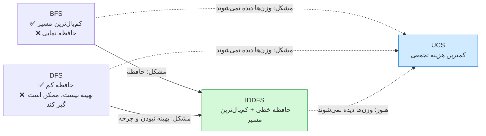
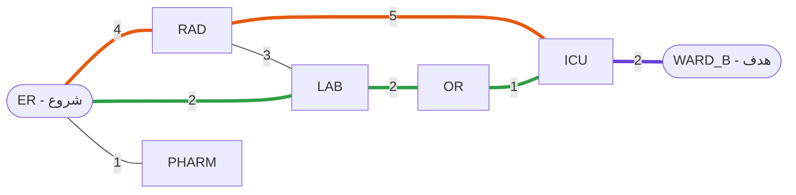
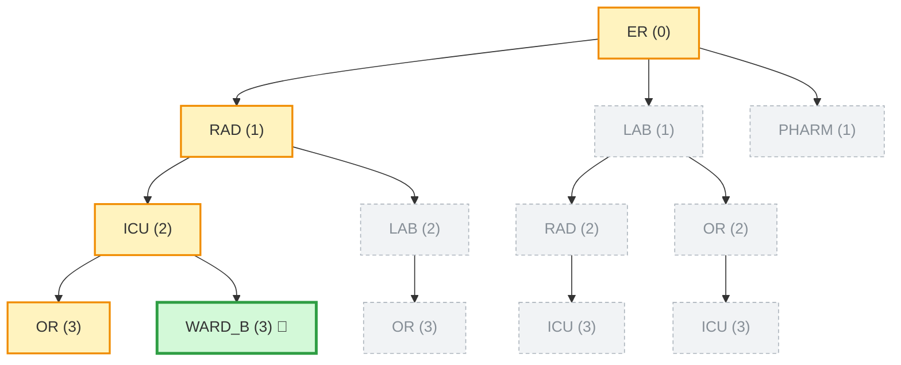
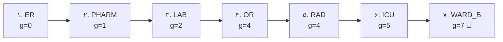
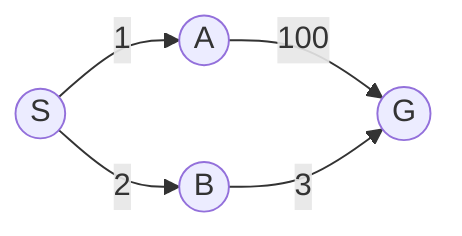
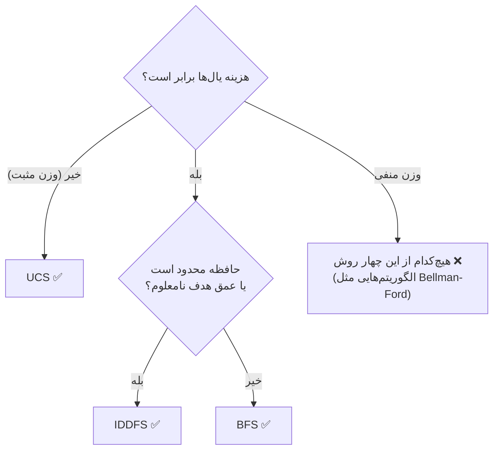
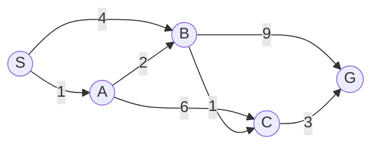

# روش‌های دیگر جست‌وجوی ناآگاهانه؛ IDDFS و UCS

> **مدت پیشنهادی:** ۶۰ تا ۹۰ دقیقه · **سطح:** مقدماتی · **پیش‌نیاز:** جلسه ۵ (BFS و DFS)
> **منابع این جلسه:** منبع ۱ (Russell & Norvig, 2016)، منبع ۱۱ (محتوای مدرس)

---

## اهداف جلسه
در پایان این جلسه دانشجو می‌تواند:
1. محدودیت‌های BFS و DFS را نام ببرد و توضیح دهد چرا روش‌های دیگری لازم‌اند.
2. ایده Iterative Deepening (تکثیر عمق) را شرح دهد، آن را **گام‌به‌گام** روی یک گراف اجرا کند و هزینه تکرار بسط گره‌ها را تحلیل کند.
3. الگوریتم UCS (جست‌وجوی هزینه یکنواخت) را روی گراف وزن‌دار **با جدول صف اولویت** دستی اجرا کند و هزینه نهایی مسیر را گزارش دهد.
4. چهار روش جست‌وجوی ناآگاهانه (BFS، DFS، IDDFS، UCS) را از نظر کامل بودن، بهینه بودن، زمان و حافظه مقایسه کند و برای یک مسئله، روش مناسب را انتخاب کند.

---

## 🗺️ نقشه راه جلسه



این جلسه دو درمان می‌آورد:
- **حافظه‌ی BFS زیاد است و DFS بهینه نیست** ← IDDFS
- **هیچ‌کدام از BFS، DFS و IDDFS وزن یال‌ها را نمی‌بینند** ← UCS

---

## ۱. مرور کوتاه و چرایی دو روش جدید

در جلسه ۵ روی گراف بیمارستان دیدیم: BFS مسیری با هزینه ۱۱ داد و DFS (اتفاقی) مسیری با هزینه ۷. هر روش ضعف اساسی خودش را دارد:

| روش | نقطه قوت | ضعف اصلی |
|---|---|---|
| BFS | کامل و (با یال هم‌هزینه) بهینه | حافظه $O(b^d)$ — سریع منفجر می‌شود |
| DFS | حافظه کم $O(bm)$ | مسیر بهینه نمی‌دهد و به ترتیب همسایه‌ها وابسته است |
| **هر دو** | — | فقط «وجود یال» را می‌بینند و **وزن یال‌ها را نادیده می‌گیرند** |

این جلسه دو اصلاح روی همین خانواده می‌بینیم: **IDDFS** هم مشکل حافظه‌ی BFS را حل می‌کند و هم ضعف‌های DFS (بهینه نبودن، گیر افتادن در شاخه‌ی عمیق) را؛ ولی هنوز به وزن‌ها بی‌توجه است. **UCS** مشکل نادیده گرفتن وزن‌ها را حل می‌کند و کمترین هزینه را تضمین می‌کند.

نمادهای $b$، $d$، $m$ و مفاهیم مرز و بسط دادن همان جلسه ۵ هستند. سه نماد تازه: $g(n)$ هزینه تجمعی از شروع تا گره $n$، $C^*$ هزینه مسیر بهینه و $\epsilon$ کوچک‌ترین هزینه یال.

### ۱-۱. چرا حافظه مسئله است؟ یک حساب سرانگشتی

فرض کنید $b=10$ و $d=10$ و هر گره حدود ۱۰۰ بایت جا بگیرد:

| روش | تعداد گره‌های نگهداری‌شده | حافظه تقریبی |
|---|---|---|
| BFS | حدود $10^{10}$ | حدود **۱ ترابایت** |
| IDDFS | حدود $b \cdot d = 100$ | حدود **۱۰ کیلوبایت** |

با سرعت یک میلیون گره در ثانیه، بررسی $10^{10}$ گره حدود سه ساعت طول می‌کشد؛ یعنی **زمان قابل تحمل است ولی حافظه نه**.

### ۱-۲. «ناآگاهانه» یعنی چه؟

جست‌وجوی ناآگاهانه (Uninformed Search) یعنی الگوریتم جز ساختار گراف (گره‌ها و هزینه‌ها) هیچ چیز درباره‌ی «**فاصله تا هدف**» نمی‌داند؛ مثل جست‌وجوی چشم‌بسته.

> [!NOTE]
> UCS وزن یال‌ها را می‌بیند، ولی هنوز ناآگاهانه است؛ چون $g(n)$ فقط «هزینه‌ی راه رفته تا اینجا» را می‌سنجد و درباره‌ی «هزینه‌ی باقی‌مانده تا هدف» حدسی ندارد. حدس زدن فاصله تا هدف کار روش‌های **آگاهانه** (مثل *A) است.

---

## ۲. گراف مثال (همان گراف جلسه ۵)

همان شبکه‌ی انتقال بیمار (بی‌جهت؛ هدف `ER → WARD_B`). برای اجرای دقیق گام‌به‌گام، دو قرارداد می‌گذاریم:
1. ترتیب همسایه‌ها هنگام بسط طبق جدول زیر است.
2. در UCS اگر دو گره هزینه‌ی تجمعی برابر داشتند، ترتیب الفبایی انگلیسی تعیین‌کننده است.

| گره | همسایه‌ها (به ترتیب) و هزینه یال |
|---|---|
| ER | RAD(4)، LAB(2)، PHARM(1) |
| RAD | ER(4)، ICU(5)، LAB(3) |
| LAB | ER(2)، RAD(3)، OR(2) |
| PHARM | ER(1) |
| OR | LAB(2)، ICU(1) |
| ICU | RAD(5)، OR(1)، WARD_B(2) |
| WARD_B | ICU(2) |

`PHARM` بن‌بست است، پس فقط چهار مسیر ساده (بدون تکرار گره) از ER تا WARD_B داریم:

| مسیر | تعداد یال | هزینه (دقیقه) |
|---|---|---|
| ER → RAD → ICU → WARD_B | **۳ (کمترین)** | 4+5+2 = **11** |
| ER → LAB → OR → ICU → WARD_B | ۴ | 2+2+1+2 = **7 (کمترین)** |
| ER → LAB → RAD → ICU → WARD_B | ۴ | 2+3+5+2 = 12 |
| ER → RAD → LAB → OR → ICU → WARD_B | ۵ | 4+3+2+1+2 = 12 |

مسیر **سبز** فقط در UCS، مسیر **نارنجی** فقط در BFS و IDDFS، و یال **بنفش** (ICU–WARD_B) در هر دو مشترک است:



> [!IMPORTANT]
> **کم‌گام‌ترین مسیر با ارزان‌ترین مسیر یکی نیست.** کل این جلسه حول همین تفاوت می‌چرخد.

---

## ۳. Iterative Deepening (تکثیر عمق)

### ۳-۱. اول: جست‌وجوی محدود به عمق (DLS)

**Depth-Limited Search** یعنی DFS معمولی که یک «خط‌کش» دارد: اگر عمق گره به حد $L$ رسید، دیگر پایین‌تر نمی‌رود (به آن **cutoff** می‌گوییم).

مشکل DLS انتخاب $L$ است:
- $L$ خیلی کوچک ← به هدف نمی‌رسیم.
- $L$ خیلی بزرگ ← وقت و کار بیهوده (و احتمال گیر افتادن در شاخه‌های عمیق).

### ۳-۲. ایده‌ی IDDFS: خودِ $L$ را هم جست‌وجو کن!

**جست‌وجوی عمق‌محور با حد عمق** را چند بار اجرا کن: بار اول با حد ۰، بار دوم با حد ۱ و همین‌طور تا رسیدن به هدف. هر بار از ریشه از نو شروع می‌کنیم و گره‌های سطح‌های بالا دوباره بسط داده می‌شوند.

> **تشبیه:** دنبال یک کلید گم‌شده می‌گردید. اول فقط دور و بر خودتان را (شعاع ۱ متر) کامل می‌گردید؛ نبود، شعاع ۲ متر؛ نبود، شعاع ۳ متر... اولین باری که کلید پیدا شد، می‌دانید نزدیک‌ترین جای ممکن بوده، چون دایره‌های کوچک‌تر را قبلاً کامل گشته‌اید.

همین استدلال ثابت می‌کند **اولین $L$ موفق = عمق کم‌عمق‌ترین هدف ($d$)**؛ پس IDDFS مثل BFS کم‌یال‌ترین مسیر را می‌یابد.

مرز جست‌وجو در هر تکرار IDDFS همان **پشته‌ی LIFO** در DFS است (در کد، پشته‌ی فراخوانی‌های بازگشتی). پس در هر لحظه فقط مسیر فعلی و همسایه‌های هنوز دیده‌نشده‌ی گره‌های روی آن در حافظه‌اند، و دلیل حافظه‌ی $O(bd)$ همین است.

```text
function IDDFS(start, goal):
    for limit = 0, 1, 2, 3, ...:
        result ← DLS(start, goal, limit)
        if result ≠ cutoff:         # یا هدف پیدا شد، یا کل درخت گشته شد و هدفی نیست
            return result

function DLS(node, goal, limit):
    if node == goal:  return path
    if limit == 0:    return cutoff           # خط‌کش تمام شد
    cutoff_occurred ← false
    for each neighbor m of node:
        result ← DLS(m, goal, limit - 1)
        if result == cutoff:        cutoff_occurred ← true
        else if result ≠ failure:   return result      # مسیر پیدا شد
    return cutoff if cutoff_occurred else failure
```

### ۳-۳. اجرای گام‌به‌گام روی گراف مثال (هدف `WARD_B` از `ER`)

**قواعد شمارش (همان قواعد کد درس):**

1. همسایه‌ها به ترتیب جدول بخش ۲ دیده می‌شوند.
2. به گره‌ای که همین حالا روی مسیر فعلی است برنمی‌گردیم (جلوگیری از چرخه).
3. هر بار که یک گره «دیده می‌شود» (یک فراخوانی DLS)، یک واحد به شمارنده اضافه می‌شود؛ حتی اگر در حد عمق متوقف شود.
4. نماد ⛔ یعنی «به حد عمق رسید و بسط داده نشد»، نماد 🎯 یعنی هدف.

| تکرار (حد $L$) | ترتیب دیده شدن گره‌ها (عمق) | نتیجه | تعداد دیده‌شدن‌ها |
|---|---|---|---|
| L=0 | ER(0)⛔ | هدف نیست | ۱ |
| L=1 | ER(0)، RAD(1)⛔، LAB(1)⛔، PHARM(1)⛔ | هدف نیست | ۴ |
| L=2 | ER(0)، RAD(1)، ICU(2)⛔، LAB(2)⛔، LAB(1)، RAD(2)⛔، OR(2)⛔، PHARM(1) | هدف نیست | ۸ |
| L=3 | ER(0)، RAD(1)، ICU(2)، OR(3)⛔، WARD_B(3)🎯 | **هدف پیدا شد** | ۵ |
| **جمع** | | | **۱۸** |

**توضیح هر تکرار:**
- **L=0:** فقط ریشه را می‌بینیم؛ ER هدف نیست و اجازه‌ی پایین رفتن نداریم.
- **L=1:** ریشه و سه فرزندش (RAD، LAB، PHARM). هیچ‌کدام هدف نیست.
- **L=2:** از RAD به ICU و LAB می‌رویم؛ از LAB به RAD و OR؛ از PHARM جایی نمی‌شود رفت (ER روی مسیر است). باز هم هدف نیست؛ چون WARD_B در عمق ۳ است.
- **L=3:** ER ← RAD ← ICU. در ICU دو همسایه‌ی مجاز داریم (RAD روی مسیر است): اول OR (عمق ۳، هدف نیست، ⛔) و بعد WARD_B (عمق ۳، **هدف!**). مسیر: `ER → RAD → ICU → WARD_B` با ۳ گام و هزینه ۱۱ دقیقه.

**درخت جست‌وجوی کامل تا عمق ۳ و آنچه در تکرار آخر دیده شد:**



زردها در تکرار L=3 دیده شدند، سبز هدف است و خاکستری‌ها اصلاً دیده نشدند (چون هدف زودتر پیدا شد). اگر هدف پیدا نمی‌شد، تکرار L=3 جمعاً ۱۳ گره را می‌دید.

**هر گره در کل اجرا چند بار دیده شد؟**

| گره | ER | RAD | LAB | PHARM | ICU | OR | WARD_B | جمع |
|---|---|---|---|---|---|---|---|---|
| تعداد دیده‌شدن | 4 | 4 | 3 | 2 | 2 | 2 | 1 | **18** |

گره‌های نزدیک ریشه بارها تکرار شده‌اند و گره‌های عمیق کمتر. این همان «سربار تکرار» است.

### ۳-۴. آیا این تکرار هدر دادن کار نیست؟

به نظر می‌رسد هست، اما سربار کم است. دلیل: **تعداد گره‌های هر سطح با ضریب $b$ بزرگ می‌شود، پس بیشترین گره‌ها در آخرین سطح‌اند** و گره‌های تکراری سطح‌های بالا سهم کوچکی از کل‌اند. سطح $k$ ام درخت، $(d-k+1)$ بار ساخته می‌شود:

$$
N_{\text{IDDFS}} = (d+1) + b \cdot d + b^2 (d-1) + \dots + b^d
$$

**مثال عددی** ($b=10$ و $d=5$):

| سطح | تعداد گره‌های سطح | چند بار ساخته می‌شود | سهم در IDDFS |
|---|---|---|---|
| 0 | 1 | 6 | 6 |
| 1 | 10 | 5 | 50 |
| 2 | 100 | 4 | 400 |
| 3 | 1,000 | 3 | 3,000 |
| 4 | 10,000 | 2 | 20,000 |
| 5 | 100,000 | 1 | 100,000 |
| **جمع** | | | **123,456** |

BFS همین درخت را با $1+10+100+1000+10000+100000 = 111{,}111$ گره می‌ساخت؛ یعنی IDDFS فقط **حدود ۱۱٪ کار اضافه** دارد، ولی به‌جای نگه‌داشتن ۱۰۰ هزار گره، فقط یک مسیر را نگه می‌دارد.

> [!NOTE]
> سربار با کوچک شدن $b$ بیشتر می‌شود: برای $b=2$ و $d=5$ مقدار $N_{\text{IDDFS}}=120$ و BFS برابر ۶۳ است (تقریباً دو برابر).  هرچه درخت پرشاخه‌تر باشد، IDDFS ارزان‌تر تمام می‌شود.

در نتیجه زمان همچنان $O(b^d)$ است، ولی حافظه فقط $O(bd)$ است (تنها مسیر فعلی و همسایه‌های آن) — برنده‌ی اصلی IDDFS همین حافظه‌ی خطی است.

### ۳-۵. IDDFS در یک نگاه

| ویژگی | وضعیت | توضیح |
|---|---|---|
| کامل بودن | ✅ بله (ضریب انشعاب متناهی) | کم‌عمق‌ترین هدف را حتماً می‌یابد |
| بهینه بودن | ✅ فقط اگر هزینه‌ی یال‌ها برابر باشد | کم‌یال‌ترین مسیر را می‌دهد، نه ارزان‌ترین |
| زمان | $O(b^d)$ | |
| حافظه | $O(bd)$ | مزیت اصلی |

> [!WARNING]
> در گراف ما IDDFS مسیر با هزینه‌ی **۱۱** را داد در حالی که مسیر **۷** وجود دارد. IDDFS اصلاً وزن‌ها را نمی‌بیند. برای مسئله‌ی وزن‌دار باید سراغ UCS رفت.

> [!TIP]
> IDDFS ترکیب بهترینِ دو دنیاست: کامل بودن و (با هزینه‌ی برابر) بهینگی BFS با حافظه‌ی DFS. در درخت‌های بزرگ (مثل بازی‌ها) این روش استاندارد است.

---

## ۴. جست‌وجوی هزینه یکنواخت (UCS)

### ۴-۱. ایده

جست‌وجوی هزینه یکنواخت (Uniform-Cost Search) به‌جای تعداد گام‌ها، **هزینه تجمعی از شروع** را کمینه می‌کند. برای هر گره، $g(n)$ جمع هزینه‌ی یال‌ها از گره شروع تا $n$ (در بهترین مسیری که تا الان شناخته‌ایم) است:

$$g(n) = \sum_{i} c(a_i)$$

> **تشبیه:** یک قطره جوهر روی کاغذ را تصور کنید که با سرعت یکسان پخش می‌شود. گره‌هایی که «نزدیک‌تر (ارزان‌تر)» هستند زودتر رنگی می‌شوند، نه الزاماً آن‌هایی که تعداد یال کمتری دارند. UCS دقیقاً به همین ترتیب (به ترتیب $g$ صعودی) گره‌ها را بسط می‌دهد. اگر الگوریتم دایکسترا (Dijkstra) را در درس ساختمان داده یا گراف دیده‌اید، UCS همان است با این تفاوت که به محض رسیدن به هدف متوقف می‌شود.

تا اینجا هیچ‌کدام از BFS، DFS و IDDFS وزن یال‌ها را نمی‌دیدند؛ UCS اولین روشی است که هزینه را در تصمیم دخالت می‌دهد. مرز جست‌وجو این بار **صف اولویت (Priority Queue)** است: همیشه گره‌ای با کمترین $g(n)$ بسط داده می‌شود.

### ۴-۲. اجزای الگوریتم

| جزء | نقش |
|---|---|
| صف اولویت | جای صف FIFO (BFS) و پشته (DFS)؛ مرز جست‌وجو را بر اساس $g$ مرتب نگه می‌دارد |
| مجموعه‌ی بسط‌یافته‌ها (Explored) | گره‌هایی که از صف خارج و بسط داده شده‌اند؛ دیگر به آن‌ها برنمی‌گردیم |
| $g(n)$ | بهترین هزینه‌ای که تا اینجا برای رسیدن به $n$ می‌شناسیم |
| والد (Parent) | گره قبلی روی بهترین مسیر؛ برای ساختن مسیر نهایی از هدف به عقب |

```text
function UCS(start, goal):
    frontier ← priority queue ordered by g;  insert (start, g = 0)
    explored ← { }
    loop:
        if frontier is empty: return failure
        n ← frontier.pop_min()                 # ارزان‌ترین گره مرز
        if n == goal: return path(n), g(n)     # ⚠️ آزمون هدف: هنگام «خروج» از صف
        explored.add(n)
        for each neighbor m of n with edge cost c:
            g_new ← g(n) + c
            if m not in explored and m not in frontier:
                frontier.insert(m, g_new)      # گره‌ی جدید
            else if m in frontier and g_new < g(m):
                frontier.update(m, g_new)      # مسیر ارزان‌تر پیدا شد؛ به‌روزرسانی
```

> در پایتون صف اولویت را با `heapq` می‌سازیم: هر عنصر یک تاپل `(g, گره)` است و `heappop` همیشه کمترین $g$ را برمی‌دارد. صف FIFO قدیمی‌ترین گره و پشته‌ی LIFO تازه‌ترین گره را برمی‌دارد، ولی ترتیب خروج در UCS فقط به **هزینه‌ی تجمعی** بستگی دارد.

### ۴-۳. اجرای گام‌به‌گام روی گراف مثال (هدف `WARD_B`)

**نمادها:** ✅ گره‌ی جدید وارد صف شد · 🔄 مسیر ارزان‌تر پیدا شد و هزینه به‌روز شد · ❌ مسیر پیدا‌شده بدتر است و نادیده گرفته می‌شود · ⛔ قبلاً بسط یافته است.

**وضعیت اولیه:** صف = `ER:0`، بسط‌یافته‌ها = { }

| گام | خروج از صف (g) | بررسی همسایه‌ها | صف اولویت پس از گام (گره:هزینه) |
|---|---|---|---|
| ۱ | **ER (0)** | RAD: 0+4=4 ✅ · LAB: 0+2=2 ✅ · PHARM: 0+1=1 ✅ | PHARM:1، LAB:2، RAD:4 |
| ۲ | **PHARM (1)** | ER ⛔ (بن‌بست) | LAB:2، RAD:4 |
| ۳ | **LAB (2)** | ER ⛔ · RAD: 2+3=5 ❌ (بدتر از 4) · OR: 2+2=4 ✅ | OR:4، RAD:4 |
| ۴ | **OR (4)** | LAB ⛔ · ICU: 4+1=5 ✅ | RAD:4، ICU:5 |
| ۵ | **RAD (4)** | ER ⛔ · ICU: 4+5=9 ❌ (بدتر از 5) · LAB ⛔ | ICU:5 |
| ۶ | **ICU (5)** | RAD ⛔ · OR ⛔ · WARD_B: 5+2=7 ✅ | WARD_B:7 |
| ۷ | **WARD_B (7)** | 🎯 هدف! آزمون هدف هنگام خروج از صف برقرار شد | — |

**نکته‌های کلیدی هر گام:**
- **گام ۳:** در صف دو گره با هزینه ۴ داریم (OR و RAD). طبق قرارداد، ترتیب الفبایی: `OR` پیش از `RAD` خارج می‌شود (O قبل از R).
- **گام ۳:** RAD از راه LAB هزینه‌ی ۵ می‌گرفت که بدتر از ۴ (از راه ER) است؛ پس تغییری نمی‌کند.
- **گام ۴:** ICU اولین بار با هزینه ۵ (از راه OR) وارد صف شد.
- **گام ۵:** مسیر RAD→ICU هزینه‌ی ۹ دارد و بدتر از ۵ است؛ پس به‌روزرسانی نمی‌شود.

**ترتیب خروج گره‌ها از صف** (توجه کنید $g$ هیچ‌وقت کم نمی‌شود: 0، 1، 2، 4، 4، 5، 7):



**ساختن مسیر نهایی:** هر گره والد خود را نگه می‌دارد؛ از هدف به عقب می‌رویم: `WARD_B ← ICU ← OR ← LAB ← ER` پس مسیر نهایی: `ER → LAB → OR → ICU → WARD_B` با هزینه ۲+۲+۱+۲ = **۷ دقیقه**. دقت کنید BFS در جلسه ۵ برای همین مسئله هزینه ۱۱ داده بود.

> [!NOTE]
> UCS گره `PHARM` را هم بسط داد، با وجود اینکه بن‌بست است و به هدف ربطی ندارد. UCS «هدف را نمی‌بیند» و مثل موجی به همه‌ی جهت‌ها پخش می‌شود. همین ضعف، انگیزه‌ی روش‌های آگاهانه (A*) است.

### ۴-۴. چرا آزمون هدف هنگام «خروج» از صف انجام می‌شود؟

وقتی یک گره فقط **وارد** صف شده، ممکن است هنوز مسیر ارزان‌تری به آن پیدا شود. فقط وقتی **خارج** می‌شود، مطمئنیم ارزان‌ترین مسیر ممکن را دارد.

**مثال کوچک** (یال‌های جهت‌دار؛ هدف G):



| گام | خروج از صف | بررسی همسایه‌ها | صف پس از گام |
|---|---|---|---|
| ۱ | S (0) | A: 1 ✅ · B: 2 ✅ | A:1، B:2 |
| ۲ | A (1) | G: 1+100 = 101 ✅ | B:2، G:101 |
| ۳ | B (2) | G: 2+3 = **5** 🔄 (بهتر از 101) | G:5 |
| ۴ | G (5) | 🎯 هدف | — |

اگر آزمون هدف را **هنگام ورود** انجام می‌دادیم، در گام ۲ با دیدن G آن را با هزینه‌ی **۱۰۱** می‌پذیرفتیم و الگوریتم تمام می‌شد؛ در حالی که پاسخ بهینه **۵** است (از راه B). این رایج‌ترین اشتباه در پیاده‌سازی UCS است.

> [!IMPORTANT]
> دو شرط برای درستی UCS: همه‌ی وزن یال‌ها باید **مثبت** باشند، و آزمون هدف باید **هنگام خروج از صف** انجام شود نه هنگام ورود. UCS همچنین باید بتواند هزینه‌ی یک گره را در صف به‌روزرسانی کند (مثل 🔄 در جدول بالا).

### ۴-۵. چرا UCS بهینه است؟ (شهود)

لحظه‌ای که گره $n$ از صف خارج می‌شود، ارزان‌ترین گره‌ی مرز است. هر مسیر دیگری به $n$ باید از یکی از گره‌های مرز بگذرد که هزینه‌اش دست‌کم برابر $g(n)$ است؛ و چون همه‌ی یال‌ها هزینه‌ی **مثبت** دارند، ادامه‌ی آن مسیر فقط چیزی به هزینه اضافه می‌کند. پس مسیر ارزان‌تری به $n$ وجود ندارد.

اگر یالی منفی داشته باشیم، همین استدلال فرو می‌ریزد: ممکن است یک مسیر «گران» در ادامه با یک یال منفی ارزان شود و UCS آن را هرگز نبیند.

### ۴-۶. UCS در یک نگاه

| ویژگی | وضعیت | توضیح |
|---|---|---|
| کامل بودن | ✅ بله (وزن مثبت) | |
| بهینه بودن | ✅ بله (وزن مثبت) | کمترین **هزینه** را می‌دهد |
| زمان و حافظه | $O(b^{1+\lfloor C^*/\epsilon \rfloor})$ | کران بدبینانه |

در فرمول بالا $C^*$ هزینه بهینه و $\epsilon$ کمترین وزن یال است؛ مثلاً با $C^*=7$ و $\epsilon=1$ توان برابر ۸ می‌شود. یعنی UCS وقتی گران است که هزینه‌ها ریز و کوچک باشند. حالت حدی: اگر همه‌ی یال‌ها هزینه‌ی برابر داشته باشند، UCS شبیه BFS رفتار می‌کند (با اندکی کار بیشتر، چون آزمون هدف را دیرتر انجام می‌دهد).

---

## ۵. مقایسه کامل روش‌های ناآگاهانه

| ویژگی | BFS | DFS | IDDFS | UCS |
|---|---|---|---|---|
| کامل بودن | بله | بله (بدون چرخه) | بله | بله (وزن مثبت) |
| بهینه بودن | یال هم‌هزینه | خیر | یال هم‌هزینه | بله (وزن مثبت) |
| زمان | $O(b^d)$ | $O(b^m)$ | $O(b^d)$ | وابسته به هزینه بهینه |
| حافظه | $O(b^d)$ | $O(bm)$ | $O(bd)$ | $O(b^{1+\lfloor C^*/\epsilon \rfloor})$ |
| به وزن یال‌ها نیاز دارد؟ | خیر | خیر | خیر | بله |
| ساختار مرز | صف (FIFO) | پشته (LIFO) | پشته (LIFO) | صف اولویت |

**کدام روش را انتخاب کنم؟**



(اگر فقط «یک جواب» کافی است و بهینگی مهم نیست و حافظه خیلی کم است، DFS هم گزینه است.)

**نتیجه روی گراف مثال:**

| نتیجه روی گراف مثال | BFS | DFS | IDDFS | UCS |
|---|---|---|---|---|
| مسیر | ER→RAD→ICU→WARD_B | ER→LAB→OR→ICU→WARD_B | ER→RAD→ICU→WARD_B | ER→LAB→OR→ICU→WARD_B |
| هزینه (دقیقه) | ۱۱ | ۷ | ۱۱ | ۷ |
| تعداد گره‌های بسط‌داده‌شده | ۷ | ۶ | ۱۸ | ۷ |

عدد ۱۸ در IDDFS اثر تکرار بسط سطح‌های بالا در هر تکرار است؛ همان‌طور که در جدول بخش ۳-۳ دیدیم (۱+۴+۸+۵).

> [!WARNING]
> شمارنده IDDFS در کد، همه‌ی فراخوانی‌های بازگشتی (شامل گره‌های مرزِ حد عمق) را می‌شمارد، در حالی که در BFS و DFS فقط گره‌های خارج‌شده از مرز شمرده می‌شوند؛ پس ۱۸ و ۷ را نباید دقیق‌به‌دقیق مقایسه کرد و فقط «مرتبه بزرگی» کار را نشان می‌دهند.

---

## ⚠️ اشتباهات رایج

| اشتباه | واقعیت |
|---|---|
| «IDDFS هدر دادن کار است» | سربار تکرار معمولاً کم است (مثلاً حدود ۱۱٪ برای $b=10$ و $d=5$)؛ در عوض حافظه از نمایی به خطی می‌رسد |
| «IDDFS همیشه بهینه است» | فقط در **تعداد یال**؛ برای هزینه‌های نابرابر مسیر ۱۱ را داد، نه ۷ |
| «در UCS هدف را هنگام ورود به صف بررسی کنم» | باید هنگام **خروج** از صف بررسی شود (مثال S، A، B، G) |
| «UCS با وزن صفر یا منفی هم کار می‌کند» | وزن باید مثبت باشد؛ وگرنه بهینگی (و حتی توقف) تضمین نمی‌شود |
| «UCS هدف را می‌بیند و مستقیم به آن می‌رود» | UCS ناآگاه است و در همه‌ی جهت‌ها (حتی بن‌بست PHARM) پخش می‌شود |

---

## 🔬 پیوند با مهندسی پزشکی

سناریوی انتقال بیمار بین بیمارستان‌های یک شبکه (مثلاً ارجاع از بیمارستان شهرستان به مرکز تروما): هر یال یک جاده است و وزن آن زمان انتقال با احتساب ترافیک.

اگر آمبولانس باید سریع‌ترین مسیر را بر اساس زمان برود، UCS صورت‌بندی درستی است؛ اگر معیار، کمترین تعداد مراکز واسطه باشد (مثلاً به دلایل هماهنگی پذیرش)، BFS پاسخ می‌دهد و UCS مسیر دیگری پیشنهاد می‌کند. در شبکه‌های بزرگ با حافظه‌ی محدود و معیار «تعداد مراکز»، IDDFS جای BFS می‌نشیند.

همین تفاوت نشان می‌دهد «بهینه» بدون تعریف دقیق هزینه بی‌معنی است. زمان‌های انتقال همواره مثبت‌اند، پس شرط UCS برقرار است.

> [!CAUTION]
> این مثال آموزشی و غیرتشخیصی است و برای تصمیم بالینی واقعی استفاده نمی‌شود. در واقعیت زمان انتقال با ترافیک و ساعت روز تغییر می‌کند، در حالی که اینجا وزن‌ها ثابت فرض شده‌اند.

---

## ✍️ فعالیت کلاسی

### فعالیت ۱: اجرای دستی UCS روی یک گراف جدید
در این گراف جهت‌دار، UCS را از `S` تا `G` اجرا کنید. بعد از هر بسط، محتوای صف اولویت را بنویسید و مشخص کنید کجا 🔄 (به‌روزرسانی) رخ می‌دهد. سپس بگویید BFS چه مسیری با چه هزینه‌ای می‌داد.



<details>
<summary>کلید پاسخ فعالیت ۱</summary>

| گام | خروج از صف (g) | بررسی همسایه‌ها | صف پس از گام |
|---|---|---|---|
| ۱ | S (0) | A: 1 ✅ · B: 4 ✅ | A:1، B:4 |
| ۲ | A (1) | B: 1+2=3 🔄 (بهتر از 4) · C: 1+6=7 ✅ | B:3، C:7 |
| ۳ | B (3) | C: 3+1=4 🔄 (بهتر از 7) · G: 3+9=12 ✅ | C:4، G:12 |
| ۴ | C (4) | G: 4+3=7 🔄 (بهتر از 12) | G:7 |
| ۵ | G (7) | 🎯 هدف | — |

مسیر UCS: `S → A → B → C → G` با هزینه ۱+۲+۱+۳ = **۷**، با ۵ بسط. سه بار به‌روزرسانی (🔄) رخ داد.

BFS کم‌یال‌ترین مسیر را می‌دهد: `S → B → G` (۲ یال) با هزینه ۴+۹ = **۱۳**، یعنی تقریباً دو برابر مسیر بهینه.

</details>

### فعالیت ۲: اجرای دستی IDDFS روی همان گراف
روی گراف فعالیت ۱ (هزینه‌ها را نادیده بگیرید)، IDDFS را از `S` تا `G` اجرا کنید. همسایه‌ها را به ترتیب `A` سپس `B` برای S، `B` سپس `C` برای A، `C` سپس `G` برای B و `G` برای C در نظر بگیرید. در هر تکرار ترتیب دیده شدن گره‌ها را بنویسید، مجموع دیده‌شدن‌ها را بشمارید و هزینه‌ی مسیر نهایی را حساب کنید. آیا این مسیر بهینه‌ی هزینه است؟

<details>
<summary>کلید پاسخ فعالیت ۲</summary>

| تکرار | ترتیب دیده شدن گره‌ها | نتیجه | تعداد |
|---|---|---|---|
| $L=0$ | S(0) | — | ۱ |
| $L=1$ | S(0)، A(1)، B(1) | — | ۳ |
| $L=2$ | S(0)، A(1)، B(2)، C(2)، B(1)، C(2)، G(2) 🎯 | هدف | ۷ |

جمع: ۱+۳+۷ = **۱۱** دیده‌شدن. مسیر: `S → B → G` (عمق ۲) با هزینه ۴+۹ = **۱۳**؛ این مسیر کم‌یال‌ترین است ولی **بهینه‌ی هزینه نیست** (UCS مسیر ۷ را می‌یابد).

</details>

### فعالیت ۳: پر کردن جدول مقایسه با کد
کد `code/session_06_uninformed_search_ucs_ids.py` را اجرا کنید و خروجی UCS، IDDFS و BFS را در جدول مقایسه بخش ۵ پر کنید. سپس پاسخ دهید: چرا تعداد بسط‌های IDDFS تقریباً سه برابر BFS است ولی هنوز از BFS «بهتر» گفته می‌شود؟

<details>
<summary>کلید پاسخ فعالیت ۳</summary>

تعداد بسط‌های IDDFS روی گراف مثال ۱۸ و BFS برابر ۷ است. با این حال IDDFS مزیت اصلی‌اش حافظه است: حافظه $O(bd)$ در برابر $O(b^d)$ برای BFS. در درخت‌های واقعی که $b$ و $d$ بزرگ‌اند، BFS به‌دلیل حافظه اصلاً اجرا نمی‌شود و IDDFS تنها گزینه‌ی کامل و بهینه (در تعداد یال) با حافظه خطی است. سربار تکرار با رشد $b$ نسبتاً کمتر می‌شود چون گره‌های سطح‌های بالا در کل نقش کوچکی دارند (مثال بخش ۳-۴: فقط ۱۱٪ سربار).

</details>

---

## 💻 کد آموزشی

فایل `code/session_06_uninformed_search_ucs_ids.py` (فقط کتابخانه استاندارد پایتون، با `heapq`):
- تابع `ucs(graph, start, goal)`: صف اولویت، به‌روزرسانی هزینه، بازگشت مسیر و هزینه نهایی و شمارش بسط‌ها.
- تابع `iddfs(graph, start, goal)`: حلقه روی حد عمق با تابع بازگشتی `dls` (جست‌وجوی محدود به عمق).
- تابع `bfs(graph, start, goal)` برای مقایسه مستقیم هزینه و بسط‌ها روی همان گراف.
- گراف `GRAPH` همان شبکه انتقال بیمار جلسه ۵ است تا نتایج دو جلسه قابل مقایسه باشند.

اجرای برنامه:

برای ردگیری گام‌به‌گام: ` trace--` و برای مثال‌های تکمیلی: `demo--` را با یک فاصله به انتهای دستور اضافه کنید

```python
python code/session_06_uninformed_search_ucs_ids.py
```

> [!TIP]
> ببینید که `UCS` با `heapq` تساوی هزینه را خودکار به‌صورت الفبایی حل می‌کند (چون تاپل `(g, گره)` مقایسه می‌شود)، و `iddfs` دقیقاً همان جدول ۱+۴+۸+۵ = ۱۸ را می‌شمارد.
>
>  iddfs با گزینه‌ی `trace--` همان جدول ۱+۴+۸+۵ = ۱۸ را چاپ می‌کند.

---

## 🧾 خلاصه یک‌صفحه‌ای

| | IDDFS | UCS |
|---|---|---|
| **یک جمله** | DFS با حد عمق ۰، ۱، ۲، ... | همیشه ارزان‌ترین گره‌ی مرز را بسط بده |
| **مرز** | پشته (مسیر فعلی) | صف اولویت (بر اساس $g$) |
| **چه چیزی را کمینه می‌کند؟** | تعداد یال | جمع هزینه یال‌ها |
| **آزمون هدف** | هنگام دیدن گره | **هنگام خروج از صف** |
| **شرط درستی** | $b$ متناهی | وزن‌ها **مثبت** |
| **نقطه قوت** | حافظه $O(bd)$ | بهینگی در هزینه |
| **نقطه ضعف** | تکرار بسط (سربار کم)، بی‌توجه به وزن‌ها | ناآگاه از فاصله تا هدف؛ حافظه زیاد |
| **نتیجه روی گراف مثال** | ۳ گام، هزینه ۱۱، ۱۸ دیده‌شدن | ۴ گام، هزینه ۷، ۷ بسط |

فرمول‌های مهم:

$$N_{\text{IDDFS}} = (d+1) + b \cdot d + b^2 (d-1) + \dots + b^d \qquad g(n)=\sum c(a_i)$$

---

## 📘 واژه‌نامه

| واژه | معنی |
|---|---|
| Uninformed Search | جست‌وجوی ناآگاهانه |
| Depth-Limited Search (DLS) | جست‌وجوی محدود به عمق |
| Cutoff | قطع به‌دلیل رسیدن به حد عمق |
| Iterative Deepening (IDDFS) | تکثیر عمق |
| Uniform-Cost Search (UCS) | جست‌وجوی هزینه یکنواخت |
| Priority Queue | صف اولویت |
| Explored Set | مجموعه گره‌های بسط‌یافته |
| g(n) | هزینه تجمعی از شروع تا گره n |

---

## ❓ پرسش‌های خودآزمون
1. چرا در UCS آزمون هدف هنگام خروج از صف انجام می‌شود، نه هنگام ورود؟ با یک مثال توضیح دهید.
2. سربار تکرار بسط در IDDFS را توضیح دهید؛ چرا با وجود تکرار، زمان کل همچنان $O(b^d)$ است؟
3. روی گراف مثال، BFS مسیر هزینه ۱۱ را داد و UCS مسیر هزینه ۷ را. کدام «بهینه» است؟ چرا هر دو می‌توانند درست باشند؟
4. کدام روش (یا روش‌ها) برای گرافی با وزن‌های منفی مناسب است؟ چرا؟
5. با $b=4$ و $d=3$ تعداد گره‌های تولیدشده توسط IDDFS و BFS را حساب کنید و نسبت آن‌ها را بگویید.
6. اگر همه‌ی یال‌ها هزینه‌ی ۱ داشته باشند، UCS و BFS چه فرقی دارند؟

<details>
<summary>نمایش کلید پاسخ</summary>

1. **آزمون هدف در UCS:** تا وقتی گره‌ای از صف خارج نشده، ممکن است مسیر ارزان‌تری به همان گره پیدا شود و جایگاهش در صف عوض شود. مثال کوچک: `S→A` هزینه ۱، `S→B` هزینه ۲، `A→G` هزینه ۱۰۰ و `B→G` هزینه ۳. اگر هدف را هنگام ورود به صف بپذیریم، G با هزینه ۱۰۱ (از طریق A) پذیرفته می‌شود، در حالی که پاسخ بهینه ۵ است (از طریق B).
2. **سربار IDDFS:** گره‌های سطح‌های بالا در هر تکرار دوباره بسط داده می‌شوند، اما تعدادشان نسبت به سطح آخر کم است؛ جمع بسط‌ها همچنان به $b^d$ غالب می‌شود، پس زمان $O(b^d)$ می‌ماند و حافظه $O(bd)$ است.
3. **کدام بهینه است:** هر دو درست‌اند اما نسبت به تعریف هزینه‌ی متفاوت: BFS نسبت به «تعداد یال» بهینه است و UCS نسبت به «جمع وزن». بدون تعریف صریح هزینه (زمان؟ مسافت؟ تعداد مرکز؟)، «بهینه» بی‌معنی است؛ در انتقال بیمار معمولاً زمان تجمعی معیار است و پس UCS پاسخ مناسب‌تر است.
4. **وزن منفی:** هیچ‌کدام. UCS با وزن منفی تضمین بهینگی و حتی توقف را از دست می‌دهد (چرخه‌های کاهش‌هزینه). صفر هم مشکل‌ساز است؛ شرط UCS وزن‌های مثبت است.
5. **محاسبه:** $N_{\text{IDDFS}} = 4 + 3\cdot4 + 2\cdot16 + 1\cdot64 = 4+12+32+64 = 112$. برای BFS: $1+4+16+64 = 85$. نسبت ≈ ۱٫۳۲؛ یعنی حدود ۳۲٪ سربار (با $b=10$ فقط ۱۱٪ می‌شد؛ هرچه $b$ بزرگ‌تر، سربار کمتر).
6. **UCS با هزینه برابر:** هر دو کم‌یال‌ترین مسیر را می‌یابند. فرق در این است که UCS آزمون هدف را هنگام خروج از صف انجام می‌دهد و معمولاً یک لایه بیشتر بسط می‌دهد (مرتبه $b^{d+1}$ به‌جای $b^d$)؛ و باید صف اولویت نگه دارد که از صف ساده گران‌تر است.

</details>

---

## 📝 تکلیف
1. UCS را روی گراف جلسه ۵ (گراف بخش ۲ همین جزوه) دستی اجرا کنید (جدول صف اولویت مثل بخش ۴-۳، با ستون «بررسی همسایه‌ها») و با خروجی کد تطبیق دهید.
2. فرض کنید وزن یال `RAD ↔ ICU` از ۵ به ۱ تغییر کند. بدون اجرای کد، پیش‌بینی کنید مسیر و هزینه UCS چه می‌شود (راهنمایی: همه‌ی مسیرها را دوباره حساب کنید و دقت کنید ممکن است تساوی پیش بیاید)، سپس با تغییر یک خط در کد بررسی کنید و نتیجه را گزارش دهید.
3. (امتیازی) با وزن جدید `RAD ↔ ICU = 1`، IDDFS را هم دستی اجرا کنید. آیا مسیر و تعداد دیده‌شدن‌ها نسبت به قبل تغییر می‌کند؟ چرا؟

## 📚 مطالعه پیشنهادی
- Russell & Norvig (۲۰۱۶)، فصل ۳: بخش کامل‌بودن و بهینگی جست‌وجوی ناآگاهانه و مقایسه UCS و IDDFS.
