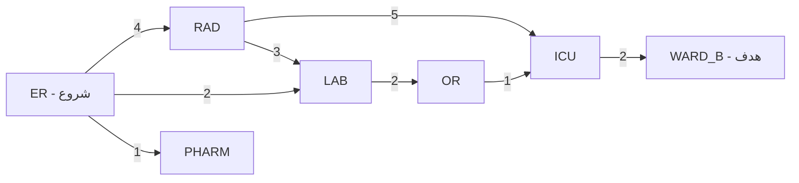

# جلسه ۶: روش‌های دیگر جست‌وجوی ناآگاهانه؛ Iterative Deepening و UCS

> **درس:** مقدمه‌ای بر هوش مصنوعی و کاربرد آن در مهندسی پزشکی
> **مدت پیشنهادی:** ۶۰ تا ۹۰ دقیقه · **سطح:** مقدماتی
> **منابع این جلسه:** منبع ۱ (Russell & Norvig, 2016)، منبع ۱۱ (محتوای مدرس)

---

## اهداف جلسه
در پایان این جلسه دانشجو می‌تواند:
1. محدودیت‌های BFS و DFS را نام ببرد و توضیح دهد چرا روش‌های دیگری لازم‌اند.
2. ایده Iterative Deepening (تکثیر عمق) را شرح دهد و هزینه تکرار بسط گره‌ها را تحلیل کند.
3. الگوریتم UCS (جست‌وجوی هزینه یکنواخت) را روی گراف وزن‌دار دستی اجرا کند و هزینه نهایی مسیر را گزارش دهد.
4. چهار روش جست‌وجوی ناآگاهانه (BFS، DFS، IDDFS، UCS) را از نظر کامل بودن، بهینه بودن، زمان و حافظه مقایسه کند.

---

## ۱. مرور کوتاه و چرایی دو روش جدید

در جلسه ۵ دو الگوریتم پایه را دیدیم. هرکدام یک ضعف اساسی دارد:

| روش | نقطه قوت | ضعف اصلی |
|---|---|---|
| BFS | کامل و (با یال هم‌هزینه) بهینه | حافظه $O(b^d)$ — سریع منفجر می‌شود |
| DFS | حافظه کم $O(bm)$ | مسیر بهینه نمی‌دهد و به ترتیب همسایه‌ها وابسته است |

جست‌وجوی ناآگاهانه (Uninformed Search) یعنی الگوریتم جزء ساختار گراف چیزی درباره «فاصله تا هدف» نمی‌داند. این جلسه دو اصلاح روی همین خانواده می‌بینیم: **IDDFS** مشکل حافظه DFS را می‌گیرد و رفتار بهینه BFS را با حافظه کم می‌سازد؛ **UCS** مشکل نادیده گرفتن وزن‌ها را حل می‌کند و کمترین هزینه را تضمین می‌کند.

## ۲. Iterative Deepening (تکثیر عمق)

ایده: **جست‌وجوی عمق‌محور با حد عمق (Depth-Limited Search)** را چند بار اجرا کن؛ بار اول با حد صفر، بار دوم با حد ۱ و همین‌طور تا رسیدن به هدف. هر بار فقط از ابتدای درخت شروع می‌کنیم و گره‌های سطح‌های قبلی دوباره بسط داده می‌شوند.

**روی گراف مثال (هدف `WARD_B` از `ER`):**
- حد ۰: فقط `ER`؛ هدف نیست.
- حد ۱: `ER` و فرزندانش (`RAD`، `LAB`، `PHARM`)؛ هدف نیست.
- حد ۲: گره‌های سطح دوم (`ICU` و `OR` و تکرارها) هم اضافه می‌شوند، اما `WARD_B` در عمق ۳ است؛ هنوز به هدف نمی‌رسیم.
- حد ۳: در شاخه `RAD` به `ICU` می‌رسیم و از آنجا `WARD_B` — هدف! مسیر: `ER → RAD → ICU → WARD_B` با ۳ گام و هزینه ۱۱ دقیقه.

به نظر می‌رسد تکرار هدر دادن کار است، اما سربار کم است. تعداد گره‌های هر سطح با $b$ رشد می‌کند، پس بیشترین گره‌ها در آخرین (عمیق‌ترین) سطح‌اند و گره‌های تکراریِ سطح‌های بالا تعداد کمی از کل را می‌سازند:

$$N_{\text{IDDFS}} = (d+1) + b \cdot d + b^2 (d-1) + \dots + b^d$$

در نتیجه زمان همچنان $O(b^d)$ است، ولی حافظه فقط $O(bd)$ است — برنده‌ی اصلی IDDFS همین حافظه خطی است.

> [!TIP]
> IDDFS ترکیب بهترینِ دو دنیاست: بهینگی و کامل بودنِ BFS با حافظه‌ی DFS. در درخت‌های بزرگ (مثل بازی‌ها) این روش استاندارد است.

## ۳. جست‌وجوی هزینه یکنواخت (UCS)

جست‌وجوی هزینه یکنواخت (Uniform-Cost Search) به‌جای تعداد گام‌ها، **هزینه تجمعی از شروع** را کمینه می‌کند. برای هر گره، تابع $g(n)$ جمع هزینه یال‌ها از گره شروع تا $n$ است:

$$g(n) = \sum_{i} c(a_i)$$

مرز جست‌وجو این بار **صف اولویت (Priority Queue)** است: همیشه گره‌ای با کمترین $g(n)$ بسط داده می‌شود. وقتی یال‌ها هزینه‌های نابرابر دارند، UCS همان مسیری را می‌دهد که BFS از دست می‌داد.

**اجرای UCS روی گراف مثال (هدف `WARD_B`):** ترتیب خروج گره‌ها از صف اولویت با هزینه تجمعی آن‌ها:

| ترتیب | گره | $g(n)$ |
|---|---|---|
| ۱ | ER | ۰ |
| ۲ | PHARM | ۱ |
| ۳ | LAB | ۲ |
| ۴ | OR | ۴ |
| ۵ | RAD | ۴ |
| ۶ | ICU | ۵ |
| ۷ | WARD_B | ۷ — هدف |

مسیر نهایی: `ER → LAB → OR → ICU → WARD_B` با هزینه ۲+۲+۱+۲ = ۷ دقیقه. دقت کنید BFS در جلسه ۵ برای همین مسئله هزینه ۱۱ داده بود.

> [!IMPORTANT]
> دو شرط برای درستی UCS: همه وزن یال‌ها باید مثبت باشند، و آزمون هدف باید **هنگام خروج از صف** انجام شود نه هنگام ورود؛ چون ممکن است بعداً مسیر ارزان‌تری به همان گره پیدا شود. UCS همچنین باید بتواند هزینه یک گره را در صف به‌روزرسانی کند.

## ۴. مقایسه کامل روش‌های ناآگاهانه

| ویژگی | BFS | DFS | IDDFS | UCS |
|---|---|---|---|---|
| کامل بودن | بله | بله (بدون چرخه) | بله | بله (وزن مثبت) |
| بهینه بودن | یال هم‌هزینه | خیر | یال هم‌هزینه | بله (وزن مثبت) |
| زمان | $O(b^d)$ | $O(b^m)$ | $O(b^d)$ | وابسته به هزینه بهینه |
| حافظه | $O(b^d)$ | $O(bm)$ | $O(bd)$ | $O(b^{1+\lfloor C^*/\epsilon \rfloor})$ |
| به وزن یال‌ها نیاز دارد؟ | خیر | خیر | خیر | بله |

در جدول بالا $C^*$ هزینه بهینه و $\epsilon$ کمترین وزن یال است؛ یعنی UCS وقتی گران است که هزینه‌ها ریز و کوچک باشند (حالت حدی مانند یال‌های هم‌هزینه، UCS را به BFS شبیه می‌کند).

نمای دو مسیر رقیب روی گراف مثال: مسیر کم‌گام (BFS و IDDFS) در برابر مسیر کم‌هزینه (UCS):



مسیر کم‌گام (`ER → RAD → ICU → WARD_B`) را BFS و IDDFS می‌یابند و مسیر کم‌هزینه (`ER → LAB → OR → ICU → WARD_B`) را UCS؛ مقایسه اعداد:

| نتیجه روی گراف مثال | BFS | DFS | IDDFS | UCS |
|---|---|---|---|---|
| مسیر | ER→RAD→ICU→WARD_B | ER→LAB→OR→ICU→WARD_B | ER→RAD→ICU→WARD_B | ER→LAB→OR→ICU→WARD_B |
| هزینه (دقیقه) | ۱۱ | ۷ | ۱۱ | ۷ |
| تعداد گره‌های بسط‌داده‌شده | ۷ | ۶ | ۱۸ | ۷ |

عدد ۱۸ در IDDFS اثر تکرار بسط سطح‌های بالا در هر تکرار است — دقیقاً همان چیزی که فرمول بخش ۲ پیش‌بینی می‌کند. یک نکته روش‌شناسی: شمارنده IDDFS در کد، **همه فراخوانی‌های بازگشتی** (شامل گره‌های مرزِ حد عمق) را می‌شمارد، در حالی که در BFS و DFS فقط گره‌های خارج‌شده از مرز شمرده می‌شوند؛ پس ۱۸ و ۷ را نباید دقیق‌به‌دقیق با هم مقایسه کرد — هر دو فقط «مرتبه بزرگی» کار را نشان می‌دهند.

---

## 🔬 پیوند با مهندسی پزشکی

سناریوی انتقال بیمار بین بیمارستان‌های یک شبکه (مثلاً ارجاع از بیمارستان شهرستان به مرکز تروما): هر یال یک جاده است و وزن آن زمان انتقال با احتساب ترافیک. اگر آمبولانس باید سریع‌ترین مسیر را بر اساس زمان برود، UCS صورت‌بندی درستی است؛ اگر معیار، کمترین تعداد مراکز واسطه باشد (مثلاً به دلایل هماهنگی پذیرش)، BFS پاسخ می‌دهد و UCS مسیر دیگری پیشنهاد می‌کند. همین تفاوت نشان می‌دهد «بهینه» بدون تعریف دقیق هزینه بی‌معنی است. یادآوری: این مثال آموزشی و غیرتشخیصی است و برای تصمیم بالینی واقعی استفاده نمی‌شود.

---

## ✍️ فعالیت کلاسی

### فعالیت ۱: اجرای دستی UCS با جدول صف اولویت
روی گراف بخش ۳ (همان گراف جلسه ۵) از `ER` تا `WARD_B` حرکت کنید. بعد از هر بسط، محتوای صف اولویت را بنویسید (گره، هزینه تجمعی). ترتیب همسایه‌ها برای تساوی هزینه: ترتیب الفبایی.

<details>
<summary>کلید پاسخ فعالیت ۱</summary>

| گام | گره بسط‌یافته | صف اولویت پس از بسط (گره: هزینه) |
|---|---|---|
| ۱ | ER (0) | RAD:4، LAB:2، PHARM:1 |
| ۲ | PHARM (1) | RAD:4، LAB:2 |
| ۳ | LAB (2) | RAD:4، OR:4 |
| ۴ | OR (4) | RAD:4، ICU:5 |
| ۵ | RAD (4) | ICU:5 |
| ۶ | ICU (5) | WARD_B:7 |
| ۷ | WARD_B (7) | هدف؛ مسیر ER→LAB→OR→ICU→WARD_B |

نکته: در گام ۳، هزینه RAD از طریق LAB می‌شد ۵ که بدتر از ۴ (از طریق ER) است؛ پس به‌روزرسانی نمی‌شود. در گام ۴، ICU برای نخستین‌بار با هزینه ۵ (از طریق OR) ثبت شد؛ در گام ۵، مسیر RAD→ICU با هزینه ۹ بدتر بود و به‌روزرسانی نشد. تساوی OR و RAD در ۴ با ترتیب الفبایی حل شد.

</details>

### فعالیت ۲: پر کردن جدول مقایسه با کد
کد `code/session_06_uninformed_search_ucs_ids.py` را اجرا کنید و خروجی UCS، IDDFS و BFS را در جدول مقایسه بخش ۴ پر کنید. سپس پاسخ دهید: چرا تعداد بسط‌های IDDFS تقریباً سه برابر BFS است ولی هنوز از BFS «بهتر» گفته می‌شود؟

<details>
<summary>کلید پاسخ فعالیت ۲</summary>

تعداد بسط‌های IDDFS روی گراف مثال ۱۸ و BFS برابر ۷ است. با این حال IDDFS مزیت اصلی‌اش حافظه است: حافظه $O(bd)$ در برابر $O(b^d)$ برای BFS. در درخت‌های واقعی که $b$ و $d$ بزرگ‌اند، BFS به‌دلیل حافظه اصلاً اجرا نمی‌شود و IDDFS تنها گزینه‌ی کامل و بهینه با حافظه خطی است. سربار تکرار با رشد $b$ نسبتاً کمتر می‌شود چون گره‌های سطح‌های بالا در کل نقش کوچکی دارند.

</details>

## 💻 کد آموزشی

فایل `code/session_06_uninformed_search_ucs_ids.py` (فقط کتابخانه استاندارد پایتون، با `heapq`):
- تابع `ucs(graph, start, goal)`: صف اولویت، به‌روزرسانی هزینه، بازگشت مسیر و هزینه نهایی و شمارش بسط‌ها.
- تابع `iddfs(graph, start, goal)`: حلقه روی حد عمق با تابع بازگشتی `dls` (جست‌وجوی محدود به عمق).
- تابع `bfs(graph, start, goal)` برای مقایسه مستقیم هزینه و بسط‌ها روی همان گراف.
- گراف `GRAPH` همان شبکه انتقال بیمار جلسه ۵ است تا نتایج دو جلسه قابل مقایسه باشند.

اجرای برنامه:

```python
!python3 code/session_06_uninformed_search_ucs_ids.py
```

## 📘 واژه‌نامه

| واژه | معنی |
|---|---|
| Uninformed Search | جست‌وجوی ناآگاهانه |
| Depth-Limited Search | جست‌وجوی محدود به عمق |
| Iterative Deepening (IDDFS) | تکثیر عمق |
| Uniform-Cost Search (UCS) | جست‌وجوی هزینه یکنواخت |
| Priority Queue | صف اولویت |
| g(n) | هزینه تجمعی از شروع تا گره n |
| Completeness | کامل بودن |
| Optimality | بهینه بودن |
| Backtracking | بازگشت به عقب |

## ❓ پرسش‌های خودآزمون
1. چرا در UCS آزمون هدف هنگام خروج از صف انجام می‌شود، نه هنگام ورود؟ با یک مثال توضیح دهید.
2. سربار تکرار بسط در IDDFS را توضیح دهید؛ چرا با وجود تکرار، زمان کل همچنان $O(b^d)$ است؟
3. روی گراف مثال، BFS مسیر هزینه ۱۱ را داد و UCS مسیر هزینه ۷ را. کدام «بهینه» است؟ چرا هر دو می‌توانند درست باشند؟
4. کدام روش (یا روش‌ها) برای گرافی با وزن‌های منفی مناسب است؟ چرا؟

کلید پاسخ‌ها در بخش «راهنمای مدرس» انتهای فایل آمده است.

## 📝 تکلیف
1. UCS را روی گراف جلسه ۵ دستی اجرا کنید (جدول صف اولویت مثل فعالیت ۱) و با خروجی کد تطبیق دهید.
2. فرض کنید وزن یال `RAD ↔ ICU` از ۵ به ۱ تغییر کند. بدون اجرای کد، پیش‌بینی کنید مسیر و هزینه UCS چه می‌شود، سپس با تغییر یک خط در کد بررسی کنید و نتیجه را گزارش دهید.

## 📚 مطالعه پیشنهادی
- Russell & Norvig (۲۰۱۶)، فصل ۳: بخش کامل‌بودن و بهینگی جست‌وجوی ناآگاهانه و مقایسه UCS و IDDFS.

---

## 🧭 راهنمای مدرس (از این عنوان تا انتها در نسخه دانشجو حذف شود)

**زمان‌بندی پیشنهادی برای ۹۰ دقیقه:** مرور جلسه ۵ (۵) | چرایی دو روش جدید (۱۰) | IDDFS (۲۰) | UCS (۲۵) | مقایسه کامل و تفسیر کد (۱۵) | فعالیت‌های ۱ و ۲ (۲۵) | جمع‌بندی (۱۰)

**نسخه ۶۰ دقیقه‌ای:** مرور (۵)، IDDFS با یک اجرای دستی کوتاه (۱۵)، UCS با جدول صف اولویت روی گراف مثال (۲۰)، مقایسه کامل (۸)، فعالیت ۱ (۱۰)، جمع‌بندی و تکلیف (۲). فعالیت ۲ به تکلیف منتقل شود.

**نکات:**
- رایج‌ترین اشتباه: اجرای آزمون هدف هنگام ورود به صف در UCS. با مثال کوچک کلید پاسخ خودآزمون ۱ نشان دهید چرا اشتباه است.
- از دانشجویان نخواهید کل فرمول $N_{\text{IDDFS}}$ را حفظ کنند؛ شهود «بیشترین گره‌ها در سطح‌های پایین‌اند» کافی است.
- مقایسه چهار روش را به‌صورت جدول روی تخته کامل کنید؛ همین جدول پایه سؤال میان‌ترم اول است.
- کد هر دو جلسه ۵ و ۶ از یک گراف مشترک استفاده می‌کنند؛ اگر فرصت داشتید، خروجی جلسه قبل را کنار خروجی UCS بگذارید تا تفاوت هزینه ۱۱ و ۷ دیده شود.

### خروجی مورد انتظار جلسه
دانشجو بتواند UCS را با جدول صف اولویت اجرا کند، هزینه نهایی مسیر را گزارش دهد، و در جدول چهار روش، تضمین‌ها (کامل بودن/بهینه بودن) و هزینه زمان و حافظه هر روش را درست پر کند.

### نکته درباره اعداد
اعداد کلیدها از اجرای واقعی `code/session_06_uninformed_search_ucs_ids.py` به‌دست آمده‌اند: UCS مسیر `ER → LAB → OR → ICU → WARD_B` با هزینه نهایی ۷ دقیقه و ۷ بسط؛ IDDFS مسیر `ER → RAD → ICU → WARD_B` با ۳ گام، هزینه ۱۱ دقیقه و ۱۸ بسط؛ BFS همان مسیر IDDFS با ۷ بسط و هزینه ۱۱ دقیقه.

### کلید پاسخ پرسش‌های خودآزمون

<details>
<summary>نمایش کلید پاسخ</summary>

1. **آزمون هدف در UCS:** تا وقتی گره‌ای از صف خارج نشده، ممکن است مسیر ارزان‌تری به همان گره پیدا شود و جایگاهش در صف عوض شود. مثال کوچک: `S→A` هزینه ۱، `S→B` هزینه ۲، `A→G` هزینه ۱۰۰ و `B→G` هزینه ۳. اگر هدف را هنگام ورود به صف بپذیریم، G با هزینه ۱۰۱ (از طریق A) پذیرفته می‌شود، در حالی که پاسخ بهینه ۵ است (از طریق B).
2. **سربار IDDFS:** گره‌های سطح‌های بالا در هر تکرار دوباره بسط داده می‌شوند، اما تعدادشان نسبت به سطح آخر کم است؛ جمع بسط‌ها همچنان به $b^d$ غالب می‌شود، پس زمان $O(b^d)$ می‌ماند و حافظه $O(bd)$ است.
3. **کدام بهینه است:** هر دو درست‌اند اما نسبت به تعریف هزینه‌ی متفاوت: BFS نسبت به «تعداد یال» بهینه است و UCS نسبت به «جمع وزن». بدون تعریف صریح هزینه (زمان؟ مسافت؟ تعداد مرکز؟)، «بهینه» بی‌معنی است؛ در انتقال بیمار معمولاً زمان تجمعی معیار است و پس UCS پاسخ مناسب‌تر است.
4. **وزن منفی:** هیچ‌کدام. UCS با وزن منفی تضمین بهینگی و حتی توقف را از دست می‌دهد (چرخه‌های کاهش‌هزینه). صفر هم مشکل‌ساز است؛ شرط UCS وزن‌های مثبت است.

</details>
