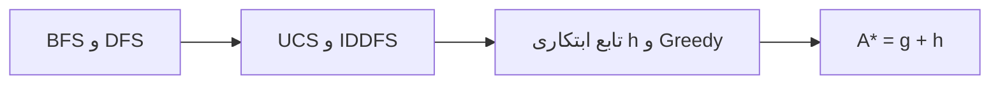
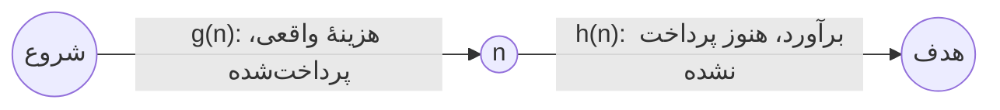
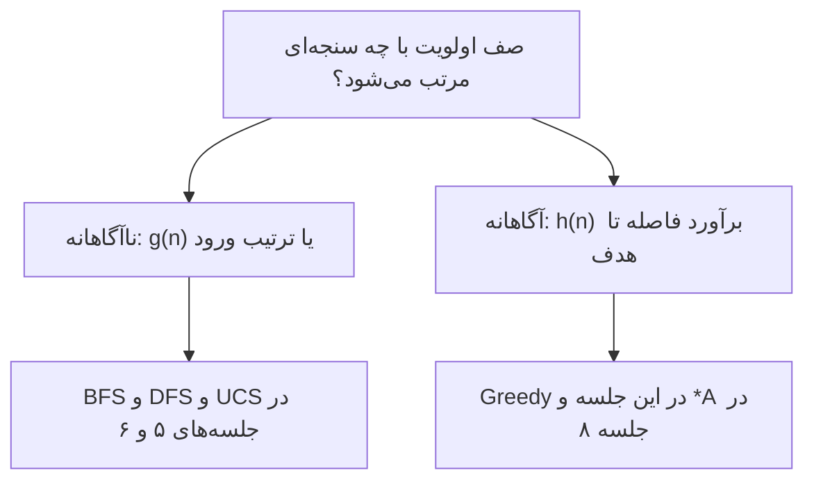
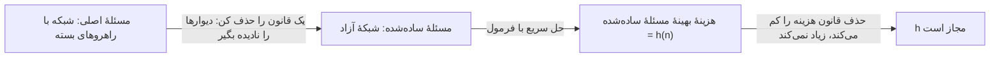
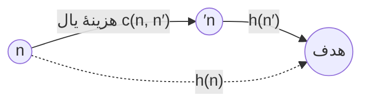
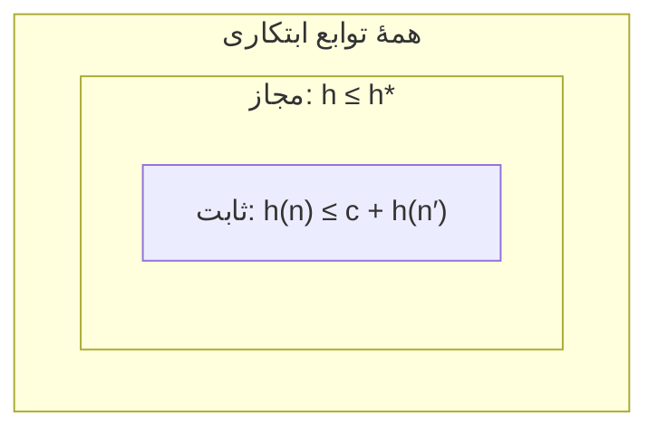
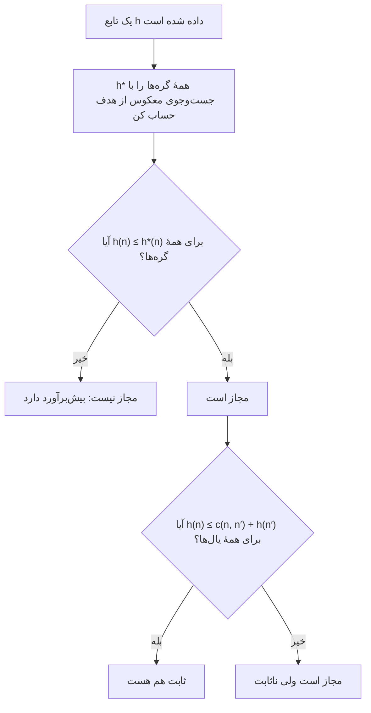
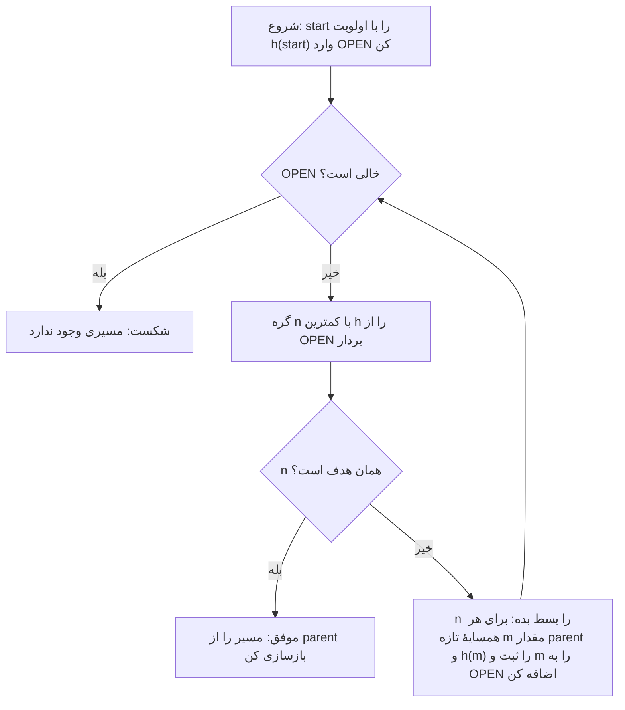
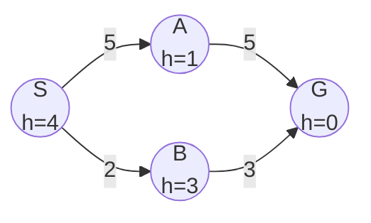
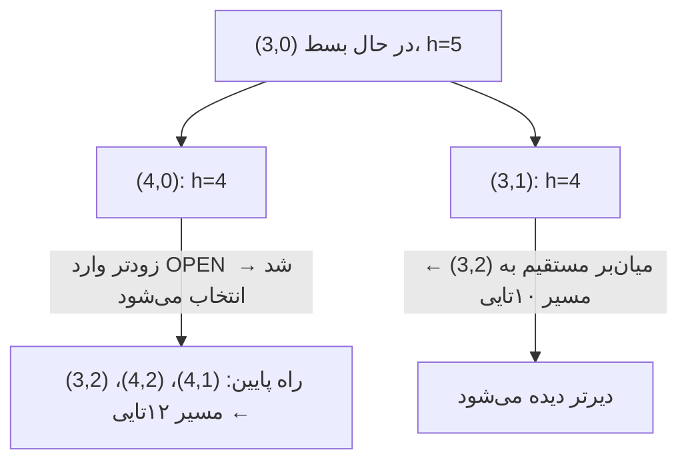

# جست‌وجوی آگاهانه و توابع ابتکاری

> **منابع این جلسه:** منبع ۱ (Russell & Norvig, 2016)، منبع ۱۱ (محتوای مدرس)

> [!NOTE]
> **این جزوه چطور خوانده شود؟** هر بخش با یک «شهود ساده» شروع می‌شود، بعد فرمول می‌آید و در پایان یک **مثال گام‌به‌گام** دارد. اگر فرمولی را متوجه نشدید، اول مثال عددی را دنبال کنید و بعد به فرمول برگردید. همهٔ اعداد این جزوه (جدول‌ها، ردیابی‌ها و شکل‌ها) با اجرای واقعی کد روی همان شبکهٔ بیمارستان بررسی شده‌اند.

---

## اهداف جلسه
در پایان این جلسه دانشجو می‌تواند:
1. تفاوت جست‌وجوی ناآگاهانه (Uninformed) و جست‌وجوی آگاهانه (Informed) را توضیح دهد.
2. دو تابع ابتکاری (Heuristic Function) رایج — فاصله منهتن (Manhattan) و فاصله اقلیدسی (Euclidean) — را روی یک شبکه محاسبه کند.
3. مجاز بودن (Admissible) و ثبات (Consistent) یک تابع ابتکاری را با هزینه واقعی $h^*(n)$ بررسی کند.
4. جست‌وجوی حریصانه (Greedy Best-First Search) را اجرا کند و بگوید چرا خروجی آن تضمین بهینگی ندارد.
5. مقدار واقعی $h^*(n)$ را با جست‌وجوی معکوس از هدف (ایدهٔ UCS/Dijkstra) محاسبه کند.
6. اجرای Greedy را روی کاغذ و به‌صورت جدول OPEN/CLOSED ردیابی کند.

## نقشهٔ راه



## ۰. مرور سریع پیش‌نیازها
این اصطلاح‌ها از جلسه‌های قبل آمده‌اند و امروز زیاد استفاده می‌شوند:

| اصطلاح | معنی ساده | مثال در این جلسه |
|---|---|---|
| حالت (State) | «الان کجا هستیم» | خانهٔ $(3,0)$ |
| همسایه‌ها (Successors) | جاهایی که با یک حرکت می‌توان رفت | از $(3,0)$ به $(2,0)$، $(4,0)$، $(3,1)$ |
| $g(n)$ | هزینهٔ **واقعی** مسیر از شروع تا $n$ (تا الان پرداخت کرده‌ایم) | $g(3,0)=3$ |
| OPEN (مرز / Frontier) | گره‌هایی که کشف شده‌اند ولی هنوز بسط نیافته‌اند | صف انتظار |
| CLOSED (بسط‌یافته‌ها) | گره‌هایی که قبلاً بسط داده‌ایم | مجموعهٔ «دیده‌شده‌ها» |
| بسط دادن (Expand) | یک گره را از OPEN برمی‌داریم و همسایه‌هایش را به OPEN اضافه می‌کنیم | یک «گام» جدول‌ها |
| parent | هر گره یادش می‌ماند از کدام گره کشف شده؛ با آن مسیر بازسازی می‌شود | $(4,2)$ پدرِ $(3,2)$ |

---

## ۱. از جست‌وجوی ناآگاهانه تا آگاهانه

### ۱.۱ یک تمثیل
تصور کنید در یک بیمارستان بزرگ دنبال «اتاق عمل» می‌گردید:

- **ناآگاهانه (BFS / UCS):** هیچ تابلویی نمی‌بینید. ناچارید اول همهٔ اتاق‌های نزدیک خودتان را ببینید، بعد دورتر‌ها را؛ مثل موجی که از یک نقطه در همهٔ جهت‌ها پخش می‌شود.
- **آگاهانه (*Greedy / A):** یک تابلوی راهنما می‌گوید «اتاق عمل تقریباً این طرف است». حالا اول جهت‌هایی را امتحان می‌کنید که به هدف نزدیک‌تر به نظر می‌رسند.

در جلسه‌های ۵ و ۶ الگوریتم‌های BFS و DFS و UCS را دیدیم. این الگوریتم‌ها فقط ساختار مسئله (گراف و هزینه یال‌ها) را می‌بینند و هیچ شهودی درباره «کدام جهت به هدف نزدیک‌تر است» ندارند. جست‌وجوی آگاهانه همین شهود را با یک **تابع ابتکاری** به الگوریتم اضافه می‌کند.

تابع ابتکاری $h(n)$ عددی است که **هزینه رسیدن از گره $n$ تا هدف** را برآورد می‌کند:
- $h(n)$ کوچک یعنی «به نظر می‌رسد به هدف نزدیکیم».
- $h(n)$ برآورد است، نه هزینه واقعی؛ هزینه واقعی کمینه را با $h^*(n)$ نشان می‌دهیم.

### ۱.۲ تفاوت «هزینهٔ پرداخت‌شده» و «هزینهٔ برآوردی»



- $g(n)$ را **می‌دانیم** (چون مسیر را رفته‌ایم).
- $h(n)$ را **حدس می‌زنیم** (چون هنوز نرفته‌ایم).
- هزینهٔ واقعی باقی‌مانده $h^*(n)$ است که معمولاً تا پایان جست‌وجو نمی‌دانیم؛ برای همین به $h$ نیاز داریم.

### ۱.۳ صف اولویت با چه سنجه‌ای مرتب می‌شود؟



| ویژگی | جست‌وجوی ناآگاهانه | جست‌وجوی آگاهانه |
|---|---|---|
| دانش اضافه | ندارد | تابع $h(n)$ |
| نمونه‌ها | BFS، DFS، UCS | *Greedy، A |
| جهت گسترش | یکسان در همه جهت‌ها | به سمت هدف هدایت می‌شود |
| نقطه ضعف | گره‌های زیادی بسط می‌دهد | همه‌چیز به کیفیت $h$ وابسته است |

برای دیدن تصویر بزرگ، این جدول «هر الگوریتم بر چه اساسی گره بعدی را انتخاب می‌کند» را کنار هم می‌گذارد:

| الگوریتم | کلید انتخاب از OPEN | بهینه است؟ |
|---|---|---|
| BFS | قدیمی‌ترین گره (صف FIFO) | فقط وقتی همهٔ هزینه‌ها برابرند |
| DFS | جدیدترین گره (پشته) | خیر |
| UCS | کمترین $g(n)$ | بله |
| **Greedy** | **کمترین $h(n)$** | **خیر** |
| *A (جلسهٔ بعد) | کمترین $g(n)+h(n)$ | بله، اگر $h$ مجاز (و برای جست‌وجوی گراف: ثابت) باشد |

> [!NOTE]
> کلمه «ابتکاری» یعنی قاعده سرانگشتی. تابع $h$ می‌تواند اشتباه کند؛ سؤال مهم این است که بدانیم **چه زمانی می‌توان به برآورد آن اعتماد کرد**. پاسخ در بخش ۴ آمده است.

---

## ۲. مسئلهٔ نمونه: راهروهای بیمارستان
در کل این جلسه روی یک نقشهٔ ۵×۵ کار می‌کنیم. این نقشه ساختگی و آموزشی است.

<div dir="ltr" align="center">

<table style="border-collapse:collapse;margin:auto"><tr><th></th><th style="font-size:12px;color:#666">c0</th><th style="font-size:12px;color:#666">c1</th><th style="font-size:12px;color:#666">c2</th><th style="font-size:12px;color:#666">c3</th><th style="font-size:12px;color:#666">c4</th></tr><tr><th style="font-size:12px;color:#666">r0</th><td style="background:#7cc4ff;color:#111;border:1px solid #999;width:62px;height:54px;text-align:center;vertical-align:middle;font-size:15px"><b>🚑 S</b><br><small style="opacity:.75">(0,0)</small></td><td style="background:#2b2b2b;color:#777;border:1px solid #999;width:62px;height:54px;text-align:center;vertical-align:middle;font-size:15px">■</td><td style="background:#fafafa;color:#111;border:1px solid #999;width:62px;height:54px;text-align:center;vertical-align:middle;font-size:15px">·<br><small style="opacity:.75">(0,2)</small></td><td style="background:#fafafa;color:#111;border:1px solid #999;width:62px;height:54px;text-align:center;vertical-align:middle;font-size:15px">·<br><small style="opacity:.75">(0,3)</small></td><td style="background:#fafafa;color:#111;border:1px solid #999;width:62px;height:54px;text-align:center;vertical-align:middle;font-size:15px">·<br><small style="opacity:.75">(0,4)</small></td></tr><tr><th style="font-size:12px;color:#666">r1</th><td style="background:#fafafa;color:#111;border:1px solid #999;width:62px;height:54px;text-align:center;vertical-align:middle;font-size:15px">·<br><small style="opacity:.75">(1,0)</small></td><td style="background:#2b2b2b;color:#777;border:1px solid #999;width:62px;height:54px;text-align:center;vertical-align:middle;font-size:15px">■</td><td style="background:#fafafa;color:#111;border:1px solid #999;width:62px;height:54px;text-align:center;vertical-align:middle;font-size:15px">·<br><small style="opacity:.75">(1,2)</small></td><td style="background:#fafafa;color:#111;border:1px solid #999;width:62px;height:54px;text-align:center;vertical-align:middle;font-size:15px">·<br><small style="opacity:.75">(1,3)</small></td><td style="background:#fafafa;color:#111;border:1px solid #999;width:62px;height:54px;text-align:center;vertical-align:middle;font-size:15px">·<br><small style="opacity:.75">(1,4)</small></td></tr><tr><th style="font-size:12px;color:#666">r2</th><td style="background:#fafafa;color:#111;border:1px solid #999;width:62px;height:54px;text-align:center;vertical-align:middle;font-size:15px">·<br><small style="opacity:.75">(2,0)</small></td><td style="background:#2b2b2b;color:#777;border:1px solid #999;width:62px;height:54px;text-align:center;vertical-align:middle;font-size:15px">■</td><td style="background:#fafafa;color:#111;border:1px solid #999;width:62px;height:54px;text-align:center;vertical-align:middle;font-size:15px">·<br><small style="opacity:.75">(2,2)</small></td><td style="background:#fafafa;color:#111;border:1px solid #999;width:62px;height:54px;text-align:center;vertical-align:middle;font-size:15px">·<br><small style="opacity:.75">(2,3)</small></td><td style="background:#fafafa;color:#111;border:1px solid #999;width:62px;height:54px;text-align:center;vertical-align:middle;font-size:15px">·<br><small style="opacity:.75">(2,4)</small></td></tr><tr><th style="font-size:12px;color:#666">r3</th><td style="background:#fafafa;color:#111;border:1px solid #999;width:62px;height:54px;text-align:center;vertical-align:middle;font-size:15px">·<br><small style="opacity:.75">(3,0)</small></td><td style="background:#fafafa;color:#111;border:1px solid #999;width:62px;height:54px;text-align:center;vertical-align:middle;font-size:15px">·<br><small style="opacity:.75">(3,1)</small></td><td style="background:#fafafa;color:#111;border:1px solid #999;width:62px;height:54px;text-align:center;vertical-align:middle;font-size:15px">·<br><small style="opacity:.75">(3,2)</small></td><td style="background:#2b2b2b;color:#777;border:1px solid #999;width:62px;height:54px;text-align:center;vertical-align:middle;font-size:15px">■</td><td style="background:#fafafa;color:#111;border:1px solid #999;width:62px;height:54px;text-align:center;vertical-align:middle;font-size:15px">·<br><small style="opacity:.75">(3,4)</small></td></tr><tr><th style="font-size:12px;color:#666">r4</th><td style="background:#fafafa;color:#111;border:1px solid #999;width:62px;height:54px;text-align:center;vertical-align:middle;font-size:15px">·<br><small style="opacity:.75">(4,0)</small></td><td style="background:#fafafa;color:#111;border:1px solid #999;width:62px;height:54px;text-align:center;vertical-align:middle;font-size:15px">·<br><small style="opacity:.75">(4,1)</small></td><td style="background:#fafafa;color:#111;border:1px solid #999;width:62px;height:54px;text-align:center;vertical-align:middle;font-size:15px">·<br><small style="opacity:.75">(4,2)</small></td><td style="background:#2b2b2b;color:#777;border:1px solid #999;width:62px;height:54px;text-align:center;vertical-align:middle;font-size:15px">■</td><td style="background:#8be28b;color:#111;border:1px solid #999;width:62px;height:54px;text-align:center;vertical-align:middle;font-size:15px"><b>🏥 G</b><br><small style="opacity:.75">(4,4)</small></td></tr></table>

<p align="center"><i>نقشه مسئله: ■ راهرو بسته، 🚑 اورژانس (شروع)، 🏥 اتاق عمل (هدف). مختصات (ردیف، ستون)</i></p>

</div>

**قواعد مسئله:**
- حرکت فقط **چهارجهته** است: بالا، پایین، چپ، راست (اریب مجاز نیست).
- هر حرکت **هزینهٔ ۱** دارد.
- خانه‌های بسته: $(0,1)$، $(1,1)$، $(2,1)$ (سه خانهٔ ستون ۱) و $(3,3)$، $(4,3)$.
- شروع: اورژانس در $(0,0)$؛ هدف: اتاق عمل در $(4,4)$.

> [!IMPORTANT]
> **قرارداد مختصات:** در این جزوه (و در کد درس) $(x, y)$ یعنی **(شمارهٔ ردیف از بالا، شمارهٔ ستون از چپ)**. پس $(4,0)$ یعنی ردیف ۴ و ستون ۰ (گوشهٔ پایین-چپ). ردیف‌ها از بالا شماره‌گذاری می‌شوند؛ «پایین» یعنی افزایش ردیف.

**ترتیب همسایه‌ها (برای شکستن تساوی):** همیشه به این ترتیب همسایه‌ها را بررسی می‌کنیم (همان ترتیب تابع `neighbors` در کد درس): **پایین، بالا، راست، چپ**. وقتی دو گره در OPEN اولویت برابر داشتند، آن که **زودتر وارد OPEN شده** انتخاب می‌شود (FIFO). این دو قاعده خروجی Greedy را کاملاً مشخص می‌کنند؛ در بخش ۵.۶ می‌بینیم چقدر مهم‌اند.

---

## ۳. توابع ابتکاری: فاصله منهتن و اقلیدسی

### ۳.۱ شهود
- **منهتن (Manhattan):** فاصله‌ای که یک **تاکسی** در شهری با خیابان‌های شطرنجی می‌رود: فقط افقی و عمودی.
- **اقلیدسی (Euclidean):** فاصلهٔ **خط مستقیم**، مثل پرواز یک پرنده.

روی شبکه‌هایی که حرکت چهارجهته دارند (مانند راهروهای بیمارستان یا خیابان‌های شهری)، دو برآورد رایج عبارت‌اند از:

$$h_M(n) = |x_n - x_g| + |y_n - y_g|$$

$$h_E(n) = \sqrt{(x_n - x_g)^2 + (y_n - y_g)^2}$$

که در آن:
<div dir="ltr" align="right">
$(x_n, y_n)$ : $n$ مختصات گره
$(x_g, y_g)$ : مختصات هدف
</div>

### ۳.۲ مثال عددی گام‌به‌گام
هدف اتاق عمل در $(4, 4)$ است.

**الف) اورژانس در $(0, 0)$:**

<div dir="ltr">

- $h_M = |0-4| + |0-4| = 4 + 4 = 8$
- $h_E = \sqrt{4^2 + 4^2} = \sqrt{32} \approx 5.66$

</div>

فاصله اقلیدسی همیشه کوچک‌تر یا مساوی منهتن است، چون خط مستقیم کوتاه‌ترین راه است. اما حرکت واقعی روی این شبکه چهارجهته است، بنابراین منهتن تصویر واقعی‌تری از حداقل حرکت لازم می‌دهد.

### ۳.۳ مقدار $h$ در همهٔ خانه‌ها

<div dir="ltr" align="center">

<table style="border-collapse:collapse;margin:auto"><tr><th></th><th style="font-size:12px;color:#666">c0</th><th style="font-size:12px;color:#666">c1</th><th style="font-size:12px;color:#666">c2</th><th style="font-size:12px;color:#666">c3</th><th style="font-size:12px;color:#666">c4</th></tr><tr><th style="font-size:12px;color:#666">r0</th><td style="background:#7cc4ff;color:#111;border:1px solid #999;width:62px;height:54px;text-align:center;vertical-align:middle;font-size:15px"><b>8</b></td><td style="background:#2b2b2b;color:#777;border:1px solid #999;width:62px;height:54px;text-align:center;vertical-align:middle;font-size:15px">■</td><td style="background:#fff6d6;color:#111;border:1px solid #999;width:62px;height:54px;text-align:center;vertical-align:middle;font-size:15px"><b>6</b></td><td style="background:#fff6d6;color:#111;border:1px solid #999;width:62px;height:54px;text-align:center;vertical-align:middle;font-size:15px"><b>5</b></td><td style="background:#fff6d6;color:#111;border:1px solid #999;width:62px;height:54px;text-align:center;vertical-align:middle;font-size:15px"><b>4</b></td></tr><tr><th style="font-size:12px;color:#666">r1</th><td style="background:#fff6d6;color:#111;border:1px solid #999;width:62px;height:54px;text-align:center;vertical-align:middle;font-size:15px"><b>7</b></td><td style="background:#2b2b2b;color:#777;border:1px solid #999;width:62px;height:54px;text-align:center;vertical-align:middle;font-size:15px">■</td><td style="background:#fff6d6;color:#111;border:1px solid #999;width:62px;height:54px;text-align:center;vertical-align:middle;font-size:15px"><b>5</b></td><td style="background:#fff6d6;color:#111;border:1px solid #999;width:62px;height:54px;text-align:center;vertical-align:middle;font-size:15px"><b>4</b></td><td style="background:#fff6d6;color:#111;border:1px solid #999;width:62px;height:54px;text-align:center;vertical-align:middle;font-size:15px"><b>3</b></td></tr><tr><th style="font-size:12px;color:#666">r2</th><td style="background:#fff6d6;color:#111;border:1px solid #999;width:62px;height:54px;text-align:center;vertical-align:middle;font-size:15px"><b>6</b></td><td style="background:#2b2b2b;color:#777;border:1px solid #999;width:62px;height:54px;text-align:center;vertical-align:middle;font-size:15px">■</td><td style="background:#fff6d6;color:#111;border:1px solid #999;width:62px;height:54px;text-align:center;vertical-align:middle;font-size:15px"><b>4</b></td><td style="background:#fff6d6;color:#111;border:1px solid #999;width:62px;height:54px;text-align:center;vertical-align:middle;font-size:15px"><b>3</b></td><td style="background:#fff6d6;color:#111;border:1px solid #999;width:62px;height:54px;text-align:center;vertical-align:middle;font-size:15px"><b>2</b></td></tr><tr><th style="font-size:12px;color:#666">r3</th><td style="background:#fff6d6;color:#111;border:1px solid #999;width:62px;height:54px;text-align:center;vertical-align:middle;font-size:15px"><b>5</b></td><td style="background:#fff6d6;color:#111;border:1px solid #999;width:62px;height:54px;text-align:center;vertical-align:middle;font-size:15px"><b>4</b></td><td style="background:#fff6d6;color:#111;border:1px solid #999;width:62px;height:54px;text-align:center;vertical-align:middle;font-size:15px"><b>3</b></td><td style="background:#2b2b2b;color:#777;border:1px solid #999;width:62px;height:54px;text-align:center;vertical-align:middle;font-size:15px">■</td><td style="background:#fff6d6;color:#111;border:1px solid #999;width:62px;height:54px;text-align:center;vertical-align:middle;font-size:15px"><b>1</b></td></tr><tr><th style="font-size:12px;color:#666">r4</th><td style="background:#fff6d6;color:#111;border:1px solid #999;width:62px;height:54px;text-align:center;vertical-align:middle;font-size:15px"><b>4</b></td><td style="background:#fff6d6;color:#111;border:1px solid #999;width:62px;height:54px;text-align:center;vertical-align:middle;font-size:15px"><b>3</b></td><td style="background:#fff6d6;color:#111;border:1px solid #999;width:62px;height:54px;text-align:center;vertical-align:middle;font-size:15px"><b>2</b></td><td style="background:#2b2b2b;color:#777;border:1px solid #999;width:62px;height:54px;text-align:center;vertical-align:middle;font-size:15px">■</td><td style="background:#8be28b;color:#111;border:1px solid #999;width:62px;height:54px;text-align:center;vertical-align:middle;font-size:15px"><b>0</b></td></tr></table>

<div dir="rtl" align="center">
<p align="center"><i>مقدار h<sub>M</sub> در هر خانه (راهروهای بسته نادیده گرفته می‌شوند)</i></p>
</div>

</div>

<div dir="ltr" align="center">

<table style="border-collapse:collapse;margin:auto"><tr><th></th><th style="font-size:12px;color:#666">c0</th><th style="font-size:12px;color:#666">c1</th><th style="font-size:12px;color:#666">c2</th><th style="font-size:12px;color:#666">c3</th><th style="font-size:12px;color:#666">c4</th></tr><tr><th style="font-size:12px;color:#666">r0</th><td style="background:#7cc4ff;color:#111;border:1px solid #999;width:62px;height:54px;text-align:center;vertical-align:middle;font-size:15px"><b>5.66</b></td><td style="background:#2b2b2b;color:#777;border:1px solid #999;width:62px;height:54px;text-align:center;vertical-align:middle;font-size:15px">■</td><td style="background:#e3f0ff;color:#111;border:1px solid #999;width:62px;height:54px;text-align:center;vertical-align:middle;font-size:15px"><b>4.47</b></td><td style="background:#e3f0ff;color:#111;border:1px solid #999;width:62px;height:54px;text-align:center;vertical-align:middle;font-size:15px"><b>4.12</b></td><td style="background:#e3f0ff;color:#111;border:1px solid #999;width:62px;height:54px;text-align:center;vertical-align:middle;font-size:15px"><b>4.00</b></td></tr><tr><th style="font-size:12px;color:#666">r1</th><td style="background:#e3f0ff;color:#111;border:1px solid #999;width:62px;height:54px;text-align:center;vertical-align:middle;font-size:15px"><b>5.00</b></td><td style="background:#2b2b2b;color:#777;border:1px solid #999;width:62px;height:54px;text-align:center;vertical-align:middle;font-size:15px">■</td><td style="background:#e3f0ff;color:#111;border:1px solid #999;width:62px;height:54px;text-align:center;vertical-align:middle;font-size:15px"><b>3.61</b></td><td style="background:#e3f0ff;color:#111;border:1px solid #999;width:62px;height:54px;text-align:center;vertical-align:middle;font-size:15px"><b>3.16</b></td><td style="background:#e3f0ff;color:#111;border:1px solid #999;width:62px;height:54px;text-align:center;vertical-align:middle;font-size:15px"><b>3.00</b></td></tr><tr><th style="font-size:12px;color:#666">r2</th><td style="background:#e3f0ff;color:#111;border:1px solid #999;width:62px;height:54px;text-align:center;vertical-align:middle;font-size:15px"><b>4.47</b></td><td style="background:#2b2b2b;color:#777;border:1px solid #999;width:62px;height:54px;text-align:center;vertical-align:middle;font-size:15px">■</td><td style="background:#e3f0ff;color:#111;border:1px solid #999;width:62px;height:54px;text-align:center;vertical-align:middle;font-size:15px"><b>2.83</b></td><td style="background:#e3f0ff;color:#111;border:1px solid #999;width:62px;height:54px;text-align:center;vertical-align:middle;font-size:15px"><b>2.24</b></td><td style="background:#e3f0ff;color:#111;border:1px solid #999;width:62px;height:54px;text-align:center;vertical-align:middle;font-size:15px"><b>2.00</b></td></tr><tr><th style="font-size:12px;color:#666">r3</th><td style="background:#e3f0ff;color:#111;border:1px solid #999;width:62px;height:54px;text-align:center;vertical-align:middle;font-size:15px"><b>4.12</b></td><td style="background:#e3f0ff;color:#111;border:1px solid #999;width:62px;height:54px;text-align:center;vertical-align:middle;font-size:15px"><b>3.16</b></td><td style="background:#e3f0ff;color:#111;border:1px solid #999;width:62px;height:54px;text-align:center;vertical-align:middle;font-size:15px"><b>2.24</b></td><td style="background:#2b2b2b;color:#777;border:1px solid #999;width:62px;height:54px;text-align:center;vertical-align:middle;font-size:15px">■</td><td style="background:#e3f0ff;color:#111;border:1px solid #999;width:62px;height:54px;text-align:center;vertical-align:middle;font-size:15px"><b>1.00</b></td></tr><tr><th style="font-size:12px;color:#666">r4</th><td style="background:#e3f0ff;color:#111;border:1px solid #999;width:62px;height:54px;text-align:center;vertical-align:middle;font-size:15px"><b>4.00</b></td><td style="background:#e3f0ff;color:#111;border:1px solid #999;width:62px;height:54px;text-align:center;vertical-align:middle;font-size:15px"><b>3.00</b></td><td style="background:#e3f0ff;color:#111;border:1px solid #999;width:62px;height:54px;text-align:center;vertical-align:middle;font-size:15px"><b>2.00</b></td><td style="background:#2b2b2b;color:#777;border:1px solid #999;width:62px;height:54px;text-align:center;vertical-align:middle;font-size:15px">■</td><td style="background:#8be28b;color:#111;border:1px solid #999;width:62px;height:54px;text-align:center;vertical-align:middle;font-size:15px"><b>0.00</b></td></tr></table>

<div dir="rtl" align="center">
<p align="center"><i>مقدار h<sub>E</sub> در هر خانه</i></p>
</div>

</div>

> [!TIP]
> دقت کنید که این دو تابع **راهروهای بسته را نمی‌بینند**؛ فقط مختصات خانه و هدف را به کار می‌برند. همین «کوررنگیِ نسبت به دیوار» هم منبع سرعت آن‌هاست (محاسبه $O(1)$) و هم منبع خطایشان.

### ۳.۴ کدام را کِی استفاده کنیم؟

| نوع حرکت | هیوریستیک مناسب | توضیح |
|:---|:---|:---|
| ۴ جهت (بالا/پایین/چپ/راست)، هزینهٔ ۱ | منهتن | دقیق‌ترین برآورد ساده و مجاز |
| حرکت آزاد در هر جهت (فضای باز، هزینه = طول) | اقلیدسی | خط مستقیم کوتاه‌ترین است |
| ۸ جهت با اریب هزینهٔ ۱ | چبیشف (Chebyshev) | *دانستنی اضافه:* $\max(\lvert\Delta x\rvert,\lvert\Delta y\rvert)$ |

> [!WARNING]
> منهتن فقط وقتی **مجاز** است که واقعاً حرکت اریب نداشته باشیم. اگر در محیطی اریب‌رفتن ممکن باشد (مثلاً ۸ جهته)، منهتن می‌تواند بیش‌برآورد کند و دیگر قابل اعتماد نیست.

### ۳.۵ یک ایده برای ساختن هیوریستیک: «ساده‌سازی مسئله» (Relaxation)
هیوریستیک خوب را از کجا بیاوریم؟ یک روش رایج: **یک قانون مسئله را حذف کن و مسئلهٔ ساده‌شده را حل کن.**



- منهتن = هزینهٔ بهینهٔ همین مسئله **بدون دیوارها**. چون دیوار فقط مسیر را سخت‌تر می‌کند:
    <div dir="ltr" align="right">
    $h_M \le h^*$
    </div>
- این ایده در جلسه‌های بعد برای مسائلی مثل پازل ۸ هم کار می‌کند.

### ۳.۶ دو حالت حدی
- $0=h(n)$ برای همهٔ گره‌ها: هیچ اطلاعاتی نداریم. تبدیل به UCS می‌شود.
- $h^*(n)=h(n)$: هیوریستیک **کامل**؛ الگوریتم مستقیم به سمت هدف می‌رود.

هر هیوریستیک واقعی جایی بین این دو است. هرچه $h$ به $h^*(n)$ نزدیک‌تر (و بزرگ‌تر از آن نباشد) بهتر است.

---

## ۴. هیوریستیک مجاز و ثابت

دو ویژگی مهم برای اعتماد به یک تابع ابتکاری وجود دارد:

**مجاز بودن (Admissibility):** هیوریستیک هرگز بیش‌برآورد نکند:

$$h(n) \le h^*(n)$$

**ثبات (Consistency):** برای هر یال از $n$ به همسایه $'n$ با هزینه $c(n, n')$:

$$h(n) \le c(n, n') + h(n')$$

یعنی برآورد $h$ نباید بیش از «هزینه یک گام به سمت همسایه + برآورد همان همسایه» افت کند (شرط مثلثی). هر هیوریستیک ثابت (با شرط $0=h(goal)$) مجاز هم هست، اما عکس آن همیشه برقرار نیست.

### ۴.۱ شهود ساده
- **مجاز** = «دوستِ خوش‌بین». او هرگز نمی‌گوید راه از واقعیت **بیشتر** است؛ ممکن است بگوید «۵ دقیقه» و در واقع ۱۰ دقیقه شود، ولی هرگز نمی‌گوید «۲۰ دقیقه» وقتی ۱۰ دقیقه کافی است.
- **ثابت** = «برآوردهای دوستِ خوش‌بین با هم **سازگارند**». اگر از A تا هدف را ۸ دقیقه می‌گوید، از همسایهٔ A که یک دقیقه آن‌طرف‌تر است نباید ناگهان ۳ دقیقه بگوید؛ برآورد در هر گام حداکثر به اندازهٔ هزینهٔ همان گام می‌تواند کم شود.



شرط ثبات می‌گوید «راه مستقیم تخمینی $h(n)$ نباید از راهِ دور‌زدن از $'n$ بلندتر باشد»؛ دقیقاً مثل نامساوی مثلث.

**چرا ثبات ⟸ مجاز بودن؟ (اثبات ساده).** اگر $n \to n_1 \to n_2 \to \dots \to goal$ بهترین مسیر باشد:

$$h(n) \le c_1 + h(n_1) \le c_1 + c_2 + h(n_2) \le \dots \le c_1 + c_2 + \dots + c_k + h(goal) = h^*(n)$$

چون $h(goal)$. 0=پس ثابت‌بودن، مجاز بودن را نتیجه می‌دهد.

### ۴.۲ الگوریتم جدید ۱: محاسبهٔ $h^*(n)$ با جست‌وجوی معکوس
برای بررسی مجاز بودن باید $h^*(n)$ (هزینهٔ واقعی) را داشته باشیم. روش: **از خود هدف شروع کن و به عقب برو.**

- چون راهروها دوطرفه‌اند، فاصلهٔ «n تا هدف» برابر «هدف تا n» است.
- یک جست‌وجوی UCS/Dijkstra از هدف، فاصلهٔ **همهٔ** گره‌ها تا هدف را یک‌جا می‌دهد.
- چون اینجا همه هزینه‌ها ۱ است، Dijkstra همان BFS است و جست‌وجو «موج‌به‌موج» پیش می‌رود.

**گام‌های الگوریتم:**
1. $h^*(goal)=0$ و هدف را در صف بگذار.
2. گره $u$ را از صف بردار؛ هر همسایهٔ دیده‌نشدهٔ $v$ را با $h^*(v)=h^*(u)+1$ ثبت و وارد صف کن.
3. تا خالی‌شدن صف تکرار کن.

**اجرای گام‌به‌گام (چند گام اول):**

| گام | گرهٔ برداشته‌شده | همسایه‌های جدید و مقدار $h^*$ | توضیح |
|---|---|---|---|
| ۱ | $(4,4)$ | $(3,4)=1$ | $(4,3)$ بسته است؛ فقط یک راه ورود به هدف وجود دارد |
| ۲ | $(3,4)$ | $(2,4)=2$ | $(3,3)$ بسته است |
| ۳ | $(2,4)$ | $(1,4)=3$، $(2,3)=3$ | |
| ۴ | $(1,4)$ | $(0,4)=4$، $(1,3)=4$ | |
| ۵ | $(2,3)$ | $(2,2)=4$ | $(1,3)$ قبلاً دیده شده؛ $(3,3)$ بسته است |
| ... | ... | ... | همین روند تا پر شدن همهٔ ۲۰ خانهٔ باز |

**نتیجهٔ کامل به‌صورت «موج»:**

| موج (مقدار $h^*$) | گره‌ها |
|---|---|
| ۰ | $(4,4)$ |
| ۱ | $(3,4)$ |
| ۲ | $(2,4)$ |
| ۳ | $(1,4)$، $(2,3)$ |
| ۴ | $(0,4)$، $(1,3)$، $(2,2)$ |
| ۵ | $(0,3)$، $(1,2)$، $(3,2)$ |
| ۶ | $(0,2)$، $(3,1)$، $(4,2)$ |
| ۷ | $(3,0)$، $(4,1)$ |
| ۸ | $(2,0)$، $(4,0)$ |
| ۹ | $(1,0)$ |
| ۱۰ | $(0,0)$ |

<div dir="ltr" align="center">

<table style="border-collapse:collapse;margin:auto"><tr><th></th><th style="font-size:12px;color:#666">c0</th><th style="font-size:12px;color:#666">c1</th><th style="font-size:12px;color:#666">c2</th><th style="font-size:12px;color:#666">c3</th><th style="font-size:12px;color:#666">c4</th></tr><tr><th style="font-size:12px;color:#666">r0</th><td style="background:#7cc4ff;color:#111;border:1px solid #999;width:62px;height:54px;text-align:center;vertical-align:middle;font-size:15px"><b>10</b></td><td style="background:#2b2b2b;color:#777;border:1px solid #999;width:62px;height:54px;text-align:center;vertical-align:middle;font-size:15px">■</td><td style="background:rgb(181,184,151);color:#111;border:1px solid #999;width:62px;height:54px;text-align:center;vertical-align:middle;font-size:15px"><b>6</b></td><td style="background:rgb(190,195,165);color:#111;border:1px solid #999;width:62px;height:54px;text-align:center;vertical-align:middle;font-size:15px"><b>5</b></td><td style="background:rgb(199,206,179);color:#111;border:1px solid #999;width:62px;height:54px;text-align:center;vertical-align:middle;font-size:15px"><b>4</b></td></tr><tr><th style="font-size:12px;color:#666">r1</th><td style="background:rgb(154,151,109);color:#111;border:1px solid #999;width:62px;height:54px;text-align:center;vertical-align:middle;font-size:15px"><b>9</b></td><td style="background:#2b2b2b;color:#777;border:1px solid #999;width:62px;height:54px;text-align:center;vertical-align:middle;font-size:15px">■</td><td style="background:rgb(190,195,165);color:#111;border:1px solid #999;width:62px;height:54px;text-align:center;vertical-align:middle;font-size:15px"><b>5</b></td><td style="background:rgb(199,206,179);color:#111;border:1px solid #999;width:62px;height:54px;text-align:center;vertical-align:middle;font-size:15px"><b>4</b></td><td style="background:rgb(208,217,193);color:#111;border:1px solid #999;width:62px;height:54px;text-align:center;vertical-align:middle;font-size:15px"><b>3</b></td></tr><tr><th style="font-size:12px;color:#666">r2</th><td style="background:rgb(163,162,123);color:#111;border:1px solid #999;width:62px;height:54px;text-align:center;vertical-align:middle;font-size:15px"><b>8</b></td><td style="background:#2b2b2b;color:#777;border:1px solid #999;width:62px;height:54px;text-align:center;vertical-align:middle;font-size:15px">■</td><td style="background:rgb(199,206,179);color:#111;border:1px solid #999;width:62px;height:54px;text-align:center;vertical-align:middle;font-size:15px"><b>4</b></td><td style="background:rgb(208,217,193);color:#111;border:1px solid #999;width:62px;height:54px;text-align:center;vertical-align:middle;font-size:15px"><b>3</b></td><td style="background:rgb(217,228,207);color:#111;border:1px solid #999;width:62px;height:54px;text-align:center;vertical-align:middle;font-size:15px"><b>2</b></td></tr><tr><th style="font-size:12px;color:#666">r3</th><td style="background:rgb(172,173,137);color:#111;border:1px solid #999;width:62px;height:54px;text-align:center;vertical-align:middle;font-size:15px"><b>7</b></td><td style="background:rgb(181,184,151);color:#111;border:1px solid #999;width:62px;height:54px;text-align:center;vertical-align:middle;font-size:15px"><b>6</b></td><td style="background:rgb(190,195,165);color:#111;border:1px solid #999;width:62px;height:54px;text-align:center;vertical-align:middle;font-size:15px"><b>5</b></td><td style="background:#2b2b2b;color:#777;border:1px solid #999;width:62px;height:54px;text-align:center;vertical-align:middle;font-size:15px">■</td><td style="background:rgb(226,239,221);color:#111;border:1px solid #999;width:62px;height:54px;text-align:center;vertical-align:middle;font-size:15px"><b>1</b></td></tr><tr><th style="font-size:12px;color:#666">r4</th><td style="background:rgb(163,162,123);color:#111;border:1px solid #999;width:62px;height:54px;text-align:center;vertical-align:middle;font-size:15px"><b>8</b></td><td style="background:rgb(172,173,137);color:#111;border:1px solid #999;width:62px;height:54px;text-align:center;vertical-align:middle;font-size:15px"><b>7</b></td><td style="background:rgb(181,184,151);color:#111;border:1px solid #999;width:62px;height:54px;text-align:center;vertical-align:middle;font-size:15px"><b>6</b></td><td style="background:#2b2b2b;color:#777;border:1px solid #999;width:62px;height:54px;text-align:center;vertical-align:middle;font-size:15px">■</td><td style="background:#8be28b;color:#111;border:1px solid #999;width:62px;height:54px;text-align:center;vertical-align:middle;font-size:15px"><b>0</b></td></tr></table>

<p align="center"><i>مقدار واقعی h*(n): هر چه تیره‌تر، دورتر از هدف (با راهروهای بسته)</i></p>

</div>

### ۴.۳ مقایسه $h$ و $h^*$: دیوارها چه می‌کنند؟

<div dir="ltr" align="center">

<table style="border-collapse:collapse;margin:auto"><tr><th></th><th style="font-size:12px;color:#666">c0</th><th style="font-size:12px;color:#666">c1</th><th style="font-size:12px;color:#666">c2</th><th style="font-size:12px;color:#666">c3</th><th style="font-size:12px;color:#666">c4</th></tr><tr><th style="font-size:12px;color:#666">r0</th><td style="background:#ffd48a;color:#111;border:1px solid #999;width:62px;height:54px;text-align:center;vertical-align:middle;font-size:15px"><b>2</b><br><small style="opacity:.75">10−8</small></td><td style="background:#2b2b2b;color:#777;border:1px solid #999;width:62px;height:54px;text-align:center;vertical-align:middle;font-size:15px">■</td><td style="background:#e8f7e8;color:#111;border:1px solid #999;width:62px;height:54px;text-align:center;vertical-align:middle;font-size:15px"><b>0</b><br><small style="opacity:.75">6−6</small></td><td style="background:#e8f7e8;color:#111;border:1px solid #999;width:62px;height:54px;text-align:center;vertical-align:middle;font-size:15px"><b>0</b><br><small style="opacity:.75">5−5</small></td><td style="background:#e8f7e8;color:#111;border:1px solid #999;width:62px;height:54px;text-align:center;vertical-align:middle;font-size:15px"><b>0</b><br><small style="opacity:.75">4−4</small></td></tr><tr><th style="font-size:12px;color:#666">r1</th><td style="background:#ffd48a;color:#111;border:1px solid #999;width:62px;height:54px;text-align:center;vertical-align:middle;font-size:15px"><b>2</b><br><small style="opacity:.75">9−7</small></td><td style="background:#2b2b2b;color:#777;border:1px solid #999;width:62px;height:54px;text-align:center;vertical-align:middle;font-size:15px">■</td><td style="background:#e8f7e8;color:#111;border:1px solid #999;width:62px;height:54px;text-align:center;vertical-align:middle;font-size:15px"><b>0</b><br><small style="opacity:.75">5−5</small></td><td style="background:#e8f7e8;color:#111;border:1px solid #999;width:62px;height:54px;text-align:center;vertical-align:middle;font-size:15px"><b>0</b><br><small style="opacity:.75">4−4</small></td><td style="background:#e8f7e8;color:#111;border:1px solid #999;width:62px;height:54px;text-align:center;vertical-align:middle;font-size:15px"><b>0</b><br><small style="opacity:.75">3−3</small></td></tr><tr><th style="font-size:12px;color:#666">r2</th><td style="background:#ffd48a;color:#111;border:1px solid #999;width:62px;height:54px;text-align:center;vertical-align:middle;font-size:15px"><b>2</b><br><small style="opacity:.75">8−6</small></td><td style="background:#2b2b2b;color:#777;border:1px solid #999;width:62px;height:54px;text-align:center;vertical-align:middle;font-size:15px">■</td><td style="background:#e8f7e8;color:#111;border:1px solid #999;width:62px;height:54px;text-align:center;vertical-align:middle;font-size:15px"><b>0</b><br><small style="opacity:.75">4−4</small></td><td style="background:#e8f7e8;color:#111;border:1px solid #999;width:62px;height:54px;text-align:center;vertical-align:middle;font-size:15px"><b>0</b><br><small style="opacity:.75">3−3</small></td><td style="background:#e8f7e8;color:#111;border:1px solid #999;width:62px;height:54px;text-align:center;vertical-align:middle;font-size:15px"><b>0</b><br><small style="opacity:.75">2−2</small></td></tr><tr><th style="font-size:12px;color:#666">r3</th><td style="background:#ffd48a;color:#111;border:1px solid #999;width:62px;height:54px;text-align:center;vertical-align:middle;font-size:15px"><b>2</b><br><small style="opacity:.75">7−5</small></td><td style="background:#ffd48a;color:#111;border:1px solid #999;width:62px;height:54px;text-align:center;vertical-align:middle;font-size:15px"><b>2</b><br><small style="opacity:.75">6−4</small></td><td style="background:#ffd48a;color:#111;border:1px solid #999;width:62px;height:54px;text-align:center;vertical-align:middle;font-size:15px"><b>2</b><br><small style="opacity:.75">5−3</small></td><td style="background:#2b2b2b;color:#777;border:1px solid #999;width:62px;height:54px;text-align:center;vertical-align:middle;font-size:15px">■</td><td style="background:#e8f7e8;color:#111;border:1px solid #999;width:62px;height:54px;text-align:center;vertical-align:middle;font-size:15px"><b>0</b><br><small style="opacity:.75">1−1</small></td></tr><tr><th style="font-size:12px;color:#666">r4</th><td style="background:#ff9f7a;color:#111;border:1px solid #999;width:62px;height:54px;text-align:center;vertical-align:middle;font-size:15px"><b>4</b><br><small style="opacity:.75">8−4</small></td><td style="background:#ff9f7a;color:#111;border:1px solid #999;width:62px;height:54px;text-align:center;vertical-align:middle;font-size:15px"><b>4</b><br><small style="opacity:.75">7−3</small></td><td style="background:#ff9f7a;color:#111;border:1px solid #999;width:62px;height:54px;text-align:center;vertical-align:middle;font-size:15px"><b>4</b><br><small style="opacity:.75">6−2</small></td><td style="background:#2b2b2b;color:#777;border:1px solid #999;width:62px;height:54px;text-align:center;vertical-align:middle;font-size:15px">■</td><td style="background:#e8f7e8;color:#111;border:1px solid #999;width:62px;height:54px;text-align:center;vertical-align:middle;font-size:15px"><b>0</b><br><small style="opacity:.75">0−0</small></td></tr></table>

<p align="center"><i>اختلاف h*(n) − h<sub>M</sub>(n): سبز = برآورد دقیق؛ هرچه نارنجی‌تر، برآورد خوش‌بینانه‌تر</i></p>

</div>

- عدد ۰: منهتن دقیق است ($h_M = h^*$).
- عدد ۲ در ستون ۰: دیوار ستون ۱ راه را ۲ واحد بلندتر کرده، ولی منهتن آن را نمی‌بیند. عدد ۲ در $(3,1)$ و $(3,2)$ هم به‌خاطر دیوار $(3,3)$ است (باید بالا رفت و دور زد).
- عدد ۴ در ردیف ۴ (ستون‌های ۰ تا ۲): آنجا دیوارهای $(3,3)$ و $(4,3)$ مانع‌اند و باید به بالا برگشت و دور زد.

کد این جلسه روی شبکه راهروهای بیمارستان، $h^*(n)$ را با همان ایده UCS جلسه ۶ (Dijkstra از سمت هدف) محاسبه می‌کند و برای هر گره آزمون مجاز بودن و ثبات را اجرا می‌کند. بخشی از خروجی واقعی:

| گره | $h^*$ | $h_M$ | $h_E$ | $2h_M$ | مجاز؟ M و E و 2M |
|---|---|---|---|---|---|
| (0,0) | 10 | 8 | 5.66 | 16 | بله، بله، خیر |
| (2,0) | 8 | 6 | 4.47 | 12 | بله، بله، خیر |
| (3,0) | 7 | 5 | 4.12 | 10 | بله، بله، خیر |
| (3,2) | 5 | 3 | 2.24 | 6 | بله، بله، خیر |
| (4,0) | 8 | 4 | 4 | 8 | بله، بله، بله |
| (4,2) | 6 | 2 | 2 | 4 | بله، بله، بله |

خلاصهٔ آزمون روی هر ۲۰ خانهٔ باز: $h_M$ و $h_E$ در **هر ۲۰ خانه** مجازند؛ اما $2h_M$ فقط در **۴ خانه** مجاز است: $(4,0)$، $(4,1)$، $(4,2)$ و $(4,4)$.

دو مشاهده مهم:
1. در $(0,0)$ داریم $h_M = 8 < h^* = 10$. چرا؟ چون راهروهای ستون ۱ بسته‌اند و مسیر واقعی مجبور به دور زدن است. هیوریستیک دیوارها را نمی‌بیند، پس خوش‌بینانه کم تخمین می‌زند — و همین یعنی مجاز.
2. $2h_M$ در بیشتر گره‌ها مجاز نیست (مثلاً $16 > 10$ در شروع)، اما در $(4,0)$ مجاز است و همچنان **ناثابت**: همسایه $(4,1)$ را ببینید که $h(4,1) = 6$ است و $8 > 1 + 6$. پس مجاز بودن و ثبات دو شرط مستقل‌اند.

### ۴.۴ بررسی گام‌به‌گام ثبات

**منهتن روی یال $(3,0) \to (3,1)$:** $h_M(3,0)=5$ و $h_M(3,1)=4$ و $c=1$. آزمون: $5 \le 1 + 4 = 5$ ✓ (برقرار، با تساوی).

**منهتن روی یال $(3,0) \to (2,0)$:** $h_M(2,0)=6$. آزمون: $5 \le 1+6 = 7$ ✓.

**اقلیدسی روی یال $(3,0) \to (3,1)$:** $4.12 \le 1 + 3.16 = 4.16$ ✓ (فقط کمی فاصله دارد!).

**$2h_M$ روی یال $(4,0) \to (4,1)$:** $h(4,0)=8$ و $h(4,1)=6$. آزمون: $8 \le 1 + 6 = 7$؟ ✗ — **نقض ثبات**.

> [!TIP]
> **میان‌بر:** وقتی همهٔ هزینه‌ها ۱ است، منهتن با هر قدم دقیقاً ۱ واحد تغییر می‌کند (یا ۱ کم، یا ۱ زیاد). پس همیشه $h(n)\le 1+h(n')$ و منهتن روی این شبکه **ثابت** است. برای اقلیدسی هم نامساوی مثلث کافی است: طول یک قدم ۱ است و فاصلهٔ مستقیم با یک قدم بیشتر از ۱ تغییر نمی‌کند. (در این شبکه، هر دو در هر ۲۰ خانه و روی همهٔ یال‌ها آزمون شده‌اند.)

### ۴.۵ مجاز و ثابت دو شرط «مستقل» اما مرتبط‌اند



- هر **ثابت** ⟹ **مجاز**.
- هر مجازی ثابت نیست. **نمونهٔ کوچک (سراسری):** گراف $S \xrightarrow{1} A \xrightarrow{3} G$ و $h(S)=4$، $h(A)=0$، $h(G)=0$.
  - مجاز: $h(S)=4 \le h^*(S)=4$ و $h(A)=0 \le 3$ ✓
  - ثابت؟ $h(S)=4 \le 1 + h(A) = 1$؟ ✗

### ۴.۶ چک‌لیست آزمون یک هیوریستیک



**چرا اهمیت دارد؟**
- مجاز بودن شرط تضمین بهینگی در *A است (جلسه ۸).
- ثبات باعث می‌شود هر گره در*A حداکثر یک بار بسط داده شود.

> [!IMPORTANT]
> هیوریستیک بیش‌برآورد خطرناک است چون الگوریتم را از مسیرهای خوب دور می‌کند. در جلسه ۸ می‌بینیم که با $h$ غیرمجاز، تضمین بهینگی *A از بین می‌رود.

### ۴.۷ اشتباهات رایج
- **«$h$ بزرگ‌تر همیشه بهتر است.»** نه؛ تا وقتی $h \le h^*$ است. بعد از آن بیش‌برآورد می‌شود.
- **«در منهتن و اقلیدسی کدام بهتر است؟»** هر دو مجازند. چون $h_M \ge h_E$ و هر دو $\le h^*$، منهتن «آگاه‌تر» است (به $h^*$ نزدیک‌تر).
- **«اگر $h$ مجاز باشد، Greedy بهینه می‌شود.»** نه! بخش ۵ را ببینید.
- **جابه‌جا کردن ردیف و ستون** در مختصات؛ همیشه $(ردیف, ستون)$.
- **فراموش کردن قاعدهٔ شکستن تساوی** در ردیابی دستی؛ نتیجهٔ Greedy به آن حساس است.

---

## ۵. جست‌وجوی حریصانه (Greedy Best-First)

### ۵.۱ ایده
ایده ساده است: همیشه گره‌ای را بسط بده که $h(n)$ کمتری دارد. صف اولویت فقط با $h(n)$ مرتب می‌شود؛ $g(n)$ (هزینه تا الان) در انتخاب نقشی ندارد.

تمثیل: مسافری که **فقط به تابلوی «تا هدف X کیلومتر»** نگاه می‌کند و هرگز به کیلومترشمار (هزینه‌ای که تا حالا داده) نگاه نمی‌کند. اگر تابلو او را به یک جادهٔ پرعوارض و طولانی هدایت کند، همان را می‌رود.

### ۵.۲ شبه‌کد و نمودار

```
GREEDY(start, goal, h):
    OPEN   ← صف اولویت (کلید = h)   ;  start را وارد کن
    parent[start] ← None
    while OPEN خالی نیست:
        n ← گرهٔ با کمترین h از OPEN
        n را «بسط‌یافته» علامت بزن
        if n == goal:  return مسیر از طریق parent
        for هر همسایه m از n:
            if m هنوز دیده نشده:            # نه در OPEN و نه بسط‌یافته
                parent[m] ← n
                m را با اولویت h(m) وارد OPEN کن
    return شکست
```



> [!NOTE]
> دو نکتهٔ ریز اما مهم: (۱) هر گره **فقط اولین بار** که کشف شود parent می‌گیرد و بعدها parent آن عوض نمی‌شود؛ (۲) Greedy هیچ‌وقت «پشیمان» نمی‌شود و مسیر قبلی را بهتر نمی‌کند. همین نکتهٔ دوم در مثال‌های زیر دیده می‌شود.

### ۵.۳ مثال گام‌به‌گام ۱: گراف کوچک (چرا $g$ مهم است؟)
چهار گره داریم. اعداد روی یال‌ها هزینه‌اند و $h$ داخل گره‌ها نوشته شده است.



**آیا $h$ مجاز است؟** $h^*(S)=5$، $h^*(A)=5$، $h^*(B)=3$. پس $4\le5$ و $1\le5$ و $3\le3$ ✓ مجاز است (و ثابت هم هست).

**اجرای Greedy:**

| گام | بسط‌یافته | همسایه‌های جدید (h) | OPEN |
|---|---|---|---|
| ۱ | $S$ | $A(1)$، $B(3)$ | $A:1$ ، $B:3$ |
| ۲ | $A$ (کمترین $h$) | $G(0)$ | $G:0$ ، $B:3$ |
| ۳ | $G$ | هدف! | — |

مسیر Greedy: $S \to A \to G$ با هزینهٔ $5+5=10$.
مسیر بهینه: $S \to B \to G$ با هزینهٔ $2+3=5$.

**درس:** Greedy فقط عدد کوچک $h(A)=1$ را دید و هزینهٔ سنگین یال $S\to A$ (۵ واحد) را نادیده گرفت. هیوریستیک **مجاز و ثابت** بود و باز هم نتیجه بهینه نشد.

### ۵.۴ مثال گام‌به‌گام ۲: Greedy با منهتن روی شبکهٔ بیمارستان
قاعده‌ها: ترتیب همسایه‌ها پایین، بالا، راست، چپ؛ تساوی FIFO.

| گام | گرهٔ بسط‌یافته | $h_M$ | همسایه‌های جدید | OPEN بعد از گام (مرتب بر اساس $h$) |
|---|---|---|---|---|
| ۱ | $(0,0)$ | 8 | $(1,0)=7$ | $(1,0){:}7$ |
| ۲ | $(1,0)$ | 7 | $(2,0)=6$ | $(2,0){:}6$ |
| ۳ | $(2,0)$ | 6 | $(3,0)=5$ | $(3,0){:}5$ |
| ۴ | $(3,0)$ | 5 | $(4,0)=4$ ، $(3,1)=4$ | $(4,0){:}4$ ، $(3,1){:}4$ ← **تساوی!** |
| ۵ | $(4,0)$ | 4 | $(4,1)=3$ | $(4,1){:}3$ ، $(3,1){:}4$ |
| ۶ | $(4,1)$ | 3 | $(4,2)=2$ | $(4,2){:}2$ ، $(3,1){:}4$ |
| ۷ | $(4,2)$ | 2 | $(3,2)=3$ | $(3,2){:}3$ ، $(3,1){:}4$ |
| ۸ | $(3,2)$ | 3 | $(2,2)=4$ | $(3,1){:}4$ ، $(2,2){:}4$ |
| ۹ | $(3,1)$ | 4 | — (همه دیده شده یا بسته) | $(2,2){:}4$ |
| ۱۰ | $(2,2)$ | 4 | $(1,2)=5$ ، $(2,3)=3$ | $(2,3){:}3$ ، $(1,2){:}5$ |
| ۱۱ | $(2,3)$ | 3 | $(1,3)=4$ ، $(2,4)=2$ | $(2,4){:}2$ ، $(1,3){:}4$ ، $(1,2){:}5$ |
| ۱۲ | $(2,4)$ | 2 | $(3,4)=1$ ، $(1,4)=3$ | $(3,4){:}1$ ، $(1,4){:}3$ ، $(1,3){:}4$ ، $(1,2){:}5$ |
| ۱۳ | $(3,4)$ | 1 | $(4,4)=0$ | $(4,4){:}0$ ، … |
| ۱۴ | $(4,4)$ | 0 | — | **هدف!** |

<div dir="ltr" align="center">

<table style="border-collapse:collapse;margin:auto"><tr><th></th><th style="font-size:12px;color:#666">c0</th><th style="font-size:12px;color:#666">c1</th><th style="font-size:12px;color:#666">c2</th><th style="font-size:12px;color:#666">c3</th><th style="font-size:12px;color:#666">c4</th></tr><tr><th style="font-size:12px;color:#666">r0</th><td style="background:#7cc4ff;color:#111;border:1px solid #999;width:62px;height:54px;text-align:center;vertical-align:middle;font-size:15px"><b>1</b><br><small style="opacity:.75">h=8</small></td><td style="background:#2b2b2b;color:#777;border:1px solid #999;width:62px;height:54px;text-align:center;vertical-align:middle;font-size:15px">■</td><td style="background:#fff;color:#111;border:1px solid #999;width:62px;height:54px;text-align:center;vertical-align:middle;font-size:15px"></td><td style="background:#fff;color:#111;border:1px solid #999;width:62px;height:54px;text-align:center;vertical-align:middle;font-size:15px"></td><td style="background:#fff;color:#111;border:1px solid #999;width:62px;height:54px;text-align:center;vertical-align:middle;font-size:15px"></td></tr><tr><th style="font-size:12px;color:#666">r1</th><td style="background:#ffd166;color:#111;border:1px solid #999;width:62px;height:54px;text-align:center;vertical-align:middle;font-size:15px"><b>2</b><br><small style="opacity:.75">h=7</small></td><td style="background:#2b2b2b;color:#777;border:1px solid #999;width:62px;height:54px;text-align:center;vertical-align:middle;font-size:15px">■</td><td style="background:#e6e6e6;color:#555;border:1px solid #999;width:62px;height:54px;text-align:center;vertical-align:middle;font-size:15px">؟<br><small style="opacity:.75">h=5</small></td><td style="background:#e6e6e6;color:#555;border:1px solid #999;width:62px;height:54px;text-align:center;vertical-align:middle;font-size:15px">؟<br><small style="opacity:.75">h=4</small></td><td style="background:#e6e6e6;color:#555;border:1px solid #999;width:62px;height:54px;text-align:center;vertical-align:middle;font-size:15px">؟<br><small style="opacity:.75">h=3</small></td></tr><tr><th style="font-size:12px;color:#666">r2</th><td style="background:#ffd166;color:#111;border:1px solid #999;width:62px;height:54px;text-align:center;vertical-align:middle;font-size:15px"><b>3</b><br><small style="opacity:.75">h=6</small></td><td style="background:#2b2b2b;color:#777;border:1px solid #999;width:62px;height:54px;text-align:center;vertical-align:middle;font-size:15px">■</td><td style="background:#ffd166;color:#111;border:1px solid #999;width:62px;height:54px;text-align:center;vertical-align:middle;font-size:15px"><b>10</b><br><small style="opacity:.75">h=4</small></td><td style="background:#ffd166;color:#111;border:1px solid #999;width:62px;height:54px;text-align:center;vertical-align:middle;font-size:15px"><b>11</b><br><small style="opacity:.75">h=3</small></td><td style="background:#ffd166;color:#111;border:1px solid #999;width:62px;height:54px;text-align:center;vertical-align:middle;font-size:15px"><b>12</b><br><small style="opacity:.75">h=2</small></td></tr><tr><th style="font-size:12px;color:#666">r3</th><td style="background:#ffd166;color:#111;border:1px solid #999;width:62px;height:54px;text-align:center;vertical-align:middle;font-size:15px"><b>4</b><br><small style="opacity:.75">h=5</small></td><td style="background:#f4a3a3;color:#111;border:1px solid #999;width:62px;height:54px;text-align:center;vertical-align:middle;font-size:15px"><b>9</b><br><small style="opacity:.75">h=4<br>بن‌بست</small></td><td style="background:#ffd166;color:#111;border:1px solid #999;width:62px;height:54px;text-align:center;vertical-align:middle;font-size:15px"><b>8</b><br><small style="opacity:.75">h=3</small></td><td style="background:#2b2b2b;color:#777;border:1px solid #999;width:62px;height:54px;text-align:center;vertical-align:middle;font-size:15px">■</td><td style="background:#ffd166;color:#111;border:1px solid #999;width:62px;height:54px;text-align:center;vertical-align:middle;font-size:15px"><b>13</b><br><small style="opacity:.75">h=1</small></td></tr><tr><th style="font-size:12px;color:#666">r4</th><td style="background:#ffd166;color:#111;border:1px solid #999;width:62px;height:54px;text-align:center;vertical-align:middle;font-size:15px"><b>5</b><br><small style="opacity:.75">h=4</small></td><td style="background:#ffd166;color:#111;border:1px solid #999;width:62px;height:54px;text-align:center;vertical-align:middle;font-size:15px"><b>6</b><br><small style="opacity:.75">h=3</small></td><td style="background:#ffd166;color:#111;border:1px solid #999;width:62px;height:54px;text-align:center;vertical-align:middle;font-size:15px"><b>7</b><br><small style="opacity:.75">h=2</small></td><td style="background:#2b2b2b;color:#777;border:1px solid #999;width:62px;height:54px;text-align:center;vertical-align:middle;font-size:15px">■</td><td style="background:#8be28b;color:#111;border:1px solid #999;width:62px;height:54px;text-align:center;vertical-align:middle;font-size:15px"><b>14</b><br><small style="opacity:.75">h=0</small></td></tr></table>

<p align="center"><i>Greedy با Manhattan: عدد بزرگ = ترتیب بسط. 🟨 مسیر نهایی (هزینه ۱۲)، 🟥 بسط‌یافته ولی خارج از مسیر، خاکستری = در OPEN مانده</i></p>

</div>

**تحلیل نقطهٔ بحرانی (گام ۴):** در $(3,0)$ دو همسایه $(4,0)$ و $(3,1)$ هر دو $h = 4$ دارند؛ صف ترتیب ورود را ملاک می‌گیرد و $(4,0)$ انتخاب می‌شود.



سپس حریصانه مجبور می‌شود از $(4,2)$ دوباره بالا برگردد و مسیر ۱۲تایی پیدا کند، در حالی که میان‌بر $(3,1)$ مسیر ۱۰تایی می‌داد. در گام ۹ گرهٔ $(3,1)$ بالاخره بسط داده می‌شود، اما $(3,2)$ قبلاً از $(4,2)$ کشف شده و parent آن عوض نمی‌شود. به همین دلیل میان‌بر هرگز استفاده نمی‌شود.

### ۵.۵ مثال گام‌به‌گام ۳: Greedy با اقلیدسی

| گام | گرهٔ بسط‌یافته | $h_E$ | همسایه‌های جدید | OPEN بعد از گام |
|---|---|---|---|---|
| ۱ | $(0,0)$ | 5.66 | $(1,0)=5.00$ | $(1,0){:}5.00$ |
| ۲ | $(1,0)$ | 5.00 | $(2,0)=4.47$ | $(2,0){:}4.47$ |
| ۳ | $(2,0)$ | 4.47 | $(3,0)=4.12$ | $(3,0){:}4.12$ |
| ۴ | $(3,0)$ | 4.12 | $(4,0)=4.00$ ، $(3,1)=3.16$ | $(3,1){:}3.16$ ، $(4,0){:}4.00$ ← **بدون تساوی** |
| ۵ | $(3,1)$ | 3.16 | $(4,1)=3.00$ ، $(3,2)=2.24$ | $(3,2){:}2.24$ ، $(4,1){:}3.00$ ، $(4,0){:}4.00$ |
| ۶ | $(3,2)$ | 2.24 | $(4,2)=2.00$ ، $(2,2)=2.83$ | $(4,2){:}2.00$ ، $(2,2){:}2.83$ ، … |
| ۷ | $(4,2)$ | 2.00 | — (بن‌بست) | $(2,2){:}2.83$ ، $(4,1){:}3.00$ ، $(4,0){:}4.00$ |
| ۸ | $(2,2)$ | 2.83 | $(1,2)=3.61$ ، $(2,3)=2.24$ | $(2,3){:}2.24$ ، $(4,1){:}3.00$ ، … |
| ۹ | $(2,3)$ | 2.24 | $(1,3)=3.16$ ، $(2,4)=2.00$ | $(2,4){:}2.00$ ، $(4,1){:}3.00$ ، … |
| ۱۰ | $(2,4)$ | 2.00 | $(3,4)=1.00$ ، $(1,4)=3.00$ | $(3,4){:}1.00$ ، $(4,1){:}3.00$ ، … |
| ۱۱ | $(3,4)$ | 1.00 | $(4,4)=0$ | $(4,4){:}0$ ، … |
| ۱۲ | $(4,4)$ | 0 | — | **هدف!** |

<div dir="ltr" align="center">

<table style="border-collapse:collapse;margin:auto"><tr><th></th><th style="font-size:12px;color:#666">c0</th><th style="font-size:12px;color:#666">c1</th><th style="font-size:12px;color:#666">c2</th><th style="font-size:12px;color:#666">c3</th><th style="font-size:12px;color:#666">c4</th></tr><tr><th style="font-size:12px;color:#666">r0</th><td style="background:#7cc4ff;color:#111;border:1px solid #999;width:62px;height:54px;text-align:center;vertical-align:middle;font-size:15px"><b>1</b><br><small style="opacity:.75">h=5.66</small></td><td style="background:#2b2b2b;color:#777;border:1px solid #999;width:62px;height:54px;text-align:center;vertical-align:middle;font-size:15px">■</td><td style="background:#fff;color:#111;border:1px solid #999;width:62px;height:54px;text-align:center;vertical-align:middle;font-size:15px"></td><td style="background:#fff;color:#111;border:1px solid #999;width:62px;height:54px;text-align:center;vertical-align:middle;font-size:15px"></td><td style="background:#fff;color:#111;border:1px solid #999;width:62px;height:54px;text-align:center;vertical-align:middle;font-size:15px"></td></tr><tr><th style="font-size:12px;color:#666">r1</th><td style="background:#ffd166;color:#111;border:1px solid #999;width:62px;height:54px;text-align:center;vertical-align:middle;font-size:15px"><b>2</b><br><small style="opacity:.75">h=5</small></td><td style="background:#2b2b2b;color:#777;border:1px solid #999;width:62px;height:54px;text-align:center;vertical-align:middle;font-size:15px">■</td><td style="background:#e6e6e6;color:#555;border:1px solid #999;width:62px;height:54px;text-align:center;vertical-align:middle;font-size:15px">؟<br><small style="opacity:.75">h=3.61</small></td><td style="background:#e6e6e6;color:#555;border:1px solid #999;width:62px;height:54px;text-align:center;vertical-align:middle;font-size:15px">؟<br><small style="opacity:.75">h=3.16</small></td><td style="background:#e6e6e6;color:#555;border:1px solid #999;width:62px;height:54px;text-align:center;vertical-align:middle;font-size:15px">؟<br><small style="opacity:.75">h=3</small></td></tr><tr><th style="font-size:12px;color:#666">r2</th><td style="background:#ffd166;color:#111;border:1px solid #999;width:62px;height:54px;text-align:center;vertical-align:middle;font-size:15px"><b>3</b><br><small style="opacity:.75">h=4.47</small></td><td style="background:#2b2b2b;color:#777;border:1px solid #999;width:62px;height:54px;text-align:center;vertical-align:middle;font-size:15px">■</td><td style="background:#ffd166;color:#111;border:1px solid #999;width:62px;height:54px;text-align:center;vertical-align:middle;font-size:15px"><b>8</b><br><small style="opacity:.75">h=2.83</small></td><td style="background:#ffd166;color:#111;border:1px solid #999;width:62px;height:54px;text-align:center;vertical-align:middle;font-size:15px"><b>9</b><br><small style="opacity:.75">h=2.24</small></td><td style="background:#ffd166;color:#111;border:1px solid #999;width:62px;height:54px;text-align:center;vertical-align:middle;font-size:15px"><b>10</b><br><small style="opacity:.75">h=2</small></td></tr><tr><th style="font-size:12px;color:#666">r3</th><td style="background:#ffd166;color:#111;border:1px solid #999;width:62px;height:54px;text-align:center;vertical-align:middle;font-size:15px"><b>4</b><br><small style="opacity:.75">h=4.12</small></td><td style="background:#ffd166;color:#111;border:1px solid #999;width:62px;height:54px;text-align:center;vertical-align:middle;font-size:15px"><b>5</b><br><small style="opacity:.75">h=3.16</small></td><td style="background:#ffd166;color:#111;border:1px solid #999;width:62px;height:54px;text-align:center;vertical-align:middle;font-size:15px"><b>6</b><br><small style="opacity:.75">h=2.24</small></td><td style="background:#2b2b2b;color:#777;border:1px solid #999;width:62px;height:54px;text-align:center;vertical-align:middle;font-size:15px">■</td><td style="background:#ffd166;color:#111;border:1px solid #999;width:62px;height:54px;text-align:center;vertical-align:middle;font-size:15px"><b>11</b><br><small style="opacity:.75">h=1</small></td></tr><tr><th style="font-size:12px;color:#666">r4</th><td style="background:#e6e6e6;color:#555;border:1px solid #999;width:62px;height:54px;text-align:center;vertical-align:middle;font-size:15px">؟<br><small style="opacity:.75">h=4</small></td><td style="background:#e6e6e6;color:#555;border:1px solid #999;width:62px;height:54px;text-align:center;vertical-align:middle;font-size:15px">؟<br><small style="opacity:.75">h=3</small></td><td style="background:#f4a3a3;color:#111;border:1px solid #999;width:62px;height:54px;text-align:center;vertical-align:middle;font-size:15px"><b>7</b><br><small style="opacity:.75">h=2<br>بن‌بست</small></td><td style="background:#2b2b2b;color:#777;border:1px solid #999;width:62px;height:54px;text-align:center;vertical-align:middle;font-size:15px">■</td><td style="background:#8be28b;color:#111;border:1px solid #999;width:62px;height:54px;text-align:center;vertical-align:middle;font-size:15px"><b>12</b><br><small style="opacity:.75">h=0</small></td></tr></table>

<p align="center"><i>Greedy با Euclidean: ۱۲ بسط و مسیر با هزینه ۱۰</i></p>

</div>

اقلیدسی در گام ۴ اتفاقاً $(3,1)$ را ترجیح می‌دهد (چون ۳٫۱۶ از ۴٫۰۰ کمتر است) و همین باعث می‌شود مسیر بهینه ۱۰ پیدا شود. این **شانس** است، نه هوش بیشتر؛ اگر دیوارها جای دیگری بودند، اقلیدسی هم ممکن بود خطا کند.

### ۵.۶ نتیجهٔ مقایسه و حساسیت به تساوی
نتیجه اجرای کد این جلسه روی شبکه بیمارستان:

| هیوریستیک | هزینه مسیر پیدا شده | گره‌های بسط‌یافته | بهینه؟ |
|---|---|---|---|
| Manhattan | 12 | 14 | خیر (بهینه 10 است) |
| Euclidean | 10 | 12 | بله (اتفاقی) |
| 2×Manhattan | 12 | 14 | خیر |

**مقایسهٔ تصویری مسیرها (Manhattan):**

<div dir="ltr" align="center">

<table style="border-collapse:collapse;margin:auto"><tr><th></th><th style="font-size:12px;color:#666">c0</th><th style="font-size:12px;color:#666">c1</th><th style="font-size:12px;color:#666">c2</th><th style="font-size:12px;color:#666">c3</th><th style="font-size:12px;color:#666">c4</th></tr><tr><th style="font-size:12px;color:#666">r0</th><td style="background:#7cc4ff;color:#111;border:1px solid #999;width:62px;height:54px;text-align:center;vertical-align:middle;font-size:15px"><b>🚑</b></td><td style="background:#2b2b2b;color:#777;border:1px solid #999;width:62px;height:54px;text-align:center;vertical-align:middle;font-size:15px">■</td><td style="background:#fff;color:#111;border:1px solid #999;width:62px;height:54px;text-align:center;vertical-align:middle;font-size:15px"></td><td style="background:#fff;color:#111;border:1px solid #999;width:62px;height:54px;text-align:center;vertical-align:middle;font-size:15px"></td><td style="background:#fff;color:#111;border:1px solid #999;width:62px;height:54px;text-align:center;vertical-align:middle;font-size:15px"></td></tr><tr><th style="font-size:12px;color:#666">r1</th><td style="background:#ffd166;color:#111;border:1px solid #999;width:62px;height:54px;text-align:center;vertical-align:middle;font-size:15px">●<br><small style="opacity:.75">هر دو</small></td><td style="background:#2b2b2b;color:#777;border:1px solid #999;width:62px;height:54px;text-align:center;vertical-align:middle;font-size:15px">■</td><td style="background:#fff;color:#111;border:1px solid #999;width:62px;height:54px;text-align:center;vertical-align:middle;font-size:15px"></td><td style="background:#fff;color:#111;border:1px solid #999;width:62px;height:54px;text-align:center;vertical-align:middle;font-size:15px"></td><td style="background:#fff;color:#111;border:1px solid #999;width:62px;height:54px;text-align:center;vertical-align:middle;font-size:15px"></td></tr><tr><th style="font-size:12px;color:#666">r2</th><td style="background:#ffd166;color:#111;border:1px solid #999;width:62px;height:54px;text-align:center;vertical-align:middle;font-size:15px">●<br><small style="opacity:.75">هر دو</small></td><td style="background:#2b2b2b;color:#777;border:1px solid #999;width:62px;height:54px;text-align:center;vertical-align:middle;font-size:15px">■</td><td style="background:#ffd166;color:#111;border:1px solid #999;width:62px;height:54px;text-align:center;vertical-align:middle;font-size:15px">●<br><small style="opacity:.75">هر دو</small></td><td style="background:#ffd166;color:#111;border:1px solid #999;width:62px;height:54px;text-align:center;vertical-align:middle;font-size:15px">●<br><small style="opacity:.75">هر دو</small></td><td style="background:#ffd166;color:#111;border:1px solid #999;width:62px;height:54px;text-align:center;vertical-align:middle;font-size:15px">●<br><small style="opacity:.75">هر دو</small></td></tr><tr><th style="font-size:12px;color:#666">r3</th><td style="background:#ffd166;color:#111;border:1px solid #999;width:62px;height:54px;text-align:center;vertical-align:middle;font-size:15px">●<br><small style="opacity:.75">هر دو</small></td><td style="background:#a7e3a7;color:#111;border:1px solid #999;width:62px;height:54px;text-align:center;vertical-align:middle;font-size:15px">B<br><small style="opacity:.75">بهینه</small></td><td style="background:#ffd166;color:#111;border:1px solid #999;width:62px;height:54px;text-align:center;vertical-align:middle;font-size:15px">●<br><small style="opacity:.75">هر دو</small></td><td style="background:#2b2b2b;color:#777;border:1px solid #999;width:62px;height:54px;text-align:center;vertical-align:middle;font-size:15px">■</td><td style="background:#ffd166;color:#111;border:1px solid #999;width:62px;height:54px;text-align:center;vertical-align:middle;font-size:15px">●<br><small style="opacity:.75">هر دو</small></td></tr><tr><th style="font-size:12px;color:#666">r4</th><td style="background:#f4a3a3;color:#111;border:1px solid #999;width:62px;height:54px;text-align:center;vertical-align:middle;font-size:15px">G<br><small style="opacity:.75">Greedy</small></td><td style="background:#f4a3a3;color:#111;border:1px solid #999;width:62px;height:54px;text-align:center;vertical-align:middle;font-size:15px">G<br><small style="opacity:.75">Greedy</small></td><td style="background:#f4a3a3;color:#111;border:1px solid #999;width:62px;height:54px;text-align:center;vertical-align:middle;font-size:15px">G<br><small style="opacity:.75">Greedy</small></td><td style="background:#2b2b2b;color:#777;border:1px solid #999;width:62px;height:54px;text-align:center;vertical-align:middle;font-size:15px">■</td><td style="background:#8be28b;color:#111;border:1px solid #999;width:62px;height:54px;text-align:center;vertical-align:middle;font-size:15px"><b>🏥</b></td></tr></table>

<p align="center"><i>مقایسه مسیرها: G فقط Greedy، B فقط بهینه، ● مشترک. Greedy از جای دیگری رفته است</i></p>

</div>

دو نکتهٔ مهم:
1. **Greedy فقط «ترتیب» $h$ را می‌بیند، نه اندازهٔ آن.** چون $2h_M$ و $h_M$ ترتیب گره‌ها را یکسان می‌کنند، Greedy با هر دو **دقیقاً یک نتیجه** می‌دهد (۱۲ و ۱۴). ضرب‌کردن $h$ در عدد مثبت، Greedy را عوض نمی‌کند؛ اما برای *A مجاز بودن را خراب می‌کند.
2. **حساسیت به شکستن تساوی.** اگر ترتیب همسایه‌ها را «راست، پایین، بالا، چپ» بگذاریم (به‌جای ترتیب پیش‌فرض)، همین Manhattan مسیر ۱۰ پیدا می‌کند (با ۱۴ بسط). یعنی بهینه‌شدن یا نشدن Greedy گاهی به یک قرارداد بی‌اهمیت وابسته است؛ این یعنی تضمینی در کار نیست.

**نتیجه:** Greedy سریع و هدفمند است اما تضمین بهینه بودن ندارد — حتی وقتی هیوریستیک مجاز است. علت: $g(n)$ را نادیده می‌گیرد و مسیر پیموده‌شده گران ممکن است پنهان بماند. راه‌حل این مشکل، ترکیب $g$ و $h$ در الگوریتم *A است که موضوع جلسه ۸ است.

### ۵.۷ ویژگی‌های Greedy

| ویژگی | وضعیت | توضیح |
|---|---|---|
| بهینگی | ❌ | همین جلسه دیدیم |
| کامل بودن | ✅ در گراف‌های متناهی با ثبت «دیده‌شده‌ها» | بدون ثبت دیده‌شده‌ها می‌تواند در حلقه بیفتد |
| سرعت | معمولاً خیلی سریع | وقتی $h$ خوب باشد گره‌های کمی بسط می‌دهد |
| بدترین حالت | مثل جست‌وجوی ناآگاهانه (نمایی) | وقتی $h$ گمراه‌کننده باشد |
| حافظه | زیاد | تمام OPEN را نگه می‌دارد |

---

## ۶. پیش‌نمایش جلسهٔ ۸: با اضافه‌کردن $g$ چه می‌شود؟
اگر کلید صف را از $h(n)$ به $f(n)=g(n)+h(n)$ تغییر دهیم، A* را ساخته‌ایم. روی همین شبکه (با همان قواعد) نتیجه اینگونه است:

| الگوریتم | هزینه مسیر | گره‌های بسط‌یافته | بهینه؟ |
|---|---|---|---|
| UCS | 10 | 20 | بله |
| Greedy + منهتن | 12 | 14 | خیر |
| Greedy + اقلیدسی | 10 | 12 | بله (اتفاقی) |
| *A + منهتن | 10 | 14 | **بله (تضمینی)** |
| *A + اقلیدسی | 10 | 14 | **بله (تضمینی)** |

```
expanded nodes (smaller = faster)          cost
UCS          ████████████████████ 20         10  optimal
A* + M       ██████████████       14         10  optimal
Greedy + M   ██████████████       14         12  NOT optimal
Greedy + E   ████████████         12         10  optimal (by luck)
```

> [!NOTE]
> تعداد بسط UCS به ترتیب شکستن تساوی وابسته است (اینجا همهٔ ۲۰ خانهٔ باز بسط داده شد). نکتهٔ مهم برای A*: وقتی مسیر $f$ را دنبال می‌کند، مقدار $f$ از ۸ به ۱۰ می‌پرد؛ یعنی A* «می‌فهمد» که دیوارها دو واحد هزینه اضافه کرده‌اند و پیش از قبول مسیر گران، مسیرهای دیگر را هم می‌سنجد. Greedy هیچ‌وقت چنین چیزی نمی‌فهمد.

این پیش‌نمایش بدون اثبات است؛ در جلسه ۸ جزئیات و دلیل تضمین بهینگی را می‌بینیم.

---

## 🔬 پیوند با مهندسی پزشکی
**مسیریابی آمبولانس (مثال آموزشی):** در سامانه‌های اعزام آمبولانس، نقشه شهر تقریباً شبکه‌ای است و فاصله بین محل حادثه و بیمارستان، یک هیوریستیک طبیعی است. چند نکته:
- **فاصلهٔ اقلیدسی (خط مستقیم)** در شبکهٔ واقعی جاده‌ها مجاز است، چون هیچ مسیر واقعی کوتاه‌تر از خط مستقیم نیست.
- **فاصلهٔ منهتن** فقط وقتی مجاز است که خیابان‌ها واقعاً چهارجهته و بدون اریب باشند؛ در شهرهایی با خیابان‌های مورب می‌تواند بیش‌برآورد کند.
- موانع واقعی (ترافیک، خیابان‌های مسدود، راهرو بسته بیمارستان) باعث می‌شوند $h^*$ بزرگ‌تر از $h$ شود؛ هرچه تفاوت بیشتر، جست‌وجو کمتر هدایت می‌شود (همان شکل «اختلاف $h^*-h_M$» در بخش ۴.۳).
- اگر به‌جای مسافت، **زمان** معیار هزینه باشد، هیوریستیک مبتنی بر مسافت دیگر لزوماً برآورد درستی از هزینه نیست. یک راه مجاز: فاصلهٔ مستقیم تقسیم بر **بیشینهٔ سرعت ممکن** در شبکه.

**نمونهٔ دیگر:** ربات‌های خدماتی که دارو یا نمونه آزمایشگاهی را در راهروهای بیمارستان حمل می‌کنند دقیقاً همین مسئله را حل می‌کنند: شبکهٔ راهروها، هزینهٔ حرکت و هدفی مثل بخش یا آزمایشگاه.

> [!WARNING]
> این مثال صرفاً برای آموزش مفهوم هیوریستیک است. سامانه واقعی اعزام آمبولانس به نقشه به‌روز، مجوزها و پروتکل‌های اورژانس وابسته است و خروجی چنین مثال‌هایی هیچ کاربرد تشخیصی یا بالینی ندارد.

---

## ✍️ فعالیت کلاسی

### فعالیت ۱: محاسبه و آزمون هیوریستیک
روی همان شبکه ۵×۵ جلسه (خانه‌های بسته: ستون ۱ در ردیف‌های ۰ تا ۲ و خانه‌های $(3,3)$ و $(4,3)$) و هدف $(4,4)$:

۱. $h_M$ و $h_E$ را برای گره‌های $(2,0)$ و $(4,2)$ دستی محاسبه کنید.

۲. با مقدار واقعی $h^*$ داده‌شده در جدول زیر، مجاز بودن هر سه هیوریستیک $h_M$ و $h_E$ و $2h_M$ را در این دو گره تعیین کنید.

| گره | $h^*(n)$ |
|---|---|
| (2,0) | 8 |
| (4,2) | 6 |

۳. برای گره $(4,0)$ نشان دهید $2h_M$ مجاز است اما ناثابت (همسایه $(4,1)$ با هزینه یال ۱ را بررسی کنید).

<details>
<summary>کلید پاسخ فعالیت ۱ (نمونه)</summary>

۱. گره $(2,0)$: $h_M = 4 + 2 = 6$ و $h_E = \sqrt{16+4} \approx 4.47$. گره $(4,2)$: $h_M = 0 + 2 = 2$ و $h_E = 2$.

۲. در $(2,0)$: $h_M = 6 \le 8$ مجاز، $h_E \approx 4.47 \le 8$ مجاز، $2h_M = 12 > 8$ غیرمجاز. در $(4,2)$: $h_M = 2 \le 6$ مجاز، $h_E = 2 \le 6$ مجاز، $2h_M = 4 \le 6$ مجاز.

۳. در $(4,0)$: $2h_M = 8$ و $h^* = 8$ پس مجاز است؛ اما برای همسایه $(4,1)$ داریم $h(4,1) = 6$ و چون $8 > 1 + 6$، شرط ثبات برقرار نیست.

</details>

### فعالیت ۲: بحث
در بیمارستان، کدام هیوریستیک مناسب‌تر است: منهتن یا اقلیدسی؟ پاسخ را به «نوع حرکت مجاز در راهروها» ربط دهید.

<details>
<summary>کلید پاسخ فعالیت ۲ (نمونه)</summary>

اگر حرکت فقط در امتداد راهروهای عمود‌به‌هم (شبیه شبکه) ممکن باشد، منهتن برآورد واقعی‌تری از حداقل حرکت است؛ فاصله اقلیدسی مسیر موربی را فرض می‌کند که در راهرو وجود ندارد و برآورد ضعیف‌تر (ولی همچنان مجاز) می‌دهد. در فضای باز (حیاط بیمارستان یا حرکت ویلچر در فضای باز) اقلیدسی معنادارتر است.

</details>

### فعالیت ۳: Greedy روی گراف کوچک
در گراف بخش ۵.۳ فرض کنید $h(A)=4$ (به‌جای ۱) و بقیهٔ مقادیر ثابت بمانند. (الف) آیا $h$ هنوز مجاز است؟ (ب) Greedy چه مسیری پیدا می‌کند؟ (پ) از این نتیجه چه می‌گیرید؟

<details>
<summary>کلید پاسخ فعالیت ۳</summary>

(الف) $h^*(A)=5$ و $4 \le 5$، پس مجاز است. (ب) بعد از بسط $S$، مقایسه $h(A)=4$ و $h(B)=3$ نشان می‌دهد $B$ انتخاب می‌شود؛ مسیر $S\to B\to G$ با هزینه ۵ که بهینه است. (پ) بهینه‌شدن Greedy به **شانس مقدارهای $h$** بستگی دارد، نه به مجاز بودن؛ هیچ تضمینی وجود ندارد.

</details>

### فعالیت ۴: آزمون ثبات
ثبات اقلیدسی را روی یال $(3,0)\to(4,0)$ بررسی کنید.

<details>
<summary>کلید پاسخ فعالیت ۴</summary>

$h_E(3,0)=4.12$ و $h_E(4,0)=4.00$ و $c=1$. آزمون: $4.12 \le 1 + 4.00 = 5.00$ ✓ برقرار است.

</details>

### فعالیت ۵: ردیابی دستی
جدول ردیابی Greedy-منهتن (بخش ۵.۴) را بدون نگاه‌کردن به جواب برای گام‌های ۱ تا ۴ پر کنید و توضیح دهید چرا در گام ۴ تساوی پیش می‌آید و چگونه با FIFO حل می‌شود.

---

## 💻 کد آموزشی
فایل `code/session_07_informed_heuristics.py` (فقط کتابخانه استاندارد پایتون):

```bash
python3 code/session_07_informed_heuristics.py
```

این اسکریپت:
1. شبکه ۵×۵ راهروهای بیمارستان با چند راهروی بسته را می‌سازد.
2. سه هیوریستیک `manhattan` و `euclidean` و `manhattan_x2` را تعریف می‌کند.
3. با Dijkstra مقدار واقعی $h^*(n)$ هر گره را حساب می‌کند و جدول «مجاز بودن/ثبات» هر گره را چاپ می‌کند.
4. جست‌وجوی حریصانه را با هر سه هیوریستیک اجرا و هزینه مسیر و تعداد گره‌های بسط‌یافته را مقایسه می‌کند.
5. ترتیب بسط گره‌ها در Greedy را چاپ می‌کند (برای مقایسه با جدول‌های ردیابی بخش‌های ۵.۴ و ۵.۵) و در «جدول ۳» UCS و *A را به‌عنوان پیش‌نمایش جلسه ۸ اجرا می‌کند (همان اعداد بخش ۶).

---

## 🧾 جمع‌بندی یک‌صفحه‌ای

| مفهوم | یک‌خطی |
|---|---|
| $h(n)$ | برآورد هزینهٔ باقی‌مانده تا هدف |
| $h^*(n)$ | هزینهٔ واقعی باقی‌مانده؛ با BFS/Dijkstra معکوس از هدف |
| مجاز | $h \le h^*$؛ هرگز بیش‌برآورد نکن |
| ثابت | $h(n) \le c + h(n')$؛ شرط مثلثی؛ ثابت ⟹ مجاز |
| منهتن / اقلیدسی | برای حرکت ۴جهته / آزاد؛ $h_E \le h_M \le h^*$ |
| Greedy | کلید صف فقط $h$؛ سریع ولی **غیربهینه** |
| *A | کلید $g+h$؛ بهینه با $h$ مجاز (جلسه ۸) |

---

## 📘 واژه‌نامه

| واژه | معنی |
|---|---|
| Informed Search | جست‌وجوی آگاهانه |
| Heuristic Function | تابع ابتکاری |
| Admissible | مجاز؛ $h(n) \le h^*(n)$ |
| Consistent | ثابت؛ برقراری شرط مثلثی روی هر یال |
| Greedy Best-First Search | جست‌وجوی حریصانه اول-بهترین |
| Manhattan / Euclidean Distance | فاصله منهتن / اقلیدسی |
| Frontier / OPEN | مرز جست‌وجو؛ گره‌های کشف‌شدهٔ بسط‌نیافته |
| Expand | بسط دادن یک گره |
| Tie-breaking | شکستن تساوی؛ انتخاب بین گره‌های هم‌اولویت |
| Relaxation | ساده‌سازی مسئله برای ساختن هیوریستیک |
| Overestimate | بیش‌برآورد؛ $h > h^*$ |

## ❓ پرسش‌های خودآزمون
1. تفاوت اصلی جست‌وجوی آگاهانه و ناآگاهانه چیست؟ $h(n)$ چه نقشی دارد و آیا هزینه واقعی است؟
2. تعریف مجاز بودن را بنویسید. چرا یک هیوریستیک بیش‌برآورد خطرناک است؟
3. با کمک جدول بخش ۵.۶ توضیح دهید چرا Greedy حتی با هیوریستیک مجاز ممکن است مسیر غیربهینه بدهد.
4. چگونه ممکن است یک هیوریستیک در یک گره مجاز اما ناثابت باشد؟ مثال گره $(4,0)$ با $2h_M$ را توضیح دهید.
5. چرا Greedy با $h_M$ و $2h_M$ دقیقاً نتیجهٔ یکسان می‌دهد؟
6. در گراف بخش ۵.۳ مسیر Greedy و هزینه‌اش را بنویسید و دلیل غیربهینه‌بودن را توضیح دهید.
7. یک مثال از هیوریستیک مجاز اما ناثابت (سراسری) بسازید.

> کلید پاسخ‌ها در بخش «راهنمای مدرس» انتهای فایل آمده است.

## 📝 تکلیف
1. کد `code/session_07_informed_heuristics.py` را اجرا کنید و جدول مقایسه سه هیوریستیک (هزینه مسیر و تعداد بسط) را گزارش کنید.
2. مقدار `BLOCKED` را تغییر دهید (دو خانه بسته جدید اضافه کنید؛ مختصات به صورت $(ردیف, ستون)$ و مراقب باشید راه رسیدن به هدف کاملاً بسته نشود) و دوباره اجرا کنید. آیا نتیجه Greedy با Manhattan بهینه می‌شود یا بدتر؟ نتیجه را در سه چهار جمله تحلیل کنید.
3. *(اختیاری)* ترتیب جهت‌ها را در حلقهٔ تابع `neighbors` عوض کنید و گزارش دهید نتیجهٔ Greedy با Manhattan تغییر می‌کند یا نه.

## 📚 مطالعه پیشنهادی
- Russell & Norvig (2016)، فصل ۳: بخش جست‌وجوی آگاهانه و توابع ابتکاری
- منبع ۱۱ (محتوای مدرس): اسلایدها و یادداشت‌های این جلسه
