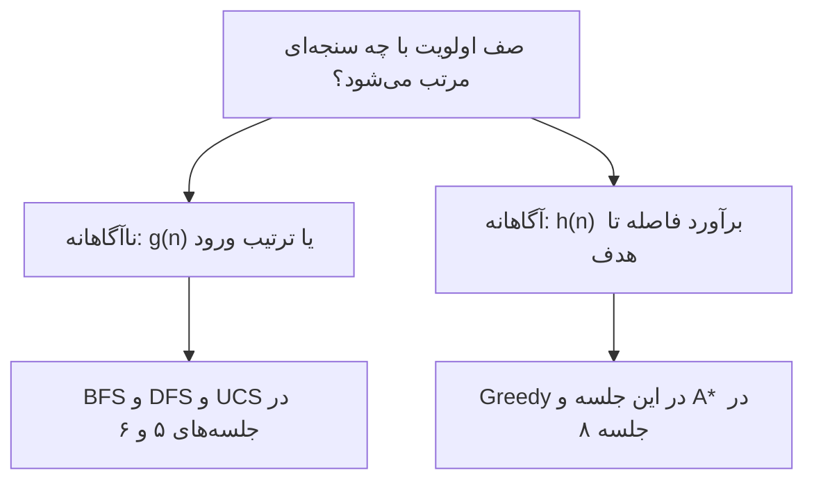

# جلسه ۷: جست‌وجوی آگاهانه و توابع ابتکاری

> **درس:** مقدمه‌ای بر هوش مصنوعی و کاربرد آن در مهندسی پزشکی
> **مدت پیشنهادی:** ۶۰ تا ۹۰ دقیقه · **سطح:** مقدماتی
> **منابع این جلسه:** منبع ۱ (Russell & Norvig, 2016)، منبع ۱۱ (محتوای مدرس)

---

## اهداف جلسه
در پایان این جلسه دانشجو می‌تواند:
1. تفاوت جست‌وجوی ناآگاهانه (Uninformed) و جست‌وجوی آگاهانه (Informed) را توضیح دهد.
2. دو تابع ابتکاری (Heuristic Function) رایج — فاصله منهتن (Manhattan) و فاصله اقلیدسی (Euclidean) — را روی یک شبکه محاسبه کند.
3. مجاز بودن (Admissible) و ثبات (Consistent) یک تابع ابتکاری را با هزینه واقعی $h^*(n)$ بررسی کند.
4. جست‌وجوی حریصانه (Greedy Best-First Search) را اجرا کند و بگوید چرا خروجی آن تضمین بهینگی ندارد.

---

## ۱. از جست‌وجوی ناآگاهانه تا آگاهانه
در جلسه‌های ۵ و ۶ الگوریتم‌های BFS و DFS و UCS را دیدیم. این الگوریتم‌ها فقط ساختار مسئله (گراف و هزینه یال‌ها) را می‌بینند و هیچ شهودی درباره «کدام جهت به هدف نزدیک‌تر است» ندارند. جست‌وجوی آگاهانه همین شهود را با یک **تابع ابتکاری** به الگوریتم اضافه می‌کند.

تابع ابتکاری $h(n)$ عددی است که **هزینه رسیدن از گره $n$ تا هدف** را برآورد می‌کند:
- $h(n)$ کوچک یعنی «به نظر می‌رسد به هدف نزدیکیم».
- $h(n)$ برآورد است، نه هزینه واقعی؛ هزینه واقعی کمینه را با $h^*(n)$ نشان می‌دهیم.



| ویژگی | جست‌وجوی ناآگاهانه | جست‌وجوی آگاهانه |
|---|---|---|
| دانش اضافه | ندارد | تابع $h(n)$ |
| نمونه‌ها | BFS، DFS، UCS | Greedy، A* |
| جهت گسترش | یکسان در همه جهت‌ها | به سمت هدف هدایت می‌شود |
| نقطه ضعف | گره‌های زیادی بسط می‌دهد | همه‌چیز به کیفیت $h$ وابسته است |

> [!NOTE]
> کلمه «ابتکاری» یعنی قاعده سرانگشتی. تابع $h$ می‌تواند اشتباه کند؛ سؤال مهم این است که بدانیم **چه زمانی می‌توان به برآورد آن اعتماد کرد**. پاسخ در بخش ۳ آمده است.

## ۲. توابع ابتکاری: فاصله منهتن و اقلیدسی
روی شبکه‌هایی که حرکت چهارجهته دارند (مانند راهروهای بیمارستان یا خیابان‌های شهری)، دو برآورد رایج عبارت‌اند از:

$$h_M(n) = |x_n - x_g| + |y_n - y_g|$$

$$h_E(n) = \sqrt{(x_n - x_g)^2 + (y_n - y_g)^2}$$

که در آن $(x_n, y_n)$ مختصات گره $n$ و $(x_g, y_g)$ مختصات هدف است.

**مثال عددی:** در شبکه طبقه بیمارستان کد این جلسه، هدف اتاق عمل در $(4, 4)$ است. برای اورژانس در $(0, 0)$:

- $h_M = |0-4| + |0-4| = 8$
- $h_E = \sqrt{4^2 + 4^2} = \sqrt{32} \approx 5.66$

فاصله اقلیدسی همیشه کوچک‌تر یا مساوی منهتن است، چون خط مستقیم کوتاه‌ترین راه است. اما حرکت واقعی روی این شبکه چهارجهته است، بنابراین منهتن تصویر واقعی‌تری از حداقل حرکت لازم می‌دهد.

## ۳. هیوریستیک مجاز و ثابت
دو ویژگی مهم برای اعتماد به یک تابع ابتکاری وجود دارد:

**مجاز بودن (Admissibility):** هیوریستیک هرگز بیش‌برآورد نکند:

$$h(n) \le h^*(n)$$

**ثبات (Consistency):** برای هر یال از $n$ به همسایه $n'$ با هزینه $c(n, n')$:

$$h(n) \le c(n, n') + h(n')$$

یعنی برآورد $h$ نباید بیش از «هزینه یک گام به سمت همسایه + برآورد همان همسایه» افت کند (شرط مثلثی). هر هیوریستیک ثابت (با شرط $h(goal)=0$) مجاز هم هست، اما عکس آن همیشه برقرار نیست.

**چرا اهمیت دارد؟**
- مجاز بودن شرط تضمین بهینگی در A* است (جلسه ۸).
- ثبات باعث می‌شود هر گره حداکثر یک بار بسط داده شود.

کد این جلسه روی شبکه راهروهای بیمارستان، $h^*(n)$ را با همان ایده UCS جلسه ۶ (Dijkstra از سمت هدف) محاسبه می‌کند و برای هر گره آزمون مجاز بودن و ثبات را اجرا می‌کند. بخشی از خروجی واقعی:

| گره | $h^*$ | $h_M$ | $h_E$ | $2h_M$ | مجاز؟ M و E و 2M |
|---|---|---|---|---|---|
| (0,0) | 10 | 8 | 5.66 | 16 | بله، بله، خیر |
| (3,0) | 7 | 5 | 4.12 | 10 | بله، بله، خیر |
| (4,0) | 8 | 4 | 4 | 8 | بله، بله، بله |
| (4,2) | 6 | 2 | 2 | 4 | بله، بله، بله |

دو مشاهده مهم:
1. در $(0,0)$ داریم $h_M = 8 < h^* = 10$. چرا؟ چون راهروهای ستون ۱ بسته‌اند و مسیر واقعی مجبور به دور زدن است. هیوریستیک دیوارها را نمی‌بیند، پس خوش‌بینانه کم تخمین می‌زند — و همین یعنی مجاز.
2. $2h_M$ در بیشتر گره‌ها مجاز نیست (مثلاً $16 > 10$ در شروع)، اما در $(4,0)$ مجاز است و همچنان **ناثابت**: همسایه $(4,1)$ را ببینید که $h(4,1) = 6$ است و $8 > 1 + 6$. پس مجاز بودن و ثبات دو شرط مستقل‌اند.

> [!IMPORTANT]
> هیوریستیک بیش‌برآورد خطرناک است چون الگوریتم را از مسیرهای خوب دور می‌کند. در جلسه ۸ می‌بینیم که با $h$ غیرمجاز، تضمین بهینگی A* از بین می‌رود.

## ۴. جست‌وجوی حریصانه (Greedy Best-First)
ایده ساده است: همیشه گره‌ای را بسط بده که $h(n)$ کمتری دارد. صف اولویت فقط با $h(n)$ مرتب می‌شود؛ $g(n)$ (هزینه تا الان) در انتخاب نقشی ندارد. نتیجه اجرای کد این جلسه روی شبکه بیمارستان:

| هیوریستیک | هزینه مسیر پیدا شده | گره‌های بسط‌یافته | بهینه؟ |
|---|---|---|---|
| Manhattan | 12 | 14 | خیر (بهینه 10 است) |
| Euclidean | 10 | 12 | بله (اتفاقی) |
| 2×Manhattan | 12 | 14 | خیر |

با Manhattan، در گره $(3,0)$ دو همسایه $(4,0)$ و $(3,1)$ هر دو $h = 4$ دارند؛ صف ترتیب ورود را ملاک می‌گیرد و $(4,0)$ انتخاب می‌شود. سپس حریصانه مجبور می‌شود از $(4,2)$ دوباره بالا برگردد و مسیر ۱۲تایی پیدا کند، در حالی که میان‌بر $(3,1)$ مسیر ۱۰تایی می‌داد.

**نتیجه:** Greedy سریع و هدفمند است اما تضمین بهینه بودن ندارد — حتی وقتی هیوریستیک مجاز است. علت: $g(n)$ را نادیده می‌گیرد و مسیر پیموده‌شده گران ممکن است پنهان بماند. راه‌حل این مشکل، ترکیب $g$ و $h$ در الگوریتم A* است که موضوع جلسه ۸ است.

---

## 🔬 پیوند با مهندسی پزشکی
**مسیریابی آمبولانس (مثال آموزشی):** در سامانه‌های اعزام آمبولانس، نقشه شهر تقریباً شبکه‌ای است و فاصله منهتن یا اقلیدسی بین محل حادثه و بیمارستان، یک هیوریستیک طبیعی است. چون هیچ مسیر واقعی کوتاه‌تر از خط مستقیم نیست، این $h$ مجاز است. اما دو نکته مهم دارد:
- موانع واقعی (ترافیک، خیابان‌های مسدود، راهرو بسته بیمارستان) باعث می‌شوند $h^*$ بزرگ‌تر از $h$ شود؛ هرچه تفاوت بیشتر، جست‌وجو کمتر هدایت می‌شود.
- اگر به‌جای مسافت، **زمان** معیار هزینه باشد، هیوریستیک مبتنی بر مسافت دیگر لزوماً برآورد درستی از هزینه نیست و باید با سرعت واقعی در ترافیک بازتنظیم شود.

> [!WARNING]
> این مثال صرفاً برای آموزش مفهوم هیوریستیک است. سامانه واقعی اعزام آمبولانس به نقشه به‌روز، مجوزها و پروتکل‌های اورژانس وابسته است و خروجی چنین مثال‌هایی هیچ کاربرد تشخیصی یا بالینی ندارد.

## ✍️ فعالیت کلاسی

### فعالیت ۱: محاسبه و آزمون هیوریستیک
روی همان شبکه ۵×۵ جلسه (خانه‌های بسته: ستون ۱ در ردیف‌های ۰ تا ۲ و خانه‌های $(3,3)$ و $(4,3)$) و هدف $(4,4)$:

۱. $h_M$ و $h_E$ را برای گره‌های $(2,0)$ و $(4,2)$ دستی محاسبه کنید.

۲. با مقدار واقعی $h^*$ داده‌شده در جدول زیر، مجاز بودن هر سه هیوریستیک $h_M$ و $h_E$ و $2h_M$ را در این دو گره تعیین کنید.

| گره | $h^*(n)$ |
|---|---|
| (2,0) | 8 |
| (4,2) | 6 |

۳. برای گره $(4,0)$ نشان دهید $2h_M$ مجاز است اما ناثابت (همسایه $(4,1)$ با هزینه یال ۱ را بررسی کنید).

<details>
<summary>کلید پاسخ فعالیت ۱ (نمونه)</summary>

۱. گره $(2,0)$: $h_M = 4 + 2 = 6$ و $h_E = \sqrt{16+4} \approx 4.47$. گره $(4,2)$: $h_M = 0 + 2 = 2$ و $h_E = 2$.

۲. در $(2,0)$: $h_M = 6 \le 8$ مجاز، $h_E \approx 4.47 \le 8$ مجاز، $2h_M = 12 > 8$ غیرمجاز. در $(4,2)$: $h_M = 2 \le 6$ مجاز، $h_E = 2 \le 6$ مجاز، $2h_M = 4 \le 6$ مجاز.

۳. در $(4,0)$: $2h_M = 8$ و $h^* = 8$ پس مجاز است؛ اما برای همسایه $(4,1)$ داریم $h(4,1) = 6$ و چون $8 > 1 + 6$، شرط ثبات برقرار نیست.

</details>

### فعالیت ۲: بحث
در بیمارستان، کدام هیوریستیک مناسب‌تر است: منهتن یا اقلیدسی؟ پاسخ را به «نوع حرکت مجاز در راهروها» ربط دهید.

<details>
<summary>کلید پاسخ فعالیت ۲ (نمونه)</summary>

اگر حرکت فقط در امتداد راهروهای عمود‌به‌هم (شبیه شبکه) ممکن باشد، منهتن برآورد واقعی‌تری از حداقل حرکت است؛ فاصله اقلیدسی مسیر موربی را فرض می‌کند که در راهرو وجود ندارد و برآورد ضعیف‌تر (ولی همچنان مجاز) می‌دهد. در فضای باز (حیاط بیمارستان یا حرکت ویلچر در فضای باز) اقلیدسی معنادارتر است.

</details>

## 💻 کد آموزشی
فایل `code/session_07_informed_heuristics.py` (فقط کتابخانه استاندارد پایتون):

```bash
python3 code/session_07_informed_heuristics.py
```

این اسکریپت:
1. شبکه ۵×۵ راهروهای بیمارستان با چند راهروی بسته را می‌سازد.
2. سه هیوریستیک `manhattan` و `euclidean` و `manhattan_x2` را تعریف می‌کند.
3. با Dijkstra مقدار واقعی $h^*(n)$ هر گره را حساب می‌کند و جدول «مجاز بودن/ثبات» هر گره را چاپ می‌کند.
4. جست‌وجوی حریصانه را با هر سه هیوریستیک اجرا و هزینه مسیر و تعداد گره‌های بسط‌یافته را مقایسه می‌کند.

> [!TIP]
> تابع `greedy_best_first` را طوری تغییر دهید که در صف اولویت از $g(n) + h(n)$ استفاده کند؛ با همین تغییر ساده، A* جلسه بعد را ساخته‌اید.

> [!NOTE]
> همه کدهای این درس آموزشی و غیرتشخیصی‌اند؛ شبکه بیمارستان و مقادیر هزینه ساختگی‌اند.

## 📘 واژه‌نامه

| واژه | معنی |
|---|---|
| Informed Search | جست‌وجوی آگاهانه |
| Heuristic Function | تابع ابتکاری |
| Admissible | مجاز؛ $h(n) \le h^*(n)$ |
| Consistent | ثابت؛ برقراری شرط مثلثی روی هر یال |
| Greedy Best-First Search | جست‌وجوی حریصانه اول-بهترین |
| Manhattan / Euclidean Distance | فاصله منهتن / اقلیدسی |

## ❓ پرسش‌های خودآزمون
1. تفاوت اصلی جست‌وجوی آگاهانه و ناآگاهانه چیست؟ $h(n)$ چه نقشی دارد و آیا هزینه واقعی است؟
2. تعریف مجاز بودن را بنویسید. چرا یک هیوریستیک بیش‌برآورد خطرناک است؟
3. با کمک جدول بخش ۴ توضیح دهید چرا Greedy حتی با هیوریستیک مجاز ممکن است مسیر غیربهینه بدهد.
4. چگونه ممکن است یک هیوریستیک در یک گره مجاز اما ناثابت باشد؟ مثال گره $(4,0)$ با $2h_M$ را توضیح دهید.

> کلید پاسخ‌ها در بخش «راهنمای مدرس» انتهای فایل آمده است.

## 📝 تکلیف
1. کد `code/session_07_informed_heuristics.py` را اجرا کنید و جدول مقایسه سه هیوریستیک (هزینه مسیر و تعداد بسط) را گزارش کنید.
2. مقدار `BLOCKED` را تغییر دهید (دو خانه بسته جدید اضافه کنید) و دوباره اجرا کنید. آیا نتیجه Greedy با Manhattan بهینه می‌شود یا بدتر؟ نتیجه را در سه چهار جمله تحلیل کنید.

## 📚 مطالعه پیشنهادی
- Russell & Norvig (2016)، فصل ۳: بخش جست‌وجوی آگاهانه و توابع ابتکاری
- منبع ۱۱ (محتوای مدرس): اسلایدها و یادداشت‌های این جلسه

---

## 🧭 راهنمای مدرس (از این عنوان تا انتها در نسخه دانشجو حذف شود)

**زمان‌بندی پیشنهادی برای ۹۰ دقیقه:** مرور جلسه قبل (۵) | از ناآگاهانه به آگاهانه و تعریف $h$ (۱۵) | هیوریستیک‌های منهتن و اقلیدسی (۱۵) | مجاز و ثابت با خروجی کد (۲۰) | Greedy و تحلیل نتایج (۱۵) | فعالیت‌های ۱ و ۲ (۱۵) | جمع‌بندی (۵)

**نسخه ۶۰ دقیقه‌ای:** تعریف $h$ و مقایسه دو نوع جست‌وجو (۱۲)، هیوریستیک‌ها با مثال عددی (۱۲)، مجاز/ثابت با دو گره نمونه از جدول کد (۱۶)، Greedy و جدول نتایج (۱۲)، فعالیت ۱ کوتاه‌شده (۶)، جمع‌بندی و تکلیف (۲). فعالیت ۲ و تغییر کد به تکلیف منتقل شود.

**نکات:**
- دانشجویان جلسه ۶ را با UCS دیده‌اند؛ $h^*$ را در کد با همان ایده محاسبه کرده‌ایم و لازم نیست Dijkstra جداگانه تدریس شود.
- نکته ظریف برای دانشجویان قوی‌تر: در $(4,0)$ هیوریستیک $2h_M$ مجاز ولی ناثابت است؛ این نشان می‌دهد ثبات شدیدتر از مجاز بودن است.
- تأکید کنید $h$ در این جلسه تابعی دستی و ثابت است؛ یادگیری خودکار $h$ موضوع پژوهش‌های جدی است و خارج از scope این درس.
- اگر وقت کم بود، جدول کامل ۲۰ گره را روی صفحه نمایش دهید و فقط چهار ردیف را با کلاس تحلیل کنید.

### خروجی مورد انتظار جلسه
دانشجو بتواند $h_M$ و $h_E$ را برای یک گره محاسبه کند، با $h^*$ مجاز بودن را آزمون کند، تفاوت مجاز/ثابت را با یک مثال بیان کند و توضیح دهد چرا Greedy تضمین بهینگی ندارد.

### نکته فنی درباره کد
شمارش «گره‌های بسط‌یافته» در این درس = تعداد دفعاتی که گره از صف خارج و بسط داده می‌شود. نسخه‌های تکراری در صف شمرده نمی‌شوند. اگر نسخه پایتون شما ترتیب تساوی‌ها را جابه‌جا کند، ممکن است مسیر هم‌هزینه متفاوتی برگردد؛ هزینه‌ها تغییری نمی‌کنند.

### کلید پاسخ پرسش‌های خودآزمون

<details>
<summary>نمایش کلید پاسخ</summary>

1. **آگاهانه در برابر ناآگاهانه:** ناآگاهانه فقط از ساختار گراف استفاده می‌کند؛ آگاهانه با $h(n)$ برآوردی از فاصله تا هدف را به صف اولویت اضافه می‌کند و گسترش را به سمت هدف هدایت می‌کند. $h(n)$ برآورد است نه هزینه واقعی؛ هزینه واقعی کمینه $h^*(n)$ است.
2. **مجاز بودن:** $h(n) \le h^*(n)$ برای همه گره‌ها. هیوریستیک بیش‌برآورد ممکن است مسیر بهینه را «بد به نظر» برساند و الگوریتم آن را کنار بگذارد؛ در نتیجه تضمین پیدا کردن مسیر بهینه از بین می‌رود.
3. **Greedy غیربهینه:** چون فقط $h(n)$ را کمینه می‌کند و $g(n)$ را نادیده می‌گیرد؛ در جدول بخش ۴ با Manhattan مسیر هزینه ۱۲ (به جای ۱۰) پیدا کرد چون در تساوی $h$ به سمت پایین رفت و بعد مجبور به برگشت شد.
4. **مجاز ولی ناثابت:** شرط ثبات روی یال‌ها بررسی می‌شود، نه تک‌گره. در $(4,0)$ داریم $2h_M = 8 = h^*$ پس مجاز است؛ اما برای همسایه $(4,1)$ با هزینه یال ۱، برابری $8 \le 1 + 6$ برقرار نیست، پس ناثابت است.

</details>
