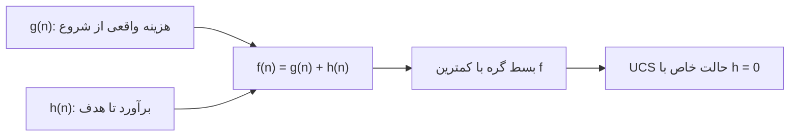
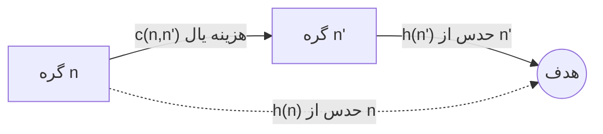
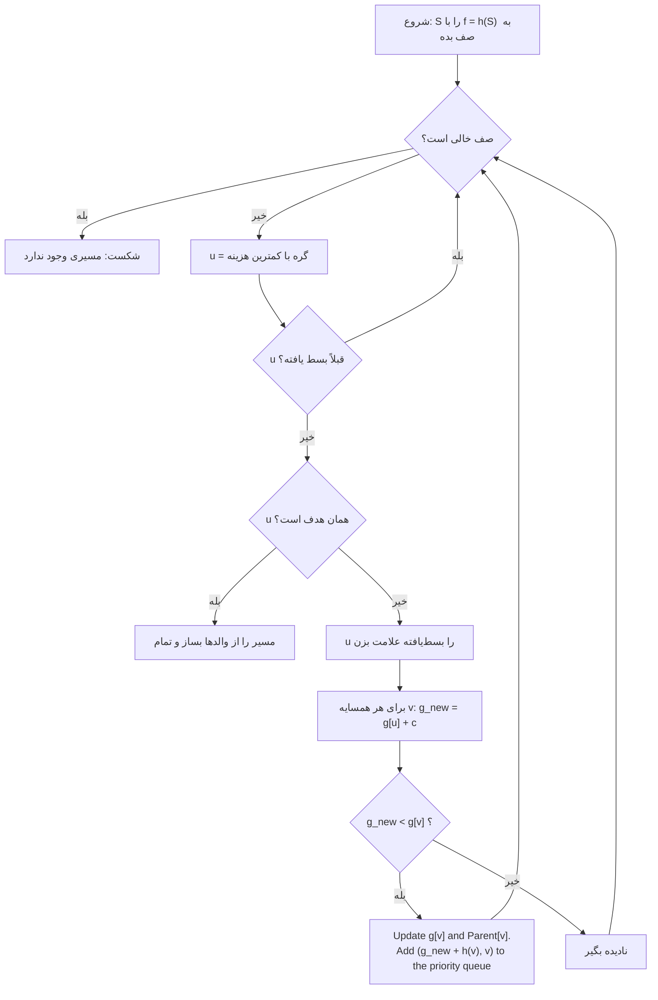
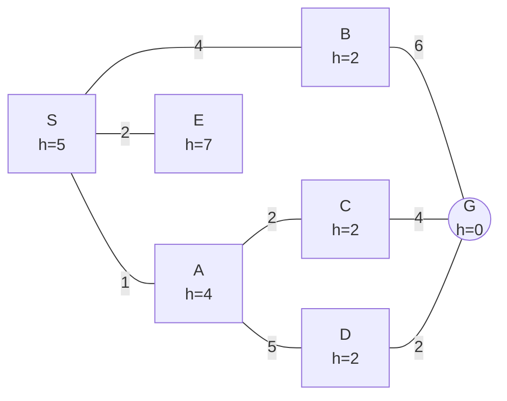
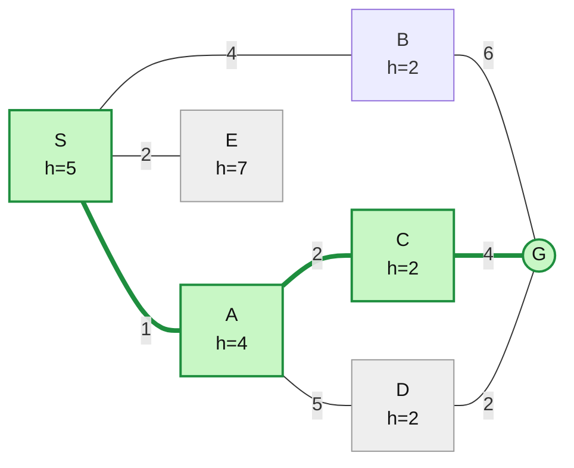
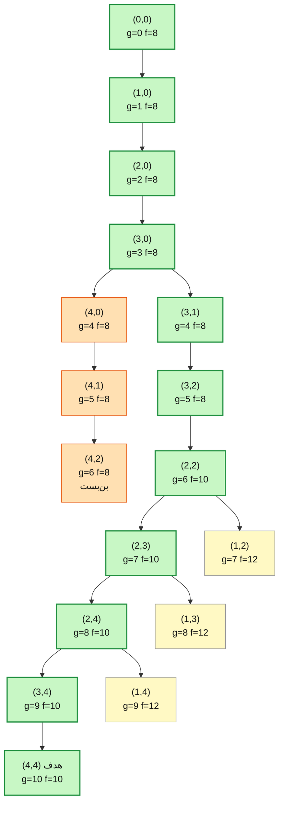
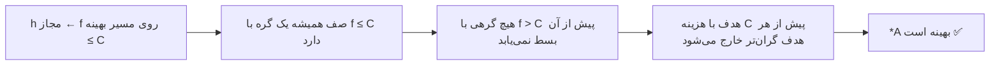
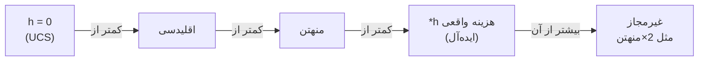

# الگوریتم *A

> **منابع این جلسه:** منبع ۱ (Russell & Norvig, 2016)، منبع ۱۱ (محتوای مدرس)

---

## اهداف جلسه
در پایان این جلسه دانشجو می‌تواند:
1. ترکیب $f(n) = g(n) + h(n)$ را توضیح دهد و نقش هر جزء را بگوید.
2. شبه‌کد *A را بخواند و روی یک مثال کوچک و یک مثال شبکه‌ای، گام‌به‌گام اجرا کند (جدول صف را خودش پر کند).
3. نقش هیوریستیک مجاز (Admissible) و ثابت (Consistent) را در تضمین بهینگی *A توضیح دهد و آن‌ها را روی یک مثال بسنجد.
4. *A را با UCS و Greedy از نظر هزینه مسیر و تعداد گره‌های بسط‌یافته مقایسه کند.


---

## ۰. مرور سریع: ما از کجا آمده‌ایم؟

در جلسه‌های قبل دو الگوریتم «جست‌وجوی آگاهانه/هزینه‌محور» دیدیم. هر کدام یک **نقطه ضعف** داشت:

| الگوریتم | مرتب‌سازی صف بر اساس | نقطه قوت | نقطه ضعف |
|---|---|---|---|
| UCS | $g(n)$ — هزینه‌ای که تا اینجا پرداخته‌ایم | مسیر **بهینه** را پیدا می‌کند | **کورکورانه** است؛ در همه جهت‌ها یکسان گسترش می‌یابد و گره زیادی بسط می‌دهد |
| Greedy | $h(n)$ — حدس ما از فاصله تا هدف | **سریع** و هدفمند است | به هزینه‌ای که تا حالا داده‌ایم توجه نمی‌کند؛ **بهینه نیست** |

**مثال روزمره:** فرض کنید با ماشین از شهر الف به شهر ب می‌روید.

- راننده‌ی **UCS** فقط به کیلومترشمار نگاه می‌کند و هر جاده‌ای را که تا حالا کم‌ترین کیلومتر داشته ادامه می‌دهد. نتیجه: همه‌جا را کمی می‌گردد.
- راننده‌ی **Greedy** فقط به نقشه نگاه می‌کند و هر جا که «از نظر فاصله هوایی نزدیک‌تر به مقصد» است می‌رود. ممکن است وارد جاده‌ای شود که به بن‌بست یا مسیر خیلی طولانی می‌رسد.
- راننده‌ی ***A** هر دو را در نظر می‌گیرد: «چقدر آمده‌ام + چقدر فکر می‌کنم مانده».

> [!NOTE]
> **یادآوری دو مفهوم از جلسه ۷.**
> - **هیوریستیک $h(n)$**: یک «حدس آگاهانه» از هزینه باقی‌مانده تا هدف (مثلاً فاصله هوایی).
> - **هزینه واقعی بهینه $h^*(n)$**: هزینه *واقعی* کوتاه‌ترین مسیر از $n$ تا هدف. معمولاً آن را نمی‌دانیم (اگر می‌دانستیم، مسئله حل بود!) و فقط برای تحلیل نظری از آن استفاده می‌کنیم.

---

## ۱. ایده اصلی *A: ترکیب گذشته و آینده

الگوریتم *A (تلفظ: «ای-استار») دو اطلاعات را **جمع** می‌کند:

$$f(n) = g(n) + h(n)$$

| نماد | معنا | منشأ | مثال سفر با ماشین |
|---|---|---|---|
| $g(n)$ | هزینه واقعی پیموده‌شده از شروع تا $n$ | **دقیق** (اندازه‌گیری شده) | عدد کیلومترشمار: ۶۰ کیلومتر آمده‌ایم |
| $h(n)$ | برآورد هزینه از $n$ تا هدف | **حدس** (ابتکاری) | فاصله هوایی تا مقصد روی نقشه: ۸۰ کیلومتر |
| $f(n)$ | برآورد کل هزینه مسیری که از $n$ می‌گذرد | ترکیب | ۶۰ + ۸۰ = ۱۴۰ کیلومتر برآورد کل سفر |

**شهود:** $f(n)$ پاسخ این پرسش است: «اگر از گره $n$ عبور کنم، در بهترین حالت کل سفرم چقدر خرج برمی‌دارد؟» *A همیشه **گره‌ای را که کمترین $f$ دارد** بسط می‌دهد (یعنی امیدوارکننده‌ترین گزینه).



> [!NOTE]
> هرچه $h$ دقیق‌تر باشد (ولی کم‌برآورد)، گسترش هدفمندتر و تعداد گره‌های بسط‌یافته کمتر می‌شود. اگر حدس ما از واقعیت **بیشتر** باشد، هدفمندی بیشتر می‌شود اما تضمین بهینگی را از دست می‌دهیم (بخش ۲ و ۴).

---

## ۲. دو ویژگی مهم هیوریستیک: مجاز و ثابت

بهینه بودن *A به «کیفیت» $h$ بستگی دارد. دو شرط مهم داریم.

### ۲.۱ هیوریستیک مجاز (Admissible)
$h$ مجاز است اگر **هرگز بیش‌برآورد نکند**، یعنی برای هر گره $n$:

$$h(n) \le h^*(n)$$

به زبان ساده: «حدس من هیچ‌وقت از هزینه واقعی بیشتر نیست؛ خوش‌بین است، ولی دروغ‌گو نیست.»

**چرا فاصله هوایی مجاز است؟** چون هیچ جاده‌ای نمی‌تواند از خط مستقیم کوتاه‌تر باشد.

### ۲.۲ هیوریستیک ثابت (Consistent) یا یکنوا (Monotone)
$h$ ثابت است اگر برای هر یال $n \to n'$ با هزینه $c(n,n')$ داشته باشیم:

$$h(n) \le c(n,n') + h(n')$$

به زبان ساده: **«حدسِ من از $n$ نباید از "هزینه رفتن تا $n'$ + حدسِ من از $n'$" بیشتر باشد.»** این همان **نابرابری مثلث** است: میان‌بُر زدن از یک راه‌واسط هیچ‌وقت نمی‌تواند ارزان‌تر از حدس مستقیم باشد.



> [!IMPORTANT]
> **رابطه دو شرط:** هر هیوریستیک **ثابت**، **مجاز** هم هست؛ اما عکس آن همیشه برقرار نیست. پس «ثابت» شرط قوی‌تر است.

---

## ۳. شبه‌کد *A

ساختار همان UCS جلسه ۶ است با **یک تفاوت**: اولویت صف با $g(n) + h(n)$ تعیین می‌شود (در UCS فقط $g(n)$).

```text
A*(Graph G, Start S, Goal T, Heuristic h):
    Priority Queue ← {(h(S), S)}          # Ordered by f = g + h
    g[S] ← 0, Parent[S] ← None

    While the queue is not empty:
        u ← Node with the lowest f-value from the queue

        If u has already been expanded:
            Continue                       # Skip stale entry

        If u = T:
            Reconstruct the path using parent pointers and terminate

        Mark u as expanded

        For each neighbor v with edge cost c(u, v):
            g_new ← g[u] + c(u, v)

            If g_new < g[v]:
                g[v] ← g_new
                Parent[v] ← u
                Add (g_new + h(v), v) to the queue

    Report failure
```

### توضیح خط‌به‌خط

| بخش | معنی ساده |
|---|---|
| صف اولویت | فهرست «گره‌های در انتظار» که همیشه کم‌ترین‌ $f$ جلوی صف است. به آن **Open List** هم می‌گویند. |
| $g[v]$ | بهترین هزینه واقعی‌ای که تا الان برای رسیدن به $v$ پیدا کرده‌ایم. |
| والد[v] | «از کدام گره آمدیم؟» برای بازسازی مسیر در پایان. |
| «بسط‌یافته» (Closed) | گره‌ای که از صف بیرون کشیده‌ایم و همسایه‌هایش را بررسی کرده‌ایم. دیگر سراغش نمی‌رویم. |
| اگر g_new < g[v] | فقط اگر راه **ارزان‌تر** پیدا کرده‌ایم، اطلاعات $v$ را به‌روز می‌کنیم. |
| نسخه کهنه | یک گره ممکن است چند بار وارد صف شود (با $g$های مختلف). نسخه‌های قدیمی و گران‌تر را که بعداً بیرون می‌آیند نادیده می‌گیریم. |
| اگر u = T | **توقف هنگام خارج شدن هدف از صف، نه هنگام ورودش!** (دلیل در بخش ۶) |



### دو اصطلاح که اغلب قاطی می‌شوند
- **تولید (Generate):** یک گره برای اولین بار (یا با $g$ بهتر) وارد صف می‌شود.
- **بسط (Expand):** گره از صف بیرون می‌آید و همسایه‌هایش تولید می‌شوند.

«تعداد گره‌های بسط‌یافته» که در مقایسه‌ها می‌شماریم، تعداد دفعات **خروج مؤثر از صف** است (گره هدف هم به‌عنوان آخرین خروج حساب می‌شود).

### قانون شکستن تساوی (Tie-breaking)
گاهی چند گره $f$ برابر دارند. در این جزوه قانون ثابت زیر را به کار می‌بریم تا همه به یک جواب برسند:

1. کمترین $f$ اول؛
2. اگر مساوی بود، گرهی که **زودتر وارد صف شده** (اول‌ورود، اول‌خروج)؛
3. همسایه‌ها به ترتیب «پایین، راست، بالا، چپ» بررسی می‌شوند (در مثال شبکه‌ای).

### نکته‌های مهم پیاده‌سازی
- **بستن گره هنگام خروج از صف:** با هیوریستیک ثابت، نخستین بار که گره از صف خارج می‌شود، $g$ آن بهینه است و نیازی به بسط دوباره (Reopening) نیست.
- **کامل بودن:** روی گراف‌های متناهی با هزینه یال‌های مثبت، *A پاسخ می‌یابد اگر راه‌حلی وجود داشته باشد.
- **حافظه:** *A همه گره‌های تولیدشده را نگه می‌دارد؛ در گراف‌های بزرگ این می‌تواند گلوگاه باشد (در عمل معمولاً حافظه زودتر از زمان تمام می‌شود).

---

## ۴. مثال گام‌به‌گام ۱: گراف کوچک (مقایسه *A، UCS و Greedy)

### مسئله
از **S** به **G** برویم. گراف بی‌جهت است؛ عدد روی هر یال هزینه آن است و $h$ برای هر گره داده شده:



| گره | S | A | B | C | D | E | G |
|---|---|---|---|---|---|---|---|
| $h(n)$ | 5 | 4 | 2 | 2 | 2 | 7 | 0 |
| $h^*(n)$ (هزینه واقعی تا G) | 7 | 6 | 6 | 4 | 2 | 9 | 0 |

چون برای همه گره‌ها *h <= h است، این $h$ **مجاز** است (و با بررسی یال‌ها، ثابت هم هست — فعالیت ۳).

**مسیرهای ممکن از S به G:**
- S→B→G: هزینه $4+6 = 10$
- S→A→D→G: هزینه $1+5+2 = 8$
- S→A→C→G: هزینه $1+2+4 = 7$ ← **بهینه**

### اجرای *A گام به گام

قرارداد جدول: هر ورودی صف به شکل **گره(f)** نوشته می‌شود و صف از چپ به راست مرتب است (چپ‌ترین = کمترین $f$).

| گام | گره خارج‌شده $(g,\;h,\;f)$ | گره‌های تولیدشده $(g,\;h,\;f)$ | صف پس از گام |
|---|---|---|---|
| ۱ | **S** (0, 5, **5**) | A (1,4,5)، B (4,2,6)، E (2,7,9) | A(5) ، B(6) ، E(9) |
| ۲ | ***A* (1, 4, **5**) | C (3,2,5)، D (6,2,8) | C(5) ، B(6) ، D(8) ، E(9) |
| ۳ | **C** (3, 2, **5**) | G (7,0,7) | B(6) ، G(7) ، D(8) ، E(9) |
| ۴ | **B** (4, 2, **6**) | G از راه B: چون هزینه (10) کمتر از 7 نیست پس نادیده گرفته می شود | G(7) ، D(8) ، E(9) |
| ۵ | **G** (7, 0, **7**) | هدف است؛ **توقف** | — |

**بازسازی مسیر با والدها:**  **S→A→C→G با هزینه ۷** ✅

**نتیجه:** ۵ گره بسط یافت: S، A، C، B، G. گره‌های **D** و **E** هرگز بسط نیافتند.



### همان مسئله با UCS (یعنی h=0 ، ترتیب بر اساس $g$)

ترتیب خروج از صف: **S(0) → A(1) → E(2) → C(3) → B(4) → D(6) → G(7)** → ۷ گره بسط. مسیر بهینه (هزینه ۷) پیدا می‌شود، ولی گره‌های E و D که هیچ کمکی نمی‌کردند هم بسط یافتند.

### همان مسئله با Greedy (ترتیب فقط بر اساس $h$)

S بسط می‌یابد؛ در صف A (h=4)، B (h=2)، E (h=7) هست. کوچک‌ترین $h$ مال **B** است ← بسط B، تولید G با h=0 و G خارج می‌شود. مسیر S→B→G با **هزینه ۱۰** (به‌جای ۷). فقط ۳ گره بسط یافت اما **مسیر بهینه نیست**.

| الگوریتم | مسیر | هزینه | گره‌های بسط‌یافته | بهینه؟ |
|---|---|---|---|---|
| UCS | S→A→C→G | 7 | 7 | ✅ |
| Greedy | S→B→G | 10 | 3 | ❌ |
| ***A** | S→A→C→G | **7** | **5** | ✅ |

> [!TIP]
> *A هم بهینه است (مثل UCS) و هم کارآمدتر (گره کمتر)؛ از Greedy کندتر است ولی در عوض تضمین می‌دهد.

### ۴.۱ چه می‌شود اگر $h$ غیرمجاز باشد؟
فقط یک عدد را عوض می‌کنیم: به‌جای h(C)=2 بگذاریم h(C)=6. این **بیش‌برآورد** است چون $h^*(C)=4$.

| گام | گره خارج‌شده $(g,h,f)$ | گره‌های تولیدشده | صف پس از گام |
|---|---|---|---|
| ۱ | S (0,5,5) | A (1,4,5)، B (4,2,6)، E (2,7,9) | A(5) ، B(6) ، E(9) |
| ۲ | A (1,4,5) | **C (3,6,9)** ← گران‌نما شد!، D (6,2,8) | B(6) ، D(8) ، C(9) ، E(9) |
| ۳ | B (4,2,6) | G (10,0,10) | D(8) ، C(9) ، E(9) ، G(10) |
| ۴ | D (6,2,8) | G از راه D و g=8 < 10 ← **به‌روزرسانی** G (8,0,8) ؛ والد D | G(8) ، C(9) ، E(9) |
| ۵ | G (8,0,8) | هدف؛ **توقف** | — |

نتیجه: مسیر **S→A→D→G با هزینه ۸** که **بهینه نیست** (بهینه ۷ بود). علت: گره C که روی مسیر بهینه است، به‌خاطر $h$ بیش‌برآورد، $f=9$ گرفت و پشت صف ماند؛ هدف با $f=8$ زودتر بیرون آمد.

> [!WARNING]
> یک نکته‌ی ریز: در گام ۴ می‌بینید $G$ دو بار وارد صف شد (یک بار با $g=10$ و یک بار با $g=8$). نسخه‌ی $g=10$ هنوز در صف مانده و اگر بعداً بیرون بیاید به‌عنوان «نسخه کهنه» نادیده گرفته می‌شود؛ همان خط «If u has already been expanded: continue» در شبه‌کد.

---

## ۵. مثال گام‌به‌گام ۲: شبکه راهروهای بیمارستان

### مسئله
یک تخت‌بر باید از **ورودی $S=(0,0)$** به **اتاق عمل $G=(4,4)$** برود. بیمارستان شبکه‌ی ۵×۵ است؛ حرکت فقط بالا/پایین/چپ/راست و هزینه هر قدم ۱ است. خانه‌های سیاه بسته‌اند. مختصات به شکل (ستون، سطر) است.

<div dir="ltr" style="display:flex;gap:28px;flex-wrap:wrap;justify-content:center;margin:12px 0">

<div>
<div style="text-align:center;font-weight:bold;margin-bottom:6px">نقشه راهروها</div>
<table style="border-collapse:collapse;text-align:center;font-family:monospace">
<tr><td style="width:46px;height:46px;border:1px solid #666;background:#a5d6a7;color:#111;font-weight:bold">S</td><td style="width:46px;height:46px;border:1px solid #666;background:#222;color:#fff">■</td><td style="width:46px;height:46px;border:1px solid #666;background:#fff;color:#111">&nbsp;</td><td style="width:46px;height:46px;border:1px solid #666;background:#fff;color:#111">&nbsp;</td><td style="width:46px;height:46px;border:1px solid #666;background:#fff;color:#111">&nbsp;</td></tr>
<tr><td style="height:46px;border:1px solid #666;background:#fff;color:#111">&nbsp;</td><td style="border:1px solid #666;background:#222;color:#fff">■</td><td style="border:1px solid #666;background:#fff;color:#111">&nbsp;</td><td style="border:1px solid #666;background:#fff;color:#111">&nbsp;</td><td style="border:1px solid #666;background:#fff;color:#111">&nbsp;</td></tr>
<tr><td style="height:46px;border:1px solid #666;background:#fff;color:#111">&nbsp;</td><td style="border:1px solid #666;background:#222;color:#fff">■</td><td style="border:1px solid #666;background:#fff;color:#111">&nbsp;</td><td style="border:1px solid #666;background:#fff;color:#111">&nbsp;</td><td style="border:1px solid #666;background:#fff;color:#111">&nbsp;</td></tr>
<tr><td style="height:46px;border:1px solid #666;background:#fff;color:#111">&nbsp;</td><td style="border:1px solid #666;background:#fff;color:#111">&nbsp;</td><td style="border:1px solid #666;background:#fff;color:#111">&nbsp;</td><td style="border:1px solid #666;background:#222;color:#fff">■</td><td style="border:1px solid #666;background:#fff;color:#111">&nbsp;</td></tr>
<tr><td style="height:46px;border:1px solid #666;background:#fff;color:#111">&nbsp;</td><td style="border:1px solid #666;background:#fff;color:#111">&nbsp;</td><td style="border:1px solid #666;background:#fff;color:#111">&nbsp;</td><td style="border:1px solid #666;background:#222;color:#fff">■</td><td style="border:1px solid #666;background:#ef9a9a;color:#111;font-weight:bold">G</td></tr>
</table>
</div>

<div>
<div style="text-align:center;font-weight:bold;margin-bottom:6px"> h: G فاصله منهتن تا</div>
<table style="border-collapse:collapse;text-align:center;font-family:monospace">
<tr><td style="width:46px;height:46px;border:1px solid #666;background:#e3f2fd;color:#111">8</td><td style="width:46px;height:46px;border:1px solid #666;background:#222;color:#fff">■</td><td style="width:46px;height:46px;border:1px solid #666;background:#e3f2fd;color:#111">6</td><td style="width:46px;height:46px;border:1px solid #666;background:#e3f2fd;color:#111">5</td><td style="width:46px;height:46px;border:1px solid #666;background:#e3f2fd;color:#111">4</td></tr>
<tr><td style="height:46px;border:1px solid #666;background:#e3f2fd;color:#111">7</td><td style="border:1px solid #666;background:#222;color:#fff">■</td><td style="border:1px solid #666;background:#e3f2fd;color:#111">5</td><td style="border:1px solid #666;background:#e3f2fd;color:#111">4</td><td style="border:1px solid #666;background:#e3f2fd;color:#111">3</td></tr>
<tr><td style="height:46px;border:1px solid #666;background:#e3f2fd;color:#111">6</td><td style="border:1px solid #666;background:#222;color:#fff">■</td><td style="border:1px solid #666;background:#e3f2fd;color:#111">4</td><td style="border:1px solid #666;background:#e3f2fd;color:#111">3</td><td style="border:1px solid #666;background:#e3f2fd;color:#111">2</td></tr>
<tr><td style="height:46px;border:1px solid #666;background:#e3f2fd;color:#111">5</td><td style="border:1px solid #666;background:#e3f2fd;color:#111">4</td><td style="border:1px solid #666;background:#e3f2fd;color:#111">3</td><td style="border:1px solid #666;background:#222;color:#fff">■</td><td style="border:1px solid #666;background:#e3f2fd;color:#111">1</td></tr>
<tr><td style="height:46px;border:1px solid #666;background:#e3f2fd;color:#111">4</td><td style="border:1px solid #666;background:#e3f2fd;color:#111">3</td><td style="border:1px solid #666;background:#e3f2fd;color:#111">2</td><td style="border:1px solid #666;background:#222;color:#fff">■</td><td style="border:1px solid #666;background:#ef9a9a;color:#111;font-weight:bold">0</td></tr>
</table>
</div>

</div>

**پیش از اجرا، دو مشاهده:**

- فاصله منهتن از S تا G برابر ۸ است، اما به‌خاطر دیوارها کوتاه‌ترین مسیر **۱۰** است؛ پس $h$ کم‌برآورد است (مجاز ✅).
- $h$ از وجود دیوار **خبر ندارد**.

### اجرای *A با هیوریستیک منهتن (۱۴ گام)

| گام | گره خارج‌شده<br/>$(g,h,f)$ | گره‌های تولیدشده<br/>$(g,h,f)$ | صف پس از گام (گره(f)) |
|---|---|---|---|
| ۱ | **(0,0)** (0,8,**8**) | (1,0) (1,7,8) | (1,0)(8) |
| ۲ | **(1,0)** (1,7,**8**) | (2,0) (2,6,8) | (2,0)(8) |
| ۳ | **(2,0)** (2,6,**8**) | (3,0) (3,5,8) | (3,0)(8) |
| ۴ | **(3,0)** (3,5,**8**) | (4,0) (4,4,8)، (3,1) (4,4,8) | (4,0)(8) ، (3,1)(8) |
| ۵ | **(4,0)** (4,4,**8**) | (4,1) (5,3,8) | (3,1)(8) ، (4,1)(8) |
| ۶ | **(3,1)** (4,4,**8**) | (3,2) (5,3,8) ؛ (4,1) قبلاً هست و بهتر نشد | (4,1)(8) ، (3,2)(8) |
| ۷ | **(4,1)** (5,3,**8**) | (4,2) (6,2,8) | (3,2)(8) ، (4,2)(8) |
| ۸ | **(3,2)** (5,3,**8**) | (2,2) (6,4,**10**) ؛ $(3,3)$ بسته است | (4,2)(8) ، (2,2)(10) |
| ۹ | **(4,2)** (6,2,**8**) | **هیچ** ← بن‌بست! ((4,3) بسته؛ بقیه همسایه‌ها بسته‌شده‌اند) | (2,2)(10) |
| ۱۰ | **(2,2)** (6,4,**10**) | (2,3) (7,3,10)، (1,2) (7,5,12) | (2,3)(10) ، (1,2)(12) |
| ۱۱ | **(2,3)** (7,3,**10**) | (2,4) (8,2,10)، (1,3) (8,4,12) | (2,4)(10) ، (1,2)(12) ، (1,3)(12) |
| ۱۲ | **(2,4)** (8,2,**10**) | (3,4) (9,1,10)، (1,4) (9,3,12) | (3,4)(10) ، (1,2)(12) ، (1,3)(12) ، (1,4)(12) |
| ۱۳ | **(3,4)** (9,1,**10**) | (4,4) (10,0,10) | (4,4)(10) ، (1,2)(12) ، (1,3)(12) ، (1,4)(12) |
| ۱۴ | **(4,4)** (10,0,**10**) | هدف است؛ **توقف** ✅ | — |

**نتیجه:** هزینه مسیر = **۱۰**، تعداد گره‌های بسط‌یافته = **۱۴**.

**بازسازی مسیر از آخر به اول با «والد»ها**

مسیر بهینه:

`(0,0) → (1,0) → (2,0) → (3,0) → (3,1) → (3,2) → (2,2) → (2,3) → (2,4) → (3,4) → (4,4)`

### نقشه نتیجه‌ی اجرا
عددها ترتیب بسط هستند.

<div dir="ltr" style="display:flex;gap:24px;flex-wrap:wrap;justify-content:center;align-items:flex-start;margin:12px 0">
<table style="border-collapse:collapse;text-align:center;font-family:monospace">
<tr><td style="width:50px;height:50px;border:1px solid #666;background:#81c784;color:#111;font-weight:bold">1<br/>S</td><td style="width:50px;border:1px solid #666;background:#222;color:#fff">■</td><td style="width:50px;border:1px solid #666;background:#e0e0e0;color:#111">—</td><td style="width:50px;border:1px solid #666;background:#e0e0e0;color:#111">—</td><td style="width:50px;border:1px solid #666;background:#e0e0e0;color:#111">—</td></tr>
<tr><td style="height:50px;border:1px solid #666;background:#81c784;color:#111;font-weight:bold">2</td><td style="border:1px solid #666;background:#222;color:#fff">■</td><td style="border:1px solid #666;background:#fff59d;color:#111">f=12</td><td style="border:1px solid #666;background:#fff59d;color:#111">f=12</td><td style="border:1px solid #666;background:#fff59d;color:#111">f=12</td></tr>
<tr><td style="height:50px;border:1px solid #666;background:#81c784;color:#111;font-weight:bold">3</td><td style="border:1px solid #666;background:#222;color:#fff">■</td><td style="border:1px solid #666;background:#81c784;color:#111;font-weight:bold">10</td><td style="border:1px solid #666;background:#81c784;color:#111;font-weight:bold">11</td><td style="border:1px solid #666;background:#81c784;color:#111;font-weight:bold">12</td></tr>
<tr><td style="height:50px;border:1px solid #666;background:#81c784;color:#111;font-weight:bold">4</td><td style="border:1px solid #666;background:#81c784;color:#111;font-weight:bold">6</td><td style="border:1px solid #666;background:#81c784;color:#111;font-weight:bold">8</td><td style="border:1px solid #666;background:#222;color:#fff">■</td><td style="border:1px solid #666;background:#81c784;color:#111;font-weight:bold">13</td></tr>
<tr><td style="height:50px;border:1px solid #666;background:#ffcc80;color:#111;font-weight:bold">5</td><td style="border:1px solid #666;background:#ffcc80;color:#111;font-weight:bold">7</td><td style="border:1px solid #666;background:#ffcc80;color:#111;font-weight:bold">9</td><td style="border:1px solid #666;background:#222;color:#fff">■</td><td style="border:1px solid #666;background:#81c784;color:#111;font-weight:bold">14<br/>G</td></tr>
</table>
<div style="font-size:14px;line-height:1.9">
<div style="background:#81c784;color:#111;padding:2px 10px;border:1px solid #666;width:20px;">&nbsp;</div> بسط‌یافته و روی مسیر بهینه
<div style="background:#ffcc80;color:#111;padding:2px 10px;border:1px solid #666;width:20px;">&nbsp;</div> بسط‌یافته ولی بیهوده (بن‌بست پایین)
<div style="background:#fff59d;color:#111;padding:2px 10px;border:1px solid #666;width:20px;">&nbsp;</div> فقط تولید شد (در صف ماند)
<div style="background:#e0e0e0;color:#111;padding:2px 10px;border:1px solid #666;width:20px;">&nbsp;</div> اصلاً دیده نشد
<div style="background:#222;color:#fff;padding:2px 10px;border:1px solid #666;width:20px;">&nbsp;</div> مسدود
</div>
</div>


### درخت جست‌وجو (ارتباط «والد-فرزند»)



### چه چیزهایی باید از این جدول یاد بگیریم؟

1. **$f$ هرگز کم نمی‌شود.** ترتیب $f$ گره‌های بسط‌یافته: ۸،۸،۸،۸،۸،۸،۸،۸،۸ ← ۱۰،۱۰،۱۰،۱۰،۱۰. (به‌خاطر ثبات هیوریستیک)
2. **جهش از ۸ به ۱۰ در گام ۸:** منهتن می‌گفت «هزینه کل ۸ است» اما وقتی دیوار سر راه آمد، $f$ به $10$ رسید که همان هزینه واقعی بهینه است. *A قبل از رفتن سراغ هر گره با $f=10$، **همه** گره‌های $f=8$ را تمام کرد؛ برای همین سه خانه پایین (4,0)، (4,1)، (4,2) را هم دید (بیهوده بود، ولی لازم بود تا مطمئن شویم مسیر ارزان‌تری آنجا نیست).
3. شیرینی کارکرد *A: سه خانه‌ی خاکستری در ردیف بالا (و (1,2) تا (1,4) که فقط تولید شدند) هرگز بسط نیافتند. UCS همه‌ی این‌ها را می‌گشت.
4. **هنگام توقف:** گره هدف وقتی بیرون آمد که $f=10$ بود؛ کم‌ترین $f$ در صف. هیچ گره دیگری با $f$ کمتر از ۱۰ باقی نمانده بود؛ یعنی مسیری ارزان‌تر ممکن نبود.

---

## ۶. چرا *A بهینه است؟ (توضیح شهودی)

### قضیه (به زبان ساده)
- اگر $h$ **مجاز** باشد، *A (نسخه درختی، یا نسخه‌ای که گره‌های بسته‌شده را در صورت یافتن $g$ بهتر دوباره باز می‌کند) مسیر بهینه را پیدا می‌کند.
- اگر $h$ **ثابت** باشد، نسخه گرافی *A — همان که در شبه‌کد بخش ۳ آمده، با فهرست بسته و **بدون** بازگشایی — مسیر بهینه را پیدا می‌کند و هر گره را **حداکثر یک بار** بسط می‌دهد.

### استدلال گام‌به‌گام

فرض کنید هزینه مسیر بهینه $C$ باشد و مسیر بهینه از گره‌های pi بگذرد.

**گام ۱ —** روی مسیر بهینه همیشه گرهی با $f \le C$ در صف هست.

- در ابتدا $S$ در صف است و $f(S) = h(S) \le h^*(S) = C$ (مجاز بودن).
- به‌طور کلی، هر گره pi روی مسیر بهینه که با $g$ درست (بهینه) در صف باشد، این را دارد:
  $$f(p_i) = g(p_i) + h(p_i) \le g(p_i) + h^*(p_i) = C$$
  یعنی «هزینه تا اینجا + حدس کم‌برآورد باقی‌مانده» نمی‌تواند از هزینه کل بهینه بیشتر شود.
- وقتی گرهی از مسیر بهینه بسط می‌یابد، بعدی‌اش به صف می‌آید؛ پس زنجیره قطع نمی‌شود.

**گام ۲ —** *A هیچ گره گران‌تر را پیش از آن بسط نمی‌دهد.

- *A همیشه کمترین $f$ را برمی‌دارد. تا وقتی گرهی با $f \le C$ در صف است، نوبت گره‌ای با $f > C$ نمی‌رسد.

**گام ۳ —** هدفِ گران‌تر هرگز زودتر خارج نمی‌شود.s

- هر مسیر غیربهینه به هدف، هزینه‌اش بیشتر از $C$ است؛ پس وقتی هدف با آن مسیر وارد صف شود، $f = g + 0 > C$ دارد و پشت گره‌های مسیر بهینه می‌ماند.
- پس نخستین باری که هدف **خارج** می‌شود، هزینه‌اش $C$ است. به همین دلیل آزمون هدف را **هنگام خروج از صف** انجام می‌دهیم، نه هنگام ورود.



### ثبات برای چه لازم است؟
مجاز بودن، «بهینگی» را در نسخه درختی تضمین می‌کند. اما در نسخه **گرافی** که گره‌ها را می‌بندیم، ممکن است یک گره از **مسیر بدتر** زودتر بیرون بیاید و بسته شود. شرط ثبات تضمین می‌کند این اتفاق نمی‌افتد:

- با ثبات، $f$ در طول مسیر کم نمی‌شود (بخش ۲.۴)؛ پس اولین‌باری که گره $n$ بیرون می‌آید، مسیر $g(n)$ آن بهینه است.
- بنابراین بستن گره و نادیده گرفتن نسخه‌های بعدی بی‌خطر است و هر گره حداکثر یک بار بسط می‌یابد.

### هیوریستیک غیرمجاز چه می‌کند؟
تضمین بهینگی از بین می‌رود: الگوریتم ممکن است مسیر بهینه را «گران» فرض کند و کنار بگذارد. دقیقاً همین را در مثال ۴.۱ دیدیم: $h(C)=6$ باعث شد $f(C)=9$ شود و مسیر ۷ را از دست بدهیم و مسیر ۸ را تحویل گرفتیم.

| وضعیت $h$ | نسخه درختی | نسخه گرافی بدون بازگشایی |
|---|---|---|
| ثابت (و مجاز) | بهینه ✅ | بهینه ✅ |
| مجاز ولی نه ثابت | بهینه ✅ | **تضمین ندارد** (مگر با Reopening) |
| غیرمجاز | تضمین ندارد ❌ | تضمین ندارد ❌ |

> [!NOTE]
> هیوریستیک‌های معمولی (فاصله منهتن، فاصله هوایی) هم مجاز و هم ثابت هستند؛ مثال‌های «مجاز ولی نه ثابت» بیشتر نظری‌اند و در عمل کم پیش می‌آیند.

## ۷. خواص *A در یک نگاه

| ویژگی | وضعیت |
|---|---|
| کامل بودن | بله، در گراف متناهی با هزینه یال‌های مثبت |
| بهینگی | بله، با $h$ مجاز/ثابت (بسته به نسخه) |
| زمان | بدترین حالت نمایی در عمق؛ در عمل بستگی شدید به کیفیت $h$ دارد |
| حافظه | همه گره‌های تولیدشده را نگه می‌دارد؛ معمولاً گلوگاه اصلی است |
| نکته | با هیوریستیک یکسان، هر الگوریتم بهینه دیگری هم معمولاً دست‌کم به همان اندازه گره بسط می‌دهد (*A از این نظر «کارآمد بهینه» است؛ جزئیات در Russell & Norvig) |

| الگوریتم | صف بر اساس | بهینه؟ (با شرط مناسب روی h) | تفاوت اصلی |
|---|---|---|---|
| UCS | $g(n)$ | بله | گسترش یکنواخت، گره زیاد |
| Greedy | $h(n)$ | خیر | سریع، بدون تضمین |
| *A | $g(n) + h(n)$ | بله، اگر $h$ ثابت باشد (نسخه گرافی) | تعادل هزینه واقعی و برآورد |


### کدام هیوریستیک بهتر است؟ (مفهوم «غلبه»)
اگر دو هیوریستیک **مجاز** h1 و h2 داشته باشیم و برای همه گره‌ها $h_2(n) \ge h_1(n)$ باشد، می‌گوییم h2 بر h1 **غلبه** می‌کند. *A با h2 هیچ‌گاه گره بیشتری از *A با h1 بسط نمی‌دهد (همان‌طور که *A باh1، از UCS که $h=0$ دارد، بهتر است).

روی شبکه‌ی ما: منهتن $\ge$ اقلیدسی (چون مجموع دو ضلع ≥ وتر)؛ پس منهتن «آگاه‌تر» است. تعداد بسط هر دو ۱۴ بود، اما **ترتیب** بسط فرق دارد (فعالیت ۲).



> [!TIP]
> قاعده‌ی طلایی طراحی $h$: **تا جایی که می‌شود بزرگ، ولی هرگز بزرگ‌تر از هزینه واقعی نباشد.**

---

## ۸. اشتباه‌های رایج دانشجویان

| اشتباه | درست |
|---|---|
| «*A همیشه از Greedy سریع‌تر است.» | Greedy معمولاً گره کمتری بسط می‌دهد؛ *A در عوض **بهینگی** می‌دهد. |
| آزمون هدف هنگام **تولید** هدف | آزمون را هنگام **خروج** از صف انجام دهید؛ وگرنه ممکن است مسیر گران را بپذیرید. |
| فراموش کردن به‌روزرسانی $g$ وقتی مسیر ارزان‌تر پیدا می‌شود | شرط `g_new < g[v]` را همیشه بررسی کنید. |
| مرتب کردن صف فقط بر اساس $h$ | صف بر اساس $f = g + h$ است. |
| «$h$ بزرگ‌تر همیشه بهتر است» | فقط تا مرز *h؛ بیشتر از آن غیرمجاز و خطرناک است. |
| اشتباه گرفتن «تولید» و «بسط» | بسط = خروج از صف؛ تولید = ورود به صف. |
| «اگر در یک اجرا جواب بهینه آمد، پس $h$ مجاز است.» | مثال $2\times$منهتن را به‌یاد بیاورید؛ شانس ≠ تضمین. |

---

## ۹. پیوند با مهندسی پزشکی

**اعزام آمبولانس در شهر شبکه‌ای (مثال آموزشی):** نقشه خیابان‌های بسیاری از شهرها تقریباً شبکه‌ای است؛ اگر هزینه هر بلوک خیابان یکسان فرض شود، فاصله منهتن یک هیوریستیک مجاز و ثابت است و *A مسیر کوتاه‌ترین مسافت را به بیمارستان می‌دهد و در مقایسه با UCS گره‌های کمتری بررسی می‌کند — یعنی روی دستگاه‌های ساده هم سریع پاسخ می‌دهد.

اما اگر معیار، **زمان رسیدن** باشد (ترافیک، یک‌طرفه بودن خیابان‌ها)، دیگر نمی‌توان از همان $h$ مبتنی بر مسافت استفاده کرد مگر آنکه برآورد $h$ نسبت به زمان هم مجاز بماند (مثلاً ضرب مسافت مستقیم در بیشینه سرعت مجاز). انتخاب نادرست $h$ یعنی از دست رفتن تضمین بهینگی، حتی اگر خروجی به‌ظاهر معقول باشد.

**مثال عددی (فرضی):** اگر سریع‌ترین زمان ممکن برای عبور از یک بلوک ۰٫۵ دقیقه باشد و ۶ بلوک تا بیمارستان مانده باشد، $h = 6 \times 0.5 = 3$ دقیقه یک برآورد مجاز است؛ چون زمان واقعی (با چراغ و ترافیک) هرگز کمتر از آن نیست. اما اگر $h$ را با «میانگین سرعت» حساب کنیم (مثلاً ۱ دقیقه برای هر بلوک ← ۶ دقیقه)، در خیابان‌های خلوت بیش‌برآورد می‌شود و تضمین بهینگی از دست می‌رود.

---

## ۱۰. جمع‌بندی و برگه تقلب (Cheat Sheet)

روش حل دستی *A در ۷ قدم:

1. جدولی با ستون‌های «گام، گره خارج‌شده $(g,h,f)$، گره‌های تولیدشده، صف» بکشید.
2. شروع: $S$ را با $g=0$ و $f=h(S)$ در صف بگذارید.
3. هر گام: گره با **کمترین $f$** را بردارید (تساوی: اول‌ورود).
4. اگر قبلاً بسط یافته بود، نادیده بگیرید؛ اگر هدف بود، **توقف**.
5. همسایه‌ها را بررسی کنید: g_new = g(u) + c. اگر از $g$ قبلی **کمتر** بود، به‌روز و به صف اضافه کنید (f = g_new + h) و والد را ثبت کنید.
6. تکرار تا خروج هدف.
7. مسیر را با دنبال کردن والدها از هدف به شروع بازسازی کنید.

| پرسش | پاسخ کوتاه |
|---|---|
| *A چه چیزی را کمینه می‌کند؟ | برآورد هزینه کل $f=g+h$ |
| UCS چه زمانی است؟ | $h=0$ |
| بهینگی چه می‌خواهد؟ | $h$ مجاز (درختی) / ثابت (گرافی) |
| هدف را کی بررسی کنیم؟ | هنگام **خروج** از صف |
| سریع‌ترین بررسی مجاز بودن؟ | مقایسه $h(n)$ با $h^*(n)$؛ هر جا h* > h بود، غیرمجاز |

---

## ✍️ فعالیت کلاسی

### فعالیت ۱: ردیابی دستی *A
روی شبکه جلسه، پس از بسط گره (3,0)، گره‌های تازه صف به‌صورت زیرند (نسخه‌های تکراری گره‌های بسته‌شده در صف می‌مانند ولی نادیده گرفته می‌شوند؛ هیوریستیک Manhattan و هدف $(4,4)$):

| گره در صف | $g$ | $h$ | $f = g + h$ |
|---|---|---|---|
| (4,0) | 4 | 4 | 8 |
| (3,1) | 4 | 4 | 8 |

۱. کدام گره بعدی بسط می‌یابد؟ اگر دو گره $f$ برابر داشته باشند، پیاده‌سازی ما با ترتیب ورود به صف تصمیم می‌گیرد.

۲. پس از بسط گره انتخاب‌شده، $g$ و $h$ و $f$ همسایه‌های جدید را حساب کنید و بگویید کدام گره پس از آن بسط می‌یابد.

۳. ترتیب واقعی بسط کد عبارت است از: `(0,0) (1,0) (2,0) (3,0) (4,0) (3,1) ...` — آیا نتیجه دستی شما با آن می‌خواند؟

<details>
<summary>کلید پاسخ فعالیت ۱ (نمونه)</summary>

۱. هر دو گره $f = 8$ دارند؛ بر اساس ترتیب ورود، (4,0) که هنگام بسط (3,0) زودتر افزوده شده، بسط می‌یابد.

۲. همسایه‌های جدید (4,0): گره (4,1) با $g = 5$ و $h = 3$ و $f = 8$. پس از آن صف شامل (3,1) و (4,1) است که هر دو $f = 8$ دارند و (3,1) چون زودتر وارد شده بسط می‌یابد (سپس (4,1)).

۳. ترتیب کامل واقعی کد: `(0,0) (1,0) (2,0) (3,0) (4,0) (3,1) (4,1) (3,2) (4,2) (2,2) (2,3) (2,4) (3,4) (4,4)`. ردیابی دستی تا اینجا با آن سازگار است (جدول بخش ۵ را ببینید).

</details>

### فعالیت ۲: اثر هیوریستیک
۱. در جدول بخش ۷ تعداد گره‌های بسط‌یافته *A با Manhattan و Euclidean برابر است. آیا ترتیب بسط آن‌ها هم یکی است؟ اجرای کد را بررسی کنید و نتیجه را با رفتار Greedy در جلسه ۷ مقایسه کنید.

۲. اگر همه هزینه‌های یال را دو برابر کنیم ولی همان تابع $h$ را نگه داریم، مسیر بهینه تغییر می‌کند؟ هزینه و تعداد بسط‌ها چه می‌شوند؟ و اگر $h$ را هم به همان نسبت بزرگ کنیم چه؟

<details>
<summary>کلید پاسخ فعالیت ۲ (نمونه)</summary>

۱. تعداد بسط برابر است (هر دو ۱۴ گره با هزینه ۱۰)، اما **ترتیب بسط یکی نیست** (اجرای واقعی کد):

- Manhattan: `(0,0) (1,0) (2,0) (3,0) (4,0) (3,1) (4,1) (3,2) (4,2) (2,2) (2,3) (2,4) (3,4) (4,4)`
- Euclidean: `(0,0) (1,0) (2,0) (3,0) (3,1) (3,2) (4,0) (4,1) (4,2) (2,2) (2,3) (2,4) (3,4) (4,4)`

علت: در گره (3,0) برآورد Euclidean برای میان‌بر (3,1) کوچک‌تر است ($f \approx 7.16$ در برابر $f = 8$ برای (4,0))، پس (3,1) و سپس (3,2) زودتر بسط می‌یابند؛ در Manhattan این دو گره هر دو $f = 8$ دارند و ترتیب ورود به صف تصمیم می‌گیرد. Greedy مرتب‌سازی کاملاً متفاوتی (فقط $h$) دارد، پس رفتارش قابل مقایسه مستقیم با *A نیست.

۲. با هزینه‌های دوبرابر و همان Manhattan، مسیر بهینه همان مسیر است و هزینه آن ۲۰ می‌شود؛ UCS بی‌تغییر (حدود) ۲۰ گره بسط می‌دهد (مقیاس‌شدن یکنواخت $g$ ترتیب صف را عوض نمی‌کند)، اما *A با همان $h$ این‌بار ۱۶ گره بسط می‌دهد: در $f = g + h$ حالا $g$ دوبرابر شده ولی $h$ نه، پس وزن نسبی $h$ کمتر و جست‌وجو کمتر هدفمند می‌شود. اگر $h$ را هم در همان نسبت بزرگ کنیم ($2h$)، تعداد بسط به ۱۴ و ترتیب بسط به حالت اول برمی‌گردد.

</details>

### فعالیت ۳: بررسی مجاز بودن و ثبات (گراف کوچک بخش ۴)
۱. برای هر یال گراف کوچک (در هر دو جهت) شرط $h(n) \le c(n,n') + h(n')$ را بررسی کنید. آیا $h$ ثابت است؟

۲. حالا $h(C)=6$ (مثال ۴.۱) را بررسی کنید: کدام شرط (مجاز یا ثابت) و روی کدام یال نقض می‌شود؟

<details>
<summary>کلید پاسخ فعالیت ۳ (نمونه)</summary>

۱. بررسی یال‌ها (هر دو جهت):

| یال | $h(n) \le c + h(n')$ | $h(n') \le c + h(n)$ |
|---|---|---|
| S–A (1) | $5 \le 1+4$ ✅ (برابر) | $4 \le 1+5$ ✅ |
| S–B (4) | $5 \le 4+2$ ✅ | $2 \le 4+5$ ✅ |
| S–E (2) | $5 \le 2+7$ ✅ | $7 \le 2+5$ ✅ (برابر) |
| A–C (2) | $4 \le 2+2$ ✅ (برابر) | $2 \le 2+4$ ✅ |
| A–D (5) | $4 \le 5+2$ ✅ | $2 \le 5+4$ ✅ |
| B–G (6) | $2 \le 6+0$ ✅ | $0 \le 6+2$ ✅ |
| C–G (4) | $2 \le 4+0$ ✅ | $0 \le 4+2$ ✅ |
| D–G (2) | $2 \le 2+0$ ✅ (برابر) | $0 \le 2+2$ ✅ |

همه برقرارند؛ پس $h$ ثابت (و در نتیجه مجاز) است.

۲. با $h(C)=6$: مجاز بودن نقض می‌شود چون $h(C)=6 > h^*(C)=4$. ثبات روی یال **C–G** نقض می‌شود: $h(C)=6 \le 4 + h(G)=4$ برقرار نیست ❌. (یال A–C همچنان برقرار است: $6 \le 2+4$.)

</details>

---

## 💻 فایل کد همراه
فایل `code/session_08_a_star.py` (فقط کتابخانه استاندارد) همراه این جلسه است و جزوه عمداً بدون کد نوشته شده تا تمرکز روی مفهوم باشد:

```bash
python3 code/session_08_a_star.py
```

این اسکریپت:
1. همان گراف جلسه ۷ را می‌سازد.
2. *A را با صف اولویت $f = g + h$ اجرا می‌کند و UCS همان تابع با $h = 0$ است.
3. مجاز بودن و ثبات هیوریستیک‌ها را با محاسبه $h^*$ (جست‌وجوی هزینه یکنواخت از هدف) بررسی و چاپ می‌کند.
4. مسیر بهینه، هزینه، تعداد گره‌های بسط‌یافته و ترتیب بسط را چاپ می‌کند و هزینه *A را با UCS مقایسه می‌کند.

> [!TIP]
> بعد از اجرا، «ترتیب بسط» چاپ‌شده را با جدول ۱۴ گامی بخش ۵ مقایسه کنید؛ باید یکی باشد.

> [!NOTE]
> همه کدهای این درس آموزشی و غیرتشخیصی‌اند؛ شبکه بیمارستان و هزینه‌ها ساختگی‌اند.

## 📘 واژه‌نامه

| واژه | معنی |
|---|---|
| *A Search | الگوریتم *A؛ جست‌وجوی اول-بهترین با $f = g + h$ |
| g(n) | هزینه واقعی از شروع تا گره $n$ |
| h(n) | هیوریستیک؛ برآورد هزینه از $n$ تا هدف |
| h*(n) | هزینه واقعی بهینه از $n$ تا هدف |
| f(n) | برآورد کل هزینه مسیر از طریق $n$ |
| Heuristic | هیوریستیک؛ حدس/قاعده ابتکاری |
| Admissible | مجاز؛ $h(n) \le h^*(n)$ (بیش‌برآورد نمی‌کند) |
| Consistent / Monotone | ثابت/یکنوا؛ $h(n) \le c(n,n')+h(n')$ |
| Dominance | غلبه؛ h1 <= h2 هر دو مجاز |
| Optimal | بهینه؛ کمترین هزینه کل |
| Expand / Generate | بسط (خروج از صف) / تولید (ورود به صف) |
| Open list / Closed list | فهرست باز (صف) / فهرست بسته (بسط‌یافته‌ها) |
| Tie-breaking | قانون شکستن تساوی میان گره‌های هم‌ارزش |
| Reopening | بسط دوباره گره بسته‌شده با $g$ بهتر |
| Manhattan / Euclidean | فاصله شهری (جمع قدرمطلق‌ها) / فاصله مستقیم |
| Priority Queue / heapq | صف اولویت / پیاده‌سازی heap در پایتون |

## ❓ پرسش‌های خودآزمون
1. $g(n)$ و $h(n)$ و $f(n)$ هر کدام چه چیزی را نشان می‌دهند و کدام‌یک دقیق و کدام برآورد است؟
2. چرا UCS حالت خاص *A است؟
3. اگر هیوریستیک غیرمجاز باشد کدام تضمین *A از بین می‌رود؟ با مثال $2 \times$ Manhattan توضیح دهید.
4. با هیوریستیک ثابت، چرا هر گره حداکثر یک بار بسط داده می‌شود؟
5. در صف سه گره داریم: X(g=3,h=7) ، Y(g=5,h=4) ، Z(g=1,h=10). کدام را UCS، کدام را Greedy و کدام را *A انتخاب می‌کند؟
6. چرا آزمون هدف را هنگام «خروج از صف» انجام می‌دهیم؟
7. درست یا غلط: «اگر $h$ ثابت باشد، حتماً مجاز هم هست.» و «اگر $h$ مجاز باشد، حتماً ثابت است.»

## 📝 تکلیف
1. کد `code/session_08_a_star.py` را اجرا کنید و جدول مقایسه UCS و *A (هزینه و تعداد بسط) را گزارش کنید.
2. خانه (2,3) را به `BLOCKED` اضافه کنید و دوباره اجرا کنید. مسیر جدید و هزینه آن چیست؟ آیا *A همچنان همان هزینه UCS را به دست می‌دهد؟ تعداد بسط‌ها را مقایسه و نتیجه را در چند جمله تحلیل کنید.
3. (دستی) جدولی مانند بخش ۴ برای گراف کوچک بکشید، با این تفاوت که $h(B) = 1$ باشد. آیا مسیر پیدا‌شده همچنان بهینه است؟ چرا؟

## 📚 مطالعه پیشنهادی
- Russell & Norvig (2016)، فصل ۳: بخش جست‌وجوی آگاهانه (*A و خواص آن)
- مرور دوباره جلسه ۷ برای مفاهیم مجاز/ثابت
