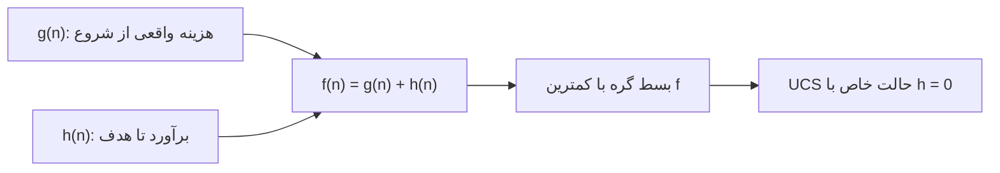

# جلسه ۸: الگوریتم A*

> **درس:** مقدمه‌ای بر هوش مصنوعی و کاربرد آن در مهندسی پزشکی
> **مدت پیشنهادی:** ۶۰ تا ۹۰ دقیقه · **سطح:** مقدماتی
> **منابع این جلسه:** منبع ۱ (Russell & Norvig, 2016)، منبع ۱۱ (محتوای مدرس)

---

## اهداف جلسه
در پایان این جلسه دانشجو می‌تواند:
1. ترکیب $f(n) = g(n) + h(n)$ را توضیح دهد و نقش هر جزء را بگوید.
2. شبه‌کد A* را بخواند و روی یک مثال کوچک چند گام اجرا کند.
3. نقش هیوریستیک مجاز (Admissible) و ثابت (Consistent) را در تضمین بهینگی A* توضیح دهد.
4. A* را با UCS از نظر هزینه مسیر و تعداد گره‌های بسط‌یافته مقایسه کند.

---

## ۱. ایده اصلی A*: ترکیب گذشته و آینده
جلسه قبل دیدیم که Greedy فقط به آینده نگاه می‌کرد ($f = h$) و بهینه نبود، و UCS فقط گذشته را می‌شمرد ($f = g$) و بهینه بود اما کورکورانه همه جهت‌ها را گسترش می‌داد. الگوریتم A* (تلفظ: ای-استار) این دو را جمع می‌کند:

$$f(n) = g(n) + h(n)$$

| نماد | معنا | منشأ |
|---|---|---|
| $g(n)$ | هزینه واقعی پیموده‌شده از شروع تا $n$ | دقیق |
| $h(n)$ | برآورد هزینه از $n$ تا هدف | ابتکاری (برآورد) |
| $f(n)$ | برآورد کل هزینه مسیری که از $n$ می‌گذرد | ترکیب |

شهود: $f(n)$ حدس A* درباره «کمترین هزینه کل یک مسیر است که از گره $n$ عبور کند». A* همیشه گره‌ای با کمترین $f$ را بسط (Expand) می‌دهد.



> [!NOTE]
> A* یک چارچوب خانوادگی است: با $h = 0$ دقیقاً UCS می‌شود (جلسه ۶)؛ هرچه $h$ دقیق‌تر باشد، گسترش هدفمندتر و تعداد گره‌های بسط‌یافته کمتر می‌شود.

## ۲. شبه‌کد A*
ساختار همان UCS جلسه ۶ است با یک تفاوت: اولویت صف با $g(n) + h(n)$ تعیین می‌شود.

```text
A*(گراف G، شروع S، هدف T، هیوریستیک h):
    صف اولویت ← {(h(S), S)}          # ترتیب بر اساس f = g + h
    g[S] ← 0 ، والد[S] ← هیچ
    تا وقتی صف خالی نیست:
        u ← گره با کمترین f از صف
        اگر u قبلاً بسط یافته است: ادامه (نسخه کهنه)
        اگر u = T: بازسازی مسیر با والد‌ها و توقف
        u را بسط‌یافته علامت بزن
        برای هر همسایه v با هزینه c(u,v):
            g_new ← g[u] + c(u,v)
            اگر g_new < g[v]:
                g[v] ← g_new ، والد[v] ← u
                افزودن (g_new + h(v), v) به صف
    گزارش شکست
```

در پیاده‌سازی پایتون از `heapq` (صف اولویت مبتنی بر heap در کتابخانه استاندارد) استفاده می‌کنیم؛ برای شکستن تساوی‌ها یک شمارنده کنار $f$ نگه می‌داریم. نکته‌های مهم:

- **بستن گره هنگام خروج از صف:** با هیوریستیک ثابت، نخستین بار که گره از صف خارج می‌شود، $g$ آن بهینه است و نیازی به بسط دوباره (Reopening) نیست.
- **کامل بودن:** روی گراف‌های متناهی با هزینه یال‌های مثبت، A* پاسخ می‌یابد اگر راه‌حلی وجود داشته باشد.
- **حافظه:** A* همه گره‌های تولیدشده را نگه می‌دارد؛ در گراف‌های بزرگ این می‌تواند گلوگاه باشد.

## ۳. بهینگی A* و نقش مجاز بودن و ثبات
قضیه (به زبان ساده): **اگر $h$ ثابت (Consistent) باشد، نسخه گرافی A* — همان که در کد این جلسه پیاده‌سازی شده است، با فهرست بسته و بدون بازگشایی — مسیر بهینه را پیدا می‌کند.** ثبات شرط قوی‌تری از مجاز بودن است: هر هیوریستیک ثابت مجاز هم هست، اما عکس آن همیشه برقرار نیست. در نسخه درختی A* یا نسخه‌ای که گره‌های بسته‌شده را با $g$ بهتر بازگشایی (Reopening) می‌کند، مجاز بودن به‌تنهایی برای بهینگی کافی است.

چرا؟ (شهود) در طول مسیر بهینه با هزینه $C^*$، همیشه دست‌کم یک گره در صف هست که $f$ آن حداکثر $C^*$ است (چون $h$ کم‌برآورد است، $f = g + h$ از هزینه واقعی آن مسیر بیشتر حدس زده نمی‌شود). A* تا وقتی چنین گره‌ای در صف است، هیچ گره‌ای با $f > C^*$ را بسط نمی‌دهد؛ پس قبل از هر مسیر گران‌تر، مسیر بهینه را می‌یابد.

- نقش **ثبات** در نسخه گرافی: شرط $h(n) \le c(n, n') + h(n')$ تضمین می‌کند نخستین بار که گره‌ای از صف خارج می‌شود $g$ آن بهینه است؛ پس بستن گره و نادیده گرفتن نسخه‌های بعدی بی‌خطر است و هر گره حداکثر یک بار بسط می‌یابد.
- با هیوریستیک **غیرمجاز** (بیش‌برآورد) تضمین بهینگی از بین می‌رود: الگوریتم ممکن است مسیر بهینه را «گران» فرض کند و کنار بگذارد.

| الگوریتم | صف بر اساس | بهینه؟ (با شرط مناسب روی h) | تفاوت اصلی |
|---|---|---|---|
| UCS | $g(n)$ | بله | گسترش یکنواخت، گره زیاد |
| Greedy | $h(n)$ | خیر | سریع، بدون تضمین |
| A* | $g(n) + h(n)$ | بله، اگر $h$ ثابت باشد (نسخه گرافی) | تعادل هزینه واقعی و برآورد |

## ۴. مقایسه عملی UCS و A*
کد این جلسه روی همان شبکه راهروهای بیمارستان جلسه ۷ اجرا می‌شود (راهروهای بسته: ستون ۱ در ردیف‌های ۰ تا ۲ و خانه‌های $(3,3)$ و $(4,3)$). خروجی واقعی:

| الگوریتم | هیوریستیک | هزینه مسیر | گره‌های بسط‌یافته | بهینه؟ |
|---|---|---|---|---|
| UCS | $h = 0$ | 10 | 20 | بله (مرجع) |
| A* | Manhattan | 10 | 14 | بله |
| A* | Euclidean | 10 | 14 | بله |
| A* | 2×Manhattan (غیرمجاز) | 10 | 14 | این‌بار بله، بدون تضمین |

مشاهدات:
1. **بهینگی عملی:** هزینه A* با هیوریستیک مجاز (۱۰) دقیقاً برابر هزینه UCS به‌عنوان مرجع است.
2. **صرفه‌جویی:** A* با Manhattan بیست گره UCS را به چهارده کاهش داد؛ چون $h$ گسترش‌های بی‌فایده سمت‌های دور از هدف را حذف می‌کند.
3. **هشدار غیرمجاز:** با $2 \times$ Manhattan در این اجرا اتفاقی مسیر بهینه پیدا شد، اما این شانس است؛ تضمین قضیه فقط با هیوریستیک مجاز (و در نسخه گرافی: ثابت) برقرار می‌شود.

مسیر بهینه پیدا شده (هر دو الگوریتم):

`(0,0) → (1,0) → (2,0) → (3,0) → (3,1) → (3,2) → (2,2) → (2,3) → (2,4) → (3,4) → (4,4)`

ترتیب واقعی بسط A* با Manhattan:

`(0,0) (1,0) (2,0) (3,0) (4,0) (3,1) (4,1) (3,2) (4,2) (2,2) (2,3) (2,4) (3,4) (4,4)`

می‌بینید که A* ابتدا گره‌های با $f = 8$ را می‌گیرد و حتی کمی به سمت پایین سر می‌کشد (همان رفتار Greedy) اما چون $g$ هم در $f$ هست، در نهایت مسیر بهینه را تضمین می‌کند.

> [!TIP]
> در کد، تابع `ucs` فقط `a_star` را با هیوریستیک صفر صدا می‌زند. اجرای هر دو و مقایسه ستون «گره‌های بسط‌یافته» بهترین نمایش اثر هیوریستیک است.

---

## 🔬 پیوند با مهندسی پزشکی
**اعزام آمبولانس در شهر شبکه‌ای (مثال آموزشی):** نقشه خیابان‌های بسیاری از شهرها تقریباً شبکه‌ای است؛ اگر هزینه هر بلوک خیابان یکسان فرض شود، فاصله منهتن یک هیوریستیک مجاز و ثابت است و A* مسیر کوتاه‌ترین مسافت را به بیمارستان می‌دهد و در مقایسه با UCS گره‌های کمتری بررسی می‌کند — یعنی روی دستگاه‌های ساده هم سریع پاسخ می‌دهد.

اما اگر معیار، **زمان رسیدن** باشد (ترافیک، یک‌طرفه بودن خیابان‌ها)، دیگر نمی‌توان از همان $h$ مبتنی بر مسافت استفاده کرد مگر آنکه برآورد $h$ نسبت به زمان هم مجاز بماند (مثلاً ضرب مسافت مستقیم در بیشینه سرعت مجاز). انتخاب نادرست $h$ یعنی از دست رفتن تضمین بهینگی، حتی اگر خروجی به‌ظاهر معقول باشد.

> [!WARNING]
> این مثال کاملاً آموزشی است؛ سامانه واقعی اعزام اورژانس به نقشه به‌روز، پروتکل اولویت بیمار و مجوزهای عملیاتی وابسته است و خروجی این کدها هیچ کاربرد تشخیصی یا تصمیم بالینی ندارد.

## ✍️ فعالیت کلاسی

### فعالیت ۱: ردیابی دستی A*
روی شبکه جلسه، پس از بسط گره $(3,0)$، گره‌های تازه صف به‌صورت زیرند (نسخه‌های تکراری گره‌های بسته‌شده در صف می‌مانند ولی نادیده گرفته می‌شوند؛ هیوریستیک Manhattan و هدف $(4,4)$):

| گره در صف | $g$ | $h$ | $f = g + h$ |
|---|---|---|---|
| (4,0) | 4 | 4 | 8 |
| (3,1) | 4 | 4 | 8 |

۱. کدام گره بعدی بسط می‌یابد؟ اگر دو گره $f$ برابر داشته باشند، پیاده‌سازی ما با ترتیب ورود به صف تصمیم می‌گیرد.

۲. پس از بسط گره انتخاب‌شده، $g$ و $h$ و $f$ همسایه‌های جدید را حساب کنید و بگویید کدام گره پس از آن بسط می‌یابد.

۳. ترتیب واقعی بسط کد عبارت است از: `(0,0) (1,0) (2,0) (3,0) (4,0) (3,1) ...` — آیا نتیجه دستی شما با آن می‌خواند؟

<details>
<summary>کلید پاسخ فعالیت ۱ (نمونه)</summary>

۱. هر دو گره $f = 8$ دارند؛ بر اساس ترتیب ورود، $(4,0)$ که هنگام بسط $(3,0)$ زودتر افزوده شده، بسط می‌یابد.

۲. همسایه‌های جدید $(4,0)$: گره $(4,1)$ با $g = 5$ و $h = 3$ و $f = 8$. پس از آن صف شامل $(3,1)$ و $(4,1)$ است که هر دو $f = 8$ دارند و $(3,1)$ چون زودتر وارد شده بسط می‌یابد (سپس $(4,1)$).

۳. ترتیب کامل واقعی کد: `(0,0) (1,0) (2,0) (3,0) (4,0) (3,1) (4,1) (3,2) (4,2) (2,2) (2,3) (2,4) (3,4) (4,4)`. ردیابی دستی تا اینجا با آن سازگار است.

</details>

### فعالیت ۲: اثر هیوریستیک
۱. در جدول بخش ۴ تعداد گره‌های بسط‌یافته A* با Manhattan و Euclidean برابر است. آیا ترتیب بسط آن‌ها هم یکی است؟ اجرای کد را بررسی کنید و نتیجه را با رفتار Greedy در جلسه ۷ مقایسه کنید.

۲. اگر همه هزینه‌های یال را دو برابر کنیم ولی همان تابع $h$ را نگه داریم، مسیر بهینه تغییر می‌کند؟ هزینه و تعداد بسط‌ها چه می‌شوند؟ و اگر $h$ را هم به همان نسبت بزرگ کنیم چه؟

<details>
<summary>کلید پاسخ فعالیت ۲ (نمونه)</summary>

۱. تعداد بسط برابر است (هر دو ۱۴ گره با هزینه ۱۰)، اما **ترتیب بسط یکی نیست** (اجرای واقعی کد):

- Manhattan: `(0,0) (1,0) (2,0) (3,0) (4,0) (3,1) (4,1) (3,2) (4,2) (2,2) (2,3) (2,4) (3,4) (4,4)`
- Euclidean: `(0,0) (1,0) (2,0) (3,0) (3,1) (3,2) (4,0) (4,1) (4,2) (2,2) (2,3) (2,4) (3,4) (4,4)`

علت: در گره $(3,0)$ برآورد Euclidean برای میان‌بر $(3,1)$ کوچک‌تر است ($f \approx 7.16$ در برابر $f = 8$ برای $(4,0)$)، پس $(3,1)$ و سپس $(3,2)$ زودتر بسط می‌یابند؛ در Manhattan این دو گره هر دو $f = 8$ دارند و ترتیب ورود به صف تصمیم می‌گیرد. Greedy مرتب‌سازی کاملاً متفاوتی (فقط $h$) دارد، پس رفتارش قابل مقایسه مستقیم با A* نیست.

۲. با هزینه‌های دوبرابر و همان Manhattan، مسیر بهینه همان مسیر است و هزینه آن ۲۰ می‌شود؛ UCS بی‌تغییر ۲۰ گره بسط می‌دهد (مقیاس‌شدن یکنواخت $g$ ترتیب صف را عوض نمی‌کند)، اما A* با همان $h$ این‌بار ۱۶ گره بسط می‌دهد: در $f = g + h$ حالا $g$ دوبرابر شده ولی $h$ نه، پس وزن نسبی $h$ کمتر و جست‌وجو کمتر هدفمند می‌شود. اگر $h$ را هم در همان نسبت بزرگ کنیم ($2h$)، تعداد بسط به ۱۴ و ترتیب بسط به حالت اول برمی‌گردد.

</details>

## 💻 کد آموزشی
فایل `code/session_08_a_star.py` (فقط کتابخانه استاندارد، `heapq`):

```bash
python3 code/session_08_a_star.py
```

این اسکریپت:
1. همان گراف جلسه ۷ را به‌صورت دیکشنری همسایه‌ها می‌سازد (`build_graph`).
2. `a_star(graph, start, goal, h)` را با صف اولویت $f = g + h$ پیاده‌سازی می‌کند و `ucs` همان تابع با $h = 0$ است.
3. مجاز بودن و ثبات هیوریستیک‌ها را با محاسبه $h^*$ (Dijkstra از هدف) بررسی و چاپ می‌کند.
4. مسیر بهینه، هزینه، تعداد گره‌های بسط‌یافته و ترتیب بسط را چاپ می‌کند و هزینه A* را با UCS مقایسه می‌کند.

> [!NOTE]
> همه کدهای این درس آموزشی و غیرتشخیصی‌اند؛ شبکه بیمارستان و هزینه‌ها ساختگی‌اند.

## 📘 واژه‌نامه

| واژه | معنی |
|---|---|
| A* Search | الگوریتم A*؛ جست‌وجوی اول-بهترین با $f = g + h$ |
| g(n) | هزینه واقعی از شروع تا گره $n$ |
| f(n) | برآورد کل هزینه مسیر از طریق $n$ |
| Optimal | بهینه؛ کمترین هزینه کل |
| Reopening | بسط دوباره گره بسته‌شده با $g$ بهتر |
| Priority Queue / heapq | صف اولویت / پیاده‌سازی heap در پایتون |

## ❓ پرسش‌های خودآزمون
1. $g(n)$ و $h(n)$ و $f(n)$ هر کدام چه چیزی را نشان می‌دهند و کدام‌یک دقیق و کدام برآورد است؟
2. چرا UCS حالت خاص A* است؟
3. اگر هیوریستیک غیرمجاز باشد کدام تضمین A* از بین می‌رود؟ با مثال $2 \times$ Manhattan توضیح دهید.
4. با هیوریستیک ثابت، چرا هر گره حداکثر یک بار بسط داده می‌شود؟

> کلید پاسخ‌ها در بخش «راهنمای مدرس» انتهای فایل آمده است.

## 📝 تکلیف
1. کد `code/session_08_a_star.py` را اجرا کنید و جدول مقایسه UCS و A* (هزینه و تعداد بسط) را گزارش کنید.
2. خانه $(2,3)$ را به `BLOCKED` اضافه کنید و دوباره اجرا کنید. مسیر جدید و هزینه آن چیست؟ آیا A* همچنان همان هزینه UCS را به دست می‌دهد؟ تعداد بسط‌ها را مقایسه و نتیجه را در چند جمله تحلیل کنید.

## 📚 مطالعه پیشنهادی
- Russell & Norvig (2016)، فصل ۳: بخش جست‌وجوی آگاهانه (A* و خواص آن)
- مرور دوباره جلسه ۷ برای مفاهیم مجاز/ثابت

---

## 🧭 راهنمای مدرس (از این عنوان تا انتها در نسخه دانشجو حذف شود)

**زمان‌بندی پیشنهادی برای ۹۰ دقیقه:** مرور جلسه ۷ (۵) | ایده $f = g + h$ (۱۵) | شبه‌کد و نکات پیاده‌سازی (۲۰) | بهینگی و نقش مجاز بودن (۱۵) | مقایسه عملی با UCS و تحلیل خروجی کد (۱۵) | فعالیت‌های ۱ و ۲ (۱۵) | جمع‌بندی (۵)

**نسخه ۶۰ دقیقه‌ای:** ایده $f = g + h$ با جدول نمادها (۱۲)، شبه‌کد با تأکید بر تفاوت با UCS (۱۵)، بهینگی و نقش مجاز بودن (۱۲)، جدول مقایسه عملی از خروجی کد (۱۲)، فعالیت ۱ (۷)، جمع‌بندی و تکلیف (۲). فعالیت ۲ و تغییر کد به تکلیف منتقل شود.

**نکات:**
- شبه‌کد را با UCS جلسه ۶ مقایسه کنید و بگذارید دانشجویان خودشان تفاوت (فقط خط اولویت‌بندی) را پیدا کنند.
- اثبات کامل بهینگی در سطح این درس به‌صورت شهودی ارائه شد؛ از دانشجویان ریاضی‌تر می‌توان بحث «گره‌ای با $f \le C^*$ همیشه در صف هست» را پرسید.
- نتیجه جالب برای بحث: A* با $2 \times$ Manhattan در این اجرا اتفاقاً مسیر بهینه داد؛ تأکید کنید تضمین چیزی نیست که بتوان روی آن حساب کرد و همین تفاوت «تضمین» با «اتفاق» است.
- برای دانشجویان علاقه‌مند: در جلسه ۱۱ با گرادیان کاهشی و در جلسه ۱۰ با جست‌وجوی محلی دوباره به ایده «هدایت جست‌وجو با یک سنجه» برمی‌گردیم.

### خروجی مورد انتظار جلسه
دانشجو بتواند $f(n)$ را برای چند گره حساب کند، تفاوت UCS و A* را از نظر تعداد بسط توضیح دهد و بگوید کدام ویژگی $h$ تضمین بهینگی می‌دهد.

### نکته فنی درباره کد
- شمارش بسط = تعداد خروج‌های مؤثر از صف (نسخه‌های تکراری شمرده نمی‌شوند).
- در گام ۱ کد، «بیشینه $h(n) - h^*(n)$» برای Manhattan و Euclidean برابر ۰.۰۰ است (مجاز) و برای $2 \times$ Manhattan برابر ۶.۰۰ (غیرمجاز). این عدد سریع‌ترین آزمون مجاز بودن روی کل گراف است.
- ترتیب تساوی‌ها به پیاده‌سازی صف بستگی دارد؛ اگر دانشجویی مسیر هم‌هزینه دیگری دید، اشکالی ندارد.

### کلید پاسخ تکلیف (اجرای واقعی کد با خانه بسته (2,3))

<details>
<summary>نمایش کلید پاسخ تکلیف</summary>

با افزودن $(2,3)$ به خانه‌های بسته:
- مسیر بهینه از بالا دور می‌زند: `(0,0) (1,0) (2,0) (3,0) (3,1) (3,2) (2,2) (1,2) (1,3) (1,4) (2,4) (3,4) (4,4)`
- هزینه A* با Manhattan: ۱۲ با ۱۶ گره بسط‌یافته؛ هزینه UCS: ۱۲ با ۱۹ گره بسط‌یافته.
- نتیجه: A* همچنان هزینه بهینه UCS را داد (تضمین با $h$ مجاز پابرجاست) و گره کمتری بسط داد.

</details>

### کلید پاسخ پرسش‌های خودآزمون

<details>
<summary>نمایش کلید پاسخ</summary>

1. $g(n)$ هزینه واقعی پیموده‌شده از شروع (دقیق)، $h(n)$ برآورد هزینه تا هدف (ابتکاری)، و $f(n) = g(n) + h(n)$ برآورد کل هزینه مسیری که از $n$ می‌گذرد.
2. چون با $h = 0$ داریم $f = g$؛ یعنی صف فقط با هزینه واقعی مرتب می‌شود که همان UCS است.
3. تضمین بهینگی. با بیش‌برآورد ممکن است A* مسیر بهینه را گران فرض و کنار بگذارد؛ در جدول بخش ۴ با $2 \times$ Manhattan بهینه بودن فقط اتفاقی بود، نه تضمین‌شده.
4. چون شرط ثبات ($h(n) \le c(n,n') + h(n')$) تضمین می‌کند نخستین بار که گره از صف خارج می‌شود، $g$ آن بهینه است؛ پس هیچ مسیر بهتری بعدها پیدا نمی‌شود که نیاز به بسط دوباره داشته باشد.

</details>
