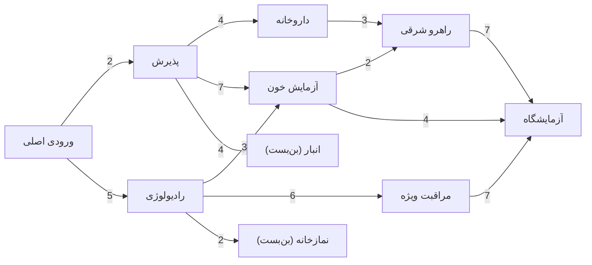

# جلسه ۹: کارگاه پیاده‌سازی الگوریتم‌های جست‌وجو

> **درس:** مقدمه‌ای بر هوش مصنوعی و کاربرد آن در مهندسی پزشکی
> **مدت پیشنهادی:** ۶۰ تا ۹۰ دقیقه (کارگاه عملی) · **سطح:** مقدماتی
> **منابع این جلسه:** منبع ۱ (Russell & Norvig, 2016)، منبع ۱۰ (Python Machine Learning by Example, 2017)، منبع ۱۱ (محتوای مدرس)

---

## اهداف جلسه
در پایان این جلسه دانشجو می‌تواند:
1. چهار الگوریتم جست‌وجو (BFS، DFS، UCS و A*) را روی یک گراف مشترک اجرا و خروجی آن‌ها را کنار هم بگذارد.
2. جدول مقایسه (مسیر، هزینه مسیر (Path Cost)، تعداد گره‌های بسط‌یافته (Expanded Nodes) و زمان اجرا) را تفسیر کند.
3. توضیح دهد چرا BFS بهینه‌ی تعداد یال است اما نه بهینه‌ی هزینه، و چرا DFS هیچ تضمین بهینگی ندارد.
4. نقش هیوریستیک مجاز (Admissible Heuristic) را در کاهش گره‌های بسط‌یافته‌ی A* با آزمایش نشان دهد.
5. با تغییر عمدی پارامترهای مسئله، رفتار الگوریتم‌ها را پیش‌بینی و بررسی کند.

> [!IMPORTANT]
> پیش‌نیاز این جلسه، جلسات ۵ تا ۸ است. این جلسه نظریه جدید معرفی نمی‌کند؛ کارگاه «اجرا، مقایسه و آزمایش» است و سهم اصلی یادگیری از اجرای کد توسط خود دانشجو به‌دست می‌آید.

---

## ۱. یادآوری کوتاه چهار الگوریتم
هر چهار الگوریتم فقط در «ترتیب بیرون‌کشیدن از مرز جست‌وجو (Frontier)» با هم فرق دارند:

| الگوریتم | ساختار مرز | ترتیب بیرون‌کشی | تضمین بهینگی هزینه |
|---|---|---|---|
| BFS | صف (Queue) | اول سطح کمتر | فقط اگر همه یال‌ها هم‌هزینه باشند |
| DFS | پشته (Stack) | آخرین گره واردشده | ندارد |
| UCS | صف اولویت بر اساس $g$ | کمترین هزینه از مبدأ | بله |
| A* | صف اولویت بر اساس $g + h$ | کمترین $g + h$ | بله، اگر $h$ مجاز باشد |

در این جدول $g$ هزینه واقعی از مبدأ تا گره و $h$ برآورد هیوریستیک فاصله تا هدف است. اگر $h(n)$ هرگز بیشتر از هزینه‌ی واقعی رسیدن از $n$ به هدف نباشد، هیوریستیک «مجاز» (Admissible) است.

## ۲. مسئله کارگاه: مسیریابی در یک بیمارستان
مسئله‌ی مشترک همه‌ی الگوریتم‌ها: یافتن مسیر از **ورودی اصلی (S)** تا **آزمایشگاه (G)** در گراف زیر. وزن هر یال فاصله‌ی تقریبی راهرو بر حسب متر است و یال‌ها دوبطرفه‌اند. دو بخش **انبار (H)** و **نمازخانه (I)** بن‌بست‌اند و برای رسیدن به آزمایشگاه بی‌فایده‌اند؛ همین دو گره در ادامه نقش مهمی در مقایسه پیدا می‌کنند.



هیوریستیک استفاده‌شده در A*، برآورد فاصله‌ی هر بخش تا آزمایشگاه است (مثلاً $h(D) = 4$ چون از D یک یال ۴ متری مستقیم تا G هست). این مقادیر در کد به‌صورت دیکشنری `HEURISTIC` تعریف شده‌اند و برای این گراف مجاز و سازگار (Consistent) هستند.

## ۳. اجرا و خواندن جدول مقایسه
اسکریپت کارگاه را اجرا کنید:

```bash
python3 code/session_09_search_workshop.py
```

خروجی مشاهده‌شده در اجرای ما به این شکل است (ستون زمان در سیستم‌های مختلف متفاوت می‌شود؛ در اجرای ما همه‌ی روش‌ها در حد چند صدم تا حدود ۰٫۲ میلی‌ثانیه بودند):

| الگوریتم | مسیر پیدا شده | تعداد یال | هزینه (متر) | گره‌های بسط‌یافته |
|---|---|---:|---:|---:|
| BFS | S → A → D → G | 3 | 13 | 9 |
| DFS | S → A → C → F → G | 4 | 16 | 4 |
| UCS | S → B → D → G | 3 | 12 | 9 |
| A* | S → B → D → G | 3 | 12 | 4 |

چهار نتیجه‌ی کلیدی که باید از این جدول ببینید:

1. **BFS** کوتاه‌ترین مسیر از نظر تعداد یال را می‌دهد (۳ یال)، اما چون وزن یال‌ها را نمی‌بیند، هزینه‌اش (۱۳) از مسیر بهینه بیشتر است.
2. **DFS** با فقط ۴ بسط زود به هدف رسید، اما مسیرش (هزینه ۱۶) بهینه نیست؛ سرعت به معنای کیفیت نیست.
3. **UCS** مسیر بهینه (هزینه ۱۲) را تضمین می‌کند، اما برای اطمینان از آن تقریباً همه‌ی گره‌ها را بسط داد — حتی بن‌بست‌های H و I.
4. **A*** با همان گراف و هیوریستیک مجاز، **دقیقاً همان مسیر بهینه** را با نصف گره‌های بسط‌یافته‌ی UCS (۴ در برابر ۹) پیدا کرد. هیوریستیک خوب یعنی «جست‌وجوی هوشمندانه‌تر».

> [!TIP]
> ستون «گره‌های بسط‌یافته» مهم‌ترین ستون این کارگاه است: هزینه‌ی محاسباتی الگوریتم‌های جست‌وجو را همان تعداد گره‌های بسط‌یافته تعیین می‌کند، نه طول مسیر نهایی.

---

## 🔬 پیوند با مهندسی پزشکی
مسیریابی راهروی بیمارستان یک مسئله‌ی واقعی عملیات بیمارستانی است: انتقال تخت بیمار بین بخش‌ها، مسیر پرستار برای واکسیناسیون، یا مسیر ربات‌های انتقال دارو و غذا در بیمارستان‌های اتوماسیون‌شده. همان چهار الگوریتم این جلسه هسته‌ی چنین سامانه‌هایی‌اند و مقایسه‌ی «هزینه» با «تعداد گره‌های بسط‌یافته» دقیقاً همان چیزی است که در مقیاس نقشه‌ی کامل یک بیمارستان (ده‌ها هزار گره) تعیین می‌کند کدام الگوریتم عملی باشد. همین چارچوب بعداً در مسیرهای پیچیده‌تر — مثل برنامه‌ریزی حرکت بازوی ربات جراحی — هم دوباره ظاهر می‌شود. یادآوری: این مثال جنبه‌ی آموزشی دارد و هیچ‌یک از خروجی‌های این کارگاه کاربرد تشخیصی یا بالینی ندارد.

## ✍️ فعالیت کلاسی / کارگاه
۱. اسکریپت را اجرا کنید و جدول خروجی را در گزارش خود بنویسید.
۲. نوت‌بوک `code/session_09_search_workshop.ipynb` را در Colab باز کنید و سلول‌ها را به‌ترتیب اجرا کنید.
۳. **آزمایش ۱ — هیوریستیک صفر:** در نوت‌بوک، A* را با هیوریستیک همگی صفر اجرا کنید. خروجی را با UCS مقایسه کنید و توضیح دهید چرا این دو یکسان شدند.
۴. **آزمایش ۲ — تغییر فاصله:** در کپی اسکریپت، وزن یال S–B را از ۵ به ۲ تغییر دهید. کدام الگوریتم‌ها مسیر جدیدی پیدا می‌کنند و چرا BFS تغییری نمی‌کند؟
۵. **آزمایش ۳ — یال میان‌بُر:** یک یال مستقیم بین انبار و آزمایشگاه با وزن ۱ اضافه کنید. UCS چه مسیری پیدا می‌کند؟ A* با همان `HEURISTIC` قبلی چه؟ (کلید و توضیح در راهنمای مدرس آمده است.)
۶. (اختیاری) یک الگوریتم را با LLM مرور کنید: از آن بخواهید تفاوت UCS و A* را روی همین کد توضیح دهد و ادعایش را با خروجی واقعی بسنجید.

### چک‌لیست پایان جلسه
- [ ] اسکریپت و نوت‌بوک را اجرا کردم.
- [ ] می‌توانم بگویم کدام ستون جدول «بهینگی» و کدام ستون «هزینه‌ی محاسباتی» را نشان می‌دهد.
- [ ] آزمایش ۱ تا ۳ را انجام دادم و نتیجه را با پیش‌بینی اولیه‌ام مقایسه کردم.

## 💻 کد آموزشی
- `code/session_09_search_workshop.py` — گراف مشترک، پیاده‌سازی کامل BFS/DFS/UCS/A* و چاپ جدول مقایسه؛ فقط با کتابخانه استاندارد پایتون.
- `code/session_09_search_workshop.ipynb` — همان محتوا سلول‌به‌سلول برای اجرای تعاملی در Colab؛ سلول اول وارد کردن کتابخانه‌های استاندارد را بررسی می‌کند و سلول پایانی آزمایش هیوریستیک صفر را آماده دارد.

هر دو فایل آفلاین اجرا می‌شوند و به نصب کتابخانه‌ی اضافه نیاز ندارند.

## 📘 واژه‌نامه

| واژه | معنی |
|---|---|
| Frontier | مرز جست‌وجو؛ مجموعه گره‌های کشف‌شده ولی هنوز بسط‌داده‌نشده |
| Expanded | گره‌ی بسط‌یافته؛ گره‌ای که همسایه‌هایش تولید شده‌اند |
| Path Cost | هزینه‌ی مسیر؛ جمع وزن یال‌ها از مبدأ تا هدف |
| Admissible Heuristic | هیوریستیک مجاز؛ برآوردی که هرگز از هزینه‌ی واقعی بیشتر نیست |
| Consistent | سازگار؛ هیوریستیک‌ای که اختلاف h دو گره از هزینه‌ی یال بین‌شان بیشتر نیست |
| Tie-breaking | شکستن تساوی؛ قاعده‌ی انتخاب در صف اولویت هنگام برابری اولویت‌ها |

## ❓ پرسش‌های خودآزمون
1. چرا مسیر BFS و مسیر UCS در جدول جلسه متفاوت است، با اینکه هر دو ۳ یال دارند؟
2. A* و UCS هر دو مسیر بهینه را پیدا کردند؛ تفاوت اصلی‌شان در کدام ستون جدول دیده می‌شود و چرا؟
3. اگر یک هیوریستیک مجاز نباشد (مثلاً h یک گره بیشتر از فاصله‌ی واقعی‌اش باشد)، کدام ویژگی A* از دست می‌رود؟

> کلید پاسخ‌ها در بخش «راهنمای مدرس» انتهای فایل آمده است.

## 📝 تکلیف
جدول مقایسه را از اجرای واقعی کد گزارش کنید؛ برای هر یک از آزمایش‌های ۱ تا ۳، خروجی مشاهده‌شده و توضیح دو سه جمله‌ای خود را بنویسید. در پایان یک پاراگراف درباره‌ی این بنویسید که برای نقشه‌ی یک بیمارستان بزرگ کدام‌یک از چهار الگوریتم را انتخاب می‌کردید و چرا.

## 📚 مطالعه پیشنهادی
- Russell & Norvig (2016)، فصل ۳: جست‌وجوی اول-سطح، اول-عمق، یکنواخت هزینه و A* (بخش‌های مرور جلسات ۵ تا ۸)
- Liu (2017)، Python Machine Learning by Example: بخش‌های مقدماتی پایتون برای خواندن راحت کد کارگاه
- محتوای مدرس: اسلاید و نکات جلسات ۵ تا ۸ به‌عنوان مرجع نظری این کارگاه

---

## 🧭 راهنمای مدرس (از این عنوان تا انتها در نسخه دانشجو حذف شود)

**زمان‌بندی پیشنهادی برای ۹۰ دقیقه:** یادآوری چهار الگوریتم (۱۰) | مرور مسئله و کد (۱۵) | اجرای اسکریپت و خواندن جدول (۱۵) | آزمایش‌های ۱ تا ۳ در نوت‌بوک (۳۰) | بحث نتیجه‌ها و انتخاب الگوریتم برای بیمارستان بزرگ (۱۰) | جمع‌بندی (۱۰)

**نسخه ۶۰ دقیقه‌ای:** یادآوری (۵)، اجرای اسکریپت و جدول (۱۰)، آزمایش‌های ۱ و ۲ (۲۵)، آزمایش ۳ به‌صورت نمایشی توسط مدرس (۱۰)، جمع‌بندی و تکلیف (۱۰). آزمایش ۳ را حتماً نمایشی اجرا کنید؛ اثر «هیوریستیک نامجاز» باقی‌مانده‌ی بهترین یادگیری این جلسه است.

**نکات:**
- پیش از کلاس، اسکریپت را یک‌بار اجرا و نوت‌بوک را در Colab آزمایش کنید.
- خروجی ستون زمان به سخت‌افزار وابسته است؛ از مقایسه‌ی زمان بین دانشجویان نتیجه‌گیری نکنید.
- اگر دانشجویی جلسات ۵ تا ۸ را ندیده، او را با یک هم‌کلاسی هم‌گروه کنید و فقط تابع اجرا و جدول را از او بخواهید.
- دانشجویان سریع‌تر می‌توانند آزمایش چهارم بسازند: خودشان یک هیوریستیک نامجاز طراحی کنند و خروجی A* را پیش‌بینی کنند.

### خروجی مورد انتظار جلسه
هر دانشجو باید جدول مقایسه را از اجرای واقعی گزارش کند و بتواند در یک جمله بگوید «UCS بهینگی را تضمین می‌کند اما گران است؛ A* با هیوریستیک مجاز همان بهینگی را ارزان‌تر می‌دهد».

### کلید پاسخ آزمایش‌ها (از اجرای واقعی کد)

<details>
<summary>نمایش کلید پاسخ</summary>

- **آزمایش ۱ (h صفر):** A* مسیر `S -> B -> D -> G` با هزینه ۱۲ و ۹ گره بسط‌یافته می‌دهد — دقیقاً خروجی UCS. با $h = 0$ ترتیب صف اولویت فقط بر اساس $g$ است، پس A* به UCS تبدیل می‌شود.
- **آزمایش ۲ (S–B از ۵ به ۲):** UCS و A* هر دو مسیر `S -> B -> D -> G` را با هزینه‌ی جدید ۹ پیدا می‌کنند (تعداد بسط‌ها بدون تغییر: ۹ و ۴). BFS همان مسیر قدیمی `S -> A -> D -> G` با هزینه ۱۳ را می‌دهد، چون تعداد یال مسیر S–B–D–G عوض نشده است. DFS هم مسیر قبلی خودش را می‌دهد (هزینه ۱۶).
- **آزمایش ۳ (یال H–G با وزن ۱):** UCS مسیر بسیار کوتاه‌تر `S -> A -> H -> G` با هزینه‌ی ۷ را پیدا می‌کند (۶ گره بسط‌یافته؛ چون G زودتر با هزینه‌ی کمتر کشف می‌شود). اما A* با همان `HEURISTIC` قبلی همچنان مسیر هزینه ۱۲ را برمی‌گرداند! دلیل: حالا $h(H) = 11$ از فاصله‌ی واقعی H تا G (که ۱ است) بیشتر است، پس هیوریستیک مجاز نیست و تضمین بهینگی A* نقض می‌شود. نکته‌ی جانبی: BFS هم این میان‌بُر را نمی‌بیند (مسیرش ۳ یال با هزینه ۱۳ می‌ماند).

</details>

### کلید پاسخ پرسش‌های خودآزمون

<details>
<summary>نمایش کلید پاسخ</summary>

1. هر دو مسیر ۳ یال دارند، اما UCS یال‌ها را با وزن شان جمع می‌کند و مسیر ۵+۳+۴=۱۲ را به مسیر ۲+۷+۴=۱۳ ترجیح می‌دهد؛ BFS وزن نمی‌بیند و اولین مسیر ۳ یالی را که در سطح سوم پیدا کند برمی‌گرداند (`S -> A -> D -> G`، هزینه ۱۳).
2. در ستون «گره‌های بسط‌یافته»: هر دو هزینه‌ی ۱۲ را می‌دهند اما UCS نُه گره و A* فقط چهار گره بسط داد. هیوریستیک $h$ گره‌هایی مثل بن‌بست‌های H و I را که از هدف دورند به عقب صف می‌فرستد، پس A* انرژی‌اش را روی گره‌های امیدبخش می‌گذارد.
3. بهینگی (Optimality). A* با هیوریستیک نامجاز ممکن است مسیری گران‌تر از بهینه برگرداند؛ سرعتش همیشه هم بهتر نمی‌شود. (در آزمایش ۳ همین را به‌چشم دیدیم.)

</details>