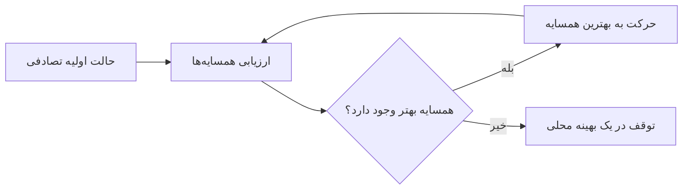
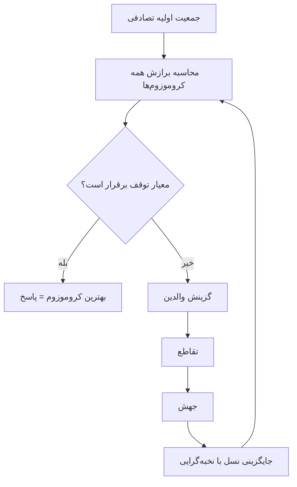

# جست‌وجوی محلی و الگوریتم ژنتیک

> **منابع این جلسه:** منبع ۱ (Russell & Norvig, 2016)، منبع ۳ (Pham et al., 2021)، منبع ۱۱ (محتوای مدرس)

---

## 🎯 اهداف جلسه
در پایان این جلسه دانشجو می‌تواند:
1. تفاوت جست‌وجوی محلی (Local Search) با جست‌وجوی مسیر جلسات قبل را توضیح دهد.
2. صعود قله (Hill Climbing) و مشکل بهینه‌ی محلی (Local Optimum) را روی یک مثال دستی و روی خروجی واقعی کد نشان دهد.
3. نقش دما در شبیه‌سازی تبرید (Simulated Annealing) و رابطه‌ی احتمال پذیرش با ΔF و T را توضیح دهد.
4. اجزای الگوریتم ژنتیک (برازش، گزینش، تقاطع، جهش، نخبه‌گرایی) را روی مسئله‌ی «چیدمان سنسور» تشریح کند.
5. با تغییر seed و نرخ جهش، رفتار سه روش را مقایسه و گزارش کند.

> [!NOTE]
> در جلسات ۵ تا ۸ مهم بود که **مسیر** از مبدأ تا هدف چیست. اینجا مسیر مهم نیست؛ فقط «یک حالت نهایی خوب» می‌خواهیم. همین ایده پایه‌ی بسیاری از روش‌های تنظیم پارامتر در یادگیری ماشین جلسات بعدی است.

---

## ۱. جست‌وجوی محلی: چرا و چگونه؟

### ۱.۱ مسئله از کجا می‌آید؟
فرض کنید باید **سه سنسور** را روی یک مسیر ۲۰ خانه‌ای (مثلاً یک تشک بیمار) جا بدهید. تعداد کل چیدمان‌ها حدود ۲۰ × ۲۰ × ۲۰ = ۸۰۰۰ است؛ این عدد کوچک است. اما اگر ۱۰۰ سنسور و ۱۰۰۰ خانه داشتیم، تعداد حالت‌ها از تعداد اتم‌های جهان هم بیشتر می‌شد. در چنین مسائلی نه می‌توان همه‌ی حالت‌ها را بررسی کرد و نه (مثل UCS) همه را در حافظه نگه داشت.

### ۱.۲ راه‌حل: فقط «همین‌جا» را ببین
جست‌وجوی محلی سه ویژگی ساده دارد:

- فقط **حالت فعلی** و همسایه‌هایش را نگه می‌دارد (حافظه‌ی بسیار کم).
- مسیر را ذخیره نمی‌کند؛ فقط به سمت حالت بهتر می‌رود.
- هر حالت یک امتیاز دارد به نام **برازش (Fitness)**؛ هرچه بیشتر، بهتر.

### ۱.۳ منظر جست‌وجو (Search Landscape)
تصور کنید روی یک کوهستان مه‌گرفته ایستاده‌اید و فقط پای خودتان و کمی اطرافش را می‌بینید. هر نقطه ارتفاعی دارد (همان برازش). هدف رسیدن به **بلندترین قله** است (بیشینه‌ی سراسری یا Global Maximum).

مشکل: ممکن است به قله‌ای برسید که از همه‌ی اطرافش بلندتر است ولی بلندترین قله‌ی کوهستان نیست. این یک **بهینه‌ی محلی** است.

برای یاد گرفتن الگوریتم‌ها، یک **کوهستان اسباب‌بازی** می‌سازیم: یک سنسور روی ۱۰ خانه (شماره‌های ۰ تا ۹) و برازش هر خانه طبق جدول زیر. همسایه‌های هر خانه، خانه‌ی چپ و راست آن‌اند.

| خانه | ۰ | ۱ | ۲ | ۳ | ۴ | ۵ | ۶ | ۷ | ۸ | ۹ |
|---|---|---|---|---|---|---|---|---|---|---|
| برازش | ۴ | ۶ | **۹** | ۷ | ۵ | ۸ | ۱۲ | **۱۴** | ۱۰ | ۶ |

<div dir="ltr" style="font-family:Tahoma,sans-serif;max-width:560px;margin:12px auto;">
  <div style="display:flex;align-items:flex-end;gap:6px;height:190px;border-bottom:2px solid #555;padding:0 6px;">
    <div style="flex:1;text-align:center;"><small>4</small><div style="height:56px;background:#90a4ae;"></div></div>
    <div style="flex:1;text-align:center;"><small>6</small><div style="height:84px;background:#90a4ae;"></div></div>
    <div style="flex:1;text-align:center;"><small><b>9</b></small><div style="height:126px;background:#ff9800;"></div></div>
    <div style="flex:1;text-align:center;"><small>7</small><div style="height:98px;background:#90a4ae;"></div></div>
    <div style="flex:1;text-align:center;"><small>5</small><div style="height:70px;background:#90a4ae;"></div></div>
    <div style="flex:1;text-align:center;"><small>8</small><div style="height:112px;background:#90a4ae;"></div></div>
    <div style="flex:1;text-align:center;"><small>12</small><div style="height:168px;background:#90a4ae;"></div></div>
    <div style="flex:1;text-align:center;"><small><b>14</b></small><div style="height:196px;background:#43a047;"></div></div>
    <div style="flex:1;text-align:center;"><small>10</small><div style="height:140px;background:#90a4ae;"></div></div>
    <div style="flex:1;text-align:center;"><small>6</small><div style="height:84px;background:#90a4ae;"></div></div>
  </div>
  <div style="display:flex;gap:6px;padding:0 6px;text-align:center;">
    <div style="flex:1;">0</div><div style="flex:1;">1</div><div style="flex:1;">2</div><div style="flex:1;">3</div><div style="flex:1;">4</div>
    <div style="flex:1;">5</div><div style="flex:1;">6</div><div style="flex:1;">7</div><div style="flex:1;">8</div><div style="flex:1;">9</div>
  </div>
    </div>
    <div dir="rtl" >
          <div style="text-align:center;margin-top:6px;font-size:13px;">🟠 بهینه‌ی محلی (خانه‌ی ۲، برازش ۹) &nbsp;|&nbsp; 🟢 بهینه‌ی سراسری (خانه‌ی ۷، برازش ۱۴)</div>
    </div>


> [!TIP]
> این جدول فقط برای آموزش است. در مسئله‌ی واقعی کلاس سه سنسور داریم و سطح جست‌وجو سه‌بعدی است؛ اما رفتار الگوریتم‌ها دقیقاً همین است.



---

## ۲. صعود قله (Hill Climbing)

**قاعده:** در هر گام، همسایه‌ها را نگاه کن؛ اگر بهتر از حالت فعلی وجود دارد به بهترین آن‌ها برو؛ اگر نه، توقف.

ساده، سریع و کم‌حافظه است، اما **فقط بالا می‌رود** و هرگز برای عبور از دره پایین نمی‌آید.

### مثال گام‌به‌گام ۱: شروع از خانه‌ی ۰

| گام | خانه‌ی فعلی (برازش) | همسایه‌ها (برازش) | تصمیم |
|---|---|---|---|
| ۱ | ۰ (۴) | ۱ (۶) | بهتر است؛ برو به ۱ |
| ۲ | ۱ (۶) | ۰ (۴)، ۲ (۹) | برو به ۲ |
| ۳ | ۲ (۹) | ۱ (۶)، ۳ (۷) | هیچ‌کدام بهتر نیست؛ **توقف** |

نتیجه: برازش ۹ در خانه‌ی ۲. این یک **بهینه‌ی محلی** است؛ قله‌ی اصلی (۱۴) را هرگز ندیدیم، چون برای رسیدن به آن باید اول به خانه‌های ۳ و ۴ (برازش ۷ و ۵) پایین می‌آمدیم.

### مثال گام‌به‌گام ۲: شروع از خانه‌ی ۴

| گام | خانه‌ی فعلی | همسایه‌ها | تصمیم |
|---|---|---|---|
| ۱ | ۴ (۵) | ۳ (۷)، ۵ (۸) | بهترین همسایه ۵ است |
| ۲ | ۵ (۸) | ۴ (۵)، ۶ (۱۲) | برو به ۶ |
| ۳ | ۶ (۱۲) | ۵ (۸)، ۷ (۱۴) | برو به ۷ |
| ۴ | ۷ (۱۴) | ۶ (۱۲)، ۸ (۱۰) | **توقف** در بهینه‌ی سراسری |

> [!IMPORTANT]
> نتیجه‌ی صعود قله به **نقطه‌ی شروع** بستگی دارد: شروع از ۰ ما را به ۹ رساند، شروع از ۴ به ۱۴.

**درمان رایج: شروع‌های مجدد (Random Restarts).** چند بار از نقاط تصادفی شروع می‌کنیم و بهترین نتیجه را نگه می‌داریم. در مثال بالا، با دو شروع (از ۰ و از ۴) بهترین نتیجه ۱۴ می‌شود.

---

## ۳. شبیه‌سازی بازپخت (Simulated Annealing)

### ۳.۱ ایده
در فلزکاری، فلز را اول گرم می‌کنند تا اتم‌ها آزادانه جابه‌جا شوند، سپس آرام سرد می‌کنند تا در یک ساختار پایدار بنشینند. الگوریتم هم همین‌طور است: **در ابتدا حرکت‌های بد را با شانس زیاد می‌پذیرد، و به‌تدریج سخت‌گیرتر می‌شود.**

### ۳.۲ قاعده
یک همسایه‌ی تصادفی انتخاب کن و ΔF را حساب کن (برازش جدید منهای برازش فعلی):

- اگر ΔF ≥ 0 (بهتر یا مساوی): **همیشه** بپذیر.
- اگر ΔF < 0 (بدتر): با احتمال p بپذیر:

$$p = e^{\Delta F / T}$$

در این فرمول T همان «دما» است. بعد از هر گام، دما سرد می‌شود:

$$T \leftarrow \alpha \cdot T \qquad (\alpha = 0.95)$$

### ۳.۳ حس عددی: احتمال پذیرش یک حرکت بد
فرض کنید حرکتی با ΔF = ‎−۲ داریم (مثلاً رفتن از برازش ۹ به ۷):

<div dir="ltr">

| دما T | محاسبه‌ی p | احتمال پذیرش |
|---|---|---|
| ۴ (داغ) | $e^{−۲/۴} = e^{−۰٫۵}$ | ≈ ۰٫۶۱ |
| ۲ | $e^{−۱}$ | ≈ ۰٫۳۷ |
| ۱ | $e^{−۲}$ | ≈ ۰٫۱۴ |
| ۰٫۵ (سرد) | $e^{−۴}$ | ≈ ۰٫۰۲ |

</div>

پس در دمای بالا تقریباً «هر حرکتی» پذیرفته می‌شود (کاوش آزاد) و در دمای پایین، الگوریتم شبیه صعود قله رفتار می‌کند (بهره‌برداری).

### ۳.۴ مثال گام‌به‌گام: فرار از بهینه‌ی محلی
همان کوهستان اسباب‌بازی؛ شروع از خانه‌ی ۲ (برازش ۹، همان دام صعود قله). دمای اولیه T = ۴ و α = ۰٫۹۵.

در هر گام یک همسایه‌ی تصادفی انتخاب می‌شود و یک عدد تصادفی u بین ۰ و ۱ می‌آید؛ اگر u کوچک‌تر از p باشد، حرکت بد پذیرفته می‌شود. (اعداد u در این مثال برای آموزش فرض شده‌اند.)

| گام | T | از خانه | همسایه‌ی انتخابی | ΔF | p | u | نتیجه |
|---|---|---|---|---|---|---|---|
| ۱ | ۴٫۰۰ | ۲ (۹) | ۳ (۷) | ‎−۲ | ۰٫۶۱ | ۰٫۴۰ | ✅ پذیرفته (u < p) |
| ۲ | ۳٫۸۰ | ۳ (۷) | ۴ (۵) | ‎−۲ | ۰٫۵۹ | ۰٫۳۰ | ✅ پذیرفته |
| ۳ | ۳٫۶۱ | ۴ (۵) | ۵ (۸) | ‎+۳ | ۱ | — | ✅ بهتر است |
| ۴ | ۳٫۴۳ | ۵ (۸) | ۶ (۱۲) | ‎+۴ | ۱ | — | ✅ بهتر است |
| ۵ | ۳٫۲۶ | ۶ (۱۲) | ۷ (۱۴) | ‎+۲ | ۱ | — | ✅ بهتر است |
| ۶ | ۳٫۱۰ | ۷ (۱۴) | ۸ (۱۰) | ‎−۴ | ۰٫۲۷ | ۰٫۸۰ | ❌ رد شد (u > p) |

دو حرکت بد اول (که صعود قله هرگز انجام نمی‌داد) ما را از دره‌ی بین دو قله عبور داد و به قله‌ی اصلی رساند. در گام ۶ هم حرکت بد رد شد و در بهینه‌ی سراسری ماندیم.

> [!WARNING]
> **انتخاب α مهم است.** اگر α خیلی کوچک باشد (سرد شدن سریع)، الگوریتم زود محافظه‌کار می‌شود و در اولین بهینه‌ی محلی گیر می‌کند. اگر α خیلی نزدیک به ۱ یا دمای اولیه خیلی بالا باشد، تقریباً جست‌وجوی تصادفی می‌شود و زمان زیادی تلف می‌شود.

>  [!NOTE]
>  **همسایه تصادفی است و الگوریتم مسیر را به‌خاطر نمی‌سپارد.** در هر گام ممکن است همسایه‌ی انتخابی همان خانه‌ای باشد که گام قبل از آن آمده‌ایم. مثلاً در گام ۲ اگر خانه‌ی ۲ (برازش ۹) انتخاب می‌شد، ΔF = ‎+۲ بود و بدون شرط پذیرفته می‌شد و به قله‌ی محلی برمی‌گشتیم. جدول بالا فقط یک اجرای نمونه است که در آن همسایه‌ها رو به جلو انتخاب شده‌اند. به همین دلیل بازپخت به گام‌های کافی نیاز دارد و موفقیتش تضمین‌شده نیست.

---

## ۴. الگوریتم ژنتیک (Genetic Algorithm)

### ۴.۱ ایده
به‌جای یک «کوهنورد»، یک **جمعیت** از کوهنوردها داریم. بهترین‌ها «تولید مثل» می‌کنند و فرزندانشان به‌جای آن‌ها وارد جمعیت می‌شوند؛ مثل تکامل در طبیعت. هر راه‌حل یک **کروموزوم** است و هر جزء آن یک **ژن**. در مسئله‌ی ما:

- کروموزوم = سه عدد (مکان سنسور ۱، ۲ و ۳)، مثلاً (۳، ۱۰، ۱۷)
- ژن = مکان یک سنسور



### ۴.۲ برازش (Fitness) در مسئله‌ی چیدمان سنسور
هر خانه‌ی مسیر، از نزدیک‌ترین سنسور «پوشش» می‌گیرد؛ هرچه سنسور نزدیک‌تر، پوشش بیشتر. اگر x شماره‌ی خانه، s_i مکان سنسور i و r شعاع پوشش باشد:

$$c(x, s) = \max\Big(0,\ \max_{i}\big(r - |x - s_i| + 1\big)\Big)$$

برازش کل، پوشش وزن‌دار همه‌ی ۲۰ خانه منهای جریمه‌ی هم‌مکانی است:

$$F(s) = \sum_{x=0}^{19} w(x)\, c(x, s) \;-\; \lambda \big( 3 - |\{s_1, s_2, s_3\}| \big)$$

معنی اجزا به زبان ساده:

- w(x): وزن خانه؛ برای خانه‌های «ناحیه‌ی مهم» برابر ۲ و برای بقیه ۱ است (پوشش ناحیه‌ی مهم دو برابر ارزش دارد).
- |{s1, s2, s3}|: تعداد مکان‌های **متفاوت**. اگر دو سنسور روی یک خانه بروند، یک سنسور هدر رفته و جریمه می‌شویم.
- λ = ۱۰: میزان جریمه‌ی هر سنسور اضافی.

### ۴.۳ اجزای چرخه‌ی هر نسل

**گزینش (Selection):** انتخاب والدین، با شانس بیشتر برای کروموزوم‌های قوی‌تر. دو روش:

۱) **چرخ رولت (Roulette Wheel):** شانس هر کروموزوم متناسب با برازش اوست:

$$P(i) = \frac{F_i}{\sum_{j=1}^{N} F_j}$$

۲) **مسابقه‌ای (Tournament):** k عضو تصادفی برمی‌داریم و بهترینشان والد می‌شود (مثلاً k = ۳)؛ چون با برازش منفی هم مشکلی ندارد و پیاده‌سازی ساده‌ای دارد.

**تقاطع (Crossover):** تک‌نقطه‌ای؛ برش در یک نقطه و ترکیب بخشی از هر والد.

**جهش (Mutation):** هر ژن با احتمال p_m = ۰٫۲ به یک خانه‌ی تصادفی می‌رود. جهش منبع اصلی «تنوع جدید» است.

**نخبه‌گرایی (Elitism):** دو کروموزوم برتر بدون تغییر به نسل بعد می‌روند تا بهترین یافته هرگز گم نشود.

### ۴.۴ مثال گام‌به‌گام: یک نسل کامل
جمعیت اولیه‌ی کوچک (۴ کروموزوم) را در نظر بگیرید. برازش‌ها برای سادگی **فرضی** هستند (نه خروجی دقیق کد) و B دو سنسور هم‌مکان دارد.

| کروموزوم | ژن‌ها (s1, s2, s3) | برازش |
|---|---|---|
| A | (۲، ۹، ۱۵) | ۲۲ |
| B | (۵، ۵، ۱۲) | ۱۵ (پوشش ۲۵ منهای جریمه‌ی ۱۰) |
| C | (۳، ۱۰، ۱۷) | ۲۸ |
| D | (۱، ۸، ۱۸) | ۱۹ |

**گام ۱ – گزینش.** با چرخ رولت: مجموع برازش‌ها ۸۴ است.

| کروموزوم | محاسبه | شانس انتخاب |
|---|---|---|
| C | ۲۸/۸۴ | ≈ ۳۳٪ |
| A | ۲۲/۸۴ | ≈ ۲۶٪ |
| D | ۱۹/۸۴ | ≈ ۲۳٪ |
| B | ۱۵/۸۴ | ≈ ۱۸٪ |

فرض کنید C و A به‌عنوان والد انتخاب شدند. (با روش مسابقه‌ای هم همین کار را می‌شد: چند عضو تصادفی بردار و بهترین را نگه دار.)

**گام ۲ – تقاطع.** برش بعد از ژن اول:

```text
والد C :  (3 | 10, 17)          فرزند ۱ :  (3, 9, 15)
والد A :  (2 |  9, 15)    ==>   فرزند ۲ :  (2, 10, 17)
```

هر فرزند، «پیشوند» یک والد را با «پسوند» والد دیگر ترکیب کرده است.

**گام ۳ – جهش.** با احتمال ۰٫۲ برای هر ژن؛ فرض کنید فقط ژن سوم فرزند ۱ جهش کرد (۱۵ ← ۶):

```text
فرزند ۱ :  (3, 9, 15)   ==>   (3, 9, 6)
```

**گام ۴ – نخبه‌گرایی و تشکیل نسل بعد.** دو برتر نسل قبل (C و A) بدون تغییر منتقل می‌شوند و فرزندان جایگزین بقیه می‌شوند:

| نسل جدید | ژن‌ها | منشأ |
|---|---|---|
| ۱ | (۳، ۱۰، ۱۷) | نخبه (C) |
| ۲ | (۲، ۹، ۱۵) | نخبه (A) |
| ۳ | (۳، ۹، ۶) | فرزند ۱ پس از جهش |
| ۴ | (۲، ۱۰، ۱۷) | فرزند ۲ |

سپس برازش نسل جدید محاسبه می‌شود و چرخه تکرار می‌شود، تا رسیدن به تعداد نسل مشخص.

### ۴.۵ چرا جهش لازم است؟
به جمعیت بالا نگاه کنید: ژن اول همه‌ی اعضا فقط ۱، ۲، ۳ یا ۵ است. تقاطع فقط **ژن‌های موجود را جابه‌جا می‌کند** و ژن جدید نمی‌سازد. اگر کروموزوم برتر برای رسیدن به بهینه نیاز به مقدار ۱۲ در ژن اول داشته باشد، بدون جهش هرگز به آن نمی‌رسیم. نتیجه، **همگرایی زودهنگام (Premature Convergence)** است: جمعیت شبیه هم می‌شود و در یک بهینه‌ی محلی می‌ماند.

> [!WARNING]
> در کد هم دیده می‌شود: با seed ۴۲ حتی نرخ جهش ۰ به ۳۴ می‌رسد، اما این اتفاقی است؛ روی ۱۰۰ seed نرخ موفقیت GA بدون جهش حدود ۲۲٪ و با جهش ۰٫۲ حدود ۹۶٪ است. نرخ‌های خیلی بالا در حالت کلی جست‌وجو را به حالت تصادفی نزدیک می‌کنند؛ در این مسئله‌ی کوچک و به‌دلیل نخبه‌گرایی، ۰٫۵ هم خوب عمل می‌کند، اما در مسائل بزرگ‌تر معمولاً نرخ پایین‌تر مناسب است.

---

## ۵. مقایسه‌ی سه روش

<div dir="rtl" style="max-width:640px;margin:10px auto;">

| ویژگی | صعود قله | شبیه‌سازی تبرید | الگوریتم ژنتیک |
|---|---|---|---|
| تعداد راه‌حل هم‌زمان | یکی | یکی | جمعیت |
| پذیرش حرکت بد | هرگز | با احتمال کاهنده | با جهش و تقاطع |
| خطر گیر افتادن | زیاد | کم | کم |
| حافظه | خیلی کم | خیلی کم | متوسط (جمعیت) |
| پارامترهای تنظیمی | شروع‌های مجدد | دمای اولیه و α | اندازه‌ی جمعیت، نرخ جهش، تقاطع |
| هزینه‌ی محاسباتی | کم | متوسط | بیشتر |

</div>

> [!IMPORTANT]
> هیچ‌کدام از این سه روش **تضمین نمی‌کنند** بهینه‌ی سراسری را پیدا کنند. روش مرجع (جست‌وجوی کامل) فقط چون فضای مسئله‌ی کلاس کوچک است قابل اجراست و برای ارزیابی همین سه روش به کار می‌رود.

## 🔬 پیوند با مهندسی پزشکی
مسئله‌ی کارگاه نسخه‌ی ساده‌شده‌ی یک تصمیم مهندسی واقعی است: **چیدمان سنسور**. نمونه‌های هم‌خانواده (همگی آموزشی):

- چیدمان سنسورهای فشار روی تشک تخت بیمار بستری برای پایش توزیع فشار و پیشگیری آموزشی از زخم فشاری.
- انتخاب محل سنسورهای شتاب روی اندام بیمار در ارزیابی راه رفتن (Gait) در کلینیک بازتوانی.
- چیدمان الکترودهای یک مجموعه سنسور پوشیدنی برای ثبت سیگنال در جلسه ۲۵.

در همه‌ی این‌ها «پوشش نواحی مهم با کمترین سنسور و بدون هم‌پوشانی بی‌فایده» همان تابع برازش جلسه است

یادآوری مهم: خروجی این الگوریتم‌ها در این درس فقط آموزشی است و برای تصمیم بالینی یا توصیه‌ی درمانی به کار نمی‌رود.

---

## ✍️ فعالیت کلاسی / کارگاه
۱. اسکریپت را اجرا کنید: `python code/session_10_local_search_genetic.py` و هر دو جدول خروجی را گزارش کنید: جدول اول (یک اجرا با seed ۴۲) و جدول دوم (نرخ موفقیت روی ۱۰۰ seed).
۲. یکی از سنسورهای چیدمان بهینه‌ی مرجع را دستی جابه‌جا کنید و با تابع `fitness` برازش جدید را حساب کنید؛ تغییر را توضیح دهید.
۳. seed را به ۷ و ۹۹ تغییر دهید (ثابت `DEFAULT_SEED` در اسکریپت) و اجرا کنید: کدام روش‌ها به بهینه‌ی جهانی (برازش ۳۴) رسیدند؟ نتیجه را جدول کنید.
۴. ثابت `MUTATION_RATE` را ۰ و بعد ۰٫۵ کنید (یا در جدول دوم به سطرهای GA نگاه کنید) و رفتار جمعیت را توضیح دهید.
۵. ثابت `HC_RESTARTS` را به ۱ و ۱۰ تغییر دهید و اثر آن را در جدول دوم ببینید.
۶. چرا نتیجه‌ی یک seed برای مقایسه‌ی روش‌ها کافی نیست؟ با جدول نرخ موفقیت پاسخ دهید.

### چک‌لیست پایان جلسه
- [ ] جدول مقایسه‌ی سه روش را از اجرای واقعی گزارش کردم.
- [ ] می‌توانم بگویم چرا صعود قله در بهینه‌ی محلی متوقف شد.
- [ ] می‌توانم قاعده‌ی پذیرش در تبرید را روی یک مثال عددی حساب کنم.
- [ ] اثر نرخ جهش، شروع‌های مجدد و seed تصادفی را با آزمایش نشان دادم.

## 💻 کد آموزشی
`code/session_10_local_search_genetic.py` فقط با کتابخانه‌ی استاندارد پایتون (شامل `random`) نوشته شده است. هر یک از سه روش تصادفی در ابتدای اجرای خودش با seed پیش‌فرض ۴۲ مقداردهی می‌شود (ثابت `DEFAULT_SEED` یا پارامتر `seed` هر تابع)؛ پس نتیجه‌ی هر روش، مستقل از اینکه همه‌ی روش‌ها را با هم اجرا کنید یا فقط یکی را، همیشه یکسان و تکرارپذیر است. فایل شامل: تابع برازش چیدمان سنسور، جست‌وجوی کامل مرجع (Brute Force)، صعود قله با شروع‌های مجدد (`HC_RESTARTS`)، شبیه‌سازی تبرید و الگوریتم ژنتیک با گزینش مسابقه‌ای، تقاطع تک‌نقطه‌ای، جهش (`MUTATION_RATE`) و نخبه‌گرایی. خروجی دو جدول است: ۱) بهترین برازش هر روش با seed ثابت، ۲) نرخ رسیدن به بهینه‌ی جهانی روی ۱۰۰ seed.

با seed ۴۲ نتیجه‌ی جدول اول چنین است: Brute Force و GA برازش ۳۴ و Hill Climbing و SA برازش ۳۳. این فقط یک نمونه است؛ مبنای مقایسه باید جدول دوم باشد (تقریباً: Hill Climbing با ۱ شروع ۲۵٪ و با ۱۰ شروع ۹۱٪، SA حدود ۵۶٪، GA بدون جهش ۲۲٪ و با جهش ۰٫۲ حدود ۹۶٪).

## 📘 واژه‌نامه

| واژه | معنی |
|---|---|
| Local Search | جست‌وجوی محلی؛ حرکت بین حالت‌های کامل با نگه‌داشتن فقط حالت فعلی |
| Fitness | برازش؛ امتیاز کیفی یک راه‌حل کاندید |
| Landscape | منظر جست‌وجو؛ تصویر برازش روی فضای حالت‌ها |
| Local / Global Optimum | بهینه‌ی محلی / سراسری؛ بهترین در همسایگی / بهترین در کل فضا |
| Random Restart | شروع مجدد تصادفی؛ تکرار صعود قله از نقاط مختلف |
| Temperature | دما؛ پارامتری که میزان جرأت پذیرش حرکت بد را تعیین می‌کند |
| Cooling Schedule | برنامه‌ی سرمایش؛ قاعده‌ی کاهش دما در شبیه‌سازی تبرید |
| Population | جمعیت؛ مجموعه‌ی راه‌حل‌های هم‌زمان در الگوریتم ژنتیک |
| Chromosome / Gene | کروموزوم / ژن؛ نمایش یک راه‌حل / یکی از اجزای آن |
| Crossover / Mutation | تقاطع / جهش؛ ترکیب دو والد / تغییر تصادفی یک ژن |
| Elitism | نخبه‌گرایی؛ انتقال بدون تغییر بهترین‌ها به نسل بعد |
| Premature Convergence | همگرایی زودهنگام؛ یکسان شدن جمعیت پیش از رسیدن به بهینه |

## ❓ پرسش‌های خودآزمون
1. چرا در جست‌وجوی محلی نیازی به نگه‌داشتن «مسیر» رسیدن به راه‌حل نیست و این چه صرفه‌جویی‌ای ایجاد می‌کند؟
2. در مثال کوهستان اسباب‌بازی، صعود قله از خانه‌ی ۸ شروع کند به کجا می‌رسد؟ از خانه‌ی ۳ چطور؟
3. در تبرید، با ΔF = ‎−۳ و T = ۱، احتمال پذیرش حرکت چقدر است؟ (e^(−۳) ≈ ۰٫۰۵). اگر T = ۶ باشد چه؟ (e^(−0.5) ≈  ۰٫۶۱)
4. در خروجی کارگاه، صعود قله برازش ۳۳ و الگوریتم ژنتیک برازش ۳۴ گرفت. با توجه به چیدمان‌ها توضیح دهید مشکل راه‌حل ۳۳ چیست.
5. اگر در الگوریتم ژنتیک نرخ جهش را صفر کنیم، چه چیزی از دست می‌رود و این چگونه به همگرایی زودهنگام منجر می‌شود؟

---

## 📝 تکلیف
خروجی اسکریپت را برای seedهای ۴۲، ۷ و ۹۹ اجرا و در یک جدول گزارش کنید (برازش و چیدمان هر روش). سپس با جدول نرخ موفقیت، اثر نرخ جهش (۰، ۰٫۲، ۰٫۵) و تعداد شروع‌های مجدد را در چند جمله توضیح دهید. در پایان یک پاراگراف بنویسید: برای مسئله‌ی واقعی چیدمان سنسور روی یک تخت بیمار، کدام روش را انتخاب می‌کردید و چرا (به هزینه‌ی محاسباتی و تضمین‌های هر روش اشاره کنید).

## 📚 مطالعه پیشنهادی
- Russell & Norvig (2016)، بخش جست‌وجوی محلی در فصل ۴: صعود قله، شبیه‌سازی تبرید و الگوریتم‌های ژنتیک
- Pham et al. (2021) (منبع ۳): فصل‌های مرتبط با بهینه‌سازی و کاربرد الگوریتم‌های تکاملی در داده‌های سلامت
- محتوای مدرس: توضیح و مثال‌های تکمیلی این جلسه
