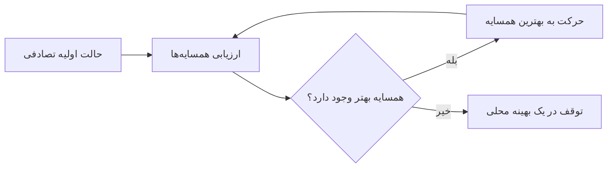
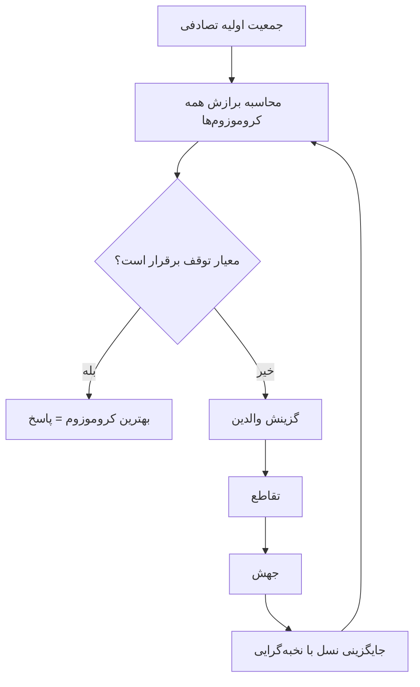

# جلسه ۱۰: جست‌وجوی محلی و الگوریتم ژنتیک

> **درس:** مقدمه‌ای بر هوش مصنوعی و کاربرد آن در مهندسی پزشکی
> **مدت پیشنهادی:** ۶۰ تا ۹۰ دقیقه · **سطح:** مقدماتی
> **منابع این جلسه:** منبع ۱ (Russell & Norvig, 2016)، منبع ۳ (Pham et al., 2021)، منبع ۱۱ (محتوای مدرس)

---

## اهداف جلسه
در پایان این جلسه دانشجو می‌تواند:
1. تفاوت جست‌وجوی محلی (Local Search) با جست‌وجوی مسیر جلسات قبل را توضیح دهد.
2. صعود قله (Hill Climbing) و مشکل بهینه محلی (Local Optimum) را روی خروجی واقعی کد نشان دهد.
3. نقش دما در شبیه‌سازی تبرید (Simulated Annealing) و رابطه‌ی احتمال پذیرش با $\Delta F$ و $T$ را توضیح دهد.
4. اجزای الگوریتم ژنتیک (برازش، گزینش، تقاطع، جهش) را روی مسئله‌ی «چیدمان سنسور» پیاده‌شده در کد تشریح کند.
5. با تغییر seed و نرخ جهش، رفتار سه روش را مقایسه و نتیجه را گزارش کند.

> [!NOTE]
> برخلاف جلسات ۵ تا ۸، اینجا به «مسیر» کاری نداریم؛ فقط «حالت نهایی خوب» مهم است. همین ایده پایه‌ی بسیاری از روش‌های تنظیم پارامتر در یادگیری ماشین جلسات بعدی است.

---

## ۱. جست‌وجوی محلی: چرا و چگونه
در مسائل بهینه‌سازی واقعی (مثل چیدمان سنسور یا تنظیم پارامترهای یک مدل) فضای حالت آن‌قدر بزرگ است که نمی‌شود همه‌ی حالت‌ها را — مثل UCS — بسط داد و به‌خاطر سپرد. جست‌وجوی محلی راه‌حل اقتصادی دارد:

- فقط **حالت فعلی** و همسایه‌هایش را نگه می‌دارد (حافظه‌ی کم).
- به‌جای مسیر، مستقیم به‌سمت حالت بهتر حرکت می‌کند.
- «منظر جست‌وجو» (Search Landscape) را تصور کنید: هر نقطه ارتفاعی برابر برازش (Fitness) دارد و هدف، رسیدن به بلندترین قله (بیشینه‌ی سراسری یا Global Maximum) است.

مشکل اصلی همین است: اگر به قله‌ای برسیم که از همه‌ی همسایه‌هایش بلندتر است ولی از قله‌ی سراسری کوتاه‌تر، الگوریتم ساده آنجا متوقف می‌شود — یک بهینه‌ی محلی. سه روش این جلسه سه جواب متفاوت به این مشکل‌اند.

## ۲. صعود قله و شبیه‌سازی تبرید
**صعود قله (Hill Climbing):** در هر گام، بهترین همسایه را انتخاب کن؛ اگر هیچ همسایه‌ای بهتر نبود، متوقف شو. ساده، سریع و کم‌حافظه — اما گیر می‌کند. درمان رایج: چند بار از نقاط تصادفی مختلف شروع کنیم (شروع‌های مجدد یا Restarts) و بهترین نتیجه را نگه داریم.

**شبیه‌سازی تبرید (Simulated Annealing):** همان صعود قله، با یک جرأت برای پذیرفتن حرکت بدتر. اگر با حرکت به همسایه‌ی $s'$ برازش از $F(s)$ به $F(s')$ تغییر کند، مقدار $\Delta F = F(s') - F(s)$ را داریم:

- حرکت بهبوددهنده ($\Delta F \geq 0$): همیشه پذیرفته می‌شود.
- حرکت بدترکننده ($\Delta F < 0$): با احتمال

$$p = e^{\Delta F / T}$$

پذیرفته می‌شود که در آن $T$ «دما» است.

دما به‌مرور سرد می‌شود: $T \leftarrow \alpha T$ با $\alpha = 0.95$ در کد ما. در دمای بالا احتمال پذیرش حرکت بد تقریباً یک است (کاوش آزاد) و با سرد شدن، الگوریتم محافظه‌کار می‌شود (بهره‌برداری). اگر $\alpha$ خیلی کوچک باشد الگوریتم زود در اولین بهینه‌ی محلی گیر می‌کند و اگر خیلی بزرگ باشد عملاً جست‌وجوی تصادفی می‌شود.

> [!TIP]
> معادل‌سازی مهندسی: جرأت پذیرش خطا در ابتدای فرایند، مثل تبرید فلز است — اول گرم تا اتم‌ها آزادانه جابه‌جا شوند، بعد سرد تا ساختار پایدار بماند.

## ۳. الگوریتم ژنتیک
الگوریتم ژنتیک (Genetic Algorithm) به‌جای یک حالت، یک **جمعیت** (Population) از راه‌حل‌های کاندید را هم‌زمان پیش می‌برد. هر راه‌حل یک «کروموزوم» است (اینجا: مکان سه سنسور) و کیفیتش با تابع برازش سنجیده می‌شود. چرخه‌ی هر نسل:

**برازش:** برای مسئله‌ی چیدمان سنسور در کد این جلسه، پوشش هر خانه‌ی مسیر $x$ توسط نزدیک‌ترین سنسور تعریف می‌شود:

$$c(x, s) = \max\left(0, \max_{i}\left(r - |x - s_i| + 1\right)\right)$$

و تابع برازش کل، پوشش وزن‌دار منهای جریمه‌ی هم‌مکانی است:

$$F(s) = \sum_{x=0}^{19} w(x)\, c(x, s) \;-\; \lambda \left( 3 - |\{s_1, s_2, s_3\}| \right)$$

که $w(x)$ برای خانه‌های ناحیه‌ی مهم ۲ و برای بقیه ۱ است و $\lambda = 10$ جریمه‌ی هر سنسور اضافی روی یک خانه‌ی مشترک است.

**گزینش (Selection):** رایج‌ترین فرمول کتاب درسی، گزینش گرد پولی (Roulette Wheel) است — احتمال انتخاب کروموزوم $i$ متناسب با برازش اوست:

$$P(i) = \frac{F_i}{\sum_{j=1}^{N} F_j}$$

کد ما برای سادگی و مقاومت در برابر مقادیر منفی از گزینش مسابقه‌ای (Tournament Selection) استفاده می‌کند: $k = 3$ عضو تصادفی برمی‌داریم و بهترینشان والد می‌شود.

**تقاطع (Crossover):** تک‌نقطه‌ای؛ برش در یک نقطه‌ی تصادفی و ترکیب پیشوند یک والد با پسوند والد دیگر.

**جهش (Mutation):** هر ژن (مکان یک سنسور) با احتمال $p_m = 0.2$ به یک خانه‌ی تصادفی می‌رود. جهش منبع اصلی «تنوع ژنتیکی جدید» است؛ بدون آن جمعیت به ترکیب ژن‌های اولیه محدود می‌ماند.

**نخبه‌گرایی (Elitism):** دو بهترین کروموزوم بدون تغییر به نسل بعد منتقل می‌شوند تا بهترین یافته هرگز گم نشود.

---

## 🔬 پیوند با مهندسی پزشکی
مسئله‌ی کارگاه این جلسه، نسخه‌ی ساده‌شده‌ی یک تصمیم مهندسی واقعی است: **چیدمان سنسور**. چند نمونه‌ی هم‌خانواده در مهندسی پزشکی (همگی آموزشی):

- چیدمان سنسورهای فشار روی تشک تخت بیمار بستری برای پایش توضیع فشار و پیشگیری آموزشی از زخم فشاری.
- انتخاب محل سنسورهای شتاب روی اندام بیمار در ارزیابی راه رفتن (Gait) در کلینیک بازتوانی.
- چیدمان الکترودهای یک پوشش قابل‌پوش برای ثبت سیگنال در جلسه ۲۵.

در همه‌ی این‌ها «پوشش نواحی مهم با کمترین سنسور و بدون هم‌پوشانی بی‌فایده» همان تابع برازش جلسه است و بهینه‌سازی آن با HC، تبرید یا ژنتیک انجام می‌شود. یادآوری مهم: خروجی این الگوریتم‌ها در این درس فقط آموزشی است و برای تصمیم بالینی یا توصیه‌ی درمانی به کار نمی‌رود.

## ✍️ فعالیت کلاسی / کارگاه
۱. اسکریپت را اجرا کنید: `python3 code/session_10_local_search_genetic.py` — جدول خروجی (seed ۴۲) را گزارش کنید.
۲. یکی از سنسورهای چیدمان بهینه‌ی مرجع را دستی جابه‌جا کنید و با تابع `fitness` در نوت‌بوک/اسکریپت برازش جدید را حساب کنید؛ تغییر را توضیح دهید.
۳. seed را به ۷ و ۹۹ تغییر دهید (ثابت `DEFAULT_SEED` در اسکریپت) و اجرا کنید: کدام روش‌ها به بهینه‌ی جهانی (برازش ۳۴) رسیدند؟ نتیجه را جدول کنید.
۴. در تابع `genetic_algorithm` نرخ جهش را ۰ و بعد ۰٫۵ کنید و رفتار جمعیت را توضیح دهید.
۵. (اختیاری) تعداد شروع‌های مجدد Hill Climbing را به ۱۰ برسانید و ببینید چه می‌شود.

### چک‌لیست پایان جلسه
- [ ] جدول مقایسه‌ی سه روش را از اجرای واقعی گزارش کردم.
- [ ] می‌توانم بگویم چرا صعود قله در بهینه‌ی محلی متوقف شد.
- [ ] اثر نرخ جهش و seed تصادفی را با آزمایش نشان دادم.

## 💻 کد آموزشی
`code/session_10_local_search_genetic.py` — فقط با کتابخانه استاندارد پایتون (شامل `random`). هر یک از سه روش تصادفی در ابتدای اجرای خودش با seed پیش‌فرض ۴۲ مقداردهی می‌شود (ثابت `DEFAULT_SEED` یا پارامتر `seed` هر تابع)؛ پس نتیجه‌ی هر روش مستقل از اینکه همه‌ی روش‌ها را با هم اجرا کنید یا فقط یکی را، همیشه یکسان و تکرارپذیر است. فایل شامل: تعریف تابع برازش چیدمان سنسور، جست‌وجوی کامل مرجع (Brute Force)، صعود قله با شروع‌های مجدد، شبیه‌سازی تبرید و الگوریتم ژنتیک با گزینش مسابقه‌ای، تقاطع تک‌نقطه‌ای، جهش و نخبه‌گرایی؛ خروجی، جدول مقایسه‌ی بهترین برازش هر روش است.

## 📘 واژه‌نامه

| واژه | معنی |
|---|---|
| Local Search | جست‌وجوی محلی؛ حرکت بین حالت‌های کامل با نگه‌داشتن فقط حالت فعلی |
| Fitness | برازش؛ امتیاز کیفی یک راه‌حل کاندید |
| Landscape | منظر جست‌وجو؛ تصویر برازش روی فضای حالت‌ها |
| Local Optimum | بهینه‌ی محلی؛ نقطه‌ای که همسایه‌هایش بدترند ولی سراسری بهترین نیست |
| Cooling Schedule | برنامه‌ی سرمایش؛ قاعده‌ی کاهش دما در شبیه‌سازی تبرید |
| Chromosome / Gene | کروموزوم / ژن؛ نمایش یک راه‌حل / یکی از اجزای آن |
| Elitism | نخبه‌گرایی؛ انتقال بدون تغییر بهترین‌ها به نسل بعد |

## ❓ پرسش‌های خودآزمون
1. چرا در جست‌وجوی محلی نیازی به نگه‌داشتن «مسیر» رسیدن به راه‌حل نیست و این چه صرفه‌جویی‌ای ایجاد می‌کند؟
2. در خروجی کارگاه، صعود قله برازش ۳۳ و الگوریتم ژنتیک برازش ۳۴ گرفت. با توجه به چیدمان‌ها توضیح دهید مشکل راه‌حل ۳۳ چیست.
3. اگر در الگوریتم ژنتیک نرخ جهش را صفر کنیم، چه چیزی از دست می‌رود و این چگونه به همگرایی زودهنگام (Premature Convergence) منجر می‌شود؟

> کلید پاسخ‌ها در بخش «راهنمای مدرس» انتهای فایل آمده است.

## 📝 تکلیف
خروجی اسکریپت را برای seedهای ۴۲، ۷ و ۹۹ اجرا و در یک جدول گزارش کنید (برازش و چیدمان هر روش). سپس نرخ جهش را به ۰ و ۰٫۵ تغییر دهید و در چند جمله اثر آن را بر نتیجه‌ی GA توضیح دهید. در پایان یک پاراگراف بنویسید: برای مسئله‌ی واقعی چیدمان سنسور روی یک تخت بیمار، کدام روش را انتخاب می‌کردید و چرا (به هزینه‌ی محاسباتی و تضمین‌های هر روش اشاره کنید).

## 📚 مطالعه پیشنهادی
- Russell & Norvig (2016)، بخش جست‌وجوی محلی در فصل ۴: صعود قله، شبیه‌سازی تبرید و الگوریتم‌های ژنتیک
- Pham et al. (2021) (منبع ۳): فصل‌های مرتبط با بهینه‌سازی و کاربرد الگوریتم‌های تکاملی در داده‌های سلامت
- محتوای مدرس: اسلاید و مثال‌های تکمیلی این جلسه

---

## 🧭 راهنمای مدرس (از این عنوان تا انتها در نسخه دانشجو حذف شود)

**زمان‌بندی پیشنهادی برای ۹۰ دقیقه:** مفهوم جست‌وجوی محلی و منظر (۱۵) | صعود قله و تبرید (۲۰) | الگوریتم ژنتیک و چرخه‌ی نسل (۲۰) | اجرای کارگاه و آزمایش‌های seed و نرخ جهش (۲۵) | جمع‌بندی و پیوند با بازتوانی (۱۰)

**نسخه ۶۰ دقیقه‌ای:** مفهوم و صعود قله (۱۵)، تبرید با یک مثال (۱۰)، الگوریتم ژنتیک (۱۵)، اجرای کارگاه با seed ۴۲ فقط و آزمایش نرخ جهش (۱۵)، جمع‌بندی (۵). آزمایش‌های seed ۷ و ۹۹ به تکلیف منتقل شود.

**نکات:**
- پیش از کلاس اسکریپت را یک‌بار اجرا کنید؛ هر روش در ابتدای تابع خودش seed می‌گیرد، پس خروجی seed ۴۲ چه در اجرای کامل و چه اجرای تک‌تک روش‌ها یکسان است و می‌توانید جدول را روی تخته بنویسید.
- نکته‌ی مهم اجرایی: تغییر seed (ثابت `DEFAULT_SEED`) خروجی همه روش‌ها را عوض می‌کند؛ این فرصت خوبی است تا تفاوت «الگوریتم قطعی» (جلسات قبل) و «الگوریتم تصادفی» را ملموس کنید.
- اگر زمان کم بود، جدول seed ۹۹ را حذف کنید؛ هر seed دیگری هم پیام درس را می‌رساند.
- از دانشجویان بخواهید قبل از اجرا پیش‌بینی کنند کدام روش بهینه‌ی جهانی را می‌یابد؛ مقایسه‌ی پیش‌بینی و واقعیت، اثر آموزشی اصلی است.

### خروجی مورد انتظار جلسه
هر دانشجو جدول مقایسه‌ی روش‌ها را از اجرای واقعی گزارش کند و بتواند در یک جمله بگوید «صعود قله ساده اما گیرکننده است؛ تبرید با پذیرش موقت حرکت بدتر فرار می‌کند؛ ژنتیک با جمعیت و تنوع فضای بیشتری را می‌کاود».

### کلید پاسخ آزمایش‌ها (از اجرای واقعی کد با seed ۴۲)

نمایش کلید پاسخ

- **جدول اصلی (seed ۴۲):** جست‌وجوی کامل مرجع: برازش ۳۴ با چیدمان (6, 11, 16). صعود قله: ۳۳ با چیدمان (2, 6, 17). شبیه‌سازی تبرید: ۳۳ با چیدمان (2, 6, 11). الگوریتم ژنتیک: ۳۴ با چیدمان (17, 6, 12) — یعنی بهینه‌ی جهانی. هر روش در ابتدای تابع خودش seed می‌گیرد، پس این اعداد چه در اجرای کامل اسکریپت و چه با اجرای تک‌تک روش‌ها یکسان است.
- **چرا ۳۳ و نه ۳۴؟** در (2, 6, 17) سنسور خانه ۲ با سنسور خانه ۶ هم‌پوشانی دارد (خانه‌ی ۴ دو بار پوشش می‌شود ولی فقط یک‌بار حساب می‌شود) و خانه‌های ۹ تا ۱۴ بی‌پوشش می‌مانند؛ برازش ۳۳ = ۹ (سنسور ۲) + ۱۵ (سنسور ۶ با احتساب وزن دوبرابر ناحیه‌ی مهم منفی هم‌پوشانی خانه ۴) + ۹ (سنسور ۱۷). چیدمان بهینه (6, 11, 16) سنسورها را مساوی پخش می‌کند: ۱۶ + ۹ + ۹ = ۳۴.
- **آزمایش seed ۷ (مشاهده‌شده):** صعود قله ۳۳ با (1, 6, 17)؛ تبرید این‌بار ۳۴ با (6, 12, 17)؛ ژنتیک ۳۴ با (6, 16, 11). پیام: در روش‌های تصادفی، یک seed ممکن است شانس یک روش را عوض کند؛ برای قضاوت باید چند seed آزمود.
- **آزمایش شروع‌های مجدد:** صعود قله با `restarts=10` در اجرای ما به برازش ۳۴ با چیدمان (6, 11, 16) رسید — شروع‌های بیشتر، شانس گریز از بهینه‌ی محلی را بالا می‌برد.
- **آزمایش نرخ جهش:** با $p_m = 0$ در seed ۴۲، GA این‌بار هم به برازش ۳۴ رسید (چیدمان (6, 17, 12))، چون ژن‌های لازم از همان جمعیت اولیه موجود بودند؛ اما همین آزمایش با seedهای ۷ و ۹۹ در برازش ۳۳ گیر کرد (چیدمان‌های (1, 6, 16) و (6, 12, 16)) — بدون جهش، موفقیت به شانس جمعیت اولیه وابسته است. با $p_m = 0.5$ در seed ۴۲ به برازش ۳۴ با چیدمان (17, 6, 11) رسید. جمع‌بندی: جهش «بیمه‌ی تنوع» است؛ اثرش را با چند seed بسنجید، نه با یک اجرا.

### کلید پاسخ پرسش‌های خودآزمون

نمایش کلید پاسخ

1. در جست‌وجوی مسیر (مثل A*) خودِ مسیر مهم است (مثلاً مسیر واقعی انتقال تخت)، پس باید والد‌ها نگه داشته شوند. در بهینه‌سازی فقط حالت نهایی مهم است؛ نگه‌داشتن فقط حالت فعلی حافظه را از $O(b^d)$ به یک نقطه‌ی واحد می‌رساند و جست‌وجو در فضاهای بسیار بزرگ را ممکن می‌کند.
2. چیدمان ۳۳ (مثل (2, 6, 17)) سنسورهایش هم‌پوشانی بی‌فایده دارند (خانه‌ی ۴ دو سنسور را پوشش می‌دهد ولی امتیاز یک‌بار شمرده می‌شود) و بخش میانی مسیر (خانه‌های ۹ تا ۱۴) را بی‌پوشش رها می‌کنند؛ در چیدمان ۳۴ سنسورها پخش‌ترند و ناحیه‌ی مهم با وزن دوبرابر کامل پوشیده شده است. یعنی ۳۳ یک بهینه‌ی محلی است نه نقص الگوریتم.
3. جهش تنها منبع ورود مقدار ژنی تازه به جمعیت است. با $p_m = 0$ فقط تقاطع ژن‌های موجود را جابه‌جا می‌کند؛ اگر آن ژن‌ها در بهینه‌ی جهانی نباشند، هیچ‌گاه پدید نمی‌آیند و جمعیت زیر فشار گزینش و نخبه‌گرایی به اطراف بهترین کروموزوم موجود همگرا می‌شود — همان همگرایی زودهنگام.

