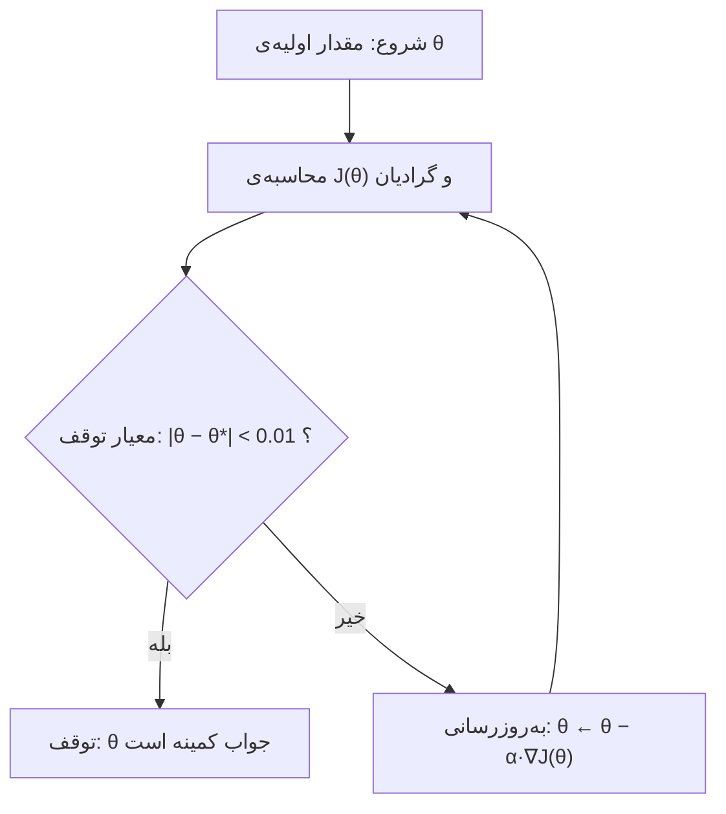

# جلسه ۱۱: جست‌وجو در فضای پیوسته و گرادیان کاهشی

> **درس:** مقدمه‌ای بر هوش مصنوعی و کاربرد آن در مهندسی پزشکی
> **مدت پیشنهادی:** ۶۰ تا ۹۰ دقیقه · **سطح:** مقدماتی
> **منابع این جلسه:** منبع ۱ (Russell & Norvig, 2016)، منبع ۱۰ (Liu, 2017)، منبع ۱۱ (محتوای مدرس)؛ منبع وب آزاد: Boyd & Vandenberghe, Convex Optimization (2004)

---

## اهداف جلسه

پس از این جلسه دانشجو باید بتواند:

1. تفاوت فضای حالت گسسته (جلسه‌های قبل) با فضای حالت پیوسته (Continuous State Space) را توضیح دهد.
2. مفهوم گرادیان (Gradient) به‌عنوان بردار شیب تابع خطا را بنویسد و تفسیر کند.
3. قاعده‌ی به‌روزرسانی $\theta \leftarrow \theta - \alpha \nabla J(\theta)$ را به کار ببرد و نقش نرخ یادگیری (Learning Rate, $\alpha$) را در همگرایی یا واگرایی نشان دهد.
4. مسئله‌ی بهینه‌ی محلی (Local Minimum) را روی یک تابع دوقله مشاهده کند و بگوید نقطه‌ی شروع چه اثری دارد.
5. کد گرادیان کاهشی روی یک مسئله‌ی کالیبراسیون سنسور اجرا کند و جدول مقایسه‌ی نرخ‌های یادگیری را گزارش دهد.

---

## ۱. از فضای گسسته به فضای پیوسته

در جلسه‌ی ۱۰ با صعود قله و الگوریتم ژنتیک، حالت‌ها را مثل مهره‌های شطرنج جابه‌جا می‌کردیم: هر سنسور روی یکی از ۲۰ خانه‌ی مسیر، هر ژن یکی از چند مقدار. اما خیلی از پارامترهای دنیای مهندسی پزشکی چنین ماهرهای ندارند:

- خروجی ولتاژ یک سنسور دما: هر عدد واقعی
- زاویه‌ی نصب یک پروتز زانو: هر درجه‌ی اعشاری
- دوز دارو در مدل فارماکوکینتیک: هر مقدار پیوسته

> [!IMPORTANT]
> در فضای پیوسته تعداد حالت‌های ممکن بی‌نهایت است؛ پس «همسایه‌های یک حالت» را مثل جلسه‌ی ۱۰ نمی‌توانیم یکی‌یکی امتحان کنیم. به راهی نیاز داریم که بگوید «به کدام سمت حرکت کنیم خطا کمتر می‌شود؟» — جواب آن راه، گرادیان است.

اگر بتوان تابع خطا را روی این فضا بنویسیم و مشتق‌پذیر باشد، کار بسیار ساده‌تر می‌شود: مشتق به ما می‌گوید در هر نقطه، تابع به کدام طرف سرازیر می‌شود. این همان ایده‌ی جلسه‌ی امروز است.

---

## ۲. گرادیان: شیب تابع خطا

فرض کنید کالیبراسیون یک سنسور دما را مدل می‌کنیم (مثال آموزشی و غیرتشخیصی). سنسور قرائت‌هایش را همیشه به‌اندازه‌ی یک مقدار ثابت بالاتر از دمای واقعی نشان می‌دهد؛ یعنی خطای بایاس (Bias):

$$y_i = t_i + \theta$$

که در آن $t_i$ دمای مرجع (ترموستات کالیبره‌شده‌ی آزمایشگاه) و $y_i$ قرائت سنسور است. پارامتر ناشناخته فقط $\theta$ است. خطای برازش را با میانگین مربعات خطا (Mean Squared Error) می‌سنجیم:

$$J(\theta) = \frac{1}{n} \sum_{i=1}^{n} \left( y_i - t_i - \theta \right)^2$$

مشتق این تابع نسبت به $\theta$:

$$\frac{dJ}{d\theta} = -\frac{2}{n} \sum_{i=1}^{n} \left( y_i - t_i - \theta \right)$$

وقتی مدل چند پارامتر دارد — مثلاً $\theta = (\theta_0, \theta_1)$ برای مدل $y = \theta_0 + \theta_1 x$ — مجموع مشتق‌های جزئی یک بردار می‌شود که گرادیان (Gradient) نام دارد:

$$\nabla J(\theta) = \left( \frac{\partial J}{\partial \theta_0}, \frac{\partial J}{\partial \theta_1} \right)$$

> [!TIP]
> گرادیان را به‌صورت فلشی روی سطح تابع خطا ببینید: همیشه به سمت بالارفتن شیب، یعنی سمت بیشتر شدن خطا، اشاره می‌کند. پس برای کم‌کردن خطا باید در جهت مخالف آن گام برداریم. این تنها شهود لازم برای کل جلسه است.

در یک بعد، گرادیان همان یک عدد است: شیب خط. شیب مثبت یعنی با بزرگ‌کردن $\theta$ خطا بیشتر می‌شود → باید کوچک کنیم. شیب منفی یعنی برعکس. شیب صفر یعنی در یک نقطه‌ی ایستاده‌ایم — یا کمینه، یا بیشینه.

---

## ۳. گرادیان کاهشی: قاعده‌ی به‌روزرسانی و نقش نرخ یادگیری

**گرادیان کاهشی (Gradient Descent)** دقیقاً همان «گام برداشتن در جهت مخالف شیب» است که با یک ضریب مقیاس تکرار می‌شود:

$$\theta \leftarrow \theta - \alpha \, \nabla J(\theta)$$

- $\theta$: بردار پارامترها (اینجا فقط بایاس سنسور)
- $\alpha$: نرخ یادگیری (Learning Rate) — طول هر گام، عددی مثبت
- $\nabla J(\theta)$: گرادیان خطا در نقطه‌ی فعلی

چرخه‌ی کار به شکل زیر است:



(در این مثال آموزشی $\theta^*$ از راه‌حل بسته‌ی کمینه‌سازی مربعات در دست است و همان معیار توقفِ کد است؛ در مسئله‌های واقعی که $\theta^*$ نامعلوم است، معیار توقف معمولاً کوچک بودن اندازه‌ی گرادیان یا ثابت‌ماندن خطا روی داده‌ی اعتبارسنجی است.)

نکته‌ی کلیدی، انتخاب $\alpha$ است:

- $\alpha$ خیلی کوچک → هر گام کوچک است → همگرا می‌شویم اما خیلی کند.
- $\alpha$ مناسب → سریع و هموار به کمینه می‌رسیم.
- $\alpha$ خیلی بزرگ → هر گام از دره‌ی کمینه رد می‌شود و به سمت دیگری می‌افتد → خطا نوسان می‌کند و حتی هر گام بزرگ‌تر می‌شود → واگرایی (Divergence).

در مثال کالیبراسیون، برای یک تابع درجه‌دو با خمیدگی (Curvature) $\lambda$ می‌توان نشان داد شرط پایداری تقریبی $\alpha < 2/\lambda$ است؛ اگر رعایت نشود، ضریب $(1 - \alpha\lambda)$ بزرگ‌تر از ۱ می‌شود و هر تکرار خطا را چند درصد بزرگ‌تر می‌کند تا بی‌نهایت.

جدول زیر نتایج واقعی اجرای کد جلسه روی داده‌ی کالیبراسیون (۵ نمونه، $\theta_0 = 0$، معیار توقف $|\theta - \theta^*| < 0.01$) است:

| $\alpha$ | رفتار مشاهده‌شده | گام همگرایی | $\theta$ نهایی |
|---|---|---|---|
| $0.1$ | همگرایی آرام و هموار | ۲۴ | $2.0774$ |
| $0.5$ | همگرایی در یک گام (تابع یک‌پارامتری، گام ۰٫۵× شیب دقیقاً به کمینه می‌رسد) | ۱ | $2.0800$ |
| $0.9$ | همگرایی با نوسان‌های بزرگ دور کمینه | ۲۴ | $2.0774$ |
| $1.5$ | واگرایی؛ θ از $6.24$ به $-6.24$ به $18.72$ و… | — | (ناپایدار، در گام ۱۹ از مرز $10^6$ عبور کرد) |

> [!NOTE]
> $\theta^* = 2.08$ جواب بسته‌ی این داده است (میانگین اختلاف قرائت و دمای مرجع). برای مقایسه، با $\alpha = 0.1$ کد پس از ۲۴ گام همگرا شد و مقدار نهایی چاپشده $2.0774$ است — همان جواب، فقط با مسیر طولانی‌تر.

---

## ۴. بهینه‌ی محلی: تابع چاه‌دوقلو و نقشه‌ی شروع

گرادیان کاهشی فقط محلی فکر می‌کند: هر گام فقط با شیبِ نقطه‌ی فعلی تصمیم می‌گیرد. اگر تابع خطا چند دره داشته باشد، الگوریتم در اولین دره‌ای که به آن می‌رسد می‌ماند و از کمینه‌ی سراسری خبر ندارد. یک نمونه‌ی کلاسیک، تابع چاه‌دوقلو (Double Well) است:

$$J(\theta) = \left( \theta^2 - 1 \right)^2, \qquad \frac{dJ}{d\theta} = 4\theta\left( \theta^2 - 1 \right)$$

این تابع دو کمینه‌ی سراسری دارد ($\theta = +1$ و $\theta = -1$، هر دو با $J = 0$) و یک نقطه‌ی بیشینه در $\theta = 0$. نتایج واقعی اجرای کد با $\alpha = 0.05$ و ۶۰ گام:

| نقطه‌ی شروع $\theta_0$ | مقصد نهایی | $J$ نهایی |
|---|---|---|
| $-0.6$ | $-1.0000$ | $0.0000$ |
| $0.0$ | $0.0000$ (در نقطه‌ی بیشینه گیر کرده) | $1.0000$ |
| $+0.6$ | $+1.0000$ | $0.0000$ |

دو درس مهم از این جدول:

1. **نقطه‌ی شروع تعیین‌کننده است.** از سمت چپ صفر به کمینه‌ی چپ می‌رسیم و از سمت راست به کمینه‌ی راست؛ این همان مشکل بهینه‌ی محلی جلسه‌ی ۱۰ است که حالا در فضای پیوسته دیده می‌شود.
2. **نقطه‌ی ایست (نقطه‌ی شیب صفر) لزوماً کمینه نیست.** از $\theta_0 = 0$ شیب دقیقاً صفر است و الگوریتم هیچ حرکتی نمی‌کند — ولی آن نقطه بیشینه‌ی محلی تابع است. در عمل، تابع خطا ابعاد بیشتری دارد و دقیقاً روی نقطه‌ی بیشینه شروع‌کردن بعید است؛ اما راه‌حل‌های امن مثل شروع تصادفی چندباره (جلسه‌ی ۱۰) یا افزودن تکانه (Momentum) از همین نکته الهام می‌گیرند.

---

## 🔬 پیوند با مهندسی پزشکی

- **کالیبراسیون سنسورها:** هر دستگاه پایش بیمار (ECG، SpO₂، فشار خون) در نصب و سرویس دوره‌ای، پارامترهای مدارش با کمینه‌سازی خطای مربعات روی نقاط مرجع تنظیم می‌شود — دقیقاً همان چیزی که امروز کدش را دیدیم (مثال آموزشی و غیرتشخیصی؛ جایگزین کالیبراسیون بالینی نیست).
- **تنظیم پارامترهای مدل‌های عملیاتی:** همین قاعده‌ی $\theta \leftarrow \theta - \alpha \nabla J(\theta)$ در ادامه‌ی دوره قلب آموزش شبکه‌های عصبی می‌شود (جلسه‌ی ۲۴)؛ خطای طبقه‌بندی سیگنال قلب با گرادیان کاهشی کمینه می‌شود. (جلسه‌ی بعدی، جلسه‌ی ۱۲، به مسائل ارضای محدودیت اختصاص دارد.)
- **واگرایی گران نیست، بلکه بی‌نهایت است:** در تنظیم خودکار دوز یا کنترل دستگاه، یک $\alpha$ نامناسب می‌تواند خروجی کنترل را در چند گام به مرزهای خطرناک بفرستد؛ به همین دلیل نرخ یادگیری همیشه با اعتبارسنجی روی داده‌ی جدا تنظیم می‌شود.

---

## ✍️ فعالیت کلاسی / کارگاه

۱. روی کاغذ، تابع $J(\theta) = (\theta - 2)^2$ را رسم کنید. نقطه‌ی شروع $\theta_0 = 0$ و $\alpha = 0.4$ را در نظر بگیرید؛ سه گام اول به‌روزرسانی را با فرمول دستی حساب کنید و روی نمودار حرکت نقاط را نشان دهید. (کمینه در $\theta^* = 2$ است.)

۲. کد `code/session_11_gradient_descent.py` را اجرا کنید و جدول چهار $\alpha$ را بازتولید کنید. حالا فقط مقدار `alpha` را در لیست `[0.1, 0.5, 0.9, 1.5]` به `$1.2$` تغییر دهید و ببینید هنوز همگرا می‌شود یا نه؛ حد تقریبی مرز پایداری را حدس بزنید.

۳. در آزمایش چاه‌دوقلو، شروع از $\theta_0 = 0$ الگوریتم را کجا می‌برد؟ اگر بخواهیم همیشه به کمینه‌ی سراسری برسیم، دو راه پیشنهاد دهید (راهنمایی: یکی از جلسه‌ی ۱۰، یکی از بخش ۴ همین جلسه).

---

## 💻 کد آموزشی

فایل `code/session_11_gradient_descent.py` دو آزمایش دارد:

1. **آزمایش کالیبراسیون:** برازش بایاس سنسور روی ۵ نمونه‌ی مرجع، اجرا با چهار نرخ یادگیری و چاپ مسیر گام‌به‌گام $\theta$ و $J$، شامل یک حالت واگرایی.
2. **آزمایش چاه‌دوقلو:** نمایش کمینه‌ی محلی و اثر نقطه‌ی شروع روی مقصد نهایی.

قطعه‌ی قلب کد:

```python
def run_gd(alpha, theta0=0.0, max_steps=30, tol=0.01, stop_big=1e6):
    theta = theta0
    path = [(0, theta, loss(theta))]
    converged_at = None
    for step in range(1, max_steps + 1):
        theta = theta - alpha * grad(theta)      # قاعده‌ی به‌روزرسانی
        path.append((step, theta, loss(theta)))
        if converged_at is None and abs(theta - THETA_STAR) < tol:
            converged_at = step                  # نزدیک کمینه شدیم
        if abs(theta) > stop_big:                # واگرایی؛ ادامه بی‌فایده
            break
    return path, converged_at
```

اجرا:

```bash
python3 code/session_11_gradient_descent.py
```

خروجی قطعی است (بدون تصادف)؛ می‌توانید مسیر همگرایی و واگرایی را گام‌به‌گام ببینید.

---

## 📘 واژهنامه

| واژه | معنی |
|---|---|
| فضای حالت پیوسته (Continuous State Space) | فضایی که هر حالت برداری از اعداد واقعی است، نه فهرست متناهی گزینه‌ها |
| تابع خطا (Loss / Objective) | تابعی که کیفیت یک پارامتر را به یک عدد تبدیل می‌کند؛ کمینه‌اش جواب ماست |
| گرادیان (Gradient) | بردار مشتق‌های جزئی تابع خطا؛ جهت بیشترین رشد را نشان می‌دهد |
| نرخ یادگیری (Learning Rate, $\alpha$) | ضریب مثبتی که طول هر گام گرادیان کاهشی را تعیین می‌کند |
| همگرایی (Convergence) | رسیدن گام‌ها به یک نقطه‌ی ثابت (کمینه) و توقف تغییر |
| واگرایی (Divergence) | بزرگ‌شدن بی‌رویه‌ی خطا یا پارامترها به‌خاطر گام‌های خیلی بزرگ |
| کمینه‌ی محلی (Local Minimum) | دره‌ای که در آن شیب صفر است ولی کمترین مقدار کل تابع نیست |
| بایاس (Bias) | خطای ثابت سنسور که به همه‌ی قرائت‌ها اضافه می‌شود |
| معیار توقف (Stopping Criterion) | قاعده‌ای مثل «شیب یا تغییر θ کوچک‌تر از حد آستانه شد» که حلقه را می‌بندد |

---

## ❓ پرسشهای خودآزمون

1. چرا در فضای حالت پیوسته نمی‌توان مثل جلسه‌ی ۱۰ همه‌ی همسایه‌های یک حالت را امتحان کرد؟
2. قاعده‌ی به‌روزرسانی $\theta \leftarrow \theta - \alpha \nabla J(\theta)$ را در یک جمله توضیح دهید: هر جزء چه نقشی دارد و چرا منفی است؟
3. اگر $\alpha$ خیلی بزرگ شود چه اتفاقی می‌افتد؟ با استفاده از عدد ۱٫۵ در جدول بخش ۳ توضیح دهید.
4. در آزمایش چاه‌دوقلو، شروع از $\theta_0 = 0$ چه مشکل‌ی ایجاد می‌کند و چرا؟
5. اگر تابع خطا یک کمینه‌ی سراسری و یک کمینه‌ی محلی داشته باشد، گرادیان کاهشی به کدام می‌رسد؟ چه چیزی تعیین‌کننده است؟

---

## 📝 تکلیف

۱. تابع $J(\theta) = 3\theta^2 + 2\theta - 5$ را در نظر بگیرید. گرادیان آن را حساب کنید و با $\alpha = 0.2$ و شروع از $\theta_0 = 0$ سه گام اول را دستی محاسبه و در جدول گزارش کنید.

۲. کد جلسه را طوری تغییر دهید که به‌جای ۵ نمونه، داده‌ی ساختگی با نویز بزرگ‌تر (مثلاً قرائت‌های `[12.5, 17.0, 22.3, 27.2, 32.1]`) داشته باشد. مقدار $\theta^*$ جدید را با جواب بسته حساب کنید و بگویید کدام $\alpha$ به آن نزدیک‌ترین جواب را با کمترین گام می‌دهد. یک بند گزارش بنویسید.

۳. در آزمایش چاه‌دوقلو، مقدار $\alpha = 0.05$ را به `0.4` تغییر دهید و اجرا کنید. گزارش دهید رفتار تغییر می‌کند یا نه و چرا. (راهنمایی: در نقطه‌های نزدیک صفر شیب تابع چاه‌دوقلو کوچک است.)

**مهلت:** جلسه‌ی آینده · **قالب تحویل:** یک فایل PDF شامل جدول‌ها و بندهای کوتاه گزارش.

---

## 📚 مطالعه پیشنهادی

- منبع ۱ (Russell & Norvig, 2016)، بخش ۴.۴: جست‌وجوی محلی در فضای پیوسته.
- منبع ۱۰ (Liu, 2017): مرور کاربردی گرادیان کاهشی در بافت یادگیری ماشین با پایتون.
- منبع وب آزاد: Boyd & Vandenberghe, Convex Optimization (2004)، فصل ۹ (فقط مقدمه‌ی فصل): نگاه ریاضی به گرادیان کاهشی.
- اسلایدها و نمودارهای جلسه‌ی امروز در سامانه‌ی درس.

---

## 🧭 راهنمای مدرس (از این عنوان تا انتها در نسخه دانشجو حذف شود)

### زمان‌بندی پیشنهادی ۹۰ دقیقه

| بازه | فعالیت |
|---|---|
| ۰–۱۰ | انگیزه: مثال کالیبراسیون سنسور و پرسش «چطور با عدد پیوسته جست‌وجو کنیم؟» |
| ۱۰–۲۵ | گرادیان و مشتق: مثال $J(\theta) = (\theta-2)^2$ روی تخته، فعالیت کلاسی شماره ۱ |
| ۲۵–۴۵ | قاعده‌ی به‌روزرسانی و نقش $\alpha$؛ اجرای زنده‌ی کد، جدول چهار نرخ |
| ۴۵–۶۵ | آزمایش چاه‌دوقلو؛ بحث کمینه‌ی محلی و نقش نقطه‌ی شروع |
| ۶۵–۷۵ | پیوند با مهندسی پزشکی و جلسات آینده (شبکه‌های عصبی) |
| ۷۵–۹۰ | تکلیف و پرسش‌وپاسخ |

### زمان‌بندی جایگزین ۶۰ دقیقه

بخش ۴ (چاه‌دوقلو) را کوتاه کنید: فقط جدول نتیجه را نشان دهید و بحث را به تکلیف ببرید. فعالیت کلاسی شماره ۲ را اختیاری کنید.

### کلید پاسخ فعالیت‌ها و آزمایش‌ها (از اجرای واقعی کد)

<details>
<summary>نمایش کلید پاسخ</summary>

1. برای $J(\theta) = (\theta - 2)^2$ با $\alpha = 0.4$ و شروع از $\theta_0 = 0$: گرادیان $J'(\theta) = 2(\theta - 2)$. گام ۱: $\theta_1 = 0 - 0.4 \times (-4) = 1.6$؛ گام ۲: $\theta_2 = 1.6 - 0.4 \times (-0.8) = 1.92$؛ گام ۳: $\theta_3 = 1.92 - 0.4 \times (-0.16) = 1.984$. نقطه‌ها روی نمودار به‌سمت $\theta = 2$ از راست و چپ جفت‌شدن‌مانند نزدیک می‌شوند.
2. با لیست پیش‌فرض `[0.1, 0.5, 0.9, 1.5]`، جدول بخش ۳ بازتولید می‌شود: $\alpha = 0.1$ در گام ۲۴ همگرا (مقدار نهایی چاپشده $2.0774$)، $\alpha = 0.5$ در گام ۱ ($\theta = 2.0800$)، $\alpha = 0.9$ در گام ۲۴ با نوسان (مقدار نهایی چاپشده $2.0774$) و $\alpha = 1.5$ واگرا (مسیر: $6.24 \to -6.24 \to 18.72 \to -31.2 \to 68.64 \to -131.04$؛ در گام ۱۹ از مرز $10^6$ عبور می‌کند و کد واگرایی را اعلام می‌کند). با تغییر به $\alpha = 1.2$ هم واگرا می‌شود، اما کندتر از $\alpha = 1.5$: گرادیان این مثال $J' = 2(\theta - \theta^*)$ است، پس ضریب فروگذاری هر گام $1 - 2\alpha$ می‌شود ($1.4$ در برابر $2$)؛ در اجرای ۳۰ گامی کد، مرز $10^6$ عبور نمی‌کند و پیام «همگرایی رخ نداد» با $\theta$ آخر برابر $-5.034 \times 10^4$ چاپ می‌شود. مرز پایداری $\alpha < 1$ است. حدس دانشجوها می‌تواند بین $1$ و $1.5$ باشد و بحث مفید است.
3. شروع از $\theta_0 = 0$ در تابع چاه‌دوقلو، در نقطه‌ی بیشینه‌ی محلی ($J = 1$) گیر می‌کند، چون شیب دقیقاً صفر است و هیچ گامی برداشته نمی‌شود. دو راه امن: (الف) شروع‌های تصادفی چندباره و انتخاب بهترین نتیجه — هم‌روح با restart در جلسه‌ی ۱۰؛ (ب) افزودن تکانه (Momentum) یا نویز کوچک به گام‌ها تا از نقطه‌ی شیب‌صفر بگذرد.

</details>

### کلید پاسخ پرسش‌های خودآزمون

<details>
<summary>نمایش کلید پاسخ</summary>

1. چون حالت‌های ممکن بی‌نهایت‌اند؛ در جلسه‌ی ۱۰ فقط ۲۰ خانه و چند جابه‌جایی محدود داشتیم، اما در فضای پیوسته تعداد همسایه‌ها بی‌نهایت است و امتحان‌کردن همه‌ی‌شان ممکن نیست. مشتق‌پذیری تابع خطا جایگزین آن می‌شود.
2. $\nabla J(\theta)$ جهت بیشترین رشد خطا را نشان می‌دهد؛ منفی کردنش جهت نزول را می‌دهد و $\alpha$ طول گام را تعیین می‌کند. پس هر گام، پارامترها را به سمتی می‌برد که خطا را کم می‌کند.
3. گام‌ها از دره‌ی کمینه رد می‌شوند و به سمت دیگر می‌افتند؛ در جدول بخش ۳، با $\alpha = 1.5$ مسیر $\theta$ از $6.24$ به $-6.24$، بعد $18.72$ و بعد $-31.2$ پرتاب می‌شود و هر بار دامنه‌ی نوسان بزرگ‌تر می‌گردد تا کد در گام ۱۹ واگرایی را اعلام کند. یعنی نه‌تنها جواب نمی‌گیریم، خطا هر گام چند برابر می‌شود.
4. در $\theta = 0$ شیب تابع چاه‌دوقلو دقیقاً صفر است، پس گام به‌روزرسانی هیچ تغییری نمی‌کند و الگوریتم همان‌جا می‌ماند؛ اما این نقطه بیشینه‌ی محلی تابع است ($J = 1$)، نه کمینه. درس: شیب صفر لزوماً جواب نیست.
5. به اولین دره‌ای که مسیر نزول به آن می‌رسد — ممکن است کمینه‌ی محلی باشد، نه سراسری. تعیین‌کننده نقطه‌ی شروع است؛ راه‌حل‌ها: شروع تصادفی چندباره، تکانه، یا روش‌های جمعیتی مثل ژنتیک.

</details>

### نکات اجرای کلاس

- قبل از کلاس، خروجی کد را یک‌بار خودتان اجرا و همین جدول‌ها را روی اسلاید بیاورید؛ بحث را با پرسش «چرا $\alpha=0.5$ فقط یک گام لازم داشت ولی $\alpha=0.1$ بیست‌وچهار گام؟» شروع کنید.
- در تابع یک‌پارامتری این مثال، گام $\alpha = 0.5$ دقیقاً به کمینه می‌رسد چون شیب نسبت به فاصله تا کمینه خطی است؛ اگر دانشجوها تعمیم به چند پارامتر را پرسیدند، توضیح دهید که در فضای چندبعدی خمیدگی در جهت‌های مختلف متفاوت است و همین است که انتخاب یک $\alpha$ برای همه‌ی پارامترها را سخت می‌کند.
- جمله‌ی خروجی مورد انتظار: هر دانشجو بتواند بگوید «گرادیان به من می‌گوید کدام سمت خطا کمتر می‌شود؛ $\alpha$ طول گام است؛ کوچک بودنش کند و بزرگ بودنش واگرا است».

### خروجی مورد انتظار جلسه

هر دانشجو جدول چهار نرخ یادگیری را از اجرای واقعی گزارش کند و بتواند در یک جمله بگوید «گرادیان جهت نزول را می‌دهد، نرخ یادگیری طول گام را تعیین می‌کند و نقطه‌ی شروع می‌تواند جواب را بین کمینه‌های محلی تقسیم کند».
