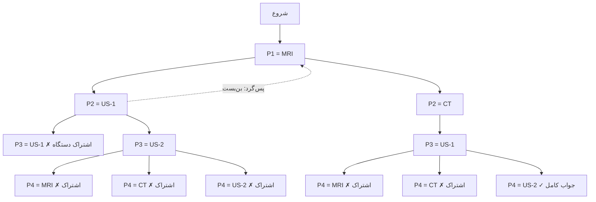

# جلسه ۱۲: مسائل ارضای محدودیت (CSP)

> **درس:** مقدمه‌ای بر هوش مصنوعی و کاربرد آن در مهندسی پزشکی
> **مدت پیشنهادی:** ۶۰ تا ۹۰ دقیقه · **سطح:** مقدماتی
> **منابع این جلسه:** منبع ۱ (Russell & Norvig, 2016)، منبع ۱۱ (محتوای مدرس)

---

## اهداف جلسه

پس از این جلسه دانشجو باید بتواند:

1. یک مسئله را به صورت‌بندی ارضای محدودیت (Constraint Satisfaction Problem, CSP) یعنی سه‌گانه‌ی متغیرها، دامنه‌ها و قیدها ترجمه کند.
2. انواع قیدها (تک‌تغیره، دوتغیره، سراسری) را از هم تشخیص دهد.
3. الگوریتم پس‌گرد (Backtracking) و درخت جست‌وجوی آن را توضیح دهد و بن‌بست‌ها را روی نمودار نشان دهد.
4. دو بهبود کلاسیک — بررسی پیش‌رو (Forward Checking) و اکتشاف کمترین مقادیر باقی‌مانده (MRV) — را توضیح دهد و اثرشان را روی شمار گره‌های پیمایش‌شده مقایسه کند.
5. یک مسئله‌ی تخصیص منابع بیمارستانی را با کد جلسه حل و دو روش را مقایسه کند.

---

## ۱. صورت‌بندی CSP: متغیرها، دامنه‌ها، قیدها

در جلسات ۵ تا ۸، هدف «پیدا کردن مسیر» بود؛ اینجا هدف «پیدا کردن یک تخصیص کامل سازگار» است. هر CSP سه مؤلفه دارد:

- **متغیرها (Variables):** مجموعه‌ای متناهی از نام‌ها که باید مقدار بگیرند، مثلاً بیمارها.
- **دامنه‌ها (Domains):** مجموعه‌ی مجاز مقادیر برای هر متغیر.
- **قیدها (Constraints):** رابطه‌هایی که مشخص می‌کنند کدام ترکیب مقادیر مجاز است.

**مثال اجرایی این جلسه (آموزشی و غیرتشخیصی):** یک بخش تصویربرداری می‌خواهد چهار بیمارِ یک روز را به چهار دستگاه تخصیص دهد.

| مؤلفه | نمونه‌ی این جلسه |
|---|---|
| متغیرها | بیماران $P_1, P_2, P_3, P_4$ |
| دامنه‌ها | دستگاه‌های MRI، CT، US-1، US-2 (با محدودیت ارجاعِ هر بیمار) |
| قیدها | هر دستگاه حداکثر به یک بیمار؛ بیماران $P_1$ و $P_4$ در دو بلوک ساختمانی متفاوت |

دامنه‌ی اعلام‌شده‌ی هر بیمار در کد (ترتیب اعلام = اولویت ارجاع):

| متغیر | دامنه | توضیح |
|---|---|---|
| $P_1$ | MRI | فقط MRI؛ قید تک‌تغیره‌ی ارجاع |
| $P_2$ | US-1، CT | اولویت سونوگرافی، جایگزین CT |
| $P_3$ | US-1، US-2 | فقط سونوگرافی |
| $P_4$ | MRI، CT، US-2 | هر سه گزینه مجاز |

> [!TIP]
> تفاوت CSP با جست‌وجوی مسیر جلسات قبل را با یک جمله حفظ کنید: در جست‌وجوی مسیر، جواب «سکانس گام‌ها» است و ساختار مسیر مهم است؛ در CSP، جواب «تخصیص کامل و بی‌نظم» است و ترتیب تخصیص متغیرها به جواب تغییری نمی‌دهد — پس می‌توانیم ترتیب را هوشمندانه انتخاب کنیم.

---

## ۲. انواع قیدها

قیدها را از دو زاویه دسته‌بندی می‌کنیم:

| نوع | تعریف | مثال در این جلسه |
|---|---|---|
| تک‌تغیره (Unary) | فقط یک متغیر را محدود می‌کند؛ عملاً کوتاه‌کردن دامنه | «$P_1$ فقط MRI» |
| دوتغیره (Binary) | رابطه بین دو متغیر | «$P_1$ و $P_4$ در دو بلوک متفاوت» |
| سراسری (Global) | رابطه بین تعداد دلخواهی از متغیرها | «هر دستگاه حداکثر یک بیمار» (همان AllDifferent روی هر چهار متغیر) |

قید سراسری AllDifferent یعنی هیچ دو متغیری مقدار مشترک نمی‌گیرند؛ در کد جلسه، هر بار تخصیص یک بیمار، دستگاه انتخابی از دامنه‌ی بقیه حذف می‌شود. قید دوتایی بلوک ساختمان هم مدل‌سازی شده: دستگاه‌های MRI و CT در بلوک A و دو سونوگراف در بلوک B هستند، و برای کنترل عفونت، بیماران نشان‌دار $P_1$ و $P_4$ باید در بلوک‌های متفاوت تصویربرداری شوند.

> [!NOTE]
> هر CSP را می‌توان به جست‌وجوی حالت جلسات قبل تبدیل کرد — حالت = تخصیص جزئی، عمل = تخصیص یک مقدار به یک متغیر — اما ابزارهای مخصوص CSP از ساختار قیدها برای حذف زودهنگام شاخه‌های مرده بهره می‌گیرند و همین، در عمل، تفاوت حل‌شدن و حل‌نشدن یک مسئله را می‌سازد.

---

## ۳. پس‌گرد: درخت جست‌وجوی تخصیص

**جست‌وجوی پس‌گرد (Backtracking)** همان DFS عمق‌اول روی درخت تخصیص است: در هر گره یک متغیر تخصیص‌ناشده را برمی‌داریم، مقادیر دامنه‌اش را یکی‌یکی امتحان می‌کنیم، اگر تخصیص جزئی با همه‌ی قیدهای فعلی سازگار بود به عمق ادامه می‌دهیم و در غیر این صورت پس‌گرد می‌کنیم.

درخت جست‌وجوی مسئله‌ی امروز با ترتیب ثابت $P_1 \to P_2 \to P_3 \to P_4$:



خروجی واقعی کد برای این جست‌وجوی ساده:

| سنجه | مقدار |
|---|---|
| بار امتحان مقدار | ۱۲ |
| تخصیص موقت | ۶ |
| بن‌بست و پس‌گرد | ۲ |
| جواب | $P_1=\text{MRI}$، $P_2=\text{CT}$، $P_3=\text{US-1}$، $P_4=\text{US-2}$ |

می‌بینید که شاخه‌ی «$P_2 = \text{US-1}$» تا عمق ۳ پایین می‌رود و آنجا می‌میرد: سه مقدارِ $P_4$ همه ناسازگارند، چون US-1 و US-2 هر دو قبلاً گرفته شده‌اند و MRI و CT هم با قید بلوک نمی‌سازند. بدون احتساب خودِ تخصیص $P_2$، زیرشاخه‌ی $P_2=\text{US-1}$ ۵ بار امتحان مقدار مصرف می‌کند (دو مقدار برای $P_3$ و سه مقدار برای $P_4$) و در عمق ۳ می‌میرد.

---

## ۴. دو بهبود کلاسیک: بررسی پیش‌رو و کمترین مقادیر باقی‌مانده

### ۴.۱ بررسی پیش‌رو (Forward Checking)

پس‌گرد ساده فقط با تخصیص‌های موجود مقایسه می‌کند؛ یعنی ناسازگاری را دیر کشف می‌دهد. بررسی پیش‌رو هر بار که مقداری را تخصیص می‌دهیم، بلافاصله مقادیر ناسازگار را از دامنه‌ی متغیرهای تخصیص‌نشده حذف می‌کند. اگر دامنه‌ی متغیری ته بماند، همان‌جا شاخه را می‌بندیم — بدون پایین‌رفتن. مثلاً با تخصیص $P_1 = \text{MRI}$، هم MRI از دامنه‌ی $P_4$ حذف می‌شود (قید اشتراک) و هم CT (چون با قید بلوک، $P_1$ و $P_4$ هر دو در بلوک A می‌افتادند)؛ دامنه‌ی $P_4$ از سه مقدار به یک مقدار می‌رسد.

### ۴.۲ اکتشاف کمترین مقادیر باقی‌مانده (MRV)

پس‌گرد ساده متغیرها را به ترتیب ثابت برمی‌دارد. اکتشاف کمترین مقادیر باقی‌مانده (Minimum Remaining Values, MRV) می‌گوید: **در هر گام، متغیری را انتخاب کن که کوچک‌ترین دامنه باقی‌مانده را دارد.** شهود: متغیرهای دارای قید سخت را زودتر می‌بندیم، پس شکست‌های احتمالی زودتر و پایین‌ترِ درخت رخ می‌دهند و درخت کوچک‌تر می‌ماند — این همان شهود «اول قدم‌های سخت» در برنامه‌ریزی است.

### ۴.۳ مقایسه‌ی واقعی دو روش

خروجی واقعی کد جلسه، اجرای هر دو روش روی همان مسئله:

| روش | بار امتحان مقدار | تخصیص | پس‌گرد | حذف با FC |
|---|---|---|---|---|
| پس‌گرد ساده | ۱۲ | ۶ | ۲ | — |
| پس‌گرد + FC + MRV | ۴ | ۴ | ۰ | ۴ |

با FC + MRV، ترتیب انتخاب متغیرها $P_1 \to P_4 \to P_3 \to P_2$ می‌شود (بعد از تخصیص $P_1$، دامنه‌ی $P_4$ با دو حذف کوچک‌ترین است) و هیچ پس‌گردی لازم نمی‌شود: هر تخصیصی که امتحان می‌شود بلافاصله سازگار است، چون FC مقادیر مرده را قبلاً از راه حذف کرده است.

> [!IMPORTANT]
> هر دو روش به یک جواب می‌رسند — اکتشاف‌ها **درستی** جواب را عوض نمی‌کنند، فقط هزینه‌ی رسیدن به آن را. این نکته را در کلاس چند بار تکرار کنید؛ در جلسه‌ی بعد همین ساختار برای زمان‌بندی شیفت پرستاری با قیدهای بیشتری به کار می‌رود.

---

## 🔬 پیوند با مهندسی پزشکی

- **تخصیص منابع:** نگاشت بیماران به دستگاه‌های تصویربرداری، بیماران به تخت‌های ICU، یا تجهیزات اتاق عمل به برنامه‌ی روزانه — همه CSP هستند: متغیر = منبع/بیمار، دامنه = گزینه‌های مجاز، قید = محدودیت ارجاع، تداخل و بلوک‌بندی (مثال آموزشی و غیرتشخیصی؛ جایگزین تصمیم بالینی نیست).
- **زمان‌بندی:** جدول هفتگی شیفت پرستاران، زمان‌بندی MRI برای بستری‌ها با اولویت‌های مختلف و برنامه‌ی نگهداری دستگاه‌ها، در جلسه‌ی بعد به‌صورت CSP حل می‌شود.
- **گزارش شکست:** وقتی FC دامنه‌ای را خالی می‌کند، سیستم می‌تواند دقیقاً بگوید «این درخواست با این قیدها ممکن نیست و علتش فلان تداخل است» — این صادق‌تر از یک جواب غلط است و در سیستم‌های بالینی ارزش قانونی و ایمنی دارد.

---

## ✍️ فعالیت کلاسی / کارگاه

۱. صورت‌بندی کنید: یک آزمایشگاه باید سه آزمون خون را به سه دستگاه تحلیلگر تخصیص دهد؛ دستگاه هر آزمون مشخص است (قید تک‌تغیره)، هر دستگاه همزمان فقط یک آزمون (AllDifferent) و آزمون‌های A و C نباید همزمان باشند چون نمونه‌هایشان با یک تکنسین مشترک است. متغیرها، دامنه‌ها و قیدها را در یک جدول بنویسید و نوع هر قید را مشخص کنید.

۲. درخت مرمید بخش ۳ را دنبال کنید و شمار بار امتحان مقدار را خودتان بشمارید؛ عدد به‌دست‌آمده را با جدول بخش ۳ (۱۲ بار) مقایسه کنید.

۳. کد `code/session_12_csp_backtracking.py` را اجرا کنید. در تابع `forward_check` حذف مقادیر را ردیابی کنید و توضیح دهید چرا با تخصیص $P_1 = \text{MRI}$، دامنه‌ی $P_4$ دو مقدار کم می‌کند نه فقط یکی.

---

## 💻 کد آموزشی

فایل `code/session_12_csp_backtracking.py` مسئله‌ی تخصیص دستگاه به بیمار را با دو جست‌وجو حل می‌کند:

1. **پس‌گرد ساده:** ترتیب ثابت متغیرها و مقادیر، چاپ ردپای کامل تخصیص‌ها و پس‌گرد.
2. **پس‌گرد + FC + MRV:** حذف زودهنگام مقادیر ناسازگار و انتخاب متغیر با کوچک‌ترین دامنه.

قطعه‌ی کلیدی بررسی پیش‌رو:

```python
def forward_check(domains, var, value, assignment):
    new_domains = {p: set(d) for p, d in domains.items()}
    pruned = 0
    for other in PATIENTS:                 # قید سراسری AllDifferent
        if other != var and other not in assignment and value in new_domains[other]:
            new_domains[other].discard(value)
            pruned += 1
    for a, b, rel in BINARY:               # قید دوتایی بلوک ساختمان
        ...
    if any(not d for d in new_domains.values()):
        return None, pruned                # دامنه‌ای خالی شد → شکست زودهنگام
    return new_domains, pruned
```

اجرا:

```bash
python3 code/session_12_csp_backtracking.py
```

خروجی قطعی است و جدول مقایسه‌ی دو روش را در انتهای اجرا چاپ می‌کند.

---

## 📘 واژهنامه

| واژه | معنی |
|---|---|
| مسئله‌ی ارضای محدودیت (CSP) | مسئله‌ای با متغیرها، دامنه‌ها و قیدها که هدف، یافتن تخصیصی سازگار با همه‌ی قیدهاست |
| دامنه (Domain) | مجموعه‌ی مقادیر مجاز یک متغیر |
| تخصیص سازگار (Consistent Assignment) | تخصیصی که هیچ قیدی را نقض نمی‌کند |
| قید تک‌تغیره (Unary Constraint) | قیدی که فقط دامنه‌ی یک متغیر را کوتاه می‌کند |
| قید دوتغیره (Binary Constraint) | رابطه‌ی مجاز بین دو متغیر |
| قید سراسری (Global Constraint) | رابطه روی تعداد دلخواهی از متغیرها، مثل AllDifferent |
| پس‌گرد (Backtracking) | جست‌وجوی عمق‌اول روی درخت تخصیص با عقب‌نشینی از بن‌بست |
| بررسی پیش‌رو (Forward Checking) | حذف مقادیر ناسازگار از دامنه‌ی متغیرهای تخصیص‌نشده بعد از هر تخصیص |
| کمترین مقادیر باقی‌مانده (MRV) | اکتشاف انتخاب متغیر با کوچک‌ترین دامنه‌ی باقی‌مانده |
| بن‌بست (Dead End) | گره‌ای که هیچ مقداری برای متغیر بعدی سازگار نیست |

---

## ❓ پرسشهای خودآزمون

1. سه مؤلفه‌ی صورت‌بندی CSP را نام ببرید و مسئله‌ی «چهار رنگ نقشه‌ی چهار استان» را با همین سه مؤلفه صورت‌بندی کنید.
2. قید «هر دستگاه حداکثر یک بیمار» از چه نوعی است و در کد جلسه کجا اعمال می‌شود؟
3. در درخت بخش ۳، شاخه‌ی «$P_2 = \text{US-1}$» کجا می‌میرد و چرا هیچ مقداری برای $P_4$ نمی‌سازد؟
4. بررسی پیش‌رو چه چیزی را به پس‌گرد ساده اضافه می‌کند و چرا شمار پس‌گرد را صفر می‌کند؟
5. چرا اکتشاف MRV جواب را تغییر نمی‌دهد اما هزینه‌ی جست‌وجو را کم می‌کند؟

---

## 📝 تکلیف

۱. مسئله‌ی فعالیت ۱ (آزمایشگاه) را با الهام از کد جلسه صورت‌بندی و با پس‌گرد ساده حل کنید. درخت جست‌وجو را بکشید و شمار بار امتحان مقدار را گزارش کنید.

۲. در کد جلسه، قید دوتایی بلوک را حذف کنید و هر دو روش را دوباره اجرا کنید. جدول مقایسه‌ی جدید را گزارش دهید و توضیح دهید چرا تفاوت دو روش کم یا زیاد می‌شود.

۳. یک قید سراسری جدید اضافه کنید: «دستگاه MRI باید به یکی از بیمارهای $P_1$ یا $P_4$ داده شود». صورت‌بندی جدید را بنویسید و بگویید درخت جست‌وجو چه تغییری می‌کند.

**مهلت:** جلسه‌ی آینده · **قالب تحویل:** فایل کد + گزارش کوتاه شامل جدول‌های مقایسه.

---

## 📚 مطالعه پیشنهادی

- منبع ۱ (Russell & Norvig, 2016)، بخش ۶.۱ تا ۶.۴: صورت‌بندی CSP، پس‌گرد، سازگاری قوس.
- اسلایدها و درخت جست‌وجوی جلسه‌ی امروز در سامانه‌ی درس.
- پیش‌زمینه‌ی جلسه‌ی بعد: مقاله‌ی مروری کوتاه درباره‌ی زمان‌بندی پرستاری (لینک در سامانه‌ی درس).

---

## 🧭 راهنمای مدرس (از این عنوان تا انتها در نسخه دانشجو حذف شود)

### زمان‌بندی پیشنهادی ۹۰ دقیقه

| بازه | فعالیت |
|---|---|
| ۰–۱۰ | انگیزه: صحنه‌ی برنامه‌ریزی یک روز تصویربرداری؛ پرسش «چرا BFS جواب این را نمی‌دهد؟» |
| ۱۰–۳۰ | صورت‌بندی سه‌گانه و انواع قیدها؛ فعالیت ۱ |
| ۳۰–۵۵ | پس‌گرد و درخت جست‌وجو؛ دنبال‌کردن گره‌به‌گره روی تخته، فعالیت ۲ |
| ۵۵–۷۵ | FC و MRV؛ اجرای زنده‌ی کد، مقایسه‌ی جدول دو روش، فعالیت ۳ |
| ۷۵–۹۰ | پیوند با جلسه‌ی بعد (زمان‌بندی شیفت)، تکلیف و پرسش‌وپاسخ |

### زمان‌بندی جایگزین ۶۰ دقیقه

بخش ۴ را کوتاه کنید: فقط جدول مقایسه‌ی دو روش را نشان دهید و بحث FC را با یک مثال تک‌گامی (تخصیص $P_1 = \text{MRI}$) بگنجانید. فعالیت ۳ اختیاری می‌شود.

### کلید پاسخ فعالیت‌ها و آزمایش‌ها (از اجرای واقعی کد)

<details>
<summary>نمایش کلید پاسخ</summary>

1. صورت‌بندی آزمایشگاه: متغیرها = آزمون‌های A، B، C؛ دامنه‌ها = دستگاه تحلیلگر مربوط به هر آزمون (تک‌تغیره، عملاً دامنه‌ی تک‌عضوی)؛ قید AllDifferent روی هر سه متغیر (سراسری) و قید دوتایی «A و C همزمان نیستند» چون تکنسین مشترک دارند. جدول‌های دانشجو باید هر قید را با نوعش برچسب بزنند؛ اگر دامنه‌ها را فقط «دستگاه مجاز» نوشتند و قید تکنسین را جای دامنه آوردند، اشاره کنید که قید بین دو متغیر، رابطه است نه دامنه.
2. شمار بار امتحان مقدار در درخت بخش ۳: $P_1$: ۱ مقدار؛ $P_2$: ۲ مقدار؛ زیر $P_2=\text{US-1}$: دو مقدار برای $P_3$ و سه مقدار برای $P_4$ (۵)؛ زیر $P_2=\text{CT}$: یک مقدار برای $P_3$ و سه مقدار برای $P_4$ (۴). جمع: $1+2+5+4 = 12$ — همان عدد جدول بخش ۳.
3. با تخصیص $P_1 = \text{MRI}$، FC دو حذف در دامنه‌ی $P_4$ انجام می‌دهد: MRI به‌خاطر قید سراسری AllDifferent (دستگاه تکراری) و CT به‌خاطر قید دوتایی بلوک (چون MRI و CT هر دو در بلوک A هستند و $P_1$ و $P_4$ باید در بلوک‌های متفاوت باشند). دامنه‌ی $P_4$ از $\{\text{MRI}, \text{CT}, \text{US-2}\}$ به $\{\text{US-2}\}$ می‌رسد. این دقیقاً نقطه‌ای است که در جست‌وجوی دوم، انتخاب بعدیِ MRV را به $P_4$ می‌برد.
4. با حذف قید دوتایی بلوک، پس‌گرد ساده به جواب $P_1=\text{MRI}$، $P_2=\text{US-1}$، $P_3=\text{US-2}$، $P_4=\text{CT}$ می‌رسد؛ در اجرای ما پس‌گرد ساده ۶ بار امتحان مقدار و صفر بن‌بست داشت و FC + MRV هم ۴ امتحان، ۳ حذف و صفر پس‌گرد. دلیل بهتر شدن پس‌گرد ساده: بدون قید بلوک، شاخه‌ی اول ($P_2=\text{US-1}$، $P_3=\text{US-2}$) مستقیماً با $P_4=\text{CT}$ جواب می‌شود، در حالی که با قید بلوک همان مقادیر هر دو شاخه را می‌بستند؛ یعنی قید بلوک منبع اصلی بن‌بست‌ها در این مسئله بود و حذفش شمار بار امتحان مقدار در پس‌گرد ساده را از $12$ به $6$ کاهش داد (فاصله‌ی دو روش نیز از $8$ به $2$ رسید؛ FC + MRV در هر دو حالت $4$ بار امتحان دارد).
5. قید «MRI فقط به $P_1$ یا $P_4$» در این مسئله افزونگی (Redundant) است: MRI از ابتدا فقط در دامنه‌ی $P_1$ و $P_4$ وجود دارد و در دامنه‌های $P_2$ و $P_3$ نیست، پس هر تخصیص سازگار این قید را خودبه‌خود ارضا می‌کند و درخت جست‌وجو تغییری نمی‌کند. نکته‌ی آموزشی: قید سراسری تازه را می‌توان به‌صورت قیدهای دوتایی بازنویسی کرد (بین حامل MRI و هر بیمار دیگر)؛ اما قبل از افزودن هر قید، بررسی کنید که آیا همان قید در دامنه‌ها و قیود موجود از قبل برقرار است — قید افزونگی فقط هزینه می‌سازد و درخت را کوچک نمی‌کند.

</details>

### کلید پاسخ پرسش‌های خودآزمون

<details>
<summary>نمایش کلید پاسخ</summary>

1. متغیرها، دامنه‌ها، قیدها. نقشه‌ی چهار استان: متغیرها = چهار استان؛ دامنه‌ی هر یک = مجموعه‌ی رنگ‌ها (مثلاً چهار رنگ)؛ قید = بین هر جفت استان همسایه، رنگ متفاوت (قیدهای دوتایی) و در کل باید همه رنگ متفاوت از همسایه‌ها باشند.
2. سراسری (AllDifferent). در کد، در تابع `consistent` با مقایسه‌ی طول مجموعه‌ی مقادیر با تعداد تخصیص‌ها (جست‌وجوی ساده) و در `forward_check` با حذف مقدار تخصیص‌یافته از دامنه‌ی بقیه.
3. زیر گره $P_3 = \text{US-2}$ می‌میرد: بعد از $P_1=\text{MRI}$، $P_2=\text{US-1}$، $P_3=\text{US-2}$، دو دستگاه MRI و US-2 با AllDifferent رد می‌شوند و CT با قید بلوک (CT در بلوک A است، همان بلوک $P_1$)؛ پس دامنه‌ی $P_4$ خالی می‌ماند و شاخه همان‌جا می‌میرد.
4. FC ناسازگاری را از «وقتی متغیر بعدی تخصیص می‌گیرد» به «همان لحظه‌ی تخصیص فعلی» جلو می‌برد؛ چون مقادیر مرده قبلاً حذف شده‌اند، در اجرای این مسئله هیچ تخصیصی به بن‌بست نمی‌رسد و پس‌گرد صفر می‌شود. در مسائل بزرگ‌تر پس‌گرد صفر نمی‌ماند، ولی تعدادش به‌شدت کم می‌شود.
5. MRV فقط ترتیب تخصیص متغیرها را عوض می‌کند؛ جواب‌های سازگار همان‌ها هستند و قیدها تغییری نمی‌کنند، پس مجموعه‌ی جواب‌ها ثابت است. اما شکست‌ها پایین‌تر و زودتر رخ می‌دهند و شاخه‌های مرده کوچک‌تر می‌شوند، پس گره‌های کمتری پیمایش می‌شود.

</details>

### نکات اجرای کلاس

- درخت مرمید بخش ۳ را قبل از اجرای کد روی تخته بکشید و از دانشجوها بخواهید بن‌بست‌ها را پیش‌بینی کنند؛ بعد اجرا را نشان دهید تا ردپای چاپ‌شده‌ی کد با درخت تطبیق بخورد.
- جمله‌ی خروجی مورد انتظار: هر دانشجو بتواند بگوید «CSP سه‌گانه‌ی متغیر/دامنه/قید است؛ پس‌گرد درخت تخصیص را با DFS می‌پیماید و FC و MRV شاخه‌های مرده را زودتر می‌بندند بدون اینکه جواب عوض شود».

### خروجی مورد انتظار جلسه

هر دانشجو جدول مقایسه‌ی دو روش (۱۲ در برابر ۴ بار امتحان مقدار در اجرای واقعی) را گزارش کند و بتواند نوع تک‌تغیره/دوتغیره/سراسری هر قید مسئله‌ی کلاس را تشخیص دهد.
