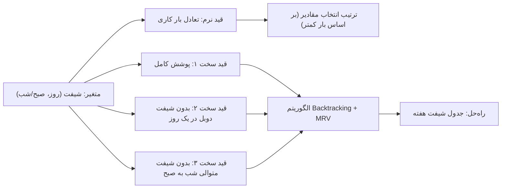

# جلسه ۱۳: حل CSP و مسئله زمان‌بندی

> **درس:** مقدمه‌ای بر هوش مصنوعی و کاربرد آن در مهندسی پزشکی
> **مدت پیشنهادی:** ۶۰ تا ۹۰ دقیقه · **سطح:** مقدماتی
> **منابع این جلسه:** منبع ۱ (Russell & Norvig, 2016)، منبع ۱۱ (محتوای مدرس)

---

## اهداف جلسه
در پایان این جلسه دانشجو می‌تواند:
1. یک مسئله زمان‌بندی واقعی را به‌صورت CSP (متغیر/دامنه/قید) صورت‌بندی کند.
2. ساختار درخت جست‌وجوی یک CSP را ترسیم و تفاوت آن با درخت جست‌وجوی مسیر جلسات ۵ تا ۸ را توضیح دهد.
3. الگوریتم Backtracking با هیوریستیک MRV را روی مسئله شیفت پرستاری اجرا و خروجی را تفسیر کند.
4. تفاوت قید سخت (Hard) و قید نرم (Soft) را تشخیص دهد و مسئله بیش‌قید (Over-constrained) را بشناسد.
5. با افزودن قیدهای سخت‌تر، رفتار الگوریتم را پیش‌بینی و آزمایش کند.

> [!IMPORTANT]
> پیش‌نیاز این جلسه، جلسه ۱۲ است. در آن جلسه صورت‌بندی CSP و الگوریتم Backtracking معرفی شد؛ این جلسه همان ابزارها را روی یک مسئله واقعی‌تر و بزرگ‌تر به کار می‌گیرد و تمرکز اصلی روی «زمان‌بندی» است.

---

## ۱. از رنگ‌آمیزی نقشه تا زمان‌بندی
در جلسه ۱۲ CSP را با مثال ساده رنگ‌آمیزی نقشه دیدیم. حالا یک مسئله‌ی واقعی‌تر بررسی می‌کنیم: **زمان‌بندی شیفت پرستاران یک بیمارستان**.

سناریو (آموزشی): بخشی از یک بیمارستان با ۴ پرستار (P1 تا P4) و هفت روز هفته دارد. هر روز دو شیفت است: صبح (M) و شب (N)؛ یعنی ۷ × ۲ = **۱۴ شیفت** که هر کدام باید دقیقاً یک پرستار داشته باشد.

| عنصر CSP | در این مسئله | مثال جلسه ۱۲ (رنگ نقشه) |
|---|---|---|
| متغیر (Variable) | هر شیفت (روز، صبح/شب) | هر منطقه نقشه |
| دامنه (Domain) | {P1, P2, P3, P4} | مجموعه رنگ‌ها |
| قید (Constraint) | پوشش کامل + بدون شیفت دوبل | همسایه‌ها هم‌رنگ نشوند |

> [!NOTE]
> ساختار CSP این جلسه همان رنگ‌آمیزی است؛ فقط قیدها پیچیده‌تر شده‌اند و مفهوم «روز و شیفت» فضای حالت را ساختارمندتر کرده‌اند.

## ۲. قیدها: سخت و نرم
دو نوع قید داریم:

| نوع قید | شرح | نقش در حل مسئله |
|---|---|---|
| قید سخت (Hard) | باید برقرار باشد؛ در غیر این صورت راه‌حل قبول نیست | Backtracking فقط این‌ها را چک می‌کند |
| قید نرم (Soft) | مطلوب است ولی لازم نیست | در طراحی ترتیب مقادیر به کار می‌رود |

در این مسئله سه قید داریم:

1. **پوشش (Coverage):** هر شیفت باید دقیقاً یک پرستار داشته باشد.
2. **بدون شیفت دوبل در یک روز:** یک پرستار نمی‌تواند هم صبح و هم شب یک روز را بگیرد.
3. **بدون شیفت متوالی:** یک پرستار نمی‌تواند شبِ یک روز و صبحِ روز بعد را بگیرد.

قید نرم هم داریم: **تعادل بار کاری** — بار کاری پرستارها تا حد امکان یکسان باشد. این قید در الگوریتم راه‌حل چک نمی‌شود ولی در ترتیب انتخاب مقادیر به کار می‌رود: پرستاری که شیفت کمتری گرفته زودتر امتحان می‌شود.



## ۳. درخت جست‌وجوی CSP با Backtracking
در جلسه ۱۲ دیدیم که درخت جست‌وجوی CSP با درخت مسیر تفاوت دارد:

| مفهوم | درخت مسیر (جلسات ۵ تا ۸) | درخت CSP |
|---|---|---|
| گره | یک شهر/خانه روی نقشه | یک «تخصیص جزئی» (Partial Assignment) |
| هدف | مسیر از شروع تا هدف | تخصیص کامل که همه قیدها را برآورده کند |
| عمق | طول مسیر | تعداد متغیرهای تخصیص‌یافته |

در هر گام، یک متغیر انتخاب می‌شود و یکی از مقادیر دامنه‌اش تخصیص می‌یابد؛ اگر قیادی نقض شود، به گام قبل برمی‌گردیم (Backtrack). دو بهینه‌سازی مهم در کد این جلسه:

- **MRV (Minimum Remaining Values):** هر بار متغیری با کمترین تعداد مقادیر سازگار انتخاب می‌شود؛ این هیوریستیک در جلسه ۱۲ معرفی شد و باعث می‌شود زودتر به بن‌بست برسیم و شاخه‌های مرده را حذف کنیم.
- **ترتیب مقادیر بر اساس قید نرم:** بار کاری فعلی هر پرستار شمرده می‌شود و پرستارِ کم‌بار زودتر امتحان می‌شود.

## ۴. اجرای کد و خواندن جدول
اسکریپت این جلسه را اجرا کنید:

```bash
python3 code/session_13_csp_scheduling.py
```

خروجی واقعی در اجرای ما:

```text
متغیرها: 14 شیفت در هفته
دامنه: [P1, P2, P3, P4]
قیدها: پوشش کامل + بدون شیفت دوبل در یک روز + بدون شیفت متوالی

راه‌حل پیدا شد (تعداد گره‌های جست‌وجو: 14)
```

جدول شیفت حاصل:

| روز | صبح (M) | شب (N) |
|---|---|---|
| شنبه | P1 | P2 |
| یکشنبه | P3 | P4 |
| دوشنبه | P1 | P2 |
| سه‌شنبه | P3 | P4 |
| چهارشنبه | P1 | P2 |
| پنجشنبه | P3 | P4 |
| جمعه | P1 | P2 |

و بار کاری هفتگی هر پرستار:

| پرستار | بار کاری (تعداد شیفت) |
|---|---|
| P1 | 4 |
| P2 | 4 |
| P3 | 3 |
| P4 | 3 |

> [!TIP]
> فقط ۱۴ گره جست‌وجو برای ۱۴ متغیر شمرده شده است. این نتیجه‌ی ترکیب MRV و ترتیب هوشمند مقادیر است: الگوریتم تقریباً بدون شاخه‌ی مرده مستقیم به راه‌حل رسیده و بار کاری هم به‌طور طبیعی متعادل شده (۴/۴/۳/۳).

## ۵. مسئله بیش‌قید و سخت‌تر کردن مسئله
چه می‌شود اگر قیدها را سخت‌تر کنیم؟ چند آزمایش طبیعی:

1. **افزودن قید «حداکثر ۴ شیفت در هفته» برای هر پرستار:** فعلاً راه‌حل فعلی این را برآورده می‌کند (۴/۴/۳/۳)، اما شاید با قیدهای بیشتر، راه‌حلی که این حد را نقض کند تنها گزینه باشد.
2. **کم کردن پرستار (از ۴ به ۳):** راه‌حل همچنان وجود دارد اما بار کاری نابرابرتر می‌شود (کلید در راهنمای مدرس).
3. **افزودن شیفت روز سوم (عصر):** فضا بزرگ‌تر و مسئله سخت‌تر می‌شود.

مسئله‌ی **بیش‌قید (Over-constrained)** مسئله‌ای است که هیچ راه‌حلی همه قیدهای سخت را برآورده نمی‌کند. راه‌حل‌های رایج:

- **سخت‌کردن و تضعیف قید نرم:** بعضی قیدها را از سخت به نرم تبدیل کنیم و به دنبال راه‌حلی باشیم که کمترین تخلف را دارد.
- **افزودن منابع:** پرستار بیشتر، شیفت کمتر یا دامنه‌ی گسترده‌تر.
- **جست‌وجوی محلی (جلسه ۱۰):** به‌جای جست‌وجوی سیستماتیک، از یک راه‌حل تصادفی شروع و کم‌کم تخلف‌ها را کم کنیم.

> [!WARNING]
> اگر قیدها با هم سازگار نباشند، الگوریتم Backtracking کل فضا را جست‌وجو می‌کند و «راه‌حل یافت نشد» می‌دهد؛ این می‌تواند خیلی طول بکشد. تشخیص سازگاری قیدها پیش از اجرا (مدل‌سازی درست) کار مهمی است.

---

## 🔬 پیوند با مهندسی پزشکی
**زمان‌بندی شیفت پرستاری در بیمارستان (مثال آموزشی):** در دنیای واقعی، سیستم‌های زمان‌بندی پرستاری نقش حیاتی در کارایی بیمارستان دارند. مدل CSP این جلسه ساده‌شده است، اما ساختار آن (متغیر، دامنه، قید) دقیقاً همان چیزی است که در نرم‌افزارهای واقعی زمان‌بندی به‌کار می‌رود؛ به‌علاوه قیدهای تکمیلی مانند تجربه‌ی لازم، محدودیت ساعات کار قانونی، درخواست‌های مرخصی و تعادل بار کاری می‌توانند به‌صورت قیدهای سخت یا نرم اضافه شوند.

> [!IMPORTANT]
> این مثال کاملاً آموزشی است. هیچ‌یک از خروجی‌های این جلسه کاربرد تشخیصی یا تصمیم بالینی ندارد و سامانه‌های واقعی زمان‌بندی بیمارستانی به پروتکل‌ها، قوانین کار و مجوزهای رسمی وابسته‌اند.

## ✍️ فعالیت کلاسی

### فعالیت ۱: صورت‌بندی CSP
با گروه خود روی تمرین‌های زیر کار کنید:
1. صورت‌بندی CSP برای مسئله‌ی «کلاس‌های یک ترم» با قید «هیچ دو کلاس در یک ساعت برگزار نشوند».
2. چه متغیرها و دامنه‌ها و قیدهایی دارید؟ چه قید نرمی می‌توانید اضافه کنید؟
3. جدول‌مانند بخش ۱ را برای مسئله‌ی خودتان پر کنید.

### فعالیت ۲: سخت‌تر کردن مسئله شیفت
۱. کد `session_13_csp_scheduling.py` را اجرا و جدول را یادداشت کنید.
۲. حالا در کد، تعداد پرستارها را از ۴ به ۳ کاهش دهید و اجرا کنید. آیا راه‌حلی پیدا می‌شود؟ بار کاری چطور تغییر می‌کند؟
۳. اگر راه‌حل نبود، کدام قید را نرم می‌کنید؟ (کلید و جدول واقعی در راهنمای مدرس آمده است.)

## 💻 کد آموزشی
فایل `code/session_13_csp_scheduling.py` (فقط کتابخانه استاندارد پایتون):

```bash
python3 code/session_13_csp_scheduling.py
```

این اسکریپت:
1. مسئله را به‌صورت CSP (متغیر/دامنه/قید سخت و نرم) صورت‌بندی می‌کند.
2. تابع `consistent` قیدهای دوبخشی (شیفت دوبل، شیفت متوالی) را بین جفت‌های مرتبط چک می‌کند.
3. با `mrv_variable` متغیر کم‌دامنه را انتخاب و با `order_values` ترتیب مقادیر را بر اساس قید نرم تعیین می‌کند.
4. با `backtrack` حل می‌کند و جدول شیفت و بار کاری هر پرستار را چاپ می‌کند.

> [!NOTE]
> همه کدهای این درس آموزشی و غیرتشخیصی‌اند؛ پرستارها، روزها و قیدها ساختگی‌اند و خروجی هیچ کاربرد بالینی ندارد.

## 📘 واژه‌نامه

| واژه | معنی |
|---|---|
| CSP | مسئله ارضای محدودیت (Constraint Satisfaction Problem) |
| Variable / Domain / Constraint | متغیر / دامنه / قید |
| Backtracking | بازگشت به عقب؛ الگوریتم حل CSP با انتخاب و چک گام‌به‌گام |
| MRV | کمترین مقادیر باقی‌مانده (Minimum Remaining Values) |
| Coverage | پوشش؛ قیدی که تخصیص هر شیفت به یک پرستار را تضمین می‌کند |
| No-Consecutive-Shift | بدون شیفت متوالی؛ منع شبِ امروز و صبحِ فردا |
| Hard Constraint | قید سخت؛ باید برآورده شود |
| Soft Constraint | قید نرم؛ مطلوب اما الزامی نیست |
| Over-constrained | بیش‌قید؛ مسئله‌ای که هیچ راه‌حلی ندارد |

## ❓ پرسش‌های خودآزمون
1. تفاوت درخت جست‌وجوی CSP با درخت مسیر جلسات ۵ تا ۸ چیست؟
2. قید نرم «تعادل بار کاری» در کد چگونه به کار رفته است؟ آیا در `consistent` چک می‌شود؟
3. اگر تعداد پرستارها به ۲ کاهش یابد، مسئله چه وضعیتی پیدا می‌کند؟
4. تفاوت قید سخت و قید نرم را با مثال این جلسه توضیح دهید.

> کلید پاسخ‌ها در بخش «راهنمای مدرس» انتهای فایل آمده است.

## 📝 تکلیف
1. کد `code/session_13_csp_scheduling.py` را اجرا و جدول شیفت و بار کاری هر پرستار را گزارش کنید.
2. یک قید نرم یا سخت جدید به مسئله اضافه کنید (مثلاً «پرستار P1 هر جمعه شیفت شب نمی‌گیرد» یا «حداکثر ۴ شیفت برای هر پرستار»). اجرای جدید را گزارش دهید و در چند جمله بنویسید که افزودن این قید چه اثری بر جدول نهایی و بار کاری گذاشت.
3. مسئله‌ی زمان‌بندی آزمون‌های دانشگاه خود را به‌صورت CSP صورت‌بندی کنید و برای هر عنصر (متغیر/دامنه/قید) یک مثال بزنید.

## 📚 مطالعه پیشنهادی
- Russell & Norvig (2016)، فصل ۶ (CSP): بخش‌های زمان‌بندی و حل CSP
- مرور دوباره جلسه ۱۲ برای مرور مفاهیم CSP و Backtracking
- محتوای مدرس: اسلایدهای جلسه ۱۳

---

## 🧭 راهنمای مدرس (از این عنوان تا انتها در نسخه دانشجو حذف شود)

**زمان‌بندی پیشنهادی برای ۹۰ دقیقه:** مرور جلسه ۱۲ (۵) | صورت‌بندی مسئله زمان‌بندی به‌عنوان CSP (۱۵) | قیدهای سخت و نرم و تعادل بار کاری (۱۵) | اجرای کد و خواندن جدول (۱۵) | بحث بیش‌قید و آزمایش‌ها (۱۵) | فعالیت‌های ۱ و ۲ (۱۵) | جمع‌بندی (۱۰)

**نسخه ۶۰ دقیقه‌ای:** مرور (۵) | صورت‌بندی CSP با جدول (۱۲) | قیدهای سخت و نرم (۱۰) | اجرای کد و جدول (۱۲) | فعالیت ۲ (۱۲) | جمع‌بندی و تکلیف (۹). فعالیت ۱ به تکلیف منتقل شود.

**نکات:**
- در جلسه ۱۲ مثال ساده رنگ‌آمیزی بود؛ اینجا از همان واژگان استفاده کنید تا پیوند مفهومی برقرار شود.
- روی ستون «تعداد گره‌های جست‌وجو» (۱۴ گره) تمرکز کنید: ترکیب MRV و ترتیب هوشمند مقادیر باعث شده جست‌وجو تقریباً بدون بن‌بست باشد؛ این نتیجه‌ی بهینه‌سازی است، نه شانس.
- اگر دانشجویی قید بیشتری اضافه کرد و الگوریتم کند یا بدون جواب شد، این نقطه‌ی شروع بحث «بیش‌قید» است.
- برای دانشجویان علاقه‌مند: در جلسه ۱۰ با جست‌وجوی محلی دوباره به ایده «جایگزین Backtracking» برمی‌گردیم.

### خروجی مورد انتظار جلسه
دانشجو بتواند یک مسئله زمان‌بندی واقعی را صورت‌بندی CSP کند، تفاوت قید سخت و نرم را توضیح دهد و خروجی کد را تفسیر کند.

### نکته فنی درباره کد
- تابع `consistent` قیدهای دوبخشی را بین جفت‌های مرتبط چک می‌کند، نه کل جدول؛ این کار با تکرار کمتر سریع‌تر است و در CSPهای بزرگ‌تر اهمیت بیشتری می‌یابد.
- ترتیب انتخاب مقادیر با `order_values` بر اساس قید نرم است؛ اگر ترتیب را حذف کنید، الگوریتم هم‌چنان راه‌حل می‌دهد اما ممکن است جدول و بار کاری متفاوت شود.
- شمارش «گره‌های جست‌وجو» فقط تخصیص‌های سازگار را می‌شمارد (خط `stats["nodes"] += 1` درون حلقه‌ی مقادیر).

### کلید پاسخ فعالیت‌ها و تکالیف (از اجرای واقعی کد)

<details>
<summary>نمایش کلید پاسخ</summary>

**فعالیت ۱ (نمونه‌پاسخ صورت‌بندی کلاس‌ها):**
- متغیر: هر جلسه‌ی کلاس (مثلاً «کلاس A جلسه ۱»).
- دامنه: ساعت‌های هفته (مثلاً شنبه ۸، شنبه ۱۰، یکشنبه ۸ و…).
- قید سخت: هیچ دو کلاس در یک ساعت برگزار نشوند + ظرفیت اتاق + دسترس‌پذیری استاد.
- قید نرم: فاصله‌ی مناسب بین کلاس‌های یک استاد، تعادل توزیع کلاس در طول هفته.

**فعالیت ۲ (کاهش پرستارها به ۳):** راه‌حل همچنان وجود دارد؛ در اجرای واقعی، الگوریتم با ۱۴ گره این جدول را یافت:

| روز | صبح | شب |
|---|---|---|
| شنبه | P1 | P2 |
| یکشنبه | P3 | P1 |
| دوشنبه | P2 | P3 |
| سه‌شنبه | P1 | P2 |
| چهارشنبه | P3 | P1 |
| پنجشنبه | P2 | P3 |
| جمعه | P1 | P2 |

بار کاری: P1 = ۵، P2 = ۵، P3 = ۴ شیفت — نابرابرتر از حالت چهار پرستار (۴/۴/۳/۳)، دقیقاً همان‌طور که قید نرم «تعادل» را دنبال می‌کند اما با منابع کمتر تعادل بدتر می‌شود. اگر قیدهای دیگری اضافه شود و راه‌حل نباشد، مسئله بیش‌قید است و باید قیدی نرم شود یا منابع افزوده شود.

**تکلیف ۲ (نمونه اجرای با قید جدید):** بسته به قید انتخاب‌شده، جدول و بار کاری تغییر می‌کند. اگر قید جدید سازگار با راه‌حل قبلی باشد، جدول دست‌نخورده می‌ماند؛ اگر نه، الگوریتم راه‌حل دیگری می‌یابد یا «راه‌حلی یافت نشد» می‌دهد. مهم این است که دانشجو نتیجه‌ی اجرای خود را گزارش کند، نه پیش‌بینی را.

</details>

### کلید پاسخ پرسش‌های خودآزمون

<details>
<summary>نمایش کلید پاسخ</summary>

1. در درخت CSP گره = «تخصیص جزئی» (مجموعه‌ای از تخصیص‌های سازگار) است و هدف، تخصیص کامل سازگار است؛ در درخت مسیر گره = یک حالت/خانه روی نقشه و هدف، رسیدن به گره هدف است. عمق درخت CSP برابر تعداد متغیرهای تخصیص‌یافته است.
2. در تابع `order_values`: بار کاری فعلی هر پرستار شمرده می‌شود و پرستار کم‌بار زودتر امتحان می‌شود. این قید در `consistent` چک نمی‌شود؛ یعنی راه‌حل بدون آن هم قابل‌قبول است، ولی ترتیب انتخاب به تعادل کمک می‌کند.
3. راه‌حل همچنان وجود دارد — مسئله بیش‌قید نمی‌شود! در اجرای واقعی الگوریتم همان الگوی ثابت را می‌یابد: P1 همه‌ی شیفت‌های صبح و P2 همه‌ی شیفت‌های شب (بار کاری ۷ و ۷). قید «بدون شیفت دوبل» با این الگو راحت برقرار می‌شود چون هر روز دو شیفت به دو پرستار متفاوت داده می‌شود. نکته‌ی جالب: از نظر شمارش بار کاری، این راه‌حل حتی کاملاً متعادل است (۷/۷)؛ اما از نظر واقعی‌بودن، یک پرستاری که هفت شب در هفته کار می‌کند قابل قبول نیست — نشانه‌ای خوب از اینکه مدل ما هنوز قیدهای واقعی دنیا (مثل «حداکثر شیفت شب در هفته») را ندارد.
4. قید سخت باید برآورده شود و در Backtracking چک می‌شود (مثل پوشش کامل و بدون شیفت متوالی)؛ قید نرم مطلوب است ولی الزامی نیست و در ترتیب انتخاب مقادیر به‌کار می‌رود (مثل تعادل بار کاری).

</details>
