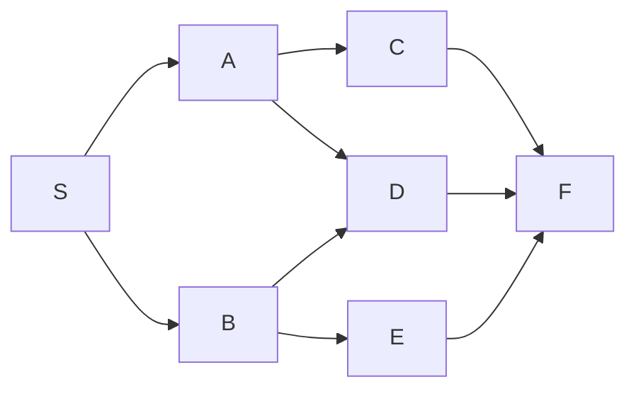
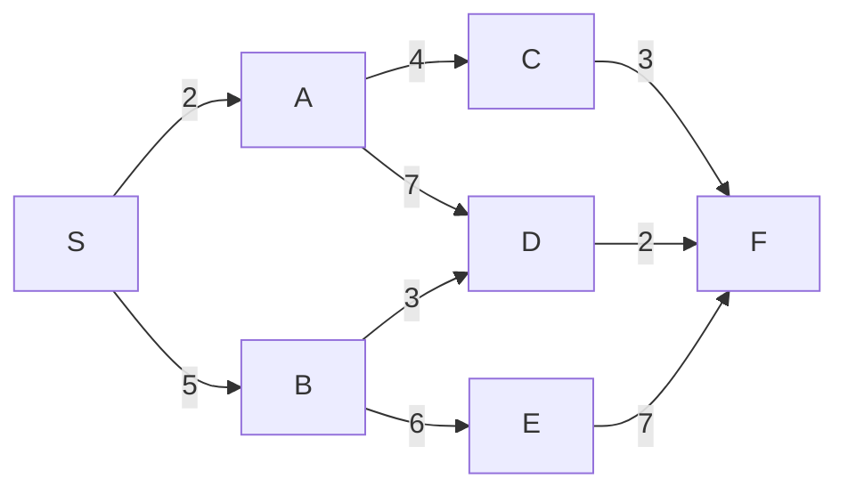

# جلسه ۱۴: جلسه حل تمرین ۱: جست‌وجو، A*، بهینه‌سازی و CSP

> **درس:** مقدمه‌ای بر هوش مصنوعی و کاربرد آن در مهندسی پزشکی
> **مدت پیشنهادی:** ۶۰ تا ۹۰ دقیقه (حل تمرین) · **سطح:** مقدماتی
> **منابع این جلسه:** منبع ۱ (Russell & Norvig, 2016)، منبع ۱۰ (Liu, 2017)، منبع ۱۱ (محتوای مدرس)

---

## اهداف جلسه
در پایان این جلسه دانشجو می‌تواند:
1. مسیرهای BFS، UCS و A* را روی یک گراف مشترک پیدا و مقایسه کند.
2. مجاز بودن (Admissibility) یک هیوریستیک را به‌صورت عملی با h* بسنجد.
3. گرادیان کاهشی (Gradient Descent) را برای یک تابع ساده پیاده‌سازی و اجرا کند.
4. دو مسئله‌ی CSP (رنگ‌آمیزی نقشه و زمان‌بندی کلاس) را صورت‌بندی و حل کند.
5. IDDFS، تپهنوردی (Hill Climbing) و سازگاری هیوریستیک را اجرا و تفسیر کند.

> [!IMPORTANT]
> این جلسه نظریه جدید معرفی نمی‌کند؛ جلسه حل تمرین است. پیش‌نیاز: جلسات ۵ تا ۱۳. اگر تمرینی را حل نکردید، راه‌حل مرجع در کد `code/session_14_solutions.py` موجود است و باید پس از تلاش شخصی مطالعه شود.

---

## ۱. ساختار تمرین‌ها
تمرین‌های این جلسه در پنج دسته دسته‌بندی می‌شوند:

| دسته | تمرین‌ها | مفاهیم |
|---|---|---|
| جست‌وجوی غیرآگاهانه | ۱، ۹ | BFS، DFS، IDDFS |
| جست‌وجوی آگاهانه | ۲، ۳، ۷ | UCS، A*، هیوریستیک مجاز و سازگار |
| جست‌وجوی محلی و بهینه‌سازی | ۴، ۸ | گرادیان کاهشی، Hill Climbing |
| CSP | ۵، ۶ | رنگ‌آمیزی نقشه، زمان‌بندی کلاس |
| نمونه‌سؤال میان‌ترم | ۱۰ | ترکیب جست‌وجو و CSP |

راه‌حل‌های کامل در بخش «✍️ فعالیت کلاسی / کارگاه» و کد مرجع در فایل `code/session_14_solutions.py` قرار دارد. برای هر تمرین ابتدا تلاش کنید؛ سپس راه‌حل را باز کنید.

## 🔬 پیوند با مهندسی پزشکی
مسیر جست‌وجو در گراف‌ها، زمان‌بندی منابع و بهینه‌سازی پیوسته در مهندسی پزشکی کاربرد مستقیم دارند:
- **مسیریابی ربات یا تخت بیمار:** گراف تمرین‌های ۱ و ۲ می‌تواند نمای ساده‌شده‌ی بخش‌های یک بیمارستان باشد.
- **زمان‌بندی آزمایشگاه یا کلاس:** تمرین ۶ نمونه‌ای کوچک از زمان‌بندی منابع محدود در آزمایشگاه بالینی است.
- **تنظیم پارامتر مدل:** گرادیان کاهشی تمرین ۴ پایه‌ی آموزش بسیاری از مدل‌های یادگیری ماشین است که در جلسات بعدی به‌کار می‌رود.

> [!NOTE]
> همه‌ی مثال‌های این جلسه آموزشی و غیرتشخیصی‌اند. هیچ‌کدام برای تصمیم‌گیری بالینی یا تشخیص پزشکی استفاده نمی‌شود.

## ✍️ فعالیت کلاسی / کارگاه
تمرین‌ها را به‌ترتیب حل کنید و پاسخ را با راه‌حل مرجع مقایسه کنید. برای هر تمرین، ابتدا صورت مسئله و سپس راه‌حل کامل داخل بخش تاشو آمده است.

### تمرین ۱: BFS و DFS روی گراف ساده
گراف جهت‌دار زیر داده شده است:



- مسیر BFS از S تا F چیست؟
- مسیر DFS از S تا F چیست؟ (ترتیب همسایه‌ها الفبایی)
- آیا BFS کوتاه‌ترین مسیر بر حسب تعداد یال را می‌دهد؟

<details>
<summary>راه‌حل کامل تمرین ۱</summary>

**مسیر BFS:** `S -> A -> C -> F` (۴ گره، ۳ یال).
- BFS سطح به سطح پیش می‌رود: ابتدا S، سپس همسایه‌های S یعنی A و B، سپس همسایه‌های آن‌ها. C در سطح ۲ کشف می‌شود و F در سطح ۳ به هدف می‌رسد.

**مسیر DFS:** `S -> A -> C -> F` (۴ گره، ۳ یال).
- DFS عمق اول با ترتیب الفبایی همسایه‌ها از S شروع می‌کند، به A می‌رود و سپس مستقیم تا C و F پیش می‌رود. در این گراف، مسیر DFS به‌طور تصادفی همان مسیر BFS را می‌دهد؛ این اتفاق همیشه رخ نمی‌دهد و در گراف‌های دیگر DFS ممکن است مسیر طولانی‌تری پیدا کند.

**پاسخ سؤال سوم:** بله. BFS کوتاه‌ترین مسیر بر حسب تعداد یال را تضمین می‌کند (چون سطح به سطح پیش می‌رود) اما مسیر DFS تضمینی ندارد.

</details>

### تمرین ۲: UCS و A* روی گراف با هزینه
روی همان گراف، وزن یال‌ها را اضافه می‌کنیم:



- مسیر بهینه از S تا F با هزینه چیست؟
- UCS چند گره بسط می‌دهد؟ A* با هیوریستیک `H = {S: 9, A: 7, B: 5, C: 3, D: 2, E: 7, F: 0}` چند گره بسط می‌دهد؟

<details>
<summary>راه‌حل کامل تمرین ۲</summary>

**مسیر بهینه:** `S -> A -> C -> F` با هزینه‌ی $2 + 4 + 3 = 9$.

**تأیید با UCS:** مسیرهای دیگر عبارت‌اند از:
- `S -> B -> D -> F` با هزینه‌ی $5 + 3 + 2 = 10$
- `S -> A -> D -> F` با هزینه‌ی $2 + 7 + 2 = 11$
- `S -> B -> E -> F` با هزینه‌ی $5 + 6 + 7 = 18$

پس هزینه‌ی کمینه ۹ است و UCS همین مسیر را می‌دهد. در اجرای واقعی کد، UCS **۶ گره** بسط داد.

**A* با هیوریستیک مجاز:** همان مسیر و هزینه را می‌دهد، اما فقط **۳ گره** بسط داد. دلیل: هیوریستیک $h$ جهت‌گیری به سمت هدف را زودتر انجام می‌دهد و گره‌های غیرمرتبط (مثل B و E که مسیر گران‌تری دارند) را دیرتر بسط می‌دهد. این دقیقاً همان مزیت A* نسبت به UCS است: هزینه‌ی محاسباتی کمتر با تضمین بهینگی.

</details>

### تمرین ۳: بررسی مجاز بودن هیوریستیک
هیوریستیک تمرین ۲ مجاز (Admissible) است؟ چگونه این را عملی بررسی می‌کنید؟

<details>
<summary>راه‌حل کامل تمرین ۳</summary>

**تعریف مجاز بودن:** $h(n) \le h^*(n)$ برای همه‌ی گره‌ها، که $h^*(n)$ هزینه‌ی واقعی کمینه‌ی رسیدن از $n$ تا هدف است.

**روش عملی:** با اعمال تکنیک تخمین کوتاه‌ترین مسیر به‌صورت دوطرفه (Bidirectional Edge Relaxation)، $h^*$ را برای همه‌ی گره‌ها حساب می‌کنیم، سپس مقایسه می‌کنیم:

| گره | $h(n)$ | $h^*(n)$ | مجاز؟ |
|---|---:|---:|---|
| S | 9 | 9 | بله |
| A | 7 | 7 | بله |
| B | 5 | 5 | بله |
| C | 3 | 3 | بله |
| D | 2 | 2 | بله |
| E | 7 | 7 | بله |
| F | 0 | 0 | بله |

**نتیجه:** برای همه‌ی گره‌ها $h(n) = h^*(n)$، پس هیوریستیک کاملاً مجاز (و در واقع «آگاه» است — دقیقاً هزینه‌ی واقعی را می‌داند). کد مرجع در تابع `check_admissible` این بررسی را پیاده‌سازی کرده و اجرای واقعی آن تأیید می‌کند: «همه گره‌ها $h(n) \le h^*(n)$ → هیوریستیک مجاز، $h(S)=9$، $h^*(S)=9$».

> [!TIP]
> اگر یکی از مقادیر $h$ بزرگ‌تر از $h^*$ باشد، A* ممکن است مسیر بهینه را از دست بدهد. در چنین حالتی گرهی که h آن بیش‌برآورد شده ممکن است دیرتر یا هرگز بسط داده نشود.

</details>

### تمرین ۴: گرادیان کاهشی
تابع $f(x) = x^2$ را با گرادیان کاهشی کمینه کنید.
- گرادیان چیست؟
- با نرخ یادگیری $\alpha = 0.1$، نقطه‌ی شروع $x_0 = 5$ و ۲۰ تکرار، مقدار نهایی $x$ چیست؟

<details>
<summary>راه‌حل کامل تمرین ۴</summary>

**گرادیان:** $\nabla f(x) = 2x$. به‌روزرسانی گرادیان کاهشی:

$$x_{t+1} = x_t - \alpha \cdot 2x_t = x_t(1 - 2\alpha)$$

با $\alpha = 0.1$:

$$x_{t+1} = x_t \cdot 0.8$$

**محاسبه‌ی دستی چند گام اول:**

| گام | $x_t$ | $x_{t+1} = 0.8 x_t$ |
|---:|---:|---:|
| ۰ | 5.0 | 4.0 |
| ۱ | 4.0 | 3.2 |
| ۲ | 3.2 | 2.56 |
| ۳ | 2.56 | 2.048 |

**نتیجه پس از ۲۰ تکرار:** $x_{20} = 5 \times 0.8^{20} \approx 0.057646$ — که با اجرای واقعی کد تأیید می‌شود: «x نهایی = 0.057646». این نقطه به کمینه‌ی تابع $f(x) = x^2$ یعنی $x = 0$ بسیار نزدیک است.

> [!NOTE]
> چون $|0.8| < 1$، هر تکرار مقدار را به کمینه نزدیک‌تر می‌کند. اگر $\alpha > 1$ بود، الگوریتم واگرا می‌شد؛ این اهمیت انتخاب نرخ یادگیری را نشان می‌دهد.

</details>

### تمرین ۵: رنگ‌آمیزی نقشه به‌عنوان CSP
چهار ناحیه‌ی A، B، C و D داریم با همسایگی‌های زیر:

| ناحیه | همسایه‌ها |
|---|---|
| A | B, C |
| B | A, C, D |
| C | A, B, D |
| D | B, C |

سه رنگ در اختیار داریم: قرمز، سبز، آبی. آیا می‌توان نقشه را رنگ‌آمیزی کرد که هیچ دو ناحیه‌ی همسایه هم‌رنگ نباشند؟

<details>
<summary>راه‌حل کامل تمرین ۵</summary>

**صورت‌بندی CSP:**
- متغیرها: A، B، C، D
- دامنه: {قرمز، سبز، آبی}
- قید: برای هر جفت همسایه، رنگ‌ها متفاوت باشند.

**حل با Backtracking (به ترتیب A, B, C, D):**
1. A ← قرمز (اولین رنگ)
2. B ← سبز (قرمز با A همسایه است؛ سبز انتخاب می‌شود)
3. C ← آبی (قرمز و سبز با A و B همسایه‌اند؛ آبی باقی می‌ماند)
4. D ← قرمز (همسایه‌های D یعنی B و C به‌ترتیب سبز و آبی هستند؛ قرمز آزاد است)

**راه‌حل نهایی:** `{A: قرمز, B: سبز, C: آبی, D: قرمز}` — دقیقاً همان چیزی که اجرای واقعی کد می‌دهد.

**تأیید قیدها:** همسایگی‌های A–B (قرمز/سبز)، A–C (قرمز/آبی)، B–C (سبز/آبی)، B–D (سبز/قرمز)، C–D (آبی/قرمز) — همه متفاوت.

</details>

### تمرین ۶: زمان‌بندی کلاس به‌عنوان CSP
سه کلاس (آناتومی، فیزیولوژی، بیوشیمی) باید در سه اسلات (۸ صبح، ۱۰ صبح، ۱۲ ظهر) برنامه‌ریزی شوند با قیدهای زیر:
- هیچ دو کلاس در یک اسلات نباشند.
- آناتومی فقط ۸ صبح یا ۱۰ صبح.
- فیزیولوژی فقط ۱۰ صبح یا ۱۲ ظهر.
- بیوشیمی فقط ۸ صبح.

<details>
<summary>راه‌حل کامل تمرین ۶</summary>

**صورت‌بندی CSP:**
- متغیرها: آناتومی، فیزیولوژی، بیوشیمی.
- دامنه‌ها: آناتومی: {۸ صبح، ۱۰ صبح}، فیزیولوژی: {۱۰ صبح، ۱۲ ظهر}، بیوشیمی: {۸ صبح}.
- قیدها: یکتایی اسلات + محدودیت‌های ترجیحی بالا.

**حل:** بیوشیمی فقط ۸ صبح می‌تواند باشد (دامنه‌ی تک‌عضوی)، پس بیوشیمی ← ۸ صبح. آناتومی نمی‌تواند ۸ صبح باشد (یکتایی)، پس آناتومی ← ۱۰ صبح. فیزیولوژی نمی‌تواند ۱۰ صبح باشد، پس فیزیولوژی ← ۱۲ ظهر.

**راه‌حل نهایی:** `{آناتومی: ۱۰ صبح, فیزیولوژی: ۱۲ ظهر, بیوشیمی: ۸ صبح}` — دقیقاً همان خروجی اجرای واقعی کد.

> [!TIP]
> این مثال نشان می‌دهد که ترتیب انتخاب متغیر اهمیت دارد: اگر آناتومی را اول امتحان می‌کردیم، ممکن بود به بن‌بست بخوریم و لازم شود Backtrack کنیم. در کد مرجع این جلسه برای سادگی از ترتیب ثابت متغیرها استفاده شده، اما انتخاب متغیر با کمترین دامنه (MRV) عملاً زودتر به بن‌بست می‌رسد و شاخه‌های مرده را حذف می‌کند.

</details>

### تمرین ۷: سازگاری هیوریستیک (Consistency)
در جست‌وجوی گرافی شرط قوی‌تری به نام سازگاری لازم است: برای هر یال $u \to v$ باید $h(u) \le w(u,v) + h(v)$ برقرار باشد. هیوریستیک تمرین ۲ سازگار است؟

<details>
<summary>راه‌حل کامل تمرین ۷</summary>
برای یال‌های مسیر بهینه: $S \to A$: $9 \le 2 + 7$ ✓، $A \to C$: $7 \le 4 + 3$ ✓، $C \to F$: $3 \le 3 + 0$ ✓. چون این هیوریستیک دقیقاً $h^*$ است (نتیجه تمرین ۳) و نامساوی مثلث $h^*(u) \le w(u,v) + h^*(v)$ همیشه برقرار است، برای همه‌ی یال‌ها سازگار است. تابع `check_consistency` همین را برای همه‌ی یال‌ها می‌سنجد و اجرای واقعی می‌گوید: «همه یال‌ها h(u) ≤ w(u,v) + h(v) → سازگار». یادآوری: سازگاری ⇒ مجاز بودن، ولی برعکس نه.

</details>

### تمرین ۸: جست‌وجوی محلی (Hill Climbing)
از جلسه ۱۰: از $x_0$ شروع کنید و به همسایه‌ی بهتر بروید تا هیچ همسایه‌ای بهتر نباشد. تابع $f(x) = (x - 3)^2$ را از $x_0 = 0$ با گام $0.5$ کمینه کنید. چند گام؟

<details>
<summary>راه‌حل کامل تمرین ۸</summary>
در هر تکرار دو کاندید $x \pm 0.5$ ساخته می‌شود و با هر $f$ کمتر جابه‌جا می‌شویم. دنباله‌ی مقادیر $x$: $0.0 \to 0.5 \to 1.0 \to 1.5 \to 2.0 \to 2.5 \to 3.0$؛ در $x = 3.0$ هیچ همسایه‌ای بهتر نیست (بهینه محلی = سراسری). پس **۶ گام** — دقیقاً خروجی واقعی کد: «x نهایی = 3.0000 | f = 0.0000 | تعداد گام = 6». چون $f$ تک‌قله است به کمینه سراسری می‌رسیم؛ در توابع چندقله‌ای Hill Climbing در اولین بهینه محلی گیر می‌کند (جلسه ۱۰: Random Restart).

</details>

### تمرین ۹: جست‌وجوی عمق‌افزایشی (IDDFS)
روی گراف تمرین ۱، IDDFS از S تا F را اجرا کنید: با محدودیت عمق ۱ شروع کنید و هر بار محدودیت را یکی زیاد کنید. مسیر نهایی و عمق کشف؟

<details>
<summary>راه‌حل کامل تمرین ۹</summary>
عمق ۱: فقط S (هدف نیست). عمق ۲: مسیرهای S→A و S→B (هدف نیست). عمق ۳: مسیر S→A→C→F پیدا می‌شود. پس **مسیر `S -> A -> C -> F` در عمق ۳** — دقیقاً خروجی واقعی کد: «مسیر = S -> A -> C -> F | عمق = 3». IDDFS همان مسیر بهینه‌ی BFS را می‌دهد ولی حافظه‌اش مانند DFS است ($O(bd)$ به‌جای $O(b^d)$).

</details>

### تمرین ۱۰: نمونه‌سؤال شبیه میان‌ترم (۲۵ دقیقه، ۱۵ نمره)
**الف — جست‌وجو (۷ نمره):** روی گراف و هیوریستیک تمرین ۲: (۱) مسیر و هزینه‌ی بهینه با UCS؛ (۲) اثبات اینکه $h$ هم مجاز است هم سازگار. | **ب — CSP زمان‌بندی جراحی (۸ نمره):** سه جراحی $S_1$، $S_2$، $S_3$ باید در سه بازه‌ی زمانی برنامه‌ریزی شوند؛ هر جراحی دقیقاً یک بازه اشغال می‌کند و هیچ دو جراحی نباید در یک بازه باشند (هر بازه حداکثر یک جراحی): (۱) متغیرها، دامنه‌ها و قید سخت را صورت‌بندی کنید؛ (۲) یک راه‌حل معتبر بیابید.

<details>
<summary>راه‌حل کامل تمرین ۱۰ (نمونه‌پاسخ)</summary>
الف: UCS مسیر `S -> A -> C -> F` با هزینه‌ی $2 + 4 + 3 = 9$ را می‌دهد (۶ گره بسط، نتیجه تمرین ۲)؛ مجاز بودن و سازگاری در تمرین‌های ۳ و ۷ اثبات شد چون $h$ دقیقاً $h^*$ است. ب: متغیرها $S_1$، $S_2$، $S_3$؛ دامنه {۱, ۲, ۳}؛ قید سخت: یکتایی بازه‌ها (All-Different) — هر بازه فقط یک جراحی. راه‌حل معتبر: $S_1 \to$ بازه ۱، $S_2 \to$ بازه ۲، $S_3 \to$ بازه ۳. اجرای واقعی کد: «UCS هزینه = 9 | CSP زمان‌بندی = {'S1': 1, 'S2': 2, 'S3': 3}». یادآوری امتحانی: صورت‌بندی درست (متغیر/دامنه/قید) نیمی از نمره است.

</details>

## 💻 کد آموزشی
فایل `code/session_14_solutions.py` راه‌حل‌های مرجع همه‌ی تمرین‌های بالا را پیاده‌سازی کرده است:

```bash
python3 code/session_14_solutions.py
```

این اسکریپت فقط از کتابخانه استاندارد پایتون استفاده می‌کند و در پایان با `assert` خودآزمون‌های هر ده تمرین را اجرا می‌کند. برای لو نرفتن پاسخ تمرین‌ها، فقط خط پایان موفق اینجا نمایش داده می‌شود؛ خروجی کامل هر تمرین داخل راه‌حل همان تمرین آمده است:

```text
ALL CHECKS PASSED
```

## 📘 واژه‌نامه

| واژه | معنی |
|---|---|
| BFS / DFS | جست‌وجوی عرض اول / عمق اول |
| UCS | جست‌وجوی هزینه یکنواخت (Uniform Cost Search) |
| Admissible Heuristic | هیوریستیک مجاز: $h(n) \le h^*(n)$ |
| Gradient Descent | گرادیان کاهشی: الگوریتم بهینه‌سازی پیوسته |
| CSP | مسئله ارضای محدودیت (Constraint Satisfaction Problem) |
| Backtracking | بازگشت به عقب: روش حل CSP |
| MRV | کمترین مقادیر باقی‌مانده (Minimum Remaining Values) |

## ❓ پرسش‌های خودآزمون
1. چرا مسیر BFS و DFS در تمرین ۱ یکی شد؟ آیا همیشه یکی می‌شود؟
2. چرا A* در تمرین ۲ فقط ۳ گره بسط داد ولی UCS ۶ گره؟
3. اگر در تمرین ۴ نرخ یادگیری را $\alpha = 1$ بگذاریم، چه اتفاقی می‌افتد؟
4. در تمرین ۶ کد مرجع با چه ترتیبی متغیرها را انتخاب می‌کند؟ اگر به‌جای آن MRV اعمال می‌شد، کدام متغیر اول انتخاب می‌شد و آیا راه‌حل نهایی عوض می‌شد؟

> کلید پاسخ‌ها در بخش «راهنمای مدرس» انتهای فایل آمده است.

## 📝 تکلیف
1. همه‌ی تمرین‌های ۱ تا ۱۰ را حل و با خروجی واقعی کد مقایسه کنید.
2. یک هیوریستیک غیرمجاز برای تمرین ۲ طراحی کنید (مثلاً $h(B) = 10$) و نشان دهید که A* ممکن است مسیر بهینه را از دست بدهد. نتیجه را گزارش دهید.
3. یک CSP زمان‌بندی کوچک خودتان طراحی کنید (مثلاً سه آزمایش در یک آزمایشگاه بالینی) و آن را با Backtracking حل کنید.

## 📚 مطالعه پیشنهادی
- Russell & Norvig (2016)، فصل ۳ و ۴: جست‌وجو، A* و بهینه‌سازی
- Liu (2017)، فصل ۱ و ۲: مقدمه‌ای بر پایتون و بهینه‌سازی
- جزوه و اسلایدهای مدرس جلسات ۵ تا ۱۳

---

## 🧭 راهنمای مدرس (از این عنوان تا انتها در نسخه دانشجو حذف شود)

**زمان‌بندی پیشنهادی برای ۹۰ دقیقه:** مرور کوتاه ساختار تمرین‌ها (۵) | تمرین ۱ و ۲ حل جمعی روی تخته (۱۵) | تمرین ۳ و ۴ بحث و اجرای کد (۱۵) | تمرین ۵ و ۶ در گروه‌های دوتایی (۱۵) | تمرین‌های ۷ تا ۹ سریع روی تخته (۱۵) | نمونه‌سؤال میان‌ترم شماره ۱۰ (۱۵) | جمع‌بندی و تکلیف (۱۰)

**نسخه ۶۰ دقیقه‌ای:** مرور (۵) | تمرین ۲ و ۴ حل جمعی (۲۵) | تمرین ۶ گروهی (۱۵) | تکلیف و جمع‌بندی (۱۵). تمرین ۱ و ۳ به‌عنوان پیش‌تمرین یا مطالعه‌ی فردی واگذار می‌شود؛ این دو ساده‌ترند و دانشجو در خانه می‌تواند آن‌ها را انجام دهد.

**نکات اجرای جلسه حل تمرین:**
- این جلسه «سخنرانی» نیست؛ نقش مدرس تسهیل‌گر است. پیش از نمایش راه‌حل، از دانشجویان بخواهید روی تخته یا در گروه حل کنند.
- برای تمرین ۲، گراف را روی تخته بکشید و از دانشجویان بخواهید UCS را دستی اجرا کنند؛ سپس خروجی کد را مقایسه کنید.
- در تمرین ۴، سه نرخ یادگیری ($\alpha = 0.1$، $0.9$، $1.1$) را کنار هم اجرا کنید تا واگرایی را به‌چشم ببینند.
- اگر دانشجویی تمرین ۵ یا ۶ را سریع حل کرد، از او بخواهید یک قید اضافه کند (مثلاً «آناتومی نمی‌تواند ۱۰ صبح باشد») و اثرش را بررسی کنید.
- اجرای کد را پیش از کلاس یک‌بار انجام دهید تا مطمئن شوید خروجی مطابق جدول‌های این فایل است.

**نکات فنی:**
- کد مرجع از `heapq` کتابخانه استاندارد استفاده می‌کند و آفلاین اجرا می‌شود.
- تابع `check_admissible` با اعمال تکنیک تخمین کوتاه‌ترین مسیر به‌صورت دوطرفه $h^*$ را حساب می‌کند — این روش را می‌توانید به‌عنوان ترفند آموزشی معرفی کنید.
- تابع `verify` در کد جلسه ۱۳ همان الگوی بازبینی قیدها با assert را دارد؛ در این جلسه هم `assert` در پایان اجرا می‌شود تا هر خطا فوراً دیده شود.

### خروجی مورد انتظار جلسه
هر دانشجو باید هر ده تمرین را حل کرده باشد و بتواند در یک جمله بگوید «A* با هیوریستیک مجاز همان مسیر بهینه UCS را با گره‌های بسط کمتر می‌دهد».

### کلید پاسخ پرسش‌های خودآزمون

<details>
<summary>نمایش کلید پاسخ</summary>

1. چون در این گراف، ترتیب الفبایی همسایه‌ها در DFS همان مسیر سطح‌به‌سطح BFS را دنبال می‌کند (S → A → C → F). این همیشگی نیست؛ در گراف‌های دارای شاخه‌های عمیق یا دوراهی، DFS ممکن است مسیر طولانی‌تر یا حتی غیربهینه پیدا کند.
2. A* با هیوریستیک مجاز و جهت‌دهنده، گره‌های غیرمرتبط با مسیر بهینه (مثل B و E) را دیرتر یا هرگز بسط نمی‌دهد؛ UCS همه‌ی گره‌های در دسترس را تا رسیدن به هدف بررسی می‌کند. در اجرای واقعی: UCS = ۶ گره، A* = ۳ گره.
3. با $\alpha = 1$ داریم $x_{t+1} = x_t(1 - 2) = -x_t$؛ یعنی الگوریتم بین $+x$ و $-x$ نوسان می‌کند و هرگز به کمینه نمی‌رسد (واگرایی و نوسان). این نشان می‌دهد انتخاب نرخ یادگیری حیاتی است.
4. کد مرجع به ترتیب ثابت (آناتومی، فیزیولوژی، بیوشیمی) پیش می‌رود و در میانه‌ی راه یک‌بار Backtrack می‌کند. اگر MRV اعمال شود، «بیوشیمی» با دامنه‌ی تک‌عضوی ({۸ صبح}) اول انتخاب می‌شود: بیوشیمی ← ۸ صبح، آناتومی ← ۱۰ صبح، فیزیولوژی ← ۱۲ ظهر؛ بدون بازگشت. راه‌حل نهایی همان است، فقط ترتیب انتساب‌ها و تعداد گره‌های بررسی‌شده فرق می‌کند.

</details>

### کلید تمرین‌های تکمیلی

<details>
<summary>نمایش کلید تمرین ۲ تکمیلی (هیوریستیک غیرمجاز)</summary>

با $h(B) = 10$ (در حالی که $h^*(B) = 5$)، هیوریستیک برای گره B غیرمجاز است. در اجرای کد مرجع، اگر $h(B)$ را به ۱۰ تغییر دهیم، ممکن است A* مسیری گران‌تر از بهینه را برگرداند یا به‌طور کلی رفتار غیرقابل پیش‌بینی داشته باشد. دانشجو باید خروجی اجرای خودش را گزارش کند؛ پیام اصلی این است که «هیوریستیک نامجاز تضمین بهینگی A* را از بین می‌برد».

</details>
