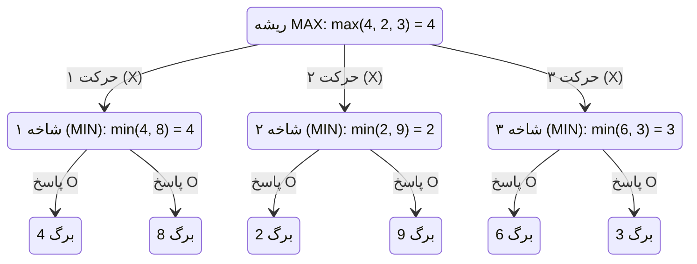
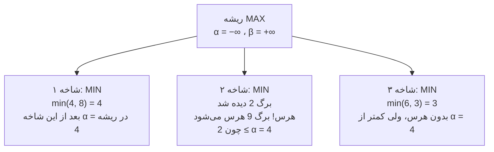

# جلسه ۱۵: جست‌وجوی مقابله‌ای؛ Minimax و هرس آلفا–بتا

> **درس:** مقدمه‌ای بر هوش مصنوعی و کاربرد آن در مهندسی پزشکی
> **مدت پیشنهادی:** ۶۰ تا ۹۰ دقیقه · **سطح:** مقدماتی
> **منابع این جلسه:** منبع ۱ (Russell & Norvig, 2016)، منبع ۱۱ (محتوای مدرس)

---

## اهداف جلسه

در پایان این جلسه دانشجو می‌تواند:

1. بازی دو‌نفره را به‌صورت مسئله جست‌وجو صورت‌بندی کند و مفهوم مقدار Minimax و بازی بهینه (Optimal Play) را توضیح دهد.
2. الگوریتم Minimax را روی یک درخت بازی کوچک به‌صورت دستی اجرا کند و حرکت بهینه را بیابد.
3. هرس آلفا–بتا (Alpha-Beta Pruning) را اجرا کند و نشان دهد کدام شاخه‌ها هرس می‌شوند و چرا.
4. پیچیدگی $O(b^d)$ و بهبود $O(b^{d/2})$ را تفسیر کند و اثر ترتیب بررسی حرکت‌ها را توضیح دهد.
5. یک حریف هوشمند برای بازی توان‌بخشی یا شبیه‌ساز آموزشی را به‌عنوان کاربرد غیربالینی طرح کند.

---

## ۱. بازی به‌عنوان مسئله جست‌وجو

در جلسه‌های ۵ تا ۹، یک عامل در محیطی ساکن مسیر خود را جست‌وجو می‌کرد. در **جست‌وجوی مقابله‌ای (Adversarial Search)** عامل دیگری در مقابل ماست: نوبتی حرکت می‌کند و حرکتش نتیجه ما را بدتر می‌کند. بازی‌های دو‌نفره متناوب (Turn-taking) مثل دوز (Tic-Tac-Toe) یا شطرنج با چهار مؤلفه صورت‌بندی می‌شوند:

| مؤلفه | در بازی دوز |
|---|---|
| حالت اولیه (Initial State) | صفحه خالی ۳×۳ و نوبت با X |
| اعمال (Actions) | گذاشتن علامت در هر خانه خالی |
| تابع انتقال (Transition Model) | صفحه‌ای که بعد از هر حرکت به‌وجود می‌آید |
| حالت پایانی و تابع سود (Utility) | برد X = +۱ ، برد O = −۱ ، مساوی = ۰ |

X تلاش می‌کند سود را **بیشینه** کند و O تلاش می‌کند آن **کمینه** کند؛ به همین دلیل X را **ماکسی‌میزر (Maximizer)** و O را **مینی‌میزر (Minimizer)** می‌نامیم. هر دو در یک درخت بازی (Game Tree) زندگی می‌کنند: عمق‌های زوج نوبت MAX و عمق‌های فرد نوبت MIN (ریشه عمق ۰).

> [!NOTE]
> فرض کلیدی این جلسه: حریف عقلانی است و بهترین حرکت خود را انجام می‌دهد. به همین دلیل ما باید فرض کنیم حریف سود ما را کمینه می‌کند؛ جست‌وجوی مقابله‌ای یعنی «بهترین حرکت من، با بدترین پاسخ فرضی حریف».

## ۲. الگوریتم Minimax

**مقدار Minimax (Minimax Value)** یک حالت، ارزش نهایی آن بازی است وقتی هر دو طرف عقلانی بازی کنند. تعریف بازگشتی آن:

$$\text{Minimax}(s)=\begin{cases}\text{Utility}(s) & \text{if } s \text{ is terminal}\\ \max_{a}\ \text{Minimax}(\text{Result}(s,a)) & \text{MAX to move}\\ \min_{a}\ \text{Minimax}(\text{Result}(s,a)) & \text{MIN to move}\end{cases}$$

محاسبه از برگ‌ها (حالت‌های پایانی) شروع می‌شود و به سمت ریشه برمی‌گردد؛ در هر گره MAX بزرگ‌ترین مقدار فرزندان و در هر گره MIN کوچک‌ترین مقدار فرزندان انتخاب می‌شود. حرکت بهینه در ریشه، حرکتی است که به فرزندِ با بیشترین مقدار Minimax می‌رود.

```text
MINIMAX(state, player):
    اگر state پایانی است: برگردان UTILITY(state)
    اگر player = MAX:
        v ← −∞
        برای هر a در ACTIONS(state):
            v ← MAX(v, MINIMAX(RESULT(state,a), MIN))
    وگرنه (player = MIN):
        v ← +∞
        برای هر a در ACTIONS(state):
            v ← MIN(v, MINIMAX(RESULT(state,a), MAX))
    برگردان v
```

### مثال دستی

درخت بازی کوچک زیر را ببینید (سه سطح، یعنی دو نوبت؛ برگ‌ها مقادیر سود پایانی‌اند):



گام‌به‌گام از برگ‌ها به ریشه:

1. شاخه ۱ (گره MIN): $\min(4, 8) = 4$ — مینی‌میزر برگ 4 را انتخاب می‌کند.
2. شاخه ۲ (گره MIN): $\min(2, 9) = 2$.
3. شاخه ۳ (گره MIN): $\min(6, 3) = 3$.
4. ریشه (گره MAX): $\max(4, 2, 3) = 4$.

پس حرکت بهینه MAX رفتن به شاخه ۱ است و مقدار بازی 4 است. نکته مهم: MAX حرکت 8 را دوست دارد، ولی می‌داند حریف هرگز اجازه نمی‌دهد به آن برسد.

## ۳. هرس آلفا–بتا

Minimax همه گره‌ها را ارزیابی می‌کند، در حالی که برخی شاخه‌ها هیچ‌وقت روی تصمیم نهایی اثر ندارند. **هرس آلفا–بتا (Alpha-Beta Pruning)** دو عدد را در طول پیمایش به‌روز نگه می‌دارد:

- **آلفا ($\alpha$):** بهترین (بزرگ‌ترین) مقداری که MAX تا این لحظه در مسیر جاری تضمین کرده است.
- **بتا ($\beta$):** بهترین (کوچک‌ترین) مقداری که MIN تا این لحظه در مسیر جاری تضمین کرده است.

شرط هرس: هر وقت در گرهی $\alpha \ge \beta$ شود، بقیه فرزندان آن گره بی‌اثرند و هرس می‌شوند. دو حالت داریم:

| نوع هرس | کجا رخ می‌دهد | شرط | معنی |
|---|---|---|---|
| هرس بتا (Beta Cut-off) | گره MIN | $\alpha \ge \beta$ در گره MIN | MAX بالاتر از این مقدار، آن شاخه را انتخاب نمی‌کند؛ ادامه دادن بی‌فایده است |
| هرس آلفا (Alpha Cut-off) | گره MAX | $\alpha \ge \beta$ در گره MAX | MIN پایین‌تر از این مقدار اجازه نمی‌دهد؛ ادامه دادن بی‌فایده است |

همان درخت مثال قبل، این بار با هرس:



گام‌به‌گام:

1. شاخه ۱ کامل ارزیابی می‌شود: مقدار 4. حالا ریشه می‌داند $\alpha = 4$.
2. شاخه ۲: MIN اول برگ 2 را می‌بیند. مقدار این گره حداکثر 2 خواهد بود، یعنی حتماً کمتر از $\alpha = 4$؛ پس برگ 9 هرگز بررسی نمی‌شود (**هرس بتا**). MAX این شاخه را به‌هرحال انتخاب نمی‌کند.
3. شاخه ۳: هر دو برگ بررسی می‌شوند (مقدار 3)، ولی چون 3 از $\alpha = 4$ کوچک‌تر است، انتخاب ریشه تغییر نمی‌کند.

نتیجه: مقدار ریشه همان 4 است (دقیقاً همان جواب Minimax)، اما یک برگ کمتر ارزیابی شد. Alpha-Beta هیچ مقداری را عوض نمی‌کند؛ فقط کار بی‌فایده را حذف می‌کند.

## ۴. پیچیدگی و مقایسه عملی

با ضریب شاخه‌بازی $b$ و عمق $d$:

- Minimax کامل همه برگ‌ها را می‌بیند: پیچیدگی زمانی $O(b^d)$.
- Alpha-Beta با **بهترین ترتیب بررسی حرکت‌ها** حدود $O(b^{d/2})$ گره بررسی می‌کند؛ یعنی با همان بودجه محاسباتی می‌توان **دو برابر عمق** را جست‌وجو کرد.

> [!IMPORTANT]
> حد $O(b^{d/2})$ فقط با ترتیب بهینه به دست می‌آید: در گره‌های MAX بهترین حرکت‌ها اول بررسی شوند و در گره‌های MIN نیز بهترین حرکت‌ها اول بررسی شوند. با بدترین ترتیب، Alpha-Beta دقیقاً مثل Minimax کامل عمل می‌کند. در عمل، ترتیب‌دهی با یک تابع ارزیابی (Evaluation Function) تقریب خوبی از این ترتیب می‌دهد.

کد آموزشی این جلسه هر دو الگوریتم را روی دوز از صفحه خالی اجرا می‌کند (اجرای واقعی):

| الگوریتم | مقدار بازی | گره‌های ارزیابی‌شده |
|---|---|---|
| Minimax | +۰ (مساوی) | ۵۴۹٬۹۴۶ |
| Alpha-Beta | +۰ (مساوی) | ۱۸٬۲۹۷ |

هر دو الگوریتم همان مقدار (+۰ یعنی مساوی) و همان حرکت اول بهینه را پیدا می‌کنند (اندیس ۰، گوشه صفحه)، اما Alpha-Beta تعداد گره‌ها را حدود **۹۶٫۷٪** کمتر کرده است. دوزِ کامل نسبتاً درخت کوچکی دارد؛ با این حال کاهش ۳۰ برابری، قدرت هرس را نشان می‌دهد و در بازی‌های با ضریب شاخه‌بازی بزرگ (مثل شطرنج) این تفاوت مرز ممکن و ناممکن است.

---

## 🔬 پیوند با مهندسی پزشکی

**حریف هوشمند در بازی توان‌بخشی (مثال آموزشی):** در توان‌بخشی (Rehabilitation) بیماران مبتلا به سکته مغزی اغلب تمرین‌های حرکتی تکراری انجام می‌دهند؛ تبدیل این تمرین‌ها به بازی، انگیزه را بالا می‌برد. یک حریف نرم‌افزاری برای بازی دوز یا چهار‌در‌یک‌ردیف می‌تواند با Minimax حرکت کند:

- **سطح دشواری قابل تنظیم:** با محدود کردن عمق جست‌وجو یا حذف هرس، حریف ضعیف‌تر می‌شود؛ برای بیمار در مراحل اولیه توان‌بخشی، حریف ساده‌تر مناسب‌تر است.
- **پیش‌بینی‌پذیری:** چون Minimax قطعی است، رفتار حریف تکرار‌پذیر است و تغییرات عملکرد بیمار بین جلسات قابل مقایسه می‌ماند.
- **شبیه‌ساز آموزشی:** همان ایده در شبیه‌سازهای تصمیم‌گیری دانشجویان هم به کار می‌رود: یک «حریف» آموزشی که سناریو را پیش می‌برد و تصمیم‌های دانشجو را محک می‌زند.

> [!WARNING]
> همه مثال‌های این جلسه آموزشی و غیرتشخیصی هستند؛ چنین بازی‌هایی ابزار تمرین حرکتی و انگیزشی‌اند و هیچ‌کدام نباید برای تشخیص، درمان یا تصمیم بالینی درباره بیمار واقعی به کار روند.

## ✍️ فعالیت کلاسی / کارگاه

### فعالیت ۱: هرس دستی

۱. درخت مثال بخش ۲ را روی کاغذ بکشید و مقدار Minimax ریشه را دستی حساب کنید.

۲. حالا Alpha-Beta را اجرا کنید: مقدار $\alpha$ ریشه بعد از هر شاخه چه می‌شود؟ کدام برگ هرس می‌شود و از کدام نوع (بتا یا آلفا) است؟

<details>
<summary>کلید پاسخ فعالیت ۱</summary>

۱. مقدار شاخه‌ها: 4 ، 2 ، 3؛ مقدار ریشه $\max(4,2,3) = 4$ و حرکت بهینه شاخه ۱ است.

۲. بعد از شاخه ۱، $\alpha = 4$ و $\beta = +\infty$ می‌ماند. در شاخه ۲، بعد از دیدن برگ 2، حد بالای گره MIN برابر 2 می‌شود ($\beta = 2 \le \alpha = 4$)؛ برگ 9 هرس می‌شود و این یک **هرس بتا** است (هرس در گره MIN). در شاخه ۳ هیچ گرهی هرس نمی‌شود؛ مقدارش 3 است و از $\alpha$ کوچک‌تر.

</details>

### فعالیت ۲: اثر ترتیب حرکت‌ها

۱. در کد `session_15_minimax_alphabeta.py` ترتیب بررسی خانه‌ها را تغییر دهید: در `legal_moves` به‌جای ترتیب طبیعی ۰ تا ۸، ترتیب «لبه‌اول» یعنی `1, 3, 5, 7, 0, 2, 6, 8, 4` را برگردانید و دوباره اجرا کنید. تعداد گره‌های Alpha-Beta چه می‌شود؟ اگر فرصت داشتید، ترتیب «مرکز‌اول» یعنی `4, 0, 2, 6, 8, 1, 3, 5, 7` را هم امتحان کنید.

۲. چرا مقدار بازی تغییر نمی‌کند، ولی تعداد گره‌ها و اندیسِ حرکتی که کد به‌عنوان «بهترین حرکت» گزارش می‌کند تغییر می‌کنند؟

<details>
<summary>کلید پاسخ فعالیت ۲ (نمونه)</summary>

۱. در اجرای واقعی با ترتیب لبه‌اول، تعداد گره‌های Alpha-Beta از ۱۸٬۲۹۷ به ۴۲٬۰۹۴ می‌رسد — حدود ۲٫۳ برابر بدتر، ولی هنوز خیلی کمتر از ۵۴۹٬۹۴۶ گره Minimax؛ هرس همچنان کار می‌کند، فقط کم‌اثرتر. با ترتیب مرکز‌اول به ۷٬۲۷۵ گره می‌رسیم — بهترین ترتیب، چون خانه مرکز در دوز قوی‌ترین حرکت اول است و زودتر حدهای α و β را محکم می‌کند.

۲. مقدار بازی ثابت می‌ماند، چون Minimax و Alpha-Beta **مقدار** ریشه را از کامل بررسی‌کردنِ (یا هرس درستِ) درخت به دست می‌آورند و ترتیب فقط تعیین می‌کند چقدر زود شاخه‌ها بی‌اعتبار شوند. اما **اندیس حرکت گزارش‌شده** به ترتیب بررسی وابسته است: از صفحه خالی همه ۹ حرکت اول هم‌ارز و بهینه‌اند (مقدار +۰) و کد در میان حرکت‌های هم‌ارزش، **اولین حرکت بهینه در ترتیب بررسی** را برمی‌گرداند. پس با ترتیب طبیعی اندیس ۰ گزارش می‌شود، با لبه‌اول اندیس ۱ و با مرکز‌اول اندیس ۴ (در اجرای واقعی همین سه خروجی دیده شد). درس مهم: بهینگی ثابت است، ولی «کدام حرکت بهینه نمایش داده می‌شود» یک تصمیم پیاده‌سازی است.

</details>

## 💻 کد آموزشی

فایل `code/session_15_minimax_alphabeta.py` (فقط کتابخانه استاندارد):

```bash
python3 code/session_15_minimax_alphabeta.py
```

این اسکریپت:

1. صفحه دوز ۳×۳ را با اندیس‌های ۰ تا ۸ مدل می‌کند و `winner` ، `is_terminal` و `utility` را پیاده‌سازی می‌کند (برد X = +1 ، برد O = −1 ، مساوی = 0).
2. `minimax` و `alpha_beta` را بازگشتی پیاده‌سازی می‌کند و هر دو شمارنده گره‌های ارزیابی‌شده دارند.
3. هر دو الگوریتم را از صفحه خالی اجرا می‌کند: مقدار بازی (+۰)، بهترین حرکت اول X و تعداد گره‌ها را چاپ می‌کند.
4. درصد کاهش گره‌ها را گزارش می‌کند تا اثر هرس دیده شود.

> [!NOTE]
> همه کدهای این درس آموزشی و غیرتشخیصی‌اند؛ بازی دوز هیچ بار بالینی ندارد و فقط برای آموزش الگوریتم است.

## 📘 واژه‌نامه

| واژه | معنی |
|---|---|
| Adversarial Search | جست‌وجوی مقابله‌ای؛ جست‌وجو با حریف فعال |
| Maximizer / Minimizer | بازیکن بیشینه‌ساز / کمینه‌ساز |
| Minimax Value | مقدار حالت وقتی هر دو طرف بهینه بازی کنند |
| Utility Function | تابع سود؛ امتیاز حالت پایانی |
| Alpha (α) | حد پایین مقداری که MAX تضمین کرده |
| Beta (β) | حد بالای مقداری که MIN تضمین کرده |
| Pruning | هرس؛ حذف شاخه‌های بی‌اثر |
| Game Tree | درخت بازی؛ همه حالت‌های ممکن و حرکت‌ها |

## ❓ پرسش‌های خودآزمون

1. در بازی دوز از صفحه خالی، اگر هر دو طرف عقلانی بازی کنند نتیجه چه می‌شود و مقدار Minimax ریشه چند است؟
2. α و β هر کدام چه چیزی را نشان می‌دهند و شرط هرس چیست؟
3. هرس بتا در کدام نوع گره رخ می‌دهد و یعنی چه؟
4. پیچیدگی Minimax کامل چیست و Alpha-Beta در بهترین حالت به چه می‌رسد؟ نقش ترتیب حرکت‌ها چیست؟

> کلید پاسخ‌ها در بخش «راهنمای مدرس» انتهای فایل آمده است.

## 📝 تکلیف

1. درخت بازی سه‌سطحی بخش ۲ را با یک ترتیب متفاوت از برگ‌ها بازکشید و نشان دهید هرس‌ها عوض می‌شوند ولی مقدار ریشه ثابت می‌ماند.
2. کد را اجرا و جدول «گره‌های Minimax در برابر Alpha-Beta» را گزارش کنید؛ سپس در `legal_moves` ترتیب لبه‌اول (`1, 3, 5, 7, 0, 2, 6, 8, 4`) را جایگزین ترتیب طبیعی کنید و تعداد گره‌های Alpha-Beta را قبل و بعد مقایسه کنید. نتیجه را با بحث $O(b^d)$ و $O(b^{d/2})$ در چند جمله تحلیل کنید.
3. یک بازی توان‌بخشی ساده (مثلاً دوز با این قاعده که حریف باید با دست غیر غالب بازی کند) را صورت‌بندی کنید: حالت اولیه، اعمال، تابع سود، ماکسی‌میزر و مینی‌میزر کیست و حریف هوشمند چگونه عمق جست‌وجو را برای سطح دشواری تنظیم می‌کند.

## 📚 مطالعه پیشنهادی

- Russell & Norvig (2016)، فصل بازی‌ها: بخش‌های بازی به‌عنوان مسئله جست‌وجو، Minimax و هرس آلفا–بتا
- مرور جلسه ۵ (صورت‌بندی مسئله جست‌وجو) چون همان چهار مؤلفه این‌جا هم به کار می‌رود

---

## 🧭 راهنمای مدرس (از این عنوان تا انتها در نسخه دانشجو حذف شود)

**زمان‌بندی پیشنهادی برای ۹۰ دقیقه:** مرور ایده عامل در محیط (۵) | بازی به‌عنوان مسئله جست‌وجو و تابع سود (۱۲) | مقدار Minimax و مثال دستی با درخت Mermaid (۲۰) | هرس آلفا–بتا با مثال هرس‌شده (۲۰) | کد آموزشی، اجرا و جدول مقایسه (۱۵) | پیوند پزشکی و فعالیت‌های ۱ و ۲ (۱۳) | جمع‌بندی (۵)

**نسخه ۶۰ دقیقه‌ای:** بازی به‌عنوان جست‌وجو (۱۰)، مقدار Minimax و مثال دستی (۱۵)، هرس آلفا–بتا با همان درخت (۱۵)، جدول مقایسه از خروجی کد (۱۰)، فعالیت ۱ (۷)، جمع‌بندی و تکلیف (۳). فعالیت ۲ و تغییر ترتیب در کد به تکلیف منتقل شود.

**نکات:**

- مثال دستی را همان درخت ثابت نگه دارید: در بخش ۲ مقدارها را کامل حساب کنید و در بخش ۳ همان درخت را با α و β باز پیمایش کنید؛ پیوستگی این دو، درک هرس را چند برابر می‌کند.
- سؤال کلیدی برای کلاس: «چرا MAX حرکت 8 را انتخاب نمی‌کند؟» پاسخ: چون MIN هیچ‌وقت اجازه نمی‌دهد؛ همین شهود، تعریف مقدار Minimax است.
- در بحث پیچیدگی، $O(b^{d/2})$ را به‌صورت «دو برابر شدن عمق مؤثر» بگویید، نه فرمول خشک؛ ارتباطش را با ترتیب‌دهی حرکت‌ها و تابع ارزیابی روشن کنید.
- اعداد کد (۵۴۹٬۹۴۶ در برابر ۱۸٬۲۹۷) را روی تخته بنویسید و از دانشجویان بپرسید چرا هر دو الگوریتم همان مقدار را می‌دهند.
- برای جلسه ۱۶ (میان‌ترم) این جلسه را جمع‌بندی کنید و یادآوری کنید که جلسات ۱ تا ۱۵ در میان‌ترم هستند.

**نکته فنی درباره کد:**

- شمارش گره = تعداد فراخوانی‌های تابع (هر بار که تابع روی حالتی صدا زده می‌شود یک گره شمرده می‌شود، شامل برگ‌های پایانی).
- در اسکریپت، ارزیابی مقدار و انتخاب حرکت اول هر کدام یک بار درخت را پیمایش می‌کنند؛ جدول بخش ۴ از ارزیابی مقدار (تک‌بار) گزارش شده: Minimax = ۵۴۹٬۹۴۶ ، Alpha-Beta = ۱۸٬۲۹۷.
- هر دو الگوریتم مقدار +۰ و حرکت اول اندیس ۰ (گوشه) را می‌دهند؛ اگر نسخه‌ای دیگر از ترتیب حرکت‌ها داده شد، مقدار ثابت می‌ماند ولی تعداد گره‌ها و اندیسِ حرکتِ گزارش‌شده (اولین حرکت بهینه در ترتیب بررسی) عوض می‌شود.
- فعالیت ۲ با ترتیب لبه‌اول در اجرای واقعی ۴۲٬۰۹۴ گره Alpha-Beta می‌دهد و با ترتیب مرکز‌اول ۷٬۲۷۵ گره؛ حرکت گزارش‌شده هم به ترتیب عوض می‌شود: لبه‌اول اندیس ۱، مرکز‌اول اندیس ۴. این اعداد را پیش از اعلام به دانشجو در محیط خودتان بازتولید کنید.
- نکته جالب برای کلاس: ترتیب کاملاً معکوس (۸ تا ۰) به دلیل تقارن صفحه دوز همان تعداد گره ترتیب طبیعی (۱۸٬۲۹۷) را می‌دهد، چون اولین حرکت در هر دو حالت گوشه صفحه است؛ حرکت گزارش‌شده اما اندیس ۸ می‌شود. اگر دانشجویی این را امتحان کرد، از آن به‌عنوان نکته تقارن استفاده کنید.

### خروجی مورد انتظار جلسه

دانشجو بتواند مقدار Minimax یک درخت کوچک را دستی حساب کند، روی همان درخت α و β را گام‌به‌گام دنبال کند و حداقل یک مورد هرس را نوع‌گذاری کند (بتا یا آلفا)، و تفاوت $O(b^d)$ و $O(b^{d/2})$ را با عدد واقعی کد توضیح دهد.

### کلید پاسخ تکلیف (نمونه)

<details>
<summary>نمایش کلید تکلیف</summary>

1. اگر ترتیب برگ‌ها عوض شود (مثلاً شاخه‌ها جابه‌جا شوند)، جا و تعداد هرس‌ها عوض می‌شود ولی مقدار ریشه همان 4 است؛ چون مقدار Minimax به ترتیب بررسی بستگی ندارد، فقط به ساختار درخت.
2. جدول مقایسه: Minimax = ۵۴۹٬۹۴۶ گره ، Alpha-Beta = ۱۸٬۲۹۷ گره (ترتیب اندیس صعودی) و کاهش ≈ ۹۶٫۷٪. با ترتیب لبه‌اول Alpha-Beta = ۴۲٬۰۹۴ گره (بدتر) و با ترتیب مرکز‌اول = ۷٬۲۷۵ گره (بهتر)؛ در هر سه ترتیب مقدار +۰ ثابت می‌ماند ولی اندیس حرکت گزارش‌شده (۰، ۱ و ۴) عوض می‌شود؛ هرس به «زود پیداشدن مقدارهای خوب» وابسته است؛ بهترین حالت $O(b^{d/2})$ و بدترین حالت $O(b^d)$، پس ترتیب حرکت‌ها تعیین‌کننده است.
3. صورت‌بندی نمونه: حالت اولیه صفحه خالی و نوبت بیمار؛ اعمال خانه‌های خالی؛ تابع سود برد/باخت/مساوی؛ بیمار ماکسی‌میزر و حریف نرم‌افزاری مینی‌میزر (یا برعکس، بسته به طراحی). برای سطح دشواری پایین، عمق جست‌وجو محدود (مثلاً ۱ یا ۲ نوبت) و با تابع ارزیابی ساده؛ برای سطح بالا، عمق کامل با هرس.

</details>

### کلید پاسخ پرسش‌های خودآزمون

<details>
<summary>نمایش کلید پاسخ</summary>

1. نتیجه مساوی است و مقدار Minimax ریشه +۰ (صفر)؛ چون هیچ حرکت اولی برای X تضمین برد نمی‌دهد و O هم نمی‌تواند برد کند.
2. α بهترین مقدار تضمین‌شده MAX در مسیر جاری (حد پایین) و β بهترین مقدار تضمین‌شده MIN (حد بالای) است؛ شرط هرس $\alpha \ge \beta$ است که در آن صورت بقیه فرزندان گره جاری بی‌اثرند.
3. هرس بتا در گره MIN رخ می‌دهد: وقتی مقدار جاری گره MIN به اندازه‌ای کوچک می‌شود که از $\alpha$ (بهترین تضمین MAX) کمتر یا مساوی باشد؛ MAX آن شاخه را انتخاب نمی‌کند، پس بررسی ادامه ارزش ندارد.
4. Minimax کامل $O(b^d)$ است؛ Alpha-Beta در بهترین حالت (ترتیب حرکت‌ها بهینه) $O(b^{d/2})$ یعنی دو برابر عمق مؤثر. با بدترین ترتیب، Alpha-Beta مثل Minimax کامل عمل می‌کند؛ در عمل تابع ارزیابی ترتیب خوب می‌دهد.

</details>
