# جلسه ۱۶: میان‌ترم اول (پوشش جلسات ۱ تا ۱۵)

> **درس:** مقدمه‌ای بر هوش مصنوعی و کاربرد آن در مهندسی پزشکی
> **مدت پیشنهادی:** ۶۰ تا ۹۰ دقیقه · **سطح:** مقدماتی
> **منابع این جلسه:** منبع ۱ (Russell & Norvig, 2016)، منبع ۱۱ (محتوای مدرس)

---

## اهداف جلسه

در پایان این جلسه دانشجو می‌تواند:

1. ساختار نیم‌ساله اول درس را در یک نقشه مفهومی بازتولید کند و پیوند ماژول‌ها را توضیح دهد.
2. تفاوت رویکردهای جست‌وجوی ناآگاهانه، آگاهانه، محلی، ارضای محدودیت و مقابله‌ای را خلاصه کند.
3. با حل سؤال‌های نمونه چندگزینه‌ای و تشریحی، آمادگی خود را برای میان‌ترم بسنجد و خلأهای یادگیری را پیدا کند.
4. سؤال‌های تشریحی را با استدلال گام‌به‌گام و دقیق پاسخ دهد.

> [!IMPORTANT]
> این سؤال‌ها **نمونه** هستند و برای تمرین طراحی شده‌اند؛ سؤال‌های واقعی میان‌ترم لزوماً از همین قالب یا همین اعداد استفاده نمی‌کنند، اما دامنه و سطح دشواری مشابه خواهد بود. پوشش آزمون، جلسات ۱ تا ۱۵ است.

## ۱. نقشه مفهومی ماژول‌های ۱ تا ۱۵

نیم‌ساله اول چهار ماژول دارد. نقشه زیر نشان می‌دهد هر جلسه کجای کلان‌نقشه است؛ هنگام مرور، همین مسیر را دنبال کنید:

```mermaid
flowchart TD
    ROOT["میان‌ترم ۱: پوشش جلسات ۱ تا ۱۵"] --> M1["ماژول ۱: مبانی و آمادگی (جلسات ۱ تا ۴)"]
    ROOT --> M2["ماژول ۲: جست‌وجو و حل مسئله (جلسات ۵ تا ۹)"]
    ROOT --> M3["ماژول ۳: بهینه‌سازی و قیود (جلسات ۱۰ تا ۱۴)"]
    ROOT --> M4["ماژول ۴: تصمیم مقابله‌ای (جلسه ۱۵)"]
    M1 --> S1["ج۱: معرفی درس و آشنایی با هوش مصنوعی"]
    M1 --> S2["ج۲: عامل‌های هوشمند و محیط؛ آشنایی مقدماتی با LLM"]
    M1 --> S3["ج۳: داده‌های زیستی و سلامت؛ Big Data و Generative AI"]
    M1 --> S4["ج۴: کارگاه مقدماتی پایتون و داده"]
    M2 --> S5["ج۵: صورت‌بندی مسئله جست‌وجو؛ BFS و DFS"]
    M2 --> S6["ج۶: روش‌های دیگر جست‌وجوی ناآگاهانه؛ ID و UCS"]
    M2 --> S7["ج۷: جست‌وجوی آگاهانه و توابع ابتکاری"]
    M2 --> S8["ج۸: الگوریتم A*"]
    M2 --> S9["ج۹: کارگاه پیاده‌سازی الگوریتم‌های جست‌وجو"]
    M3 --> S10["ج۱۰: جست‌وجوی محلی و الگوریتم ژنتیک"]
    M3 --> S11["ج۱۱: جست‌وجو در فضای پیوسته و گرادیان کاهشی"]
    M3 --> S12["ج۱۲: مسائل ارضای محدودیت (CSP)"]
    M3 --> S13["ج۱۳: حل CSP و مسئله زمان‌بندی"]
    M3 --> S14["ج۱۴: حل تمرین ۱: جست‌وجو، A*، بهینه‌سازی و CSP"]
    M4 --> S15["ج۱۵: جست‌وجوی مقابله‌ای؛ Minimax و هرس آلفا–بتا"]
```



سه نکته برای مرور:

- **جلسه ۴ (کارگاه پایتون)** ابزار پاسخ‌دهی است، نه موضوع مستقل؛ سؤال‌های کوتاهی مثل خواندن خروجی یک تکه‌کد منتظر شماست.
- **جلسه ۹ (کارگاه پیاده‌سازی)** و **جلسه ۱۴ (حل تمرین ۱)** جلسات تمرینی‌اند و محتوای تازه‌ای ندارند؛ سؤال از این دو، یعنی تسلط عملی بر جلسات ۵ تا ۸ و ۱۰ تا ۱۳.
- سنگین‌ترین ماژول، **جست‌وجو و حل مسئله (جلسات ۵ تا ۹)** است؛ اگر وقت مرور کم است، از این‌جا شروع کنید.

## ۲. سؤال‌های چندگزینه‌ای نمونه (۱۲ سؤال)

**۱. (جلسه ۱ — معرفی درس و آشنایی با هوش مصنوعی)** کدام گزینه به‌درستی «عامل عقلانی» (Rational Agent) را توصیف می‌کند؟

- الف) عاملی که دقیقاً مانند انسان رفتار می‌کند
- ب) عاملی که با توجه به شواهد موجود، انتظار موفقیت را بر اساس معیار عملکرد بیشینه می‌کند
- ج) عاملی که همیشه سریع‌ترین الگوریتم ممکن را اجرا می‌کند
- د) عاملی که بیشترین حجم داده را ذخیره می‌کند

**۲. (جلسه ۲ — عامل‌های هوشمند و محیط؛ آشنایی مقدماتی با LLM)** محیط بازی دوز از دید هر بازیکن کدام دسته است؟

- الف) جزئی قابل مشاهده، تصادفی، تک‌مرحله‌ای
- ب) کاملاً قابل مشاهده، قطعی، متوالی
- ج) کاملاً قابل مشاهده، تصادفی، تک‌مرحله‌ای
- د) جزئی قابل مشاهده، قطعی، تک‌مرحله‌ای

**۳. (جلسه ۲ و ۳ — عامل‌های هوشمند و محیط؛ آشنایی مقدماتی با LLM؛ داده‌های زیستی و سلامت؛ Big Data و Generative AI)** در گفت‌وگوهای آموزشی با یک مدل زبانی، اصلی‌ترین خطر استفاده مستقیم از پاسخ‌های آن درباره موضوعات پزشکی چیست؟

- الف) مصرف زیاد حافظه دستگاه کاربر
- ب) کندی پاسخ‌دهی مدل
- ج) توهم (Hallucination): تولید پاسخ غیرواقعی با لحن مطمئن
- د) نبود رابط کاربری مناسب

**۴. (جلسه ۴ — کارگاه مقدماتی پایتون و داده)** خروجی کد زیر چیست؟

```python
print(len([1, 2, 3]) + len("سلام"))
```

- الف) 5
- ب) 6
- ج) 8
- د) 7

**۵. (جلسه ۵ — صورت‌بندی مسئله جست‌وجو؛ BFS و DFS)** کدام گزینه درباره جست‌وجوی اول سطح (BFS) درست است؟

- الف) BFS کامل است و وقتی همه گام‌ها هزینه یکسان دارند، بهینه است
- ب) BFS حتی با هزینه‌های متفاوت گام‌ها همیشه بهینه است
- ج) BFS حافظه‌ای خطی از مرتبه $O(bd)$ مصرف می‌کند
- د) BFS در گراف‌های عمیق بی‌نهایت همیشه کامل است

**۶. (جلسه ۶ — روش‌های دیگر جست‌وجوی ناآگاهانه؛ ID و UCS)** جست‌وجوی هزینه یکنواخت (UCS) در کدام شرط بهینه است؟

- الف) وقتی عمق جست‌وجو محدود شود
- ب) وقتی یک تابع ابتکاری به آن اضافه شود
- ج) در هیچ شرایطی
- د) وقتی همه هزینه‌های گام‌ها غیرمنفی باشند

**۷. (جلسه ۷ — جست‌وجوی آگاهانه و توابع ابتکاری)** تابع ابتکاری «قابل‌قبول» (Admissible) چه ویژگی‌ای دارد؟

- الف) هرگز هزینه واقعی باقی‌مانده تا هدف را بیش‌برآورد نمی‌کند
- ب) همیشه دقیقاً برابر هزینه واقعی باقی‌مانده است
- ج) هزینه مسیر طی‌شده از ابتدا تا گره جاری را تخمین می‌زند
- د) فقط برای درخت‌های بازی معتبر است

**۸. (جلسه ۸ — الگوریتم A*)** در A*، تابع ارزیابی هر گره چگونه محاسبه می‌شود؟

- الف) $f(n) = h(n)$
- ب) $f(n) = g(n) + h(n)$
- ج) $f(n) = g(n)$
- د) $f(n) = g(n) - h(n)$

**۹. (جلسه ۹ — کارگاه پیاده‌سازی الگوریتم‌های جست‌وجو)** در پیاده‌سازی BFS روی گراف حلقه‌دار، کدام خطا الگوریتم را در یک حلقه بی‌نهایت می‌بَرد؟

- الف) علامت‌گذاری گره هنگام تولید به‌جای هنگام بسط
- ب) فراموش کردن مجموعه گره‌های بازدیدشده (visited)
- ج) استفاده از پشته به‌جای صف
- د) استفاده از صف به‌جای پشته

**۱۰. (جلسه ۱۰ — جست‌وجوی محلی و الگوریتم ژنتیک)** نقش عملگر جهش (Mutation) در الگوریتم ژنتیک چیست؟

- الف) ترکیب دو والد برای تولید فرزند
- ب) انتخاب بهترین فرد جمعیت به‌عنوان والد بعدی
- ج) تغییر تصادفی برخی ژن‌ها برای حفظ تنوع جمعیت
- د) محاسبه امتیاز برازندگی (Fitness) هر فرد

**۱۱. (جلسه ۱۱ — جست‌وجو در فضای پیوسته و گرادیان کاهشی)** اگر نرخ یادگیری (Learning Rate) در گرادیان کاهشی خیلی بزرگ انتخاب شود چه می‌شود؟

- الف) الگوریتم ممکن است واگرا شود و هرگز به مینیمم نرسد
- ب) همگرایی تضمین‌شده اما بسیار کند
- ج) مقدار تابع هزینه در هر گام همیشه کاهش می‌یابد
- د) گرادیان در همه نقاط صفر می‌شود

**۱۲. (جلسه ۱۲ و ۱۳ — مسائل ارضای محدودیت (CSP)؛ حل CSP و مسئله زمان‌بندی)** کدام‌یک مؤلفه استاندارد یک مسئله ارضای محدودیت نیست؟

- الف) تابع سود (Utility)
- ب) متغیرها (Variables)
- ج) دامنه مقادیر (Domains)
- د) محدودیت‌ها (Constraints)

## ۳. سؤال‌های تشریحی نمونه (۶ سؤال)

**۱. (جلسه ۲ — عامل‌های هوشمند و محیط)** چارچوب PEAS را برای «ربات انتقال اقلام آزمایشگاهی و دارویی بین بخش‌های بیمارستان» بنویسید و نوع محیط آن را از نظر قابل‌مشاهده‌بودن، تصادفی‌بودن و پویایی مشخص کنید. (این ربات فقط حمل‌ونقل انجام می‌دهد و هیچ نقش تشخیصی ندارد.)

**۲. (جلسه ۵ و ۶ — صورت‌بندی مسئله جست‌وجو؛ BFS و DFS؛ روش‌های دیگر جست‌وجوی ناآگاهانه؛ ID و UCS)** جست‌وجوی اول سطح (BFS) در چه شرایطی بهینه است؟ چرا جست‌وجوی هزینه یکنواخت (UCS) با هزینه‌های متفاوت گام‌ها بهینه می‌ماند؟

**۳. (جلسه ۷ و ۸ — جست‌وجوی آگاهانه و توابع ابتکاری؛ الگوریتم A*)** با چند جمله توضیح دهید چرا A* وقتی تابع ابتکاری قابل‌قبول (Admissible) باشد، در نسخه درختی مسیر بهینه را تضمین می‌کند. برای نسخه گرافی با فهرست بسته چه شرط قوی‌تری لازم است؟

**۴. (جلسه ۱۰ — جست‌وجوی محلی و الگوریتم ژنتیک)** چرا جست‌وجوی تپه‌نوردی (Hill Climbing) در بهینه محلی گیر می‌کند؟ الگوریتم ژنتیک چگونه این مشکل را کاهش می‌دهد؟

**۵. (جلسه ۱۱ — جست‌وجو در فضای پیوسته و گرادیان کاهشی)** اثر نرخ یادگیری خیلی بزرگ و خیلی کوچک را بر رفتار گرادیان کاهشی توضیح دهید و راه معمول برای انتخاب مقدار مناسب را نام ببرید.

**۶. (جلسه ۱۵ — جست‌وجوی مقابله‌ای؛ Minimax و هرس آلفا–بتا)** درخت بازی زیر را در نظر بگیرید: ریشه یک گره MAX است که سه فرزند MIN دارد؛ برگ‌های زیر فرزند اول ۴ و ۸، زیر فرزند دوم ۲ و ۹ و زیر فرزند سوم ۶ و ۳ هستند (ارزیابی از چپ به راست).

- الف) مقدار Minimax ریشه چند است و حرکت بهینه کدام شاخه است؟
- ب) با اجرای هرس آلفا–بتا از چپ به راست، کدام برگ هرس می‌شود و چرا؟

> [!NOTE]
> همه مثال‌های این جلسه (ربات بیمارستانی، داده‌های آزمایشگاهی و بازی‌ها) آموزشی و غیرتشخیصی‌اند و نباید برای تصمیم بالینی درباره بیمار واقعی به کار روند.

## ۴. کلید پاسخ سؤال‌های نمونه

<details>
<summary>کلید پاسخ سؤال‌های چندگزینه‌ای</summary>

| سؤال | ۱ | ۲ | ۳ | ۴ | ۵ | ۶ | ۷ | ۸ | ۹ | ۱۰ | ۱۱ | ۱۲ |
|---|---|---|---|---|---|---|---|---|---|---|---|---|
| پاسخ | ب | ب | ج | د | الف | د | الف | ب | ب | ج | الف | الف |

توضیح‌های کوتاه موارد پرخطا:

- **سؤال ۳:** مدل زبانی ممکن است با لحن مطمئن، پاسخ غیرواقعی تولید کند (توهم/Hallucination)؛ به همین دلیل خروجی آن برای موضوع سلامت فقط جنبه آموزشی دارد و باید همیشه با منابع معتبر کنترل شود.
- **سؤال ۵:** BFS حافظه‌ای نمایی مصرف می‌کند: در بدترین حالت کل فرانتیر (Frontier) با اندازه $O(b^d)$ در حافظه می‌ماند؛ حافظه خطی متعلق به DFS و جست‌وجوی عمقی تکراری است. DFS در گراف با عمق بی‌نهایت کامل هم نیست.
- **سؤال ۷:** تعریف قابل‌قبول بودن، نامساوی $h(n) \le h^*(n)$ است؛ برابری همیشگی نه لازم است نه واقع‌بینانه.
- **سؤال ۹:** علامت‌گذاری هنگام تولید نه‌تنها خطا نیست بلکه الگوی صحیح BFS است تا گره‌ها دوبار وارد صف نشوند؛ خطای واقعی، نبودِ مجموعه visited است که در گراف حلقه‌دار به حلقه بی‌نهایت می‌رسد.

</details>

<details>
<summary>کلید پاسخ سؤال‌های تشریحی</summary>

**۱. چارچوب PEAS ربات انتقال اقلام:**

- **عملکرد (Performance):** رساندن سریع و ایمن اقلام آزمایشگاهی و دارویی بین بخش‌ها؛ بدون برخورد، بدون گم شدن مسیر.
- **محیط (Environment):** راهروها، بخش‌های بیمارستان، آسانسورها، محل‌های تحویل.
- **اثرگرها (Actuators):** موتور چرخ‌ها، آژیر نمایشگر، بازو یا محفظه حمل.
- **حس‌گرها (Sensors):** دوربین، لیدار، حسگر برخورد، حسگر باتری، نقشه داخلی.
- **نوع محیط:** جزئی قابل مشاهده (بخش‌هایی از مسیر مثل پشت درها دیده نمی‌شود)، تصادفی (حرکت عابران و برخوردهای ناخواسته)، متوالی و پویا (محیط حین تصمیم‌گیری تغییر می‌کند).

**۲. بهینه‌بودن BFS و UCS:**

- BFS سطح‌به‌سطح گسترش می‌یابد؛ وقتی همه گام‌ها هزینه یکسان (مثلاً ۱) دارند، هر گره در سطح $d$ کم‌هزینه‌ترین مسیر ممکن را دارد و BFS اولین هدف را در کم‌عمق‌ترین (بهینه‌ترین) سطح می‌یابد.
- UCS گره‌ای را که کمترین $g(n)$ (هزینه مسیر تا آن‌جا) را دارد گسترش می‌دهد؛ پس وقتی هدف از صف خارج می‌شود، هیچ مسیر ارزان‌تری باقی نمانده است. شرط آن، غیرمنفی بودن هزینه‌هاست؛ با هزینه منفی ممکن است مسیری ارزان‌تر دیر کشف شود.

**۳. بهینه‌بودن A* با h قابل‌قبول:**

اگر $h(n) \le h^*(n)$ باشد، تابع $f(n) = g(n) + h(n)$ هرگز مسیر بهینه را از مسیرهای بدتر گران‌تر نشان نمی‌دهد؛ در نتیجه پیش از آن‌که هدف با $f = C^*$ گسترش یابد، همه گره‌هایی که می‌توانستند به مسیری با هزینه کمتر از $C^*$ برسند، گسترش یافته‌اند. پس اولین هدفی که A* گسترش می‌دهد، با هزینه بهینه است.

نکته تکمیلی: این استدلال برای نسخه درختی A* (یا نسخه‌ای که گره‌های بسته را با $g$ بهتر بازگشایی می‌کند) کامل است. در نسخه گرافی با فهرست بسته (Closed List) که هر گره فقط یک بار بسط می‌یابد، مجاز بودن به‌تنهایی کافی نیست و به شرط **ثبات (Consistency)** یعنی $h(n) \le c(n, n') + h(n')$ نیاز داریم؛ بدون ثبات ممکن است گره‌ای با مسیر بهینه‌تر دیرتر کشف شود ولی چون قبلاً بسته شده، دیگر بسط داده نمی‌شود و جواب غیربهینه می‌ماند (همان تمایز جلسه ۸).

**۴. تپه‌نوردی در برابر الگوریتم ژنتیک:**

تپه‌نوردی فقط همسایه‌های حالت جاری را می‌بیند و به اولین همسایه بهتر می‌رود؛ وقتی به نقطه‌ای برسد که هیچ همسایه‌ای بهتر نباشد (بهینه محلی یا صفحه‌نقطه)، بدون سازوکار فرار، همان‌جا می‌ماند. راه‌حل ساده، شروع مجدد تصادفی است. الگوریتم ژنتیک با نگه داشتن یک **جمعیت** از راه‌حل‌ها و اعمال تقاطع (Crossover) و جهش (Mutation)، هم‌زمان چند ناحیه از فضای جست‌وجو را نمونه‌گیری می‌کند و جهش، تنوع را حفظ می‌کند؛ به همین دلیل احتمال فرار از بهینه‌های محلی بالاتر است.

**۵. اثر نرخ یادگیری:**

- خیلی بزرگ: گام‌ها از مینیمم رد می‌شوند و مقدار تابع هزینه نوسان می‌کند یا واگرا می‌شود.
- خیلی کوچک: هر گام تغییر ناچیزی ایجاد می‌کند و همگرایی بسیار کند می‌شود.
- راه معمول: شروع با یک مقدار متوسط و کاهش تدریجی آن (نرخ یادگیری نزولی)؛ در تمرین‌ها، چند مقدار را امتحان کردن و رسم منحنی هزینه بر حسب تکرار.

**۶. درخت Minimax و هرس آلفا–بتا:**

- **الف)** مقدار فرزندان MIN: فرزند اول $\min(4,8) = 4$، فرزند دوم $\min(2,9) = 2$، فرزند سوم $\min(6,3) = 3$؛ مقدار ریشه $\max(4, 2, 3) = 4$ و حرکت بهینه، شاخه اول است.
- **ب)** پس از ارزیابی شاخه اول، $\alpha$ ریشه برابر 4 می‌شود. در شاخه دوم، گره MIN با دیدن برگ ۲ حد بالای خود را به ۲ می‌کاهد؛ چون $2 \le \alpha = 4$، هرگز MAX آن شاخه را انتخاب نمی‌کند و **برگ ۹ هرس می‌شود**. در شاخه سوم هر دو برگ بررسی می‌شوند و مقدار ۳ از $\alpha$ کوچک‌تر است، ولی چون آخرین برگ است، چیزی باقی نمی‌ماند تا هرس شود.

</details>

## ۵. بارم پیشنهادی میان‌ترم (از ۲۰ نمره)

| بخش | شرح | تعداد | نمره هر مورد | جمع |
|---|---|---|---|---|
| الف | چندگزینه‌ای (پوشش کل جلسات ۱ تا ۱۳) | ۱۲ | ۰٫۵ | ۶ |
| ب | تشریحی کوتاه (سؤال‌های ۱ تا ۵) | ۵ | ۲ | ۱۰ |
| ج | تشریحی تحلیلی (سؤال Minimax و هرس) | ۱ | ۴ | ۴ |
| — | جمع کل | | | ۲۰ |

> [!TIP]
> سهم‌بندی پیشنهادی است؛ مدرس می‌تواند بر اساس تمرکز کلاس، وزن جلسات ۵ تا ۹ را بیشتر کند. در آزمون واقعی، دامنه چندگزینه‌ای همه جلسات ۱ تا ۱۵ است و سؤال‌های تشریحی معمولاً از جست‌وجو، A*، بهینه‌سازی، CSP و Minimax انتخاب می‌شوند.

## 📚 مطالعه پیشنهادی

- مرور اسلایدها و خلاصه جلسات ۵ تا ۹ (ماژول جست‌وجو؛ سنگین‌ترین بخش آزمون)
- Russell & Norvig (2016)، فصل‌های حل مسئله، جست‌وجو در محیط‌های پیچیده و بازی‌ها (منبع ۱)
- مرور تکلیف حل‌شده جلسه ۱۴ و کدهای آموزشی `session_05` تا `session_15` در پوشه `code/`

---

## 🧭 راهنمای مدرس (از این عنوان تا انتها در نسخه دانشجو حذف شود)

**این جلسه، جلسه مرور است؛ آزمون واقعی در همان جلسه یا جلسه بعدی برگزار می‌شود.**

### برنامه جلسه مرور (۹۰ دقیقه)

| زمان | فعالیت |
|---|---|
| ۱۰ دقیقه | مرور نقشه مفهومی بخش ۱؛ از دانشجویان بخواهید هر جلسه را در یک جمله تعریف کنند |
| ۱۵ دقیقه | مرور سریع ماژول ۱ (جلسات ۱ تا ۴) با تمرکز بر عامل‌ها، محیط‌ها و خطر توهم LLM |
| ۲۰ دقیقه | مرور ماژول ۲ (جلسات ۵ تا ۹): مقایسه BFS، DFS، UCS، ID و A* روی تخته |
| ۲۰ دقیقه | مرور ماژول ۳ (جلسات ۱۰ تا ۱۴): تپه‌نوردی، GA، گرادیان کاهشی و CSP |
| ۱۰ دقیقه | مرور ماژول ۴ (جلسه ۱۵): Minimax و هرس آلفا–بتا با مثال درخت بخش ۳ سؤال ۶ |
| ۱۵ دقیقه | حل سؤال‌های نمونه به‌صورت گروهی؛ هر گروه یک سؤال تشریحی را روی تخته حل می‌کند |

### نسخه ۶۰ دقیقه‌ای

نقشه مفهومی (۵) | مرور ماژول ۱ و ۲ فشرده (۱۵) | مرور ماژول ۳ و ۴ فشرده (۱۵) | حل سؤال‌های چندگزینه‌ای در کلاس (۱۵) | جمع‌بندی و اعلام دامنه آزمون (۱۰). سؤال‌های تشریحی به تمرین خانگی منتقل شوند.

### نکات مدیریت کلاس و آزمون

- سؤال‌های نمونه را **قبل از** اعلام بارم، دانشجویان خودشان حل کنند؛ کلید را در پایان نمایش دهید.
- سؤال ۴ (پایتون) را حتماً زنده اجرا کنید: `len([1, 2, 3]) + len("سلام")` برابر ۷ است (سه عنصر لیست + چهار نویسه رشته).
- برای سؤال ۶ تشریحی، درخت را روی تخته بکشید و از دانشجویان بخواهید هرس را با نام (هرس بتا در گره MIN) اعلام کنند؛ پاسخ صحیح: برگ ۹ هرس می‌شود و مقدار ریشه ۴ است.
- یادآوری کنید سؤال‌های نمونه **نمونه**اند؛ آزمون واقعی دامنه جلسات ۱ تا ۱۵ را پوشش می‌دهد و قالب مشابه دارد.
- جلسه ۱۴ (حل تمرین ۱) فایل سؤال و پاسخ تمرین دارد؛ اشکال رایج دانشجویان همان‌جا جمع‌آوری شده و مرور آن برای آزمون پرارزش است.
- همه مثال‌های پزشکی این جلسه آموزشی و غیرتشخیصی‌اند؛ در پاسخ‌دهی به سؤال ربات بیمارستانی، تأکید کنید ربات نقش حمل‌ونقل دارد و هیچ تصمیم تشخیصی نمی‌گیرد.
- اگر کلاس پرسش جمعی دارد، پرسش‌های پرتکرار را به جلسه‌های مرجع ارجاع دهید (مثلاً بهینه‌بودن UCS → جلسه ۶؛ توهم LLM → جلسه ۲ و ۳).
