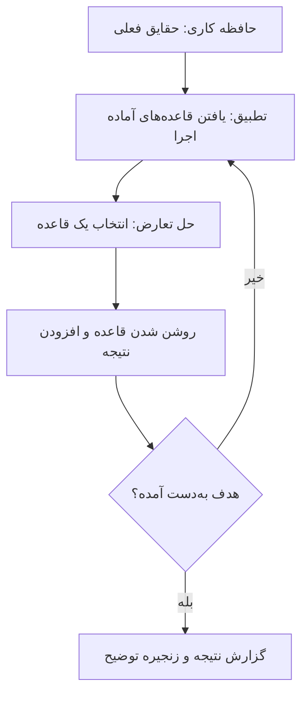

# جلسه ۱۷: منطق گزاره‌ای و مرتبه اول؛ سیستم‌های خبره

> **درس:** مقدمه‌ای بر هوش مصنوعی و کاربرد آن در مهندسی پزشکی
> **مدت پیشنهادی:** ۶۰ تا ۹۰ دقیقه · **سطح:** مقدماتی
> **منابع این جلسه:** منبع ۱ (Russell & Norvig, 2016)، منبع ۲ (Erickson, 2021)، منبع ۱۱ (محتوای مدرس)

---

## اهداف جلسه
در پایان این جلسه دانشجو می‌تواند:
1. عملگرهای منطق گزاره‌ای (Propositional Logic) را روی جدول درستی (Truth Table) بررسی و همستان (Implication) را با هم‌ارز عبارت‌هایش تطبیق دهد.
2. تفاوت منطق گزاره‌ای و منطق مرتبه اول (First-Order Logic) را با کمّی‌کننده‌های «برای همه» و «وجود دارد» توضیح دهد.
3. دو قاعده استنتاج «مقدمات پذیرفته» (Modus Ponens) و «مجزا» (Resolution) را روی مثال‌های کوچک اجرا کند.
4. سه جزء اصلی سیستم خبره (Expert System) — پایگاه قاعده (Rule Base)، حافظه کاری (Working Memory) و موتور استنتاج (Inference Engine) — را نام ببرد و حلقه استنتاج روبه‌جلو را ترسیم کند.

---

## ۱. منطق گزاره‌ای: گزاره‌ها و عملگرها

در جلسه‌های جست‌وجو، دانش ما درباره مسئله در «شکل گراف» بود. منطق زبانی رسمی است برای بیان دانش به‌صورت **گزاره** (Proposition) — جمله‌ای که یا درست است یا نادرست، مثل «تب بیمار بالاست». گزاره‌ها را با عملگرهای منطقی به هم وصل می‌کنیم (P و Q دو گزاره‌اند):

| عملگر | نماد | معنی در فارسی | نادرست فقط وقتی که… |
|---|---|---|---|
| نقیض (Negation) | $\neg P$ | «نه P» | P درست باشد |
| عطف (Conjunction) | $P \land Q$ | «P و Q» | دست‌کم یکی نادرست باشد |
| فصل (Disjunction) | $P \lor Q$ | «P یا Q» | هر دو نادرست باشند |
| همستان (Implication) | $P \rightarrow Q$ | «اگر P آنگاه Q» | P درست و Q نادرست باشد |
| دوشرطی (Biconditional) | $P \leftrightarrow Q$ | «P اگر و تنها اگر Q» | طرفین مخالف هم باشند |

جدول درستی کامل این عملگرها (خروجی واقعی بخش ۱ کد این جلسه):

| P | Q | $\neg P$ | $P \land Q$ | $P \lor Q$ | $P \rightarrow Q$ | $P \leftrightarrow Q$ |
|---|---|---|---|---|---|---|
| T | T | F | T | T | T | T |
| T | F | F | F | T | F | F |
| F | T | T | F | T | T | F |
| F | F | T | F | F | T | T |

دو نکته که در امتحان زیاد گره می‌خورد:

1. **همستان با «حقیقت خالی»:** $P \rightarrow Q$ فقط در یک حالت نادرست است — وقتی P درست باشد اما Q نادرست. اگر P اصلاً رخ ندهد، همستان درست است حتی اگر Q رخ دهد.
2. **هم‌ارزی (Equivalence):** دو فرمول هم‌ارزند اگر روی همه حالت‌ها جدول درستی یکسانی داشته باشند. مهم‌ترین هم‌ارزی این جلسه:

$$P \rightarrow Q \equiv (\neg P \lor Q) \equiv (\neg Q \rightarrow \neg P)$$

فرم سوم را **نقیض معکوس** (Contrapositive) می‌نامند: «اگر Q نبود، پس P هم نبود» دقیقاً همان «اگر P بود، Q بود» است. اما وارونه‌اش یعنی $Q \rightarrow P$ **هم‌ارز نیست** — مراقب این خطای رایج باشید.

## ۲. منطق مرتبه اول: محمول‌ها و کمّی‌کننده‌ها

در منطق گزاره‌ای هر گزاره یک شناسه بی‌ساختار است؛ نمی‌توانیم داخل جمله «تب بیمار بالاست» چیزی را تعمیم دهیم. منطق مرتبه اول (First-Order Logic) این را با دو ابزار حل می‌کند:

- **محمول (Predicate):** ویژگی یا رابطه روی اشیا؛ مثل $\text{Fever}(x)$ یعنی «x تب دارد». $x$ متغیر است و می‌تواند «بیمار شماره ۱۲» باشد.
- **کمّی‌کننده (Quantifier):** «برای همه» $\forall$ و «وجود دارد» $\exists$.

| الگوی جمله | صورت منطقی | خوانش |
|---|---|---|
| همه بیمارانی که تب دارند سرفه می‌کنند | $\forall x\, (\text{Fever}(x) \rightarrow \text{Cough}(x))$ | برای هر x، اگر تب داشته باشد، سرفه دارد |
| یک بیمار در بخش، تب دارد | $\exists x\, (\text{Patient}(x) \land \text{Fever}(x))$ | دست‌کم یک x هست که بیمار است و تب دارد |

> [!WARNING]
> جای دام در کمّی‌کننده‌ها اینجاست: با $\forall$ داخل جمله معمولاً $\rightarrow$ می‌آید و با $\exists$ معمولاً $\land$. اگر بنویسیم $\forall x (\text{Fever}(x) \land \text{Cough}(x))$ معنایش می‌شود «همه موجوداتِ جهان هم تب دارند هم سرفه» — چیزی که نمی‌خواستیم!

نقیض کمّی‌کننده‌ها هم قاعده تمیزی دارد: $\neg \forall x\, P(x) \equiv \exists x\, \neg P(x)$ و برعکس. «همه تب ندارند» یعنی «یکی هست که تب ندارد».

## ۳. قواعد استنتاج: از مقدمات پذیرفته تا مجزا

استنتاج (Inference) یعنی تولید گزاره‌های تازه‌ای که از دانش موجود **نتیجه می‌شوند**. دو قاعده اصلی این جلسه:

**مقدمات پذیرفته (Modus Ponens):** اگر $P \rightarrow Q$ درست باشد و $P$ هم درست باشد، آنگاه $Q$ درست است. ساده‌ترین و پرکاربردترین قاعده؛ تقریباً همه موتورهای قاعده‌محور روی آن سوارند.

**مجزا (Resolution):** اگر دو بند (Clause) دارای رویون متناقض باشند، می‌توان آن دو را ترکیب کرد. مثلاً از $\{P \lor Q\}$ و $\{\neg Q \lor R\}$ بند تازه $\{P \lor R\}$ به‌دست می‌آید. قدرت مجزا در **اثبات با ردّ** (Refutation) است: برای اثبات اینکه مجموعه‌دانش KB نتیجه می‌دهد G، نقیض G را به KB اضافه می‌کنیم و با مجزا بندها را ترکیب می‌کنیم؛ اگر به **بند تهی** برسیم، یعنی تناقض کامل رخ داده و پس G از KB نتیجه می‌شده است.

مثال اجراشده در کد (گزاره‌ها: F = تب، C = سرفه، I = مشکل تنفسی محتمل):

- دانش: $F \rightarrow C$ و $C \rightarrow I$ و $F$ (سه بند: $\{\neg F, C\}$، $\{\neg C, I\}$، $\{F\}$)
- هدف: اثبات $I$ ← بند $\{\neg I\}$ اضافه می‌شود.
- مسیر مجزا در اجرای واقعی کد: از $\{\neg F, C\}$ و $\{F\}$ بند $\{C\}$؛ از $\{\neg C, I\}$ و $\{\neg I\}$ بند $\{\neg C\}$؛ و از $\{C\}$ و $\{\neg C\}$ **بند تهی** — اثبات کامل شد.
- **کنترل منفی:** اگر هدف را گزاره‌ای بی‌ربط مثل «سردرد» بگیریم، هیچ‌وقت به بند تهی نمی‌رسیم و اثبات شکست می‌خورد — درست همان‌طور که انتظار داریم.

> [!NOTE]
> مجزا «کامل» است: اگر نتیجه‌گیری درست باشد، حتماً راهی به بند تهی هست. بهای این completeness، جست‌وجوی نمایی در مسائل بزرگ است — به همین دلیل در عمل از موتورهای محدودتر یا قاعده‌محور استفاده می‌شود.

## ۴. سیستم‌های خبره: دانش صریح + موتور استنتاج

سیستم خبره (Expert System) تلاشی بود برای بسته‌بندی دانش متخصص در قالب **قاعده‌های اگر–آنگاه** (If–Then Rules) تا ماشین بتواند استدلال کند. سه جزء اصلی:

| جزء | نقش | مثال این جلسه |
|---|---|---|
| پایگاه قاعده (Rule Base) | قاعده‌های اگر–آنگاه که دانش صریح متخصص است | «اگر تب و سرفه، آنگاه التهاب تنفسی محتمل» |
| حافظه کاری (Working Memory) | حقایق فعلی درباره همین مسئله | «تب = بله، سرفه = بله» |
| موتور استنتاج (Inference Engine) | حلقه تطبیق و اجرای قاعده‌ها | استنتاج روبه‌جلو در کد این جلسه |

**مثال تاریخی MYCIN:** در دهه ۱۹۷۰ در دانشگاه استنفورد، MYCIN حدود ششصد قاعده اگر–آنگاه برای شناسایی عامل عفونت‌های باکتریایی و پیشنهاد آنتی‌بیوتیک داشت و با «ضریب اطمینان» (Certainty Factor) با عدم قطعیت کنار می‌آمد. MYCIN الگوی صدها سیستم خبره بعدی شد و درس بزرگش این بود: **دانش تخصصی، نه الگوریتم جادویی، عامل اصلی عملکرد بود**. محدودیت‌هایش هم آموزنده است: نگهداری دستی صدها قاعده شکننده است، مرزهای قطعیت مبهم‌اند و تعامل با پزشکِ پرسشگر باید طراحی‌شده باشد — همین محدودیت‌ها بعداً مسیر را به یادگیری ماشین باز کرد (منبع ۲).

**استنتاج روبه‌جلو (Forward Chaining):** از حقایق شروع می‌کنیم و قاعده‌هایی را که شرطشان برقرار است «روشن» (Fire) می‌کنیم تا نتیجه‌های تازه به حافظه کاری اضافه شود؛ حرکت از داده به نتیجه است (Data-driven):



در کد این جلسه، با حقایق اولیه «تب، سرفه، سن بالاتر از ۶۵» سه قاعده R1 و R3 و R5 (به همین ترتیب، همه در دور اول) روشن شدند و حافظه کاری به «اولویت ویزیت فوری» رسید — زنجیره‌ای که موتور می‌تواند به‌عنوان **توضیح** (Explanation) گزارش کند؛ همین توضیح‌پذیری مزیت تاریخی سیستم‌های خبره بود.

---

## 🔬 پیوند با مهندسی پزشکی

**سیستم خبره تریاژ بخش اورژانس (مثال آموزشی):** فرض کنید قاعده‌های ساده‌ای مثل «اگر تب و سرفه، آنگاه التهاب تنفسی محتمل» و «اگر التهاب تنفسی محتمل و سن بالای ۶۵، آنگاه ارجاع برای بررسی بیشتر» در پایگاه قاعده باشد. پرستار ورودی‌ها را ثبت می‌کند، موتور استنتاج روبه‌جلو زنجیره را تا «اولویت ویزیت فوری» می‌سازد و اگر پرسیده شود «چرا؟»، همان فهرست قاعده‌های روشن‌شده پاسخ است. همین شفافیت دلایل، سیستم‌های خبره را برای محیط‌های حساس جذاب می‌کرد.

> [!WARNING]
> این مثال کاملاً آموزشی و ساختگی است؛ قاعده‌های کد این جلسه هیچ ارزش تشخیصی ندارند و سامانه واقعی تریاژ به پروتکل‌های بالینی، داده حقیقی و اعتبارسنجی دقیق نیاز دارد.

## ✍️ فعالیت کلاسی

### فعالیت ۱: ردیابی استنتاج روبه‌جلو
حافظه کاری را به‌جای «تب، سرفه، سن بالاتر از ۶۵» با «سرفه، خلط غیرعادی، اشباع اکسیژن پایین» شروع کنید (قاعده‌ها همان R1 تا R5 اسکریپت):

۱. کدام قاعده‌ها به ترتیب روشن می‌شوند؟ زنجیره را با ذکر گام بنویسید.
۲. حافظه کاری نهایی چه چیزی است؟ آیا «تب» در آن هست؟
۳. اگر علاوه بر این‌ها «تب» هم باشد، آیا قاعده تازه‌ای روشن می‌شود؟ چرا؟

<details>
<summary>کلید پاسخ فعالیت ۱ (نمونه)</summary>

۱. اجرای واقعی کد سه قاعده روشن کرد: ابتدا R2 (سرفه و خلط غیرعادی ← التهاب تنفسی محتمل)، سپس R4 (اشباع اکسیژن پایین و التهاب تنفسی محتمل ← ارجاع برای بررسی بیشتر) و در پایان R5 (ارجاع ← اولویت ویزیت فوری). R1 روشن نمی‌شود چون «تب» در حافظه کاری نیست.

۲. حافظه کاری نهایی شش حقیقت دارد: سرفه، خلط غیرعادی، اشباع اکسیژن پایین، التهاب تنفسی محتمل، ارجاع برای بررسی بیشتر و اولویت ویزیت فوری. «تب» در آن نیست — موتور فقط چیزی را می‌داند که از قاعده‌ها نتیجه شده باشد.

۳. خیر، قاعده تازه‌ای روشن نمی‌شود: با «تب» قاعده R1 هم فعال می‌شد اما نتیجه‌اش «التهاب تنفسی محتمل» قبلاً از R2 در حافظه کاری است و افزودن تکراری اتفاقی نمی‌افتد. نتیجه زنجیره همان است.

</details>

### فعالیت ۲: تمرین مجزا و اثبات با ردّ
همان دانش جلسه (سه بند $\{\neg F, C\}$، $\{\neg C, I\}$، $\{F\}$) را در نظر بگیرید:

۱. برای اثبات $I$ با ردّ، کدام بند اضافه می‌شود؟ زنجیره سه‌مرحله‌ای به بند تهی را بنویسید.
۲. یک مسیر مجزای متفاوت هم وجود دارد که از نقیض $F$ می‌گذرد؛ پیدا کنید.
۳. اگر بند $\{\neg C, I\}$ را حذف کنیم، آیا هنوز می‌توان $I$ را اثبات کرد؟

<details>
<summary>کلید پاسخ فعالیت ۲ (نمونه)</summary>

۱. بند $\{\neg I\}$ اضافه می‌شود؛ زنجیره اجرای واقعی کد: $\{\neg F, C\}$ با $\{F\}$ ← $\{C\}$؛ سپس $\{\neg C, I\}$ با $\{\neg I\}$ ← $\{\neg C\}$؛ سپس $\{C\}$ با $\{\neg C\}$ ← بند تهی. پس اثبات کامل است.

۲. مسیر دوم: $\{\neg C, I\}$ با $\{\neg I\}$ ← $\{\neg C\}$؛ سپس $\{\neg F, C\}$ با $\{\neg C\}$ ← $\{\neg F\}$؛ سپس $\{\neg F\}$ با $\{F\}$ ← بند تهی. مجزا بند میانی متفاوتی می‌سازد اما به همان تناقض می‌رسد.

۳. خیر. بدون $\{\neg C, I\}$ هیچ بندی حاوی $I$ یا $\neg I$ به جز $\{\neg I\}$ نیست و هیچ جفت متناقض کاملی به بند تهی نمی‌رسد؛ اثبات شکست می‌خورد — همان رفتاری که کد برای هدف بی‌ربط «سردرد» نشان داد.

</details>

## 💻 کد آموزشی
فایل `code/session_17_logic_expert_system.py` (فقط کتابخانه استاندارد):

```bash
python3 code/session_17_logic_expert_system.py
```

این اسکریپت سه کار می‌کند:
1. جدول درستی کامل پنج عملگر پایه را برای $P$ و $Q$ چاپ می‌کند (بخش ۱).
2. یک سیستم خبره کوچک با پنج قاعده پزشکی آموزشی می‌سازد و استنتاج روبه‌جلو را گام‌به‌گام اجرا و چاپ می‌کند: پایگاه قاعده، حافظه کاری و گام‌های روشن شدن قاعده‌ها (بخش ۲).
3. اثبات با ردّ را با مجزا پیاده‌سازی می‌کند: برای هدف $I$ بند تهی به‌دست می‌آید (اثبات موفق) و برای هدف بی‌ربط «سردرد» اثبات شکست می‌خورد (کنترل منفی) (بخش ۳).

> [!NOTE]
> خروجی اسکریپت قطعی است (هیچ تصادفی در کار نیست) و می‌توانید هر گام را با ردیابی دستی فعالیت‌ها مقایسه کنید.

## 📘 واژه‌نامه

| واژه | معنی |
|---|---|
| Proposition | گزاره؛ جمله‌ای که درست یا نادرست است |
| Truth Table | جدول درستی؛ فهرست همه حالت‌های درست/نادرست |
| Implication / Contrapositive | همستان / نقیض معکوس ($P \rightarrow Q \equiv \neg Q \rightarrow \neg P$) |
| Predicate / Quantifier | محمول / کمّی‌کننده ($\forall$، $\exists$) |
| Modus Ponens | قاعده «از $P \rightarrow Q$ و $P$ نتیجه $Q$» |
| Resolution / Refutation | مجزا / اثبات با افزودن نقیض هدف و رسیدن به بند تهی |
| Expert System | سیستم خبره؛ پایگاه قاعده + حافظه کاری + موتور استنتاج |
| Forward Chaining | استنتاج روبه‌جلو؛ از داده به نتیجه |
| Inference Engine | موتور استنتاج؛ حلقه تطبیق، حل تعارض و اجرا |

## ❓ پرسش‌های خودآزمون
1. در کدام حالت $P \rightarrow Q$ نادرست است؟ و چرا $\neg Q \rightarrow \neg P$ هم‌ارز آن است ولی $Q \rightarrow P$ نه؟
2. جمله «هر بیماری که تب دارد باید بررسی شود» را با محمول و کمّی‌کننده بنویسید و نشان دهید نقیض آن چه می‌شود.
3. اثبات با ردّ چگونه «اثبات یک گزاره» را به «یافتن تناقض» تبدیل می‌کند؟
4. سه جزء سیستم خبره را نام ببرید و بگویید در استنتاج روبه‌جلو هر کدام چه نقشی دارند.

> کلید پاسخ‌ها در بخش «راهنمای مدرس» انتهای فایل آمده است.

## 📝 تکلیف
1. کد `code/session_17_logic_expert_system.py` را اجرا کنید و گام‌های استنتاج روبه‌جلو و زنجیره مجزا را با ردیابی دستی خود مقایسه و گزارش کنید.
2. یک قاعده جدید به پایگاه قاعده اسکریپت اضافه کنید: «اگر اولویت ویزیت فوری و سن بالاتر از ۶۵، آنگاه هشدار سطح بالا» و دوباره اجرا کنید. گام‌های جدید را گزارش و توضیح دهید: کدام قاعده‌های زنجیره اصلی به همان ترتیب روشن می‌شوند، قاعده جدید در کجای زنجیره فعال می‌شود و حافظه کاری چه حقیقت تازه‌ای می‌گیرد. (یادآوری: قاعده‌ها ساختگی و آموزشی‌اند.)

## 📚 مطالعه پیشنهادی
- Russell & Norvig (2016)، فصل ۷ (عامل‌های مبتنی بر دانش: منطق گزاره‌ای، استنتاج و مجزا) و فصل ۸ (منطق مرتبه اول) (منبع ۱)
- Erickson (2021)، بخش‌های تاریخی درباره سیستم‌های خبره پزشکی و MYCIN (منبع ۲)
- مرور جلسه ۱۲ (CSP) برای مقایسه دو نوع «استدلال روی محدودیت/دانش»

---

## 🧭 راهنمای مدرس (از این عنوان تا انتها در نسخه دانشجو حذف شود)

**زمان‌بندی پیشنهادی برای ۹۰ دقیقه:** انگیزه و مرور جلسه ۱۶ (۵) | منطق گزاره‌ای و جدول درستی (۱۵) | منطق مرتبه اول و کمّی‌کننده‌ها (۱۵) | مقدمات پذیرفته و مجزا با مثال ردّ (۲۰) | سیستم‌های خبره و MYCIN (۱۵) | اجرای کد و فعالیت‌های ۱ و ۲ (۱۵) | جمع‌بندی و تکلیف (۵)

**نسخه ۶۰ دقیقه‌ای:** جدول درستی و هم‌ارزی همستان (۱۲)، منطق مرتبه اول با دو مثال (۱۰)، مقدمات پذیرفته و اثبات با ردّ روی مثال کد (۱۸)، معماری سیستم خبره و حلقه روبه‌جلو با مرمید (۱۰)، فعالیت ۱ (۷)، جمع‌بندی (۳). فعالیت ۲ و تکلیف قاعده جدید به خانه منتقل شود.

**نکات:**
- رایج‌ترین خطاها: (الف) باور به وارونه همستان ($Q \rightarrow P$)، (ب) جای‌گذاری $\land$ زیر $\forall$. هر دو را روی تخته با جدول درستی بشکنید.
- در مجزا، دانشجوها اغلب «بند تهی» را نمی‌فهمند؛ تأکید کنید بند تهی یعنی $P \lor \neg P$ یعنی تناقض صریح.
- MYCIN را به‌عنوان نقطه عطف تاریخی معرفی کنید اما تأکید کنید ادعای عملکرد بالینی آن امروز ملاک نیست؛ نکته آموزنده معماری و توضیح‌پذیری است.
- حلقه روبه‌جلو در مرمید را با حلقه‌های جست‌وجوی جلسه‌های ۵ تا ۸ مقایسه کنید: اینجا «هدف» از داخل دانش می‌آید نه از یک گراف بیرونی.
- این جلسه جزو پوشش میان‌ترم دوم (جلسات ۱۷ تا ۲۶) است؛ در جلسه ۲۳ به مجزا و سیستم خبره برگردیم.

### خروجی مورد انتظار جلسه
دانشجو بتواند جدول درستی همستان را کامل کند، یک استنتاج روبه‌جلوی سه‌گامی را ردیابی کند و سه جزء سیستم خبره را با نقش هر کدام توضیح دهد.

### نکته فنی درباره کد
- استنتاج روبه‌جلو با حلقه ساده «تا وقتی تغییری هست» پیاده شده؛ در قاعده‌های بزرگ کارایی ندارد اما شفافیت آموزشی دارد.
- ترتیب بررسی قاعده‌ها ثابت است (فهرست `RULES`)؛ پس خروجی گام‌ها قطعی و قابل ردیابی است.
- در مجزا، نقیض هدف به‌صورت بند تک‌عضوی اضافه می‌شود و حلقه جفت‌ها را می‌سازد؛ با رسیدن به بند تهی متوقف می‌شود (در اجرای واقعی، گام ۹).

### کلید پاسخ تکلیف (اجرای واقعی کد با قاعده جدید)

<details>
<summary>نمایش کلید پاسخ تکلیف</summary>

با افزودن قاعده R6: {اولویت_ویزیت_فوری و سن_بالاتر_از_۶۵} ← هشدار_سطح_بالا:
- زنجیره اصلی بدون تغییر می‌ماند (R1، R3، R5 به همان ترتیب) و در همان دور اول R6 هم روشن می‌شود.
- حافظه کاری نهایی فقط یک حقیقت بیشتر از اجرای اصلی دارد: «هشدار_سطح_بالا»؛ «اولویت_ویزیت_فوری» که پیش‌شرط R6 است از قبل (با R5) در حافظه کاری بود و تکرار نمی‌شود. اجرای اصلی شش حقیقت دارد و اجرای با R6 هفت حقیقت.
- نکته آموزشی: یک قاعده جدید می‌تواند بی‌دردسر به انتهای زنجیره وصل شود و فقط انتهای زنجیره را گسترش دهد؛ اما اگر قاعده جدید حقیقتی می‌ساخت که قاعده‌های دیگر روی آن تکیه دارند، کل زنجیره بعدی تغییر می‌کرد — حساسیت سیستم خبره به «نقطه اتصال قاعده جدید».

</details>

### کلید پاسخ پرسش‌های خودآزمون

<details>
<summary>نمایش کلید پاسخ</summary>

1. فقط وقتی $P$ درست و $Q$ نادرست باشد. جدول درستی $P \rightarrow Q$ و $\neg Q \rightarrow \neg P$ روی هر چهار حالت یکسان است (هر دو فقط در سطر T,F نادرستند)، اما $Q \rightarrow P$ در سطرهای F,T و F,F برخلاف آنها عمل می‌کند.
2. $\forall x (\text{Patient}(x) \land \text{Fever}(x) \rightarrow \text{Review}(x))$؛ نقیض آن با قاعده $\neg \forall \equiv \exists \neg$ می‌شود $\exists x (\text{Patient}(x) \land \text{Fever}(x) \land \neg \text{Review}(x))$ — «دست‌کم یک بیمار تب‌دار هست که بررسی نشده».
3. نقیض هدف را به مجموعه‌دانش می‌افزاییم؛ اگر مجموعه ناسازگار باشد، با مجزا به بند تهی می‌رسیم و چون افزودن نقیض تنها تغییر بود، خود هدف باید از دانش نتیجه می‌شده است.
4. پایگاه قاعده (دانش اگر–آنگاه)، حافظه کاری (حقایق فعلی)، موتور استنتاج (حلقه تطبیق/حل تعارض/اجرای قاعده و افزودن نتیجه تا رسیدن به هدف).

</details>
