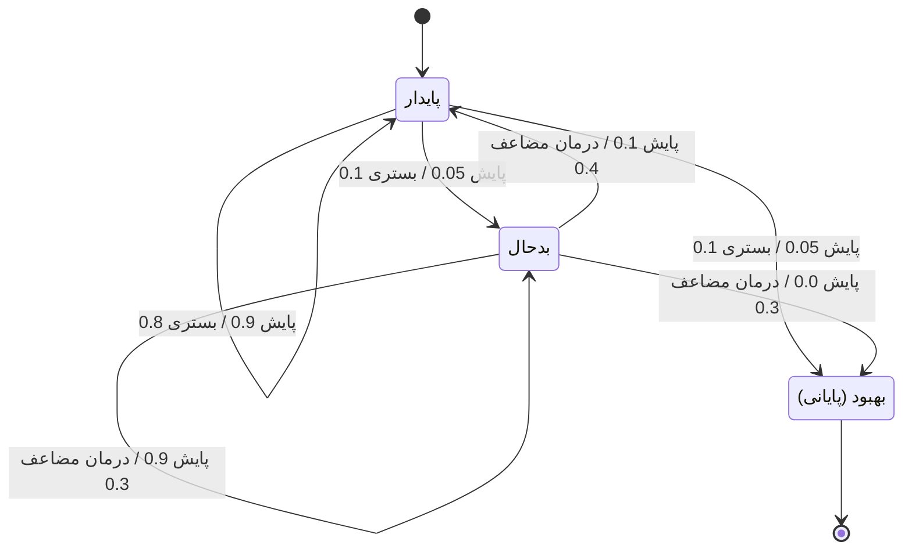

# جلسه ۱۸: فرایند تصمیم مارکوف (MDP)

> **درس:** مقدمه‌ای بر هوش مصنوعی و کاربرد آن در مهندسی پزشکی
> **مدت پیشنهادی:** ۶۰ تا ۹۰ دقیقه · **سطح:** مقدماتی
> **منابع این جلسه:** منبع ۱ (Russell & Norvig, 2016)، منبع ۱۱ (محتوای مدرس)

---

## اهداف جلسه
در پایان این جلسه دانشجو می‌تواند:
1. مؤلفه‌های پنج‌گانه MDP یعنی $\langle S, A, P, R, \gamma \rangle$ را روی یک مثال پزشکی کوچک شناسایی کند.
2. معادله بلمن (Bellman Equation) را بنویسد و نقش ضریب تنزیل $\gamma$ را توضیح دهد.
3. شبه‌کد تکرار ارزش (Value Iteration) و تکرار سیاست (Policy Iteration) را بخواند و تفاوتشان را بگوید.
4. خروجی کد (تابع ارزش بهینه $V^*$ و سیاست بهینه $\pi^*$) را تفسیر کند و آن را با یادگیری تقویتی جلسه بعد پیوند دهد.

---

## ۱. تصمیم در محیط با عدم قطعیت: چه چیزی به MDP می‌انجامد؟

تا جلسه ۱۵، دنیای ما **قطعی** بود: از یک گره با یک کنش دقیقاً به یک گره می‌رفتیم. اما بیمار، بافت زنده است: همین درمان ممکن است خوب، بی‌اثر یا حتی مضر شود. وقتی نتیجه کنش‌ها **احتمالی** است و تصمیم امروز بر فرصت‌های فردا اثر می‌گذارد، به چارچوبی نیاز داریم که هر دو را با هم صورت‌بندی کند: فرایند تصمیم مارکوف (Markov Decision Process).

برای کوتاهی در فرمول‌های این جلسه نام‌های لاتین می‌گذاریم: حالت‌ها $s_1$ (پایدار)، $s_2$ (بدحال) و $s_3$ (بهبود) و کنش‌ها $a_1$ (پایش)، $a_2$ (بستری پیشگیرانه) و $a_3$ (درمان مضاعف).

| مؤلفه | نماد | معنا | مثال پایش بیمار (آموزشی) |
|---|---|---|---|
| حالت‌ها (States) | $S$ | وضعیت‌های ممکن دنیا | پایدار، بدحال، بهبود |
| کنش‌ها (Actions) | $A$ | کارهایی که عامل می‌تواند انجام دهد | پایش، بستری پیشگیرانه، درمان مضاعف |
| احتمال گذار (Transition Probability) | $P$ | احتمال رسیدن از یک حالت به حالت دیگر با هر کنش | $P(s_3 \mid s_2, a_3) = 0.3$ |
| پاداش (Reward) | $R$ | بازخورد عددی فوری هر گذار | هزینه کنش منفی است؛ رسیدن به بهبود پاداش دارد |
| ضریب تنزیل (Discount Factor) | $\gamma$ | وزن آینده نسبت به امروز، $0 < \gamma < 1$ | $\gamma = 0.9$: آینده مهم است ولی کمتر از امروز |

**ویژگی مارکوف:** احتمال گذار بعدی فقط به حالت فعلی و کنش فعلی بستگی دارد، نه به تاریخچه. نمادش: $P(s' \mid s, a)$ — «احتمال رفتن به $s'$ اگر در $s$ باشیم و $a$ را انجام دهیم». این فرض ساده است اما دنیای زیادی را مدل می‌کند.

هدف چیست؟ یافتن **سیاست** (Policy) $\pi(s)$: برای هر حالت یک کنش توصیه می‌کند، به‌گونه‌ای که جمع تنزیل‌شده پاداش‌ها در بلندمدت بیشینه شود:

$$V^\pi(s) = \mathbb{E}\left[\, R_0 + \gamma R_1 + \gamma^2 R_2 + \cdots \mid \pi \,\right]$$

## ۲. معادله بلمن: ارزش حالت، از ارزش آینده می‌آید

اگر بدانیم «ارزش» هر حالت چقدر است، تصمیم ساده می‌شود: کنشی را انتخاب کن که پاداش فوری + ارزش تنزیل‌شده حالت بعدی را بیشینه کند. معادله بلمن دقیقاً همین را می‌گوید — ارزش بهینه یک حالت، بهترین کنش ممکن از آن حالت است:

$$V^*(s) = \max_{a} \sum_{s'} P(s' \mid s, a)\,\big[\, R(s,a,s') + \gamma\, V^*(s') \,\big]$$

عبارت داخل کروشه برای هر گذار ممکن حساب می‌شود و احتمال‌ها وزنشان می‌کنند؛ $\max_a$ یعنی «بهترین کنش را انتخاب کن». برای هر کنش مشخص، مقدار $Q$ را هم تعریف می‌کنیم که بعداً در جلسه ۱۹ ستون اصلی Q-learning است:

$$Q(s,a) = \sum_{s'} P(s' \mid s, a)\,\big[\, R(s,a,s') + \gamma\, V^*(s') \,\big], \qquad V^*(s) = \max_a Q(s,a)$$

دو نکته درباره $\gamma$:

1. $\gamma$ نزدیک به ۱ یعنی آینده تقریباً به اندازه امروز مهم است (درمان‌های با اثر درازمدت)؛ $\gamma$ کوچک یعنی فقط به نتیجه فوری اهمیت می‌دهیم.
2. معادله بلمن معادله‌ای است که $V^*$ خودش در دو طرفش هست؛ به همین دلیل حل مستقیمش سخت است و به **الگوریتم تکراری** نیاز داریم — دقیقاً همان کاری که بخش بعدی می‌کند.

## ۳. تکرار ارزش و تکرار سیاست

هر دو الگوریتم ایده یکسانی دارند: با حدس فعلی از $V$، سمت راست معادله بلمن را حساب کن و حدس را بهتر کن؛ چون عملگر بلمن انقباضی (Contraction) با ضریب $\gamma$ است، این تکرار به $V^*$ همگرا می‌شود.

**تکرار ارزش (Value Iteration)** — همه کنش‌ها را در هر مرور امتحان می‌کند:

```text
Value-Iteration:
    برای همه حالت‌ها: V(s) ← 0
    تکرار:
        Δ ← 0
        برای هر حالت غیرپایانی s:
            V_new(s) ← بیشینه‌ی a از Σ_s' P(s'|s,a) × [R(s,a,s') + γ·V(s')]
            Δ ← بیشینه(Δ, |V_new(s) − V(s)|)
        V ← V_new
    تا وقتی Δ < θ (آستانه همگرایی)
    در پایان: π(s) ← کنشی که بیشترین Q(s,a) را دارد
```

**تکرار سیاست (Policy Iteration)** — بین دو گام یکی در میان حرکت می‌کند:

```text
Policy-Iteration:
    سیاست اولیه π را انتخاب کن (مثلاً اولین کنش هر حالت)
    تکرار:
        ارزیابی: V^π را برای همین π حساب کن (حل معادله خطی با V = R + γ·P·V)
        بهبود: برای هر s، کنشی با بیشترین Q(s,a) را در π بگذار
    تا وقتی π تغییر نکند
```

| ویژگی | تکرار ارزش | تکرار سیاست |
|---|---|---|
| در هر تکرار چه می‌کند | یک مرور کامل روی همه کنش‌ها | ارزیابی دقیق یک سیاست + یک گام بهبود |
| تعداد تکرارهای بیرونی | معمولاً زیاد | معمولاً کم |
| هزینه هر تکرار | کم | ارزیابی می‌تواند گران باشد |
| نتیجه نهایی | $V^*$ و $\pi^*$ | همان $V^*$ و $\pi^*$ |

> [!NOTE]
> در مسائل کوچک هر دو سریع همگرا می‌شوند و به **یک‌جواب** می‌رسند؛ تفاوت اصلی در هزینه هر تکرار و تعداد تکرارهاست. در جلسه ۱۹ می‌بینیم که Q-learning حتی مدل $P$ و $R$ را هم نمی‌خواهد و از تجربه یاد می‌گیرد.

## ۴. مدل نمونه درمانی و خروجی کد

مدل مینی‌اتم «پایش/درمان» کد این جلسه (کاملاً ساختگی و آموزشی) — سه حالت و سه کنش (چهار ترکیب حالت–کنش)، $\gamma = 0.9$، پاداش رسیدن به بهبود $+10$، هزینه‌ها منفی پاداش‌اند؛ ستون‌های جدول، احتمال رسیدن به هر حالت پس از آن کنش‌اند:

| حالت | کنش | $P(s_1)$ | $P(s_2)$ | $P(s_3)$ |
|---|---|---|---|---|
| پایدار | پایش (هزینه ۱) | 0.9 | 0.05 | 0.05 |
| پایدار | بستری پیشگیرانه (هزینه ۶) | 0.8 | 0.1 | 0.1 |
| بدحال | پایش (هزینه ۱) | 0.1 | 0.9 | 0.0 |
| بدحال | درمان مضاعف (هزینه ۵) | 0.4 | 0.3 | 0.3 |



نتیجه اجرای واقعی کد (هر دو الگوریتم):

| حالت | $V^*$ | $\pi^*$ |
|---|---|---|
| پایدار | $-3.7143$ | پایش |
| بدحال | $-4.5714$ | درمان مضاعف |
| بهبود | $0.0000$ (پایانی) | — |

تفسیر — این جدول قلب جلسه است:

1. **سیاست بهینه به حالت بستگی دارد:** در حالت پایدار، پایشِ ارزان کافی است (بستری پیشگیرانه ۶ واحدی فایده کم دارد)؛ در حالت بدحال، درمان مضاعف با وجود هزینه ۵، ارزش موردانتظار بالاتری می‌سازد چون ۳۰ درصد شانس بهبودی و ۴۰ درصد بازگشت به پایداری دارد.
2. **ارزش‌ها منفی‌اند اما «بهینه»ند:** چون هیچ مسیری بی‌هزینه به بهبود نیست، هر سیاستی هزینه دارد؛ $V^*$ بیشینه **امید ریاضی** بازده تنزیل‌شده در میان همه سیاست‌هاست — نه «بهترین میان بدترین‌ها». آن مفهوم (Maximin) به بازی‌های رقابتی جلسه ۱۵ مربوط است؛ اینجا دنیا بدخواه نیست، فقط تصادفی است و ما روی میانگین وزن‌دار با احتمال‌ها بیشینه می‌گیریم.
3. **توافق دو الگوریتم:** تکرار ارزش پس از ۱۳۰ مرور کامل همگرا شد و تکرار سیاست پس از فقط ۲ تکرار بیرونی؛ بیشینه اختلاف $V$ بین دو روش در حد $9.2 \times 10^{-10}$ بود و سیاست‌ها یکسان درآمدند — همان جواب بهینه.

## ۵. از MDP به یادگیری تقویتی: مدل‌محور و اکتشاف در برابر بهره‌برداری

چهار فرض پنهان MDP این جلسه را دست‌نخورده فرض کردیم: احتمال‌های گذار و پاداش‌ها را **می‌شناسیم**، حالت‌ها کاملاً مشاهده‌پذیرند و مسئله کوچک است. چارچوب‌بندی کلاسیک:

- **مدل‌محور (Model-based):** مثل همین جلسه؛ اول مدل ($P$ و $R$) داریم، بعد با تکرار ارزش/سیاست آن را حل می‌کنیم. سریع و نمونه‌کم، اما ساختن مدل درست خودش سخت است.
- **بدون مدل (Model-free):** جلسه ۱۹؛ عامل با **تجربه** (امتحان و خطا) مستقیم $V$ یا $Q$ را یاد می‌گیرد، بی‌آنکه $P$ و $R$ را بداند. کندتر و پرنمونه، اما برای دنیاهایی که مدلشان را نمی‌دانیم.

و وقتی عامل باید خودش داده جمع کند، معمای همیشگی یادگیری تقویتی پیش می‌آید — **اکتشاف در برابر بهره‌برداری** (Exploration vs Exploitation): ادامه دادن کنشی که تاکنون خوب جواب داده (بهره‌برداری) یا امتحان کنش‌های دیگر برای کشف شاید بهترها (اکتشاف). در مدل درمانی ما: اگر همیشه «پایش» را امتحان کنیم هرگز نمی‌فهمیم درمان مضاعف از بدحال چقدر می‌ارزد. این دوگانه را در جلسه ۱۹ با $\epsilon$-greedy دقیق‌تر می‌سازیم.

---

## 🔬 پیوند با مهندسی پزشکی

**تنظیم دوز داروی پیوسته (مثال آموزشی):** پمپ‌های انفوزیون دارو را می‌توان به‌صورت MDP دید: حالت‌ها سطوح دارو در خون (کم، هدف، بالا)، کنش‌ها نرخ تزریق، گذارها مدل فارماکوکینتیک با عدم قطعیت، و پاداش منفیِ فاصله از دوز هدف. معادله بلمن می‌گوید نرخ امروز را طوری انتخاب کن که هم حالت فعلی را اصلاح کند هم حالت آینده را خراب نکند — همین تعادل «فوری/آینده» است که $\gamma$ کد می‌کند. توجه کنید که $\gamma$ در کاربردهای پزشکی بار معنایی پیدا می‌کند: $\gamma$ کوچک یعنی سیاستی که فقط نگاه به وضعیت لحظه‌ای دارد و ممکن است دوز امروز را با هزینه فردا بخرد.

> [!WARNING]
> این مثال کاملاً آموزشی است؛ سامانه‌های واقعی تنظیم دوز به مدل‌های فارماکوکینتیک اعتبارسنجی‌شده، پروتکل بالینی و تأیید نظارتی نیاز دارند و خروجی این کدها هیچ کاربرد درمانی یا تشخیصی ندارد.

## ✍️ فعالیت کلاسی

### فعالیت ۱: یک مرور تکرار ارزش، دستی
با مقادیر اولیه $V_0(s) = 0$ برای همه حالت‌ها و مدل جدول بخش ۴:

۱. مقدار $Q(s_1, a_1)$ با $V_0$ را دستی حساب کنید (سه گذار با احتمال‌ها ۰.۹ و ۰.۰۵ و ۰.۰۵).
۲. همین کار برای $Q(s_2, a_3)$ انجام دهید.
۳. $V_1$ (نتیجه نخستین مرور) چیست؟ برای راستی‌آزمایی می‌توانید پس از نخستین مرور در `value_iteration` یک چاپ موقت اضافه کنید.

<details>
<summary>کلید پاسخ فعالیت ۱ (نمونه)</summary>

۱. $Q = 0.9(-1) + 0.05(-1) + 0.05(-1+10) = -0.9 - 0.05 + 0.45 = -0.5$. (گذار به بهبود: هزینه ۱ منهای پاداش ۱۰ یعنی $+9$.)

۲. $Q = 0.4(-5) + 0.3(-5) + 0.3(-5+10) = -2 - 1.5 + 1.5 = -2.0$.

۳. مقادیر پس از نخستین مرور: $V_1(s_1) = -0.5$ و $V_1(s_2) = -1.0$ — در حالت پایدار $\max(-0.5, -5) = -0.5$ و در بدحال $\max(-1.0, -2.0) = -1.0$. توجه کنید در این نقطه هنوز «پایش» در هر دو حالت برنده است؛ تفاوت سیاست بهینه در مرورهای بعدی و با بلوغ ارزش‌ها آشکار می‌شود.

</details>

### فعالیت ۲: مرور دوم و جهت حرکت
با $V_1$ از فعالیت ۱:

۱. $Q(s_1, a_1)$ را با $V_1$ حساب کنید؛ نتیجه درست $-0.95$ است.
۲. بدون محاسبه بگویید $V$ها به چه سمت حرکت می‌کنند و چرا علامت منفی طبیعی است.
۳. اگر $\gamma$ را از ۰.۹ به ۰.۵ کاهش دهیم، کدام کنش‌ها محتمل‌تر است بهینه شوند؟ (فقط استدلال کیفی.)

<details>
<summary>کلید پاسخ فعالیت ۲ (نمونه)</summary>

۱. $Q = 0.9(-1 + 0.9 \times -0.5) + 0.05(-1 + 0.9 \times -1) + 0.05 \times 9 = 0.9(-1.45) + 0.05(-1.9) + 0.45 = -1.305 - 0.095 + 0.45 = -0.95$ — این عدد با اجرای گام‌به‌گام تابع `q_value` اسکریپت روی $V_1$ هم به‌دست می‌آید.

۲. ارزش‌ها منفی‌تر می‌شوند و به $V^* = (-3.7143, -4.5714)$ میل می‌کنند؛ چون هر گام هزینه دارد و زنجیره‌ی هزینه‌ها در $\gamma = 0.9$ انباشته می‌شود. منفی بودن $V$ معیار «بد بودن» نیست؛ فقط یعنی جریان تنزیل‌شده پاداش از این حالت به بعد، با بهترین سیاست، این‌قدر است.

۳. با $\gamma = 0.5$ آینده تقریباً نادیده گرفته می‌شود؛ پاداش یک‌باره بهبود ($+10$) وزن کمتری می‌گیرد و هزینه‌های فوری حرف اول را می‌زنند، پس گرایش به سمت کنش‌های ارزان‌تر (پایش) بیشتر می‌شود و احتمالاً از «بدحال» هم پایش بهینه می‌شود. اجرای کد با این تغییر می‌تواند پاسخ قطعی را نشان دهد (بخشی از تکلیف).

</details>

## 💻 کد آموزشی
فایل `code/session_18_mdp_value_iteration.py` (فقط کتابخانه استاندارد):

```bash
python3 code/session_18_mdp_value_iteration.py
```

این اسکریپت:
1. MDP سه‌حالته جدول بخش ۴ را با دیکشنری احتمال‌های گذار و تابع پاداش تعریف می‌کند.
2. `value_iteration()` را با آستانه همگرایی $10^{-10}$ اجرا می‌کند و $V^*$ و $\pi^*$ را چاپ می‌کند.
3. `policy_iteration()` را با ارزیابی تکراری سیاست اجرا می‌کند و هر دو خروجی را با هم مقایسه می‌کند (اختلاف و یکسانی سیاست).

> [!NOTE]
> خروجی قطعی است؛ اجرای چندباره همان اعداد را می‌دهد و جدول بخش ۴ را می‌توانید یک‌به‌یک با چاپ اسکریپت تطبیق دهید.

## 📘 واژه‌نامه

| واژه | معنی |
|---|---|
| Markov Decision Process | فرایند تصمیم مارکوف؛ $\langle S, A, P, R, \gamma \rangle$ |
| Transition Probability | احتمال گذار $P(s' \mid s, a)$ |
| Markov Property | ویژگی مارکوف؛ آینده فقط به حالت فعلی و کنش بستگی دارد |
| Discount Factor | ضریب تنزیل $\gamma$؛ وزن آینده نسبت به امروز |
| Bellman Equation | معادله بلمن؛ ارزش = بهترین کنش با لحاظ ارزش حالت بعد |
| Value Iteration | تکرار ارزش؛ به‌روزرسانی مستقیم $V$ با عملگر بلمن |
| Policy Iteration | تکرار سیاست؛ چرخه ارزیابی/بهبود سیاست |
| Model-based / Model-free | مدل‌محور / بدون مدل |
| Exploration vs Exploitation | اکتشاف در برابر بهره‌برداری |

## ❓ پرسش‌های خودآزمون
1. پنج مؤلفه MDP را نام ببرید و برای مدل بخش ۴ بنویسید کدام عدد، کدام مؤلفه است.
2. معادله بلمن را برای $V^*(s)$ بنویسید و بگویید چرا حل مستقیم آن دشوار است.
3. تفاوت اصلی تکرار ارزش و تکرار سیاست چیست و چرا هر دو به یک $\pi^*$ می‌رسند؟
4. اگر $\gamma$ خیلی کوچک باشد رفتار سیاست بهینه چگونه تغییر می‌کند؟ در مثال درمانی چه خطر معنایی دارد؟

> کلید پاسخ‌ها در بخش «راهنمای مدرس» انتهای فایل آمده است.

## 📝 تکلیف
1. کد `code/session_18_mdp_value_iteration.py` را اجرا کنید و جدول $V^*$ و $\pi^*$ را با بخش ۴ گزارش خود مقایسه کنید.
2. در اسکریپت $\gamma$ را به ۰.۵ تغییر دهید و دوباره اجرا کنید. $\pi^*$ جدید را گزارش کنید و در دو سه جمله توضیح دهید چرا سیاست تغییر کرد. سپس $\gamma$ را به ۰.۹۹ برگردانید و اثر آن بر تعداد مرورهای تکرار ارزش را گزارش کنید.

## 📚 مطالعه پیشنهادی
- Russell & Norvig (2016)، فصل ۱۷: تصمیم‌گیری در مسائل پیچیده (MDP و تکرار ارزش)
- پیش‌نیاز جلسه ۱۹: مرور تعریف $Q(s,a)$ از بخش ۲ همین جلسه

---

## 🧭 راهنمای مدرس (از این عنوان تا انتها در نسخه دانشجو حذف شود)

**زمان‌بندی پیشنهادی برای ۹۰ دقیقه:** انگیزه: از قطعیت به عدم قطعیت (۱۰) | مؤلفه‌های MDP و ویژگی مارکوف (۱۵) | معادله بلمن و نقش $\gamma$ (۱۵) | تکرار ارزش و تکرار سیاست با شبه‌کد (۲۰) | خروجی کد و تفسیر سیاست بهینه (۱۵) | فعالیت‌های ۱ و ۲ (۱۰) | جمع‌بندی و پل به جلسه ۱۹ (۵)

**نسخه ۶۰ دقیقه‌ای:** مؤلفه‌های MDP با جدول (۱۲)، معادله بلمن با مثال عددی فعالیت ۱ (۱۵)، شبه‌کد تکرار ارزش فقط (۱۲)، جدول نتیجه اجرا و تفسیر (۱۲)، جمع‌بندی و پل به Q-learning (۹). تکرار سیاست، فعالیت ۲ و تکلیف $\gamma$ به خانه منتقل شوند.

**نکات:**
- دانشجوها معمولاً «منفی بودن $V$» را نشانه خطا می‌گیرند؛ از ابتدا بگویید پاداش این مدل هزینه‌محور است و علامت معیار کیفیت نیست.
- یک مرور دستی بلمن (فعالیت ۱) مهم‌ترین سرمایه‌گذاری زمانی این جلسه است؛ بدون آن معادله انتزاعی می‌ماند.
- تأکید کنید تکرار سیاست با ۲ تکرار بیرونی به همان جواب ۱۳۰ مرورِ تکرار ارزش رسید — این «کم اما سنگین» بودن تکرارها نکته اصلی جدول مقایسه است.
- مقایسه با جلسه ۱۵ (Minimax): آنجا حریف بدترین حالت را انتخاب می‌کرد و $\max/\min$ داشتیم؛ اینجا دنیا با احتمال انتخاب می‌کند و $\max$ روی امید ریاضی داریم.
- این جلسه جزو پوشش میان‌ترم دوم (جلسات ۱۷ تا ۲۶) است؛ در جلسه ۲۳ با یک مسئله MDP بازگشت داریم.

### خروجی مورد انتظار جلسه
دانشجو بتواند یک مرور بلمن را با اعداد دقیق اجرا کند، $\pi^*$ خروجی کد را تفسیر کند و تفاوت Value/Policy Iteration را در یک جمله بگوید.

### نکته فنی درباره کد
- پاداش بهبود روی گذار به حالت پایانی اعمال می‌شود؛ حالت پایانی خودش $V = 0$ دارد.
- آستانه همگرایی $10^{-10}$ است؛ برای مقایسه دو الگوریتم از اختلاف بیشینه $V$ (چاپ‌شده در حد $10^{-10}$) استفاده کنید نه از عددهای گردشده جدول.
- شمارش مرورها در تکرار ارزش (۱۳۰) به $\gamma$ و دقت وابسته است؛ اگر دانشجویی $\theta$ را سخت‌گیرانه‌تر کند عدد بزرگ‌تری می‌بیند — این خودش یک آزمایش خوب کلاسی است.

### کلید پاسخ تکلیف (اجرای واقعی کد با γ = 0.5 و γ = 0.99)

<details>
<summary>نمایش کلید پاسخ تکلیف</summary>

- با $\gamma = 0.5$: سیاست بهینه در هر دو حالت «پایش» می‌شود ($\pi(s_1) = \pi(s_2) = a_1$)؛ چون پاداش یک‌باره بهبود با تنزیل شدید کم‌وزن می‌شود و هزینه فوری درمان مضاعف غالب می‌شود. $V^*$ به مقادیر نزدیک‌تری به صفر همگرا می‌شود ($V(s_1) \approx -1.00$ و $V(s_2) \approx -1.91$) و تعداد مرورها از ۱۳۰ به ۳۳ کاهش می‌یابد (همگرایی سریع‌تر با $\gamma$ کوچک‌تر).
- با $\gamma = 0.99$: سیاست بهینه همان سیاست اصلی می‌ماند (پایدار: پایش، بدحال: درمان مضاعف) اما تعداد مرورهای تکرار ارزش به ۲۸۱ افزایش می‌یابد و $V^*$ به $(-7.90, -7.30)$ می‌رسد — هرچه آینده وزن بیشتری بگیرد، تأثیر تصمیم‌های امروز دورتر می‌رود و همگرایی کندتر می‌شود.
- جمع‌بندی: $\gamma$ هم معنای تصمیم (افق دید) و هم پیچیدگی محاسبه (سرعت همگرایی) را کنترل می‌کند.

</details>

### کلید پاسخ پرسش‌های خودآزمون

<details>
<summary>نمایش کلید پاسخ</summary>

1. حالت‌ها $S = \{s_1, s_2, s_3\}$؛ کنش‌ها $A$: از پایدار (پایش، بستری پیشگیرانه) و از بدحال (پایش، درمان مضاعف)؛ احتمال‌های گذار $P$: اعداد ستون‌های جدول بخش ۴ (مثلاً $P(s_3 \mid s_2, a_3) = 0.3$)؛ پاداش $R$: منفی هزینه هر کنش به‌علاوه $+10$ برای گذار به بهبود؛ $\gamma = 0.9$.
2. $V^*(s) = \max_a \sum_{s'} P(s'|s,a)[R(s,a,s') + \gamma V^*(s')]$؛ سخت بودنش به این دلیل که $V^*$ در دو طرف معادله است — حل آن نیازمند حل همزمان یک دستگاه به تعداد همه حالت‌هاست.
3. تکرار ارزش در هر تکرار روی همه کنش‌ها بیشینه می‌گیرد (ارزش را مستقیم بهتر می‌کند)؛ تکرار سیاست یک سیاست کامل را ارزیابی و سپس یک‌بار بهبود می‌دهد. هر دو در نهایت به نقطه ثابت معادله بلمن می‌رسند که همان $V^*$ و $\pi^*$ است.
4. با $\gamma$ کوچک، پاداش‌های دور تقریباً صفر وزن می‌گیرند و سیاست کوتاه‌بین می‌شود؛ در مثال درمانی خطرش انتخاب کنش ارزان فوری است که هزینه بالینی آینده (بدتر شدن) را می‌خرد.

</details>
