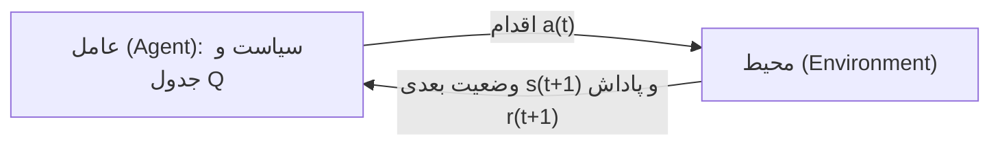

# جلسه ۱۹: یادگیری تقویتی و Q-learning

> **درس:** مقدمه‌ای بر هوش مصنوعی و کاربرد آن در مهندسی پزشکی
> **مدت پیشنهادی:** ۶۰ تا ۹۰ دقیقه · **سطح:** مقدماتی
> **منابع این جلسه:** منبع ۱ (Russell & Norvig, 2016)، منبع ۱۱ (محتوای مدرس)

---

## اهداف جلسه
در پایان این جلسه دانشجو می‌تواند:
1. حلقه‌ی عامل–محیط (Agent–Environment) در یادگیری تقویتی را رسم کند و نقش پاداش (Reward) را توضیح دهد.
2. تفاوت «یادگیری تقویتی» با «برنامه‌ریزی روی MDP» جلسه قبل را بگوید.
3. قانون به‌روزرسانی Q-learning را بنویسد و نقش $\alpha$ و $\gamma$ را در آن توضیح دهد.
4. مسئله‌ی اکتشاف در برابر بهره‌برداری (Exploration/Exploitation) و راه‌حل $\epsilon$-greedy را شرح دهد.

---

## ۱. یادگیری تقویتی: یادگیری از پاداش، نه از نقشه

در جلسه قبل (MDP) ماتریس انتقال و تابع پاداش را **به‌طور کامل می‌دانستیم** و فقط بهترین سیاست را محاسبه می‌کردیم. در یادگیری تقویتی (Reinforcement Learning) فرض ما برعکس است: **مدل محیط را نمی‌دانیم**؛ عامل باید با انجام اقدام، مشاهده‌ی نتیجه و دریافت پاداش، خودش سیاست خوب را کشف کند.

حلقه‌ی اصلی یادگیری تقویتی:



| جزء | نقش | مثال جلسه امروز |
|---|---|---|
| وضعیت (State) | جایی که عامل هست | خانه‌ی $(r,c)$ روی شبکه |
| اقدام (Action) | انتخاب عامل | بالا/پایین/چپ/راست |
| پاداش (Reward) | بازخورد عددی محیط | $-1$ هر گام، هدف $+10$ (خالص گام آخر $+9$)، جریمه‌ی اتاق آلوده $-6$ |
| سیاست (Policy) | نگاشت وضعیت به اقدام | جدول $Q$ و اقدامِ با بیشترین ارزش |

> [!NOTE]
> وجه مشترک هر دو جلسه، همان چهار قلم MDP (وضعیت، اقدام، انتقال، پاداش) است. تفاوت در «چه‌کسی مدل انتقال را می‌داند»: در برنامه‌ریزی مدل داده می‌شود، در یادگیری از تجربه تخمین زده می‌شود.

## ۲. Q-learning و قانون به‌روزرسانی

ایده‌ی مرکزی: به‌جای ارزش وضعیت $V(s)$ (جلسه ۱۸)، ارزش **جفت وضعیت–اقدام** را نگه می‌داریم: $Q(s,a)$ یعنی «برآورد مجموع پاداش‌های آینده اگر در $s$ باشم، $a$ را انجام دهم و بعد درست رفتار کنم». جدول $Q$ مثل یک دفترچه‌ی امتیاز است که عامل هربار تجربه‌ی تازه را با آن ثبت می‌کند:

$$Q(s,a) \leftarrow Q(s,a) + \alpha\left[\,r + \gamma\max_{a'} Q(s',a') - Q(s,a)\,\right]$$

| نماد | نام | نقش | مقدار در کد جلسه |
|---|---|---|---|
| $\alpha$ | نرخ یادگیری (Learning Rate) | اندازه‌ی گام اصلاح؛ $0$ یعنی هیچ نمی‌آموزد | $0.5$ |
| $\gamma$ | ضریب تنزیل (Discount Factor) | وزن آینده نسبت به اکنون؛ نزدیک $1$ یعنی دوراندیش | $0.9$ |
| $r$ | پاداش لحظه‌ای | بازخورد محیط | گام عادی $-1$؛ ورود به اتاق آلوده $-7$؛ گام هدف $+9$ |
| $\max_{a'} Q(s',a')$ | بهترین آینده‌ی تخمینی | تعقیب هدف از وضعیت بعد | از جدول $Q$ |

عبارت داخل کروشه «خطای تفاضل زمانی» (Temporal Difference Error) نام دارد: فاصله‌ی آنچه انتظار داشتی و آنچه دیدی. $\alpha$ تعیین می‌کند چه کسرى از این خطا به جدول اعمال شود؛ با $\alpha = 0.5$ یعنی «میانگین‌گیریِ نصف‌به‌نصف تجربه‌ی قدیمی و تازه».

## ۳. اکتشاف یا بهره‌برداری؟ نقش $\epsilon$-greedy و شهود همگرایی

عاملی که همیشه بهترین اقدام شناخته‌شده را انتخاب کند (بهره‌برداری — Exploitation) ممکن است هرگز مسیرهای بهتر را ندیده باشد. عاملی که همیشه تصادفی حرکت کند (اکتشاف — Exploration) هیچ‌وقت از آموخته‌هایش استفاده نمی‌کند. راه‌حل کلاسیک، سیاست $\epsilon$-greedy است:

- با احتمال $\epsilon$: اقدام **تصادفی** (اکتشاف)؛
- با احتمال $1-\epsilon$: اقدام با بیشترین $Q$ (بهره‌برداری).

در کد این جلسه $\epsilon$ با شماره‌ی قسمت (Episode) کم می‌شود: $\epsilon_{\text{ep}} = \max(0.05,\ 0.99^{\text{ep}})$ با شمارش قسمت‌ها از صفر (پس قسمت اول $\epsilon = 1.00$)؛ یعنی اول زیاد گردش کن، آخر کار روی آموخته‌ها برو. همگرایی Q-learning شهوداً همین است: هر جفت $(s,a)$ به اندازه‌ی کافی تکرار شود، برآورد $Q$ به سمت مقدار درست (مجموع تنزیل‌شده‌ی پاداش‌های واقعی) فشرده می‌شود و سیاست حریصانه‌ی نهایی به سیاست بهینه نزدیک می‌گردد.

> [!WARNING]
> اگر $\epsilon$ هیچ‌وقت به صفر نزدیک نشود، جدول $Q$ پرغوغا می‌ماند و سیاست نهایی نوسانی است؛ اگر $\epsilon$ خیلی زود صفر شود، عامل در مسیر نادرستی که اول تصادفی یافت گیر می‌کند. تعادل این دو، یکی از مهارت‌های اصلی کار عملی با یادگیری تقویتی است.

---

## 🔬 پیوند با مهندسی پزشکی

**برنامه‌ی تمرین توانبخشیِ تطبیقی (مثال آموزشی):** دستگاه تمرین خانگی برای بیمار پس از جراحی زانو باید تعیین کند روز بعد کدام تمرین را پیشنهاد دهد. اینجا «عامل» برنامه‌ریز تمرین، «اقدام» انتخاب بین چند تمرین، «وضعیت» سابقه‌ی عملکرد بیمار و «پاداش» میزان همراهی و پیشرفت تمرینی است (نه هیچ شاخص تشخیصی). با $\epsilon$-greedy دستگاه گاهی تمرین جدیدی امتحان می‌کند تا تمرینی را پیدا کند که بیمار بیشترین ادامه‌دهندگی را دارد؛ با تکرار، توالی تمرین‌ها شخصی می‌شود.

> [!NOTE]
> این مثال آموزشی است. کاربردهای واقعی یادگیری تقویتی در حوزه‌ی سلامت (مثل تنظیم دوز درمان) به داده‌ی فراوان، نظارت بالینی و چارچوب ایمنی نیاز دارند و خروجی این جلسه هیچ کاربرد تشخیصی یا تصمیم بالینی ندارد.

## ✍️ فعالیت کلاسی

### فعالیت ۱: ردیابی دستی یک به‌روزرسانی — و یک دام
عامل در خانه‌ی $(4,2)$ است و اقدام «پایین» را انتخاب می‌کند. به قاعده‌ی انتقال کد دقت کنید: خانه‌ی جنوبیِ $(4,2)$ یعنی $(5,2)$ خارج از شبکه است و طبق همین قاعده، حرکت به دیوار/لبه یعنی **ماندن درجا** با همان هزینه‌ی گام. ردیف $Q(4,2)$ در جدول همگراشده‌ی اجرای واقعی (به ترتیب UP/DOWN/LEFT/RIGHT) برابر $(3.85,\ 5.39,\ 3.85,\ 7.10)$ است و بیشینه‌ی سطر خانه‌ی $(4,3)$ برابر $9.00$. پاداش گام $r = -1$، فراپارامترها $\alpha = 0.5$ و $\gamma = 0.9$.

1. عامل پس از این گام در کدام خانه است و چه پاداشی می‌گیرد؟
2. هدف (Target) به‌روزرسانی $Q(4,2,\text{DOWN})$ را حساب کنید. (دام: عدد $9.00$ اینجا به‌کار نمی‌آید!)
3. مقدار جدید $Q(4,2,\text{DOWN})$ را حساب کنید؛ آیا این به‌روزرسانی جدول را تغییر می‌دهد؟ اگر همین به‌روزرسانی در آغاز تمرین رخ می‌داد (وقتی جدول هنوز تمام صفر بود)، مقدار جدید چه می‌شد؟

<details>
<summary>کلید پاسخ فعالیت ۱ (نمونه)</summary>

۱. «پایین» از $(4,2)$ به سمت $(5,2)$ می‌رود که خارج از شبکه است؛ پس محیط عامل را در $(4,2)$ نگه می‌دارد (حلقه‌ی درجا) و عامل فقط پاداش $-1$ می‌گیرد. از این خانه فقط «راست» به $(4,3)$ می‌رسد.

۲. چون وضعیت بعدی همان $(4,2)$ است، بیشینه باید روی سطر همین خانه گرفته شود، نه سطر خانه‌ی بعدی:

$$\text{target} = r + \gamma \max_{a'} Q((4,2),a') = -1 + 0.9 \times \max(3.85, 5.39, 3.85, 7.10) = -1 + 0.9 \times 7.10 = 5.39$$

دام همین‌جاست: اگر $9.00$ (بیشینه‌ی خانه‌ی $(4,3)$) را به‌کار ببرید و به $7.10$ برسید، هدفِ اقدام «راست» را حساب کرده‌اید، نه «پایین» را؛ عاملِ انجام‌دهنده‌ی «پایین» هرگز به $(4,3)$ نمی‌رود.

۳. $Q_{t+1} = 5.39 + 0.5 \times (5.39 - 5.39) = 5.39$ — به‌روزرسانی جدول را تکان نمی‌دهد و این اتفاقی نیست: نقطه‌ی تعادل این اقدام دقیقاً $-1 + 0.9 \times 7.10 = 5.39$ است (و $7.10$ خودش $-1 + 0.9 \times 9.00$ است). جدول همگرا نقطه‌ی ثابت قانون به‌روزرسانی است؛ این همان معنای همگرایی Q-learning است. در مقابل، اگر همین به‌روزرسانی در آغاز تمرین رخ می‌داد و جدول هنوز تمام‌صفر بود، آن‌گاه $\max_{a'} Q((4,2),a') = 0$ و هدف برابر $r = -1$ می‌شد؛ پس مقدار جدید $0 + 0.5 \times (-1 - 0) = -0.5$ می‌شد: هر تجربه جدول را به سمت هدفِ همان لحظه می‌کشد و تنها وقتی خودِ مقدار به هدفش برسد، دیگر تغییری نمی‌کند. پیام: در محیط‌های دیواری، «پایین» ممکن است یک گام به جلو نباشد؛ هدفِ هر اقدام را باید با وضعیت بعدیِ واقعیِ همان اقدام حساب کرد.

</details>

### فعالیت ۲: پاداش را جابه‌جا کن
۱. اگر جریمه‌ی اتاق آلوده را صفر کنیم، به‌نظر شما سیاست آموخته‌شده چه تغییری می‌کند؟ حدس بزنید، بعد در تکلیف با اجرای کد بررسی کنید.

۲. با $\gamma = 0$ عامل چه چیزی را بهینه می‌کند؟ با $\gamma = 0.9$ چه؟

<details>
<summary>کلید پاسخ فعالیت ۲ (نمونه)</summary>

۱. دیگر دلیلی برای دورزدن اتاق آلوده نیست؛ هر مسیر ۸ گامه خوب است و کد عملاً مسیری پیدا می‌کند که از خود اتاق آلوده عبور می‌کند (در کلید تکلیف، خروجی واقعی را می‌بینید).

۲. با $\gamma = 0$ فقط پاداش همین یک گام مهم است؛ عامل «کودکانه» رفتار می‌کند و اثر هدف (پاداش بزرگ آخر مسیر) دیده نمی‌شود. با $\gamma$ نزدیک $1$، زنجیره‌ی پاداش از هدف به عقب منتشر می‌شود و پاداش $+10$ در خانه‌های دورتر هم اثر می‌گذارد.

</details>

## 💻 کد آموزشی
فایل `code/session_19_q_learning.py` (فقط کتابخانه‌ی استاندارد، `random` با seed ثابت):

```bash
python3 code/session_19_q_learning.py
```

این اسکریپت:
1. شبکه‌ی ۵×۵ «رسیدن به اتاق تجهیزات» را می‌سازد: شروع $(0,0)$، هدف $(4,4)$، سه اتاق بسته و اتاق آلوده $(2,3)$ با جریمه $-6$.
2. Q-learning جدولی را با $\alpha = 0.5$ و $\gamma = 0.9$ و ۴۰۰ قسمت اجرا می‌کند؛ $\epsilon$ از $1.00$ با ضریب $0.99$ تا $0.05$ کم می‌شود.
3. انتقال محیط قطعی است؛ حرکت به دیوار یعنی ماندن درجا با همان هزینه‌ی گام.
4. جدول $Q$ نهایی و سیاست حریصانه را به‌صورت نقشه چاپ می‌کند و خودآزمایی می‌کند.
5. برای تکرارپذیری، seed به‌ازای **هر قسمت** ساخته می‌شود (`SEED_BASE + ep`)؛ پس نتیجه به ترتیب اجرای توابع بستگی ندارد.

سیاست آموخته‌شده در اجرای واقعی (`!` اتاق آلوده، `#` دیوار):

```text
      c0  c1  c2  c3  c4
r0   S  >  v  v  v
r1   v  #  v  >  v
r2   v  #  v  !  v
r3   >  >  v  #  v
r4   >  >  >  >  G
```

اجرای سیاست حریصانه از $(0,0)$:

```text
(0,0) → (0,1) → (0,2) → (1,2) → (2,2) → (3,2) → (4,2) → (4,3) → (4,4)
طول مسیر: ۸ گام، مجموع پاداش: +2.0
```

مشاهده‌های مهم از جدول $Q$ (اجرای واقعی):

| وضعیت | UP | DOWN | LEFT | RIGHT | تفسیر |
|---|---|---|---|---|---|
| $(0,0)$ شروع | $-1.82$ | $-0.91$ | $-1.82$ | $-0.91$ | پایین و راست تقریباً برابرند (هر دو به مسیر بهینه می‌رسند) |
| $(3,4)$ کنار هدف | $5.38$ | $9.00$ | $7.10$ | $7.10$ | $Q = 9.00$ یعنی $-1 + 10$ در یک گام |
| $(2,3)$ اتاق آلوده | $2.44$ | $-2.16$ | $2.46$ | $5.39$ | بهترین اقدام از داخل جریمه، فرار به راست است! |

> [!TIP]
> به ستون مقادیر نگاه کنید: از هدف به عقب، مقادیر دقیقاً زنجیره‌ی $9.00, 7.10, 5.39, 3.85, 2.47, 1.22, 0.10, -0.91$ را می‌سازند. این همان انتشار پاداش از هدف به عقب در طول تمرین است.

## 📘 واژه‌نامه

| واژه | معنی |
|---|---|
| Reinforcement Learning | یادگیری تقویتی؛ یادگیری سیاست از پاداش و جریمه |
| Agent / Environment | عامل / محیط؛ دو طرف حلقه‌ی تعامل |
| Reward | پاداش؛ بازخورد عددی محیط بعد از هر اقدام |
| Episode | قسمت؛ یک دوره‌ی کامل از شروع تا پایان (هدف یا سقف گام) |
| Q-value | ارزش جفت وضعیت–اقدام؛ برآورد مجموع پاداش آینده |
| TD Error | خطای تفاضل زمانی (Temporal Difference Error)؛ فاصله‌ی برآورد قبلی از تجربه‌ی تازه |
| $\epsilon$-greedy | سیاست مخلوط: با احتمال $\epsilon$ تصادفی، وگرنه بهترین اقدام |
| Convergence | همگرایی؛ نزدیک شدن $Q$ به مقادیر درست با تکرار کافی |

## ❓ پرسش‌های خودآزمون
1. سه مؤلفه‌ی حلقه‌ی یادگیری تقویتی را نام ببرید و بگویید در مثال شبکه‌ی بیمارستان هر کدام چه چیزی است.
2. جلسه قبل با value iteration برنامه‌ریزی کردیم؛ همین‌جا Q-learning یاد گرفتیم. از نظر «دانستن مدل انتقال» تفاوت در چیست؟
3. در قانون به‌روزرسانی، اگر $\alpha = 1$ چه می‌شود؟ اگر $\gamma = 0$ چه چیزی از دست می‌رود؟
4. چرا $\epsilon$ را به‌کلی صفر نمی‌کنیم و به‌جایش با گذشت زمان کم می‌کنیم؟

> کلید پاسخ‌ها در بخش «راهنمای مدرس» انتهای فایل آمده است.

## 📝 تکلیف
1. در `code/session_19_q_learning.py` مقدار `HAZARD_PENALTY` را از `-6.0` به `0.0` تغییر دهید و اسکریپت را اجرا کنید. مسیر حریصانه‌ی جدید چیست؟ آیا هنوز ۸ گام است؟ نتیجه را با جدول بخش «کد آموزشی» مقایسه و در دو جمله تحلیل کنید.
2. حالا `GAMMA` را از `0.9` به `0.5` تغییر دهید (و جریمه را به `-6.0` برگردانید). مسیر حریصانه و مقادیر $Q$ در شروع چه می‌شوند؟ آیا عامل هنوز به هدف می‌رسد؟ در یک جدول کوتاه نتیجه‌ی دو اجرا را گزارش کنید.

## 📚 مطالعه پیشنهادی
- Russell & Norvig (2016)، فصل ۲۱: یادگیری تقویتی (بخش Q-learning)
- مرور جلسه ۱۸: MDP، معادله‌ی بلمن و value iteration برای مقایسه‌ی برنامه‌ریزی و یادگیری

---

## 🧭 راهنمای مدرس (از این عنوان تا انتها در نسخه دانشجو حذف شود)

**زمان‌بندی پیشنهادی برای ۹۰ دقیقه:** مرور جلسه ۱۸ و جایگاه یادگیری تقویتی (۱۰) | حلقه‌ی عامل–محیط و پاداش (۱۵) | قانون به‌روزرسانی Q و مثال عددی (۲۰) | اکتشاف/بهره‌برداری و $\epsilon$-greedy (۱۵) | اجرای کد و تحلیل جدول $Q$ و سیاست (۱۵) | فعالیت‌های ۱ و ۲ (۱۰) | جمع‌بندی (۵)

**نسخه ۶۰ دقیقه‌ای:** حلقه‌ی عامل–محیط با دیاگرام (۱۲)، قانون به‌روزرسانی با مثال عددی فعالیت ۱ (۱۸)، $\epsilon$-greedy و شهود همگرایی (۱۲)، جدول مقایسه و سیاست آموخته‌شده از خروجی کد (۱۲)، فعالیت ۲ به‌صورت شفاهی (۴)، جمع‌بندی و تکلیف (۲).

**نکات:**
- تفاوت با جلسه ۱۸ را زودتر روشن کنید: آنجا ماتریس انتقال «ورودی» بود، اینجا فقط تجربه‌ی $(s, a, r, s')$ داریم.
- زنجیره‌ی $9.00 \to 7.10 \to 5.39 \to \dots$ را روی تخته بنویسید؛ فرمول بسته‌اش برای مسیر بهینه با فاصله‌ی $d$ گام: $V_d = -10 + 19 \times 0.9^{d-1}$. عامل وقتی مفهوم «انتشار ارزش» را با این اعداد ملموس می‌کند.
- نکته‌ی بحث‌برانگیز خوشمزه است: در $(2,3)$ بهترین اقدام «فرار به راست» است؛ یعنی جدول $Q$ حتی برای وضعیت‌های بد هم می‌گوید از کجا کم‌ضررتر خارج شوی.
- تساوی‌های تقریبی ($-0.91$ در برابر $-0.91$ در شروع) فرصت خوبی است برای گفتن اینکه کد نخستین بیشینه را برمی‌دارد و اختلاف واقعی این دو (حدود $6 \times 10^{-5}$) فقط از نویز تمرین است.
- تأکید کنید «بهینه بودن مسیر» را ما نمی‌گوییم؛ عامل فقط مجموع پاداش را بالا برده و همین به مسیر ۸ گامه رسیده است.

**خروجی مورد انتظار جلسه:** دانشجو بتواند یک به‌روزرسانی $Q$ را عددی انجام دهد، تفاوت یادگیری و برنامه‌ریزی را بیان کند و از جدول $Q$ سیاست را بخواند.

**نکته فنی درباره کد:**
- seed هر قسمت مستقل است (`random.Random(SEED_BASE + ep)`) و $\epsilon$ فقط تابع شماره‌ی قسمت؛ خروجی تکرارپذیر و مستقل از ترتیب اجراست. اگر seed یک‌بار در ابتدای برنامه گرفته می‌شد، جابه‌جایی فراخوانی توابع خروجی را عوض می‌کرد — خطای رایج در تکرارپذیری.
- تساوی‌ها در `greedy_policy` با ترتیب ثابت اقدام‌ها (بالا، پایین، چپ، راست) حل می‌شوند.
- خودآزمایی انتهای اسکریپت: مسیر ۸ گامه، بدون اتاق آلوده (وقتی جریمه فعال است)، مجموع پاداش $+2$، و قاعده‌ی انتقال فعالیت ۱ («پایین» از $(4,2)$ حلقه‌ی درجاست، «راست» به $(4,3)$ می‌رسد).

### کلید پاسخ تکلیف (اجرای واقعی کد)

<details>
<summary>نمایش کلید پاسخ تکلیف</summary>

۱. با `HAZARD_PENALTY = 0.0`:
- مسیر حریصانه: `(0,0) → (0,1) → (0,2) → (1,2) → (2,2) → (2,3) → (2,4) → (3,4) → (4,4)` — دقیقاً از اتاق آلوده عبور می‌کند.
- هنوز ۸ گام است و مجموع پاداش $+2.0$؛ چون بدون جریمه، عبور از آنجا هم همان هزینه‌ی گام عادی را دارد و همه‌ی مسیرهای ۸ گامه هم‌ارزند. نتیجه: «سیاستِ اخلاقی یا ایمن» فقط با پاداش/جریمه شکل می‌گیرد، نه با چیزی دیگر.

۲. با `GAMMA = 0.5` (و جریمه $-6$ برگشته):
- مسیر حریصانه: `(0,0) → (1,0) → (2,0) → (3,0) → (3,1) → (3,2) → (4,2) → (4,3) → (4,4)` — باز هم ۸ گام و $+2.0$، اما این‌بار از ستون ۰ (مسیر بهینه‌ی دیگری از میان مسیرهای هم‌ارز).
- مقادیر $Q$ در شروع: UP = $-1.96$، DOWN = $-1.91$، LEFT = $-1.96$، RIGHT = $-1.91$ (به‌جای $-0.91$ در $\gamma = 0.9$)؛ با تنزیل شدیدتر، پاداش دورترِ هدف کمتر به نقاط دور می‌رسد: فرمول می‌شود $V_d = -2 + 11 \times 0.5^{d-1}$.
- نکته: عامل هنوز هدف را می‌یابد، اما «فرق مقدار» مسیرها کمتر به چشم می‌آید و جدول $Q$ دیرتر متمایز می‌شود.

</details>

### کلید پاسخ پرسش‌های خودآزمون

<details>
<summary>نمایش کلید پاسخ</summary>

۱. عامل (تکنسین/برنامه‌ی تمرین)، محیط (شبکه‌ی طبقه/دستگاه تمرین)، پاداش (جریمه‌ی گام و پاداش هدف/میزان همراهی بیمار). عامل سیاست را یاد می‌گیرد، محیط وضعیت بعد و پاداش را می‌دهد.
۲. در برنامه‌ریزی، ماتریس انتقال و پاداش‌ها از قبل داده‌شده‌اند و الگوریتم روی آن محاسبه می‌کند؛ در Q-learning مدل نداریم و $Q$ فقط از تجربه‌های واقعی $(s, a, r, s')$ به‌روز می‌شود.
۳. با $\alpha = 1$ هر تجربه‌ی تازه مقدار قبلی را کامل جایگزین می‌کند (حافظه‌ی نمی‌مانَد و جدول نسبت به نویز حساس می‌شود). با $\gamma = 0$ فقط پاداش گام جاری مهم است و اثر هدفِ دور (و طویل‌مدت) از بین می‌رود.
۴. چون لازم است عامل همیشه کمی گزینه‌های کم‌تجربه را هم امتحان کند تا مطمئن شود بهترین را از دست نداده؛ اما برای رسیدن به سیاست پایدار، دوز اکتشاف باید با گذشت زمان کم شود (اینجا $\epsilon_{\text{ep}} = \max(0.05,\ 0.99^{\text{ep}})$ با شمارش قسمت‌ها از صفر).

</details>
