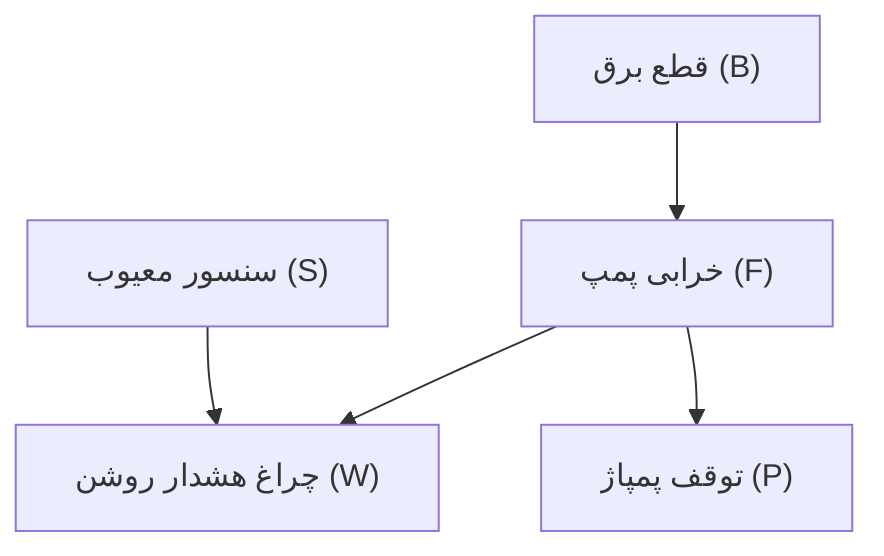

# جلسه ۲۰: شبکه‌های بیزین و مدل‌های مارکوف

> **درس:** مقدمه‌ای بر هوش مصنوعی و کاربرد آن در مهندسی پزشکی
> **مدت پیشنهادی:** ۶۰ تا ۹۰ دقیقه · **سطح:** مقدماتی
> **منابع این جلسه:** منبع ۱ (Russell & Norvig, 2016)، منبع ۲ (Erickson, 2021)، منبع ۱۱ (محتوای مدرس)

---

## اهداف جلسه
در پایان این جلسه دانشجو می‌تواند:
1. احتمال شرطی (Conditional Probability) و قاعده‌ی بیز را روی یک مسئله‌ی عددی به‌کار ببرد.
2. ساختار شبکه‌ی بیزین (DAG و جدول احتمال شرطی) را بخواند و استقلال شرطی را در آن تشخیص دهد.
3. ویژگی مارکوف و مفهوم توزیع مانا (Stationary Distribution) را توضیح دهد.
4. الگوریتم پیش‌رو (Forward Algorithm) را برای به‌روزرسانی باور در مدل پنهان مارکوف اجرا کند.

---

## ۱. احتمال شرطی و قاعده‌ی بیز

احتمال شرطی یعنی احتمال یک رویداد **با دانستن** یک شاهد: $P(A \mid B)$ می‌گوید «احتمال $A$ به شرطی که $B$ را دیده‌ایم». قاعده‌ی بیز (Bayes' Rule) دو جهت این شرطی را به هم وصل می‌کند:

$$P(A \mid B) = \frac{P(B \mid A)\,P(A)}{P(B)}$$

| مؤلفه | نام | در مثال غربالگری |
|---|---|---|
| $P(A)$ | پیشین (Prior) | شیوع بیماری قبل از آزمون: $1/100$ |
| $P(B \mid A)$ | آهنگ درستی (Likelihood) | حساسیت آزمون: $9/10$ |
| $P(B)$ | شاهد (Evidence) | احتمال کل مثبت شدن آزمون |
| $P(A \mid B)$ | پسین (Posterior) | احتمال بیماری **به‌شرط** مثبت بودن آزمون |

با عددهای واقعی کد این جلسه (حساسیت $9/10$، نرخ مثبت کاذب $1/10$):

$$P(+) = \frac{9}{10} \cdot \frac{1}{100} + \frac{1}{10} \cdot \frac{99}{100} = \frac{27}{250} \approx 0.1080$$

$$P(D \mid +) = \frac{\frac{9}{10} \cdot \frac{1}{100}}{\frac{27}{250}} = \frac{1}{12} \approx 0.0833$$

تنها ۸.۳٪! این همان «پارادوکس پایه‌ی نرخ» (Base-Rate Paradox) است: وقتی بیماری کم‌شیوع است، حتی آزمون خوب هم مثبت‌های کاذب زیادی تولید می‌کند؛ برای همین پیشین اهمیت دارد. اگر **دومین آزمون مستقل** هم مثبت شود، پسین دیروز پیشین امروز می‌شود و کد نشان می‌دهد:

| مرحله | پسین $P(D \mid +)$ |
|---|---|
| بعد از آزمون ۱ | $\frac{1}{12} \approx 0.0833$ |
| بعد از آزمون ۲ | $\frac{9}{20} = 0.4500$ |

> [!NOTE]
> قاعده‌ی بیز یک «ماشین به‌روزرسانی باور» است: ورودی‌اش پیشین و شاهد تازه، خروجی‌اش پسین. هر شاهد جدید، خروجی قبلی را به‌عنوان پیشین مصرف می‌کند — همین ایده در ادامه با HMM دوباره ظاهر می‌شود.

## ۲. شبکه‌های بیزین: گراف دانش + احتمال

محاسبه‌ی مفصل همه‌ی متغیرها بیدردسر نیست؛ شبکه‌ی بیزین (Bayesian Network) کار را مرتب می‌کند: یک گراف جهت‌دار بدون دور (DAG) که هر گره یک متغیر تصادفی است و هر یال رابطه‌ی علّی مستقیم را نشان می‌دهد. به‌ازای هر گره یک **جدول احتمال شرطی** (CPT) داریم: احتمال هر حالت آن گره با در نظر گرفتن والدینش.

مثال آموزشی: خطایابی سامانه‌ی تزریق مواد به دستگاه آزمایشگاهی.



CPTهای این شبکه (اعداد فرضی):

| والد/والدین | حالت | احتمال |
|---|---|---|
| $F \mid B$ | بله | $0.30$ |
| $F \mid \lnot B$ | بله | $0.05$ |
| $W \mid F, S$ | روشن | $0.98$ |
| $W \mid F, \lnot S$ | روشن | $0.90$ |
| $W \mid \lnot F, S$ | روشن | $0.60$ |
| $W \mid \lnot F, \lnot S$ | روشن | $0.05$ |
| $P \mid F$ | بله (توقف پمپاژ) | $0.85$ |
| $P \mid \lnot F$ | بله (توقف پمپاژ) | $0.02$ |

سه نکته‌ی کلیدی:
1. **تجزیه:** احتمال مشترک حاصل‌ضرب CPTها می‌شود: $P(B, F, S, W, P) = P(B)P(S)P(F \mid B)P(W \mid F, S)P(P \mid F)$ — به‌جای جدول عظیم مشترک.
2. **استقلال شرطی (Conditional Independence):** با دانستن حالت پمپ $F$، چراغ هشدار دیگر به قطع برق بستگی ندارد؛ اثر $B$ بر $W$ از مسیر $F$ می‌گذرد. این همان دلیلی است که شبکه کوچک می‌ماند.
3. **استدلال در هر دو جهت:** همان‌طور که از علل به نشانه‌ها می‌رویم، با قاعده‌ی بیز از نشانه‌ها به علل برمی‌گردیم (تشخیص علت روشن بودن هشدار).

## ۳. مدل‌های مارکوف و مدل پنهان مارکوف (HMM)

زنجیره‌ی مارکوف (Markov Chain) سری زمانیِ وضعیت‌هاست با یک فرض ساده:

$$P(X_{t+1} \mid X_t, X_{t-1}, \dots, X_1) = P(X_{t+1} \mid X_t)$$

آینده فقط به حالت فعلی بستگی دارد، نه کل تاریخچه (ویژگی مارکوف). مثال کد این جلسه: وضعیت دستگاه «سالم» یا «در حال خرابی» با ماتریس انتقال $\begin{pmatrix} 0.9 & 0.1 \\ 0.3 & 0.7 \end{pmatrix}$ و شروع از $P(\text{OK}) = 0.8$. برای اختصار در فرمول‌های این بخش: $\text{OK}$ یعنی «سالم»، $\text{BAD}$ یعنی «در حال خرابی»، $\text{Hot}$ یعنی مشاهده‌ی «داغ» و $\text{Norm}$ یعنی «عادی». اجرای واقعی:

| گام | $P(\text{OK})$ | $P(\text{BAD})$ |
|---|---|---|
| ۱ | ۰.۷۸۰۰ | ۰.۲۲۰۰ |
| ۲ | ۰.۷۶۸۰ | ۰.۲۳۲۰ |
| ۳ | ۰.۷۶۰۸ | ۰.۲۳۹۲ |
| ۱۰ | ۰.۷۵۰۳ | ۰.۲۴۹۷ |
| ۳۰ | ۰.۷۵۰۰ | ۰.۲۵۰۰ |

توزیع به $(0.75, 0.25)$ می‌رسد و دیگر تغییر نمی‌کند: **توزیع مانا**. حالت اولیه «فراموش» می‌شود؛ احتمال بلندمدت به ساختار انتقال بستگی دارد نه به نقطه‌ی شروع.

اما در دنیای واقعی اغلب حالت را مستقیم نمی‌بینیم؛ فقط نشانه‌ای از آن را می‌بینیم. مدل پنهان مارکوف (Hidden Markov Model) دو لایه دارد: حالت پنهان (سالم/خراب) و مشاهده (دمای موتور: داغ/عادی). الگوریتم پیش‌رو باور را گام‌به‌گام به‌روز می‌کند:

$$\alpha_t(j) = b_j(o_t) \sum_i \alpha_{t-1}(i)\, a_{ij}$$

یعنی: پیش‌بینی با انتقال ($\sum_i \alpha_{t-1}(i)a_{ij}$) و بعد تصحیح با مشاهده ($b_j(o_t)$)، سپس نرمال‌سازی. اجرای واقعی کد با دنباله‌ی «داغ، داغ، عادی»:

| بعد از مشاهده | $P(\text{OK})$ | $P(\text{BAD})$ |
|---|---|---|
| «داغ» | ۰.۵۳۳۳ | ۰.۴۶۶۷ |
| «داغ» | ۰.۳۱۷۹ | ۰.۶۸۲۱ |
| «عادی» | ۰.۷۱۹۹ | ۰.۲۸۰۱ |

> [!NOTE]
> به ارتباط ساختاری دقت کنید: هر گام الگوریتم پیش‌رو یک قاعده‌ی بیز است — پیشینِ امروز همان پسینِ دیروز است و مشاهده‌ی جدید آن را تصحیح می‌کند. HMM یعنی «بیزِ تکرارشونده روی زنجیره‌ی مارکوف».

---

## 🔬 پیوند با مهندسی پزشکی

**پایش وضعیت تجهیزات آزمایشگاهی (مثال آموزشی):** سانتریفیوژ یا پمپِ دستگاه دیالیز ساعت‌ها کار می‌کند و فقط سنسورهای سطحی (دما، لرزش) در دسترس است. مدل HMM همین جلسه می‌تواند باور «سالم بودن» را پس از هر خواندنِ دما به‌روز کند و به کاربر زودتر از خرابی کامل هشدار پیشگیرانه بدهد. همچنین پارادوکس پایه‌ی نرخ، درسی برای هر برنامه‌ی غربالگری آموزشی است: با شیوع کم، تفسیر آزمون مثبت بدون پیشین بی‌معناست.

> [!WARNING]
> همه‌ی اعداد این جلسه ساختگی و آموزشی‌اند؛ طراحی و تفسیر هیچ آزمون تشخیصی واقعی به اعتبارسنجی بالینی، جمعیت مرجع و پروتکل رسمی نیاز دارد و کاربرد تشخیصی ندارد.

## ✍️ فعالیت کلاسی

### فعالیت ۱: یک گام الگوریتم پیش‌رو به‌صورت دستی
توزیع اولیه $P(\text{OK}) = 0.8$ است و نخستین مشاهده «داغ» ($\text{Hot}$) است. از جدول انتشار: $P(\text{Hot} \mid \text{OK}) = 0.2$ و $P(\text{Hot} \mid \text{BAD}) = 0.7$.

۱. وزن خام هر دو حالت را حساب کنید (پیشین × انتشار).
۲. با نرمال‌سازی، باور بعد از مشاهده را به دست آورید.
۳. نتیجه‌ی خود را با سطر اول جدول بخش ۳ مقایسه کنید.

<details>
<summary>کلید پاسخ فعالیت ۱ (نمونه)</summary>

۱. سالم: $0.8 \times 0.2 = 0.16$؛ خراب: $0.2 \times 0.7 = 0.14$.

۲. جمع = $0.30$؛ پس $P(\text{OK}) = 0.16/0.30 \approx 0.5333$ و $P(\text{BAD}) \approx 0.4667$.

۳. دقیقاً همان سطر اول: «داغ» حتی با وجود اینکه حالت سالم محتمل‌تر بود، باور را تقریباً متوازن کرد.

</details>

### فعالیت ۲: استقلال شرطی در شبکه‌ی بیزین
با CPTهای بخش ۲ و $P(B) = 0.10$ و $P(S) = 0.02$:

۱. $P(F)$ را حساب کنید (قانون تمام احتمال روی والد $B$).
۲. با دانستن $F$، آیا $W$ مستقل از $B$ است؟ چرا؟
۳. احتمال نامشروط روشن بودن هشدار $P(W)$ را با جمع‌کردن چهار حالت $(F,\lnot F) \times (S, \lnot S)$ حساب کنید.

<details>
<summary>کلید پاسخ فعالیت ۲ (نمونه)</summary>

۱. $P(F) = 0.3 \times 0.1 + 0.05 \times 0.9 = 0.03 + 0.045 = 0.075$.

۲. بله؛ با دانستن $F$، حالت $B$ اطلاعات تازه‌ای درباره‌ی $W$ نمی‌دهد (اثر $B$ فقط از مسیر $F$ می‌گذشت). به این می‌گویند استقلال شرطی: $W \perp B \mid F$.

۳. $P(W) = 0.98 \times (0.075 \times 0.02) + 0.90 \times (0.075 \times 0.98) + 0.60 \times (0.925 \times 0.02) + 0.05 \times (0.925 \times 0.98)$
$= 0.00147 + 0.06615 + 0.0111 + 0.045325 \approx 0.124$. یعنی بدون هیچ مشاهده‌ای، حدود ۱۲٪ شانس روشن بودن هشدار وجود دارد.

</details>

## 💻 کد آموزشی
فایل `code/session_20_bayes_markov.py` (فقط کتابخانه‌ی استاندارد، `fractions` برای کسر دقیق):

```bash
python3 code/session_20_bayes_markov.py
```

این اسکریپت:
1. قاعده‌ی بیز را روی مثال غربالگری با کسر دقیق (`Fraction`) حساب می‌کند: $P(D \mid +) = 1/12 \approx 0.0833$.
2. بیز زنجیره‌ای را نشان می‌دهد: پسینِ آزمون اول ($1/12$) پیشینِ آزمون دوم می‌شود و خروجی $9/20 = 0.45$ درمی‌آید.
3. زنجیره‌ی مارکوف دستگاه را ۳۰ گام تکرار می‌کند و توزیع مانا $(0.75, 0.25)$ را چاپ می‌کند.
4. الگوریتم پیش‌رو را روی مشاهده‌های «داغ، داغ، عادی» اجرا و باور هر گام را چاپ می‌کند.
5. در پایان خودآزمایی می‌کند: پسین‌ها و توزیع مانا با فرمول بسته‌ی همین پارامترها و باور نهایی HMM با شمارش کامل توالی‌های حالت مقایسه می‌شوند؛ هیچ عددی در خودآزمایی هاردکد نیست، پس تغییر پارامترها در تکلیف اجرا را نمی‌شکند.

> [!TIP]
> در این اسکریپت هیچ تصادفی وجود ندارد (بیز و پیش‌رو محاسبات قطعی‌اند) و بیز با کسر دقیق محاسبه می‌شود؛ پس $1/12$ و $9/20$ عددهای **دقیق** هستند، نه گردشده.

## 📘 واژه‌نامه

| واژه | معنی |
|---|---|
| Conditional Probability | احتمال شرطی؛ احتمال رویداد با دانستن شاهد |
| Prior / Posterior | پیشین / پسین؛ باور قبل و بعد از دیدن شاهد |
| Likelihood | آهنگ درستی؛ $P(\text{evidence} \mid \text{hypothesis})$ |
| Bayesian Network | شبکه‌ی بیزین؛ DAG از متغیرها همراه با CPT |
| CPT | جدول احتمال شرطی هر گره به‌ازای حالت والدین |
| Conditional Independence | استقلال شرطی؛ بی‌اثر شدن شاهد با دانستن واسطه |
| Markov Chain | زنجیره‌ی مارکوف؛ آینده فقط تابع حالت فعلی |
| Stationary Distribution | توزیع مانا؛ حد بلندمدت توزیع وضعیت |
| HMM | مدل پنهان مارکوف؛ حالت پنهان + مشاهده |
| Forward Algorithm | الگوریتم پیش‌رو؛ به‌روزرسانی باور با هر مشاهده |

## ❓ پرسش‌های خودآزمون
1. چهار مؤلفه‌ی قاعده‌ی بیز (پیشین، آهنگ درستی، شاهد، پسین) را در مثال غربالگری شناسایی کنید.
2. چرا در شبکه‌ی بیزین با دانستن وضعیت پمپ، چراغ هشدار مستقل از قطع برق می‌شود؟
3. ویژگی مارکوف را بنویسید و بگویید چرا توزیع مانا به شرط شروع بستگی ندارد.
4. دو گام الگوریتم پیش‌رو را با اصطلاحات «پیش‌بینی» و «تصحیح» توضیح دهید و بگویید هرکدام با کدام ستون ماتریس کار می‌کنند.

> کلید پاسخ‌ها در بخش «راهنمای مدرس» انتهای فایل آمده است.

## 📝 تکلیف
1. در `code/session_20_bayes_markov.py` مقدار `PRIOR` را از `Fraction(1, 100)` به `Fraction(1, 10)` تغییر دهید (جامعه‌ی پرخطر). $P(+)$ و $P(D \mid +)$ جدید چه می‌شوند؟ و بعد از دو آزمون مثبت؟ این تغییر چه چیزی درباره‌ی نقش پیشین نشان می‌دهد؟ (خودآزمایی اسکریپت انتظارهایش را از خود پارامترها می‌سازد؛ پس این تغییر اجرا را نمی‌شکند.)
2. دنباله‌ی مشاهده‌ی HMM را در ثابت `DEMO_OBS` به `("عادی", "عادی", "داغ")` تغییر دهید. باور پس از هر مشاهده را گزارش کنید و توضیح دهید چرا با یک «داغ» تنها، باور برنمی‌گردد به حالت اول.

## 📚 مطالعه پیشنهادی
- Russell & Norvig (2016)، فصل ۱۳: عدم قطعیت و قاعده‌ی بیز؛ فصل ۱۴: استدلال احتمالاتی و شبکه‌های بیزین
- Erickson و همکاران (2021)، فصل‌های مرتبط با مدل‌های احتمالاتی در پزشکی
- مرور جلسه ۱۷ (سیستم خبره) برای مقایسه‌ی قاعده‌محور و احتمالاتی

---

## 🧭 راهنمای مدرس (از این عنوان تا انتها در نسخه دانشجو حذف شود)

**زمان‌بندی پیشنهادی برای ۹۰ دقیقه:** احتمال شرطی و قاعده‌ی بیز با مثال غربالگری (۲۰) | پارادوکس پایه‌ی نرخ و بیز زنجیره‌ای (۱۰) | شبکه‌ی بیزین: DAG، CPT، استقلال شرطی (۲۰) | زنجیره‌ی مارکوف و توزیع مانا (۱۵) | HMM و الگوریتم پیش‌رو + تحلیل خروجی کد (۱۵) | فعالیت‌های ۱ و ۲ (۵) | جمع‌بندی (۵)

**نسخه ۶۰ دقیقه‌ای:** قاعده‌ی بیز با جدول چهار مؤلفه (۱۵)، پارادوکس پایه‌ی نرخ با عددهای $1/12$ و $9/20$ (۸)، شبکه‌ی بیزین با دیاگرام و دو نکته‌ی تجزیه/استقلال شرطی (۱۵)، زنجیره‌ی مارکوف و مانا از خروجی کد (۱۰)، HMM فقط با گام اول پیش‌رو (۸)، جمع‌بندی و تکلیف (۴). فعالیت ۲ به تکلیف منتقل شود.

**نکات:**
- ضعف رایج دانشجو: خلط $P(B \mid A)$ با $P(A \mid B)$؛ در تخته دو گره بکشید و جهت فلش را عوض کنید تا محسوس شود.
- تمرکز مفهومی شبکه‌ی بیزین را روی «تجزیه‌ی احتمال مشترک» بگذارید؛ CPTها ابزار همین تجزیه‌اند.
- در HMM، هر گام را با دو کلمه‌ی «پیش‌بینی» و «تصحیح» روایت کنید؛ همین دو کلمه بعداً در فیلتر کالمن هم می‌آید.
- مقایسه‌ی جدول زنجیره‌ی مارکوف (بدون مشاهده) و جدول HMM (با مشاهده) عالی است: مشاهده‌ها باور را «شکافته» می‌کنند و باز برمی‌گردانند.
- برای دانشجویان علاقه‌مند: مقایسه‌ی استنتاج دقیق شبکه‌ی بیزین در شبکه‌های بزرگ NP-hard است؛ به همین دلیل روش‌های تقریبی مطرح می‌شود.

**خروجی مورد انتظار جلسه:** دانشجو بتواند یک پسین بیزی را کامل حساب کند، ساختار DAG و استقلال شرطی را بخواند و یک گام پیش‌رو را دستی اجرا کند.

**نکته فنی درباره کد:**
- بیز با `Fraction` دقیق است؛ زنجیره‌ی مارکوف و HMM هم با کسر دقیق کار می‌کنند و فقط موقع چاپ به اعشار تبدیل می‌شوند.
- هیچ تصادفی وجود ندارد؛ پس اجرا تکرارپذیر و مستقل از ترتیب فراخوانی توابع است.
- توزیع مانا با تکرار ۳۰ گامی به $(0.75, 0.25)$ می‌رسد؛ سرعت همگرایی هندسی است (نرخ حدود $0.6$ در گام).

### کلید پاسخ تکلیف (اجرای واقعی کد)

<details>
<summary>نمایش کلید پاسخ تکلیف</summary>

۱. با `PRIOR = Fraction(1, 10)`:
- $P(+) = \frac{9}{50} \approx 0.1800$ و پسین $P(D \mid +) = \frac{1}{2} = 0.5000$.
- بعد از آزمون دوم: $P(D \mid ++) = \frac{9}{10} = 0.9000$.
- درس: با پیشین قوی‌تر (شیوع ۱۰٪ به‌جای ۱٪)، همان آزمون‌ها جهش بسیار بزرگی در باور می‌سازند؛ پایه‌ی نرخ مرز تصمیم است.

۲. با دنباله‌ی `("عادی", "عادی", "داغ")`:
- بعد از «عادی» اول: $P(\text{OK}) = 0.9143$، $P(\text{BAD}) = 0.0857$.
- بعد از «عادی» دوم: $P(\text{OK}) = 0.9373$، $P(\text{BAD}) = 0.0627$.
- بعد از «داغ»: $P(\text{OK}) = 0.6416$، $P(\text{BAD}) = 0.3584$.
- تفسیر: پس از دو «عادی» باور سلامت خیلی بالا رفته بود ($0.94$)؛ یک «داغ» تنها آن را به $0.64$ می‌رساند — یعنی حتی زیر پیشین اولیه‌ی $0.8$، اما نه بحرانی؛ چون پمپ سالم هم گاهی داغ می‌کند ($P(\text{Hot} \mid \text{OK}) = 0.2$). پیام: اثر هر مشاهده به باورِ پیش از آن بستگی دارد.

</details>

### کلید پاسخ پرسش‌های خودآزمون

<details>
<summary>نمایش کلید پاسخ</summary>

۱. پیشین: شیوع $\frac{1}{100}$؛ آهنگ درستی: حساسیت $\frac{9}{10}$؛ شاهد: $P(+) = \frac{27}{250}$؛ پسین: $\frac{1}{12}$.
۲. چون همه‌ی اثر قطع برق روی چراغ از مسیر خرابی پمپ می‌گذرد؛ با دانستن $F$، دانستن $B$ اطلاعات تازه‌ای به $W$ نمی‌افزاید (استقلال شرطی).
۳. $P(X_{t+1} \mid X_t, \dots, X_1) = P(X_{t+1} \mid X_t)$؛ توزیع مانا نقطه‌ی ثابت معادله‌ی انتقال است $\pi = \pi A$؛ تکرار انتقال هر توزیع اولیه‌ای را به آن هدایت می‌کند، پس شرط شروع «فراموش» می‌شود.
۴. پیش‌بینی: باور فعلی را با ماتریس انتقال یک گام جلو می‌برد ($\sum_i \alpha_{t-1}(i)a_{ij}$). تصحیح: نتیجه را با آهنگ انتشار مشاهده ($b_j(o_t)$) وزن می‌دهد و نرمال می‌کند. پیش‌بینی با ستون‌های ماتریس انتقال کار می‌کند و تصحیح با سطرهای ماتریس انتشار.

</details>
