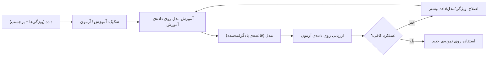
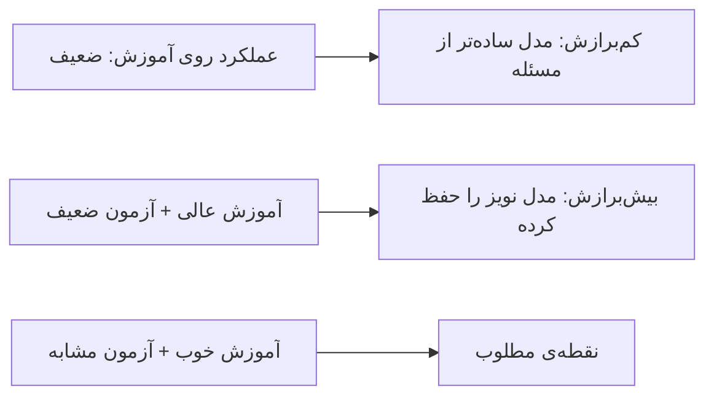

# جلسه ۲۱: مبانی یادگیری ماشین و ارزیابی مدل

> **درس:** مقدمهای بر هوش مصنوعی و کاربرد آن در مهندسی پزشکی
> **مدت پیشنهادی:** ۶۰ تا ۹۰ دقیقه · **سطح:** مقدماتی
> **منابع این جلسه:** منبع ۲ (Erickson, 2021)، منبع ۱۰ (Liu, 2017)، منبع ۱۱ (محتوای مدرس)

---

## اهداف جلسه
در پایان این جلسه دانشجو می‌تواند:
1. مسئله‌ی یادگیری ماشین (Machine Learning) را به‌صورت «یادگیری از داده» صورت‌بندی کند و یادگیری نظارت‌شده (Supervised) و بدون نظارت (Unsupervised) را تمیز دهد.
2. داده را به مفاهیم ویژگی (Feature) و برچسب (Label) و به دو دسته‌ی آموزش (Train) و آزمون (Test) تفکیک کند.
3. بیش‌برازش (Overfitting) و کم‌برازش (Underfitting) را تشخیص دهد و علت آن‌ها را توضیح دهد.
4. ماتریس درهم‌ریختگی (Confusion Matrix) را بخواند و دقت، حساسیت، ویژگی، PPV، NPV و F1 را حساب کند.
5. توضیح دهد چرا در داده‌ی نامتوازن پزشکی، «دقت کل» (Accuracy) به‌تنهایی گمراه‌کننده است.

---

## ۱. یادگیری ماشین یعنی چه؟
تا حالا همه‌ی قاعده‌ها را ما نوشتیم: شرط‌های A*، هیوریستیک‌ها، قواعد سیستم خبره. ایده‌ی مرکزی یادگیری ماشین ساده است: **به‌جای نوشتن قاعده، داده بده و بگذار قاعده از داده دربیاید.**

| رویکرد | چه چیزی می‌دهیم | چه چیزی می‌گیریم | مثال این درس |
|---|---|---|---|
| برنامه‌نویسی سنتی | قاعده + داده | خروجی | کد BFS جلسه ۵ |
| یادگیری ماشین | داده + نمونه‌ی خروجی (برچسب) | قاعده (مدل) | طبقه‌بند تومور جلسه ۲۲ |

> [!NOTE]
> این چرخه را در جلسه ۲۲ با کد واقعی scikit-learn اجرا می‌کنیم؛ امروز منطق و به‌ویژه گام «ارزیابی» را عمیق می‌کنیم.

## ۲. نظارت‌شده، بدون نظارت، ویژگی و برچسب
- **یادگیری نظارت‌شده (Supervised Learning):** هر نمونه یک جواب درست (برچسب) دارد؛ مدل نقشه‌ی ورودی→خروجی را یاد می‌گیرد. دو خانواده: طبقه‌بندی (Classification — برچسب گسسته، مثل «بدخیم/خوش‌خیم») و رگرسیون (Regression — خروجی پیوسته، مثل فشار خون).
- **یادگیری بدون نظارت (Unsupervised Learning):** برچسب نداریم؛ مدل ساختار پنهان را پیدا می‌کند، مثل خوشه‌بندی (Clustering) بیماران با الگوی مشابه.

جدول مثال‌های مهندسی پزشکی (همگی آموزشی و غیرتشخیصی):

| مسئله | نوع | ویژگی‌ها | برچسب |
|---|---|---|---|
| طبقه‌بندی تومور از مشخصات سلول | نظارت‌شده/طبقه‌بندی | اندازه، بافت، همواری | بدخیم / خوش‌خیم |
| پیش‌بینی مدت بستری | نظارت‌شده/رگرسیون | سن، علائم حیاتی، آزمایش‌ها | روز بستری |
| خوشه‌بندی بیماران با پرونده مشابه | بدون نظارت | سن، آزمایش‌ها، داروها | — (خودِ خوشه) |

> [!NOTE]
> مجموعه‌داده‌ی `load_breast_cancer` که در جلسه ۲۲ استفاده می‌کنیم، برای تمرین برنامه‌نویسی است و هرگز مبنای تصمیم بالینی قرار نمی‌گیرد.

## ۳. تفکیک آموزش/آزمون و دو خطای نمونه
اگر مدل را روی همان داده‌ای امتحان کنیم که با آن درس خوانده، مثل امتحانی است که سؤال‌هایش قبلاً لو رفته: نتیجه خوش‌بینانه و بی‌ارزش. پس داده را از قبل دو قسمت می‌کنیم:

| قسمت | سهم رایج | نقش |
|---|---|---|
| آموزش (Train) | حدود ۸۰٪ | تنظیم پارامترهای مدل |
| آزمون (Test) | حدود ۲۰٪ | سنجش نهایی روی نمونه‌های ندیده |

با `random_state` ثابت (مثلاً ۴۲) این تقسیم قطعی و تکرارپذیر می‌شود.

- **کم‌برازش (Underfitting):** مدل خیلی ساده است؛ روی آموزش هم بد است. مثال: برازش یک خط صاف روی داده‌ی منحنی.
- **بیش‌برازش (Overfitting):** مدل جزئیات و نویز داده‌ی آموزش را حفظ کرده؛ روی آموزش عالی، روی آزمون بد.

> [!NOTE]
> فاصله‌ی «آموزش عالی، آزمون ضعیف» همان زنگ خطر بیش‌برازش است؛ در جلسه‌ی شبکه‌های عصبی (جلسه ۲۴) دوباره به آن برمی‌گردیم.

## ۴. ماتریس درهم‌ریختگی
در طبقه‌بندی دوکلاسه، چهار نتیجه ممکن است. با مثال آزمون فرضی یک آزمون‌سنج (صرفاً تمرینی):

| | پیش‌بینی: مثبت | پیش‌بینی: منفی |
|---|---|---|
| **واقعیت: بیمار** | TP = درست مثبت | FN = مثبت کاذب‌گم‌شده |
| **واقعیت: سالم** | FP = هشدار اشتباه | TN = درست منفی |

هر متریک یکی از این خانه‌ها را «مهم» می‌داند. پرسش کلیدی در پزشکی این است: **هزینه‌ی FN (بیمارِ ازدست‌رفته) با هزینه‌ی FP (اضطراب و آزمایش اضافه) برابر نیست.**

## ۵. متریک‌ها و فرمول‌ها
با تعریف $TP$، $FN$، $FP$، $TN$:

$$\text{Accuracy} = \frac{TP + TN}{TP + TN + FP + FN}$$

$$\text{Sensitivity (Recall/TPR)} = \frac{TP}{TP + FN} \qquad \text{Specificity (TNR)} = \frac{TN}{TN + FP}$$

$$\text{Precision (PPV)} = \frac{TP}{TP + FP} \qquad \text{NPV} = \frac{TN}{TN + FN}$$

$$F_1 = \frac{2 \cdot \text{Precision} \cdot \text{Recall}}{\text{Precision} + \text{Recall}}$$

| متریک | به سؤال «…» جواب می‌دهد | از نظر چه کسی مهم است |
|---|---|---|
| Accuracy | چند درصد کل درست پیش‌بینی شد؟ | داده‌ی متوازن |
| Sensitivity | از بیماران، چند نفر را گرفتیم؟ | غربالگری — FN گران است |
| Specificity | از سالم‌ها، چند نفر را درست رد کردیم؟ | جلوگیری از هشدار اشتباه |
| PPV | از مثبت‌ها، چند نفر واقعاً بیمارند؟ | تفسیر نتیجه‌ی مثبت آزمون |
| NPV | از منفی‌ها، چند نفر واقعاً سالمند؟ | تفسیر نتیجه‌ی منفی |
| F1 | تعادل Precision و Recall چقدر است؟ | جمع‌بندی یک‌عددی |

## ۶. تله‌ی Accuracy در داده‌ی نامتوازن
فرض کنید شیوع (Prevalence) یک بیماری ۵٪ باشد و مدلی بسازیم که همیشه «سالم» می‌گوید و هیچ‌کاری نمی‌کند:

$$\text{Accuracy} = \frac{0 + 95}{100} = 0.95 \qquad \text{Sensitivity} = \frac{0}{0 + 5} = 0$$

مدل با «دقت ۹۵٪» **تمام بیماران را از دست داده است.** همین ماجرا را با داده‌ی ساختگی قطعی در کد جلسه اجرا می‌کنیم:

| سناریو (کد جلسه) | Accuracy | Sensitivity | Specificity | F1 |
|---|---|---|---|---|
| مدل تنبل (همیشه سالم، شیوع ۵٪) | ۰٫۹۵۰ | ۰٫۰۰۰ | ۱٫۰۰۰ | — |
| مدل واقعی، همان داده، آستانه ۰٫۵ | ۰٫۴۸۰ | ۰٫۸۰۰ | ۰٫۴۶۳ | ۰٫۱۳۳ |

دو درس: (۱) Accuracy بالا به‌تنهایی معنایی ندارد؛ (۲) با افت شیوع، PPV هم سقوط می‌کند (در سناریوی ۲-ب فقط ۰٫۰۷۳) — حتی مدل خوب در جمعیتی با شیوع کم، مثبت‌های زیادی تولید می‌کند.

## 🔬 پیوند با مهندسی پزشکی
- **غربالگری در مقابل تشخیص:** در غربالگری (مثلاً فرضی برای پایش ریتم قلب روی پوشیدنی‌ها) Sensitivity حیاتی است؛ یک FN یعنی یک بیمارِ واقعی که رد شد. در غربالگری عمومی با شیوع پایین، Specificity هم مهم است وگرنه سیل FP تیم درمان را بی‌ارزش می‌کند.
- **PPV و شیوع:** یک «آزمون ۹۹٪ دقیق» در جمعیتی با شیوع ۰٫۱٪، با آن فرمول بیز (جلسه ۲۰) PPV کمتر از ۵۰٪ دارد. ارزیابی مدل بدون جمعیت هدف بی‌معناست.
- تأکید دوباره: این مثال‌ها صرفاً آموزشی و غیرتشخیصی‌اند.

## ✍️ فعالیت کلاسی / کارگاه
1. یک ماتریس درهم‌ریختگی با TP=۴۰، FN=۱۰، FP=۵، TN=۴۵ بدهید. همه‌ی شش متریک را با دست حساب کنید. *(پاسخ در راهنمای مدرس.)*
2. در جدول سناریوهای بخش ۶، تصمیم بگیرید برای «غربالگری» و برای «تأیید مرحله دوم» به‌ترتیب کدام آستانه از جدول جاروب آستانه‌ی کد مناسب‌تر است و چرا.

## 💻 کد آموزشی
`code/session_21_ml_metrics.py` — فقط با کتابخانه‌ی استاندارد پایتون (بدون numpy یا scikit-learn)، با seed ثابت و خروجی قطعی:
- ساخت داده‌ی ساختگی با دو توزیعِ کمی‌روی‌هم‌افتاده؛
- `confusion_matrix(...)` و شش متریک با فرمول‌های همین جلسه؛
- جاروب آستانه و رسم ASCII منحنی ROC با AUC ذوزنقه‌ای؛
- دو سناریو: متوازن و نامتوازن (شیوع ۵٪).

اجرا: `python3 code/session_21_ml_metrics.py`

## 📘 واژهنامه
| واژه | معادل انگلیسی | تعریف کوتاه |
|---|---|---|
| ویژگی | Feature | ورودی قابل‌اندازه‌گیری هر نمونه |
| برچسب | Label | پاسخ درست نمونه در یادگیری نظارت‌شده |
| ماتریس درهم‌ریختگی | Confusion Matrix | جدول TP/FN/FP/TN |
| حساسیت | Sensitivity / Recall | TP/(TP+FN)؛ پوشش بیماران |
| ویژگی | Specificity | TN/(TN+FP)؛ پوشش سالم‌ها |
| PPV | Positive Predictive Value | TP/(TP+FP) |
| NPV | Negative Predictive Value | TN/(TN+FN) |
| بیش‌برازش | Overfitting | حفظ نویز داده‌ی آموزش |
| کم‌برازش | Underfitting | مدل بسیار ساده‌تر از مسئله |
| شیوع | Prevalence | نسبت واقعی مثبت‌ها در جمعیت |

## ❓ پرسشهای خودآزمون
1. تفاوت Sensitivity و PPV در چیست و کدام‌یک به شیوع جمعیت وابسته است؟
2. مدل A روی آموزش ۹۹٪ و آزمون ۶۲٪؛ مدل B روی آموزش ۸۵٪ و آزمون ۸۳٪. کدام بیش‌برازش دارد و کدام را انتخاب می‌کنید؟
3. با TP=۳۰، FN=۲۰، FP=۱۰، TN=۴۰ مقدار Accuracy، Sensitivity، Specificity و F1 را حساب کنید.
4. چرا مدل «همیشه منفی» در داده‌ی نامتوازن Accuracy بالا دارد؟ چه متریکی این تقلب را لو می‌دهد؟

> کلید پاسخ‌ها در بخش «راهنمای مدرس» انتهای فایل آمده است.

## 📝 تکلیف
1. `code/session_21_ml_metrics.py` را اجرا کنید. جدول سناریوی ۱ (متوازن) را با ماتریس و متریک‌ها گزارش کنید و توضیح دهید چرا با بالا رفتن آستانه، حساسیت کم و ویژگی زیاد می‌شود.
2. در تابع `make_scores` پارامتر `overlap` را از ۰٫۳۰ به ۰٫۵۰ تغییر دهید و دوباره اجرا کنید. AUC و متریک‌ها چه تغییری کردند؟ در چند جمله، رابطه‌ی «روی‌هم‌افتادن دو توزیع» با AUC را توضیح دهید.
3. سناریوی نامتوازن را تحلیل کنید: چرا مدل واقعی در آن جمعیت PPV بسیار پایینی دارد؟ با فرمول بیز جلسه ۲۰ وصل کنید.

## 📚 مطالعه پیشنهادی
- منبع وب آزاد: Géron، Hands-On Machine Learning (2019) — فصل ۱ (نگاه کلی ML) و فصل ۳ (متریک‌های طبقه‌بندی)
- مرور جلسه ۲۰ (بیز) برای اتصال شیوع به PPV

---

## 🧭 راهنمای مدرس (از این عنوان تا انتها در نسخه دانشجو حذف شود)

**زمان‌بندی ۹۰ دقیقه:** مرور چرخه‌ی ML (۱۰) | نظارت‌شده/بدون نظارت (۱۵) | تفکیک آموزش/آزمون و بیش/کم‌برازش (۱۵) | ماتریس درهم‌ریختگی (۱۰) | متریک‌ها و فرمول‌ها (۲۰) | تله‌ی Accuracy و اجرای کد (۱۵) | فعالیت و جمع‌بندی (۵).

**نسخه ۶۰ دقیقه:** بخش ۱ و ۲ فشرده (۲۰)، بخش ۴ و ۵ کامل (۲۵)، بخش ۶ فقط با اجرای کد بدون مشتق‌گیری (۱۰)، فعالیت ۱ (۵). فعالیت ۲ به تکلیف.

**نکات تدریس:**
- محور جلسه «چه چیزی را می‌سنجیم و از نگاه چه کسی» است، نه فرمول‌حفظی؛ هر متریک را از ماتریس بچینید، نه از حافظه.
- سناریوی ۲-ب (PPV=۰٫۰۷۳ در شیوع ۵٪) بهترین پل به جلسه ۲۰ و بحث بیز است؛ حتماً روی آن توقف کنید.
- در این محیط اجرا، scikit-learn نصب نیست؛ کد جلسه ۲۱ عمداً std-only نوشته شده و **کاملاً اجرا و تأیید شده است**. کد جلسه ۲۲ فقط کامپایل شده و اعدادش نمونه‌اند (پایین را ببینید).

**خروجی مورد انتظار جلسه:** دانشجو هر متریک را از ماتریس بسازد، بگوید در غربالگری کدام متریک اولویت دارد و تله‌ی Accuracy را با عدد توضیح دهد.

**وضعیت اعداد کد جلسه ۲۲ (مهم):** خروجی‌های عددی `session_22_sklearn_workshop.py`/`.ipynb` نمونه (illustrative) هستند — در محیط تألیف، numpy/sklearn در دسترس نبوده و فقط `py_compile` گرفته شده. پیش از ارائه، نوت‌بوک را در Colab اجرا کنید و عددهای واقعی خودتان را جایگزین اعداد نمونه در همین راهنما کنید.

### خروجی تأییدشده‌ی `code/session_21_ml_metrics.py` (اجرای واقعی، seed ثابت)
- سناریوی ۱ (متوازن، آستانه ۰٫۵): TP=۲۵، FN=۵، FP=۱۲، TN=۱۸ → Accuracy=۰٫۷۱۷، Sensitivity=۰٫۸۳۳، Specificity=۰٫۶۰۰، PPV=۰٫۶۷۶، NPV=۰٫۷۸۳، F1=۰٫۷۴۶؛ **AUC=۰٫۷۶۳**.
- جدول جاروب آستانه (Sens/Spec): ۰٫۲→۱٫۰۰۰/۰٫۰۰۰ · ۰٫۳→۱٫۰۰۰/۰٫۲۰۰ · ۰٫۵→۰٫۸۳۳/۰٫۶۰۰ · ۰٫۷→۰٫۴۶۷/۰٫۸۰۰ · ۰٫۸→۰٫۲۳۳/۰٫۹۶۷.
- سناریوی ۲ (مدل تنبل، شیوع ۵٪): Accuracy=۰٫۹۵۰، Sensitivity=۰٫۰۰۰، Specificity=۱٫۰۰۰.
- سناریوی ۲-ب (مدل واقعی، آستانه ۰٫۵): TP=۴، FN=۱، FP=۵۱، TN=۴۴ → Accuracy=۰٫۴۸۰، Sensitivity=۰٫۸۰۰، Specificity=۰٫۴۶۳، PPV=۰٫۰۷۳، NPV=۰٫۹۷۸، F1=۰٫۱۳۳؛ **AUC=۰٫۷۹۴**.

### کلید فعالیت ۱
Accuracy = (۴۰+۴۵)/۱۰۰ = ۰٫۸۵ · Sensitivity = ۴۰/۵۰ = ۰٫۸۰ · Specificity = ۴۵/۵۰ = ۰٫۹۰ · PPV = ۴۰/۴۵ ≈ ۰٫۸۸۹ · NPV = ۴۵/۵۵ ≈ ۰٫۸۱۸ · F1 = ۲(۰٫۸۸۹×۰٫۸)/(۰٫۸۸۹+۰٫۸) ≈ ۰٫۸۴۲.

### کلید پرسشهای خودآزمون

نمایش کلید پاسخ

1. Sensitivity از میان **بیماران واقعی** می‌شمرد و به شیوع وابسته نیست؛ PPV از میان **مثبت‌پیش‌بینی‌شده‌ها** می‌شمرد و به‌شدت تابع شیوع جمعیت است.
2. مدل A بیش‌برازش دارد (فاصله‌ی ۳۷ واحدی آموزش/آزمون). مدل B با تعادل بهتر انتخاب می‌شود؛ اگر هر دو مجاز باشند، B را می‌گیریم چون تعمیم بیشتری دارد.
3. Accuracy = ۷۰/۱۰۰ = ۰٫۷۰ · Sensitivity = ۳۰/۵۰ = ۰٫۶۰ · Specificity = ۴۰/۵۰ = ۰٫۸۰ · Precision = ۳۰/۴۰ = ۰٫۷۵ · F1 = ۲(۰٫۷۵×۰٫۶)/(۱٫۳۵) ≈ ۰٫۶۶۷.
4. چون سهم کلاس اکثریت (سالم) را به‌راحتی می‌گیرد و با شیوع ۵٪ همین یعنی ۹۵٪ درست. Sensitivity (و F1) این تقلب را لو می‌دهد: صفر است.

### کلید فعالیت ۲
غربالگری: آستانه‌ی پایین‌تر (مثلاً ۰٫۲ یا ۰٫۳) چون Sensitivity حیاتی است و FP بعداً با آزمون قطعی‌تر فیلتر می‌شود. تأیید مرحله دوم: آستانه‌ی بالاتر (مثلاً ۰٫۸) چون PPV=۰٫۸۷۵ یعنی مثبت‌ها واقعاً محتمل‌اند.
