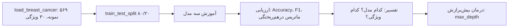

# جلسه ۲۲: کارگاه یادگیری ماشین با scikit-learn

> **درس:** مقدمهای بر هوش مصنوعی و کاربرد آن در مهندسی پزشکی
> **مدت پیشنهادی:** ۶۰ تا ۹۰ دقیقه · **سطح:** مقدماتی
> **منابع این جلسه:** منبع ۲ (Erickson, 2021)، منبع ۱۰ (Liu, 2017)، منبع ۱۱ (محتوای مدرس)

> [!NOTE]
> این جلسه کارگاه است: هدف، اجرای چرخه‌ی ML جلسه ۲۱ با کد واقعی است، نه معرفی نظریه‌ی جدید. با خود لپ‌تاپ/Colab بیایید.

---

## اهداف جلسه
در پایان این جلسه دانشجو می‌تواند:
1. چرخه‌ی کامل یادگیری ماشین (داده → تفکیک → آموزش → ارزیابی → تفسیر) را با scikit-learn اجرا کند.
2. `train_test_split` با `random_state` و `stratify` را درست استفاده کند و دلیل هر پارامتر را توضیح دهد.
3. سه مدل (رگرسیون لجستیک، درخت تصمیم، جنگل تصادفی) را آموزش دهد و با متریک‌های جلسه ۲۱ مقایسه کند.
4. بیش‌برازش را با مقایسه‌ی Accuracy آموزش/آزمون روی درخت تصمیم به‌صورت عددی مشاهده و درمان کند.

---

## ۱. صحنه‌ی کارگاه: مسئله و ابزار
مسئله‌ی ما (آموزشی و غیرتشخیصی): از ۳۰ ویژگی عددیِ محاسبه‌شده از تصویر سلول‌ها، تومور را در دو کلاس «بدخیم» و «خوش‌خیم» طبقه‌بندی کنیم. داده از `sklearn.datasets.load_breast_cancer` می‌آید (۵۶۹ نمونه؛ ۲۱۲ بدخیم، ۳۵۷ خوش‌خیم) و با خود scikit-learn سوار است — بدون هیچ دانلود اینترنتی.

> [!IMPORTANT]
> این دیتاست فقط برای تمرین برنامه‌نویسی است و **هرگز** مبنای تصمیم بالینی قرار نمی‌گیرد.

ابزار: `numpy`، `scikit-learn` (اختیاری برای مشاهده راحت‌تر: `pandas` و `matplotlib`). نصب طبق `code/requirements.txt`؛ در Colab همه از پیش نصب‌اند.

## ۲. جدول گام‌های کارگاه
هر گام در نوت‌بوک `code/session_22_sklearn_workshop.ipynb` یک سلول دارد؛ نسخه‌ی اسکریپت همان کار در `code/session_22_sklearn_workshop.py` است.

| گام | سلول | کار | نکته‌ی کلیدی |
|---|---|---|---|
| ۰ | ۲ | وارد کردن کتابخانه‌ها | `SEED = 42` همه‌جا ثابت |
| ۱ | ۴ | `load_breast_cancer()` | شکل داده و تعداد کلاس‌ها را ببینید |
| ۲ | ۶ | `train_test_split(test_size=0.2, random_state=42, stratify=y)` | stratify برای حفظ نسبت کلاس‌ها |
| ۳ | ۸ | آموزش رگرسیون لجستیک + Accuracy و F1 | اولین مدل ساده |
| ۴ | ۱۰ | `confusion_matrix` و حساسیت نسبت به کلاس بدخیم | ترتیب کلاس ۰ اول در sklearn |
| ۵ | ۱۲ | درخت بی‌محدودیت + جنگل تصادفی | مقایسه‌ی train/test = تشخیص بیش‌برازش |
| ۶ | ۱۴ | `max_depth` از ۲ تا ۱۰ | درمان بیش‌برازش را ببینید |
| ۷ | ۱۶ | ۵ ویژگی مهم جنگل تصادفی | تفسیرپذیری مدل |
| — | ۱۸ | تمرین‌های خودتان | سه تمرین بالای نوت‌بوک |

## ۳. آنچه باید در خروجی ببینید (چارچوب تفسیر)
**نمونه خروجی — برای دیدن مقدار واقعی در Colab اجرا کنید.** عددهای زیر نمونه‌اند، نه کلید تأییدشده:

| مدل | Accuracy (نمونه) | رفتار مورد انتظار |
|---|---|---|
| رگرسیون لجستیک | حدود ۰٫۹۵ | خط پایه‌ی خوب |
| درخت بی‌محدودیت | train ≈ ۱٫۰۰، test پایین‌تر | بیش‌برازش آشکار |
| درخت max_depth=۳ | train و test نزدیک | تعادل بهتر |
| جنگل تصادفی | معمولاً بالاترین test | میانگین ۱۰۰ درخت |

ماتریس درهم‌ریختگی sklearn این‌ترتیب است: سطر = واقعیت، ستون = پیش‌بینی، کلاس ۰ (بدخیم) اول. برای «کشف بدخیم»، متریک مهمِ ما حساسیت نسبت به کلاس ۰ است: $cm[0,0]/(cm[0,0]+cm[0,1])$ — چون FN یعنی یک تومور بدخیمِ نادیده‌گرفته‌شده (جلسه ۲۱).

> [!NOTE]
> چرا seed ثابت؟ بدون `random_state=42` هر بار تقسیم داده و هر دو مدل متفاوت می‌شود و نتایج شما با کلاس و با تمرین قبلی خودتان یکی نمی‌ماند. تکرارپذیری (Reproducibility) اصل علمی است، نه سلیقه‌ی کدنویسی.

## ۴. خطاهای رایج کارگاه

| خطا / نشانه | علت | راه‌حل |
|---|---|---|
| `ConvergenceWarning` در LogisticRegression | الگوریتم به همگرا نرسیده | `max_iter=5000` بگذارید یا داده را استاندارد کنید |
| Accuracy بالا اما حساسیت بدخیم پایین | متریک اشتباه نگاه می‌کنید | ماتریس درهم‌ریختگی را بخوانید (جلسه ۲۱) |
| درخت: train=۱٫۰۰۰ و test افت کرده | بیش‌برازش | `max_depth` یا `min_samples_leaf` محدود کنید |
| هر بار اجرا عدد متفاوت | seed تنظیم نشده | `random_state=42` در split و همه‌ی مدل‌ها |
| `ImportError: No module named 'sklearn'` | نصب نیست | `pip install -r code/requirements.txt` یا Colab |
| ماتریس برعکس فکر می‌کردید | ترتیب کلاس‌ها | کلاس ۰ اول است؛ با `labels=[0,1]` صریح کنید |

## ۵. پل به جلسات بعد
- جلسه ۲۳ (حل تمرین ۲): از همین دیتاست و متریک‌ها در سؤال‌های تحلیلی استفاده می‌کنیم.
- جلسه ۲۴: جنگل تصادفی امروز «میانگین‌گیری» بود؛ شبکه‌های عصبی همان نکته را با لایه‌ها ادامه می‌دهند.
- جلسه ۲۷: تفسیرپذیری و اعتبارسنجی مدل‌های پزشکی، عمومی‌شده‌ی گفت‌وگوی گام ۷ امروز است.

## 🔬 پیوند با مهندسی پزشکی
- **تفسیر ویژگی‌های مهم:** در گام ۷ ببینید کدام ویژگی‌ها (مثل ابعاد هسته یا همواری لبه) بیشترین سهم را دارند. در دنیای واقعی، این همان جایی است که با متخصص گفت‌وگو می‌کنیم: آیا ویژگی مهم، زیستی معنادار دارد یا اثر حاشیه‌ای داده؟
- **دسته‌بندی خطاها:** یک FP یعنی آزمایش و اضطراب اضافه؛ یک FN یعنی تاخیر درمان. انتخاب مدل و آستانه، همیشه از این هزینه‌ها شروع می‌شود، نه از عدد Accuracy.
- تأکید: دیتاست و کلاس‌ها صرفاً برای تمرین برنامه‌نویسی‌اند؛ هیچ‌کدام از نتایج این کارگاه معنای تشخیصی ندارد.

## ✍️ فعالیت کلاسی / کارگاه
۱. گام‌های ۰ تا ۵ نوت‌بوک را اجرا کنید و جدول مقایسه‌ی سه مدل (Accuracy، F1، ماتریس) را پر کنید.
۲. گام ۶: کدام `max_depth` بهترین تعادل آموزش/آزمون را داد؟ در یک جمله توضیح دهید چه اتفاقی بین بیش‌برازش و کم‌برازش افتاد.
۳. `random_state` را در split به عدد دیگری تغییر دهید؛ Accuracy چند واحد جابه‌جا شد؟ (پاسخ‌ها در راهنمای مدرس.)

## 💻 کد آموزشی
- `code/session_22_sklearn_workshop.ipynb` — نوت‌بوک اصلی کارگاه (۱۸ سلول، فارسی/RTL).
- `code/session_22_sklearn_workshop.py` — همان کار به‌صورت اسکریپت با `if __name__ == "__main__":`.
- مبنای نظری متریک‌ها: `code/session_21_ml_metrics.py` و جلسه ۲۱.

## 📘 واژهنامه
| واژه | معادل انگلیسی | تعریف کوتاه |
|---|---|---|
| برآوردگر | Estimator | شیء scikit-learn با `fit`/`predict` |
| تفکیک طبقه‌ای | Stratified split | حفظ نسبت کلاس‌ها در آموزش/آزمون |
| بذر تصادفی | Random seed | عدد ثابت برای تکرارپذیری |
| اهمیت ویژگی | Feature importance | سهم هر ویژگی در تصمیم مدل |
| خط پایه | Baseline | مدل ساده برای سنجش بقیه |
| فرا-پارامتر | Hyperparameter | تنظیمی که مدل خودش یاد نمی‌گیرد (مثل `max_depth`) |

## ❓ پرسشهای خودآزمون
1. چرا در این دیتاست `stratify=y` مهم است؟ اگر نگذاریم چه ریسکی هست؟
2. درخت تصمیم با train accuracy = ۱٫۰۰۰ و test = ۰٫۹۰ چی می‌گوید؟ درمانش؟
3. چرا جنگل تصادفی معمولاً پایدارتر از یک درخت تنهاست؟
4. حساسیت نسبت به کلاس بدخیم را با خانه‌های ماتریس sklearn (کلاس ۰ اول) بنویسید.

> کلید پاسخ‌ها در بخش «راهنمای مدرس» انتهای فایل آمده است.

## 📝 تکلیف
1. نوت‌بوک را در Colab اجرا کنید (Runtime → Run all) و جدول گام ۲ فعالیت را با اعداد **خودتان** پر کنید؛ خروجی نمونه‌ی فایل جلسه را ملاک نگیرید.
2. سه تمرین انتهای نوت‌بوک (تغییر `test_size`، تغییر `random_state`، یافتن `max_depth` بهینه) را انجام دهید و نتیجه را در ۵ تا ۸ جمله تحلیل کنید: هر تغییری چه چیزی را ثابت نگه داشت و چه چیزی را جابه‌جا کرد؟
3. حساسیت نسبت به کلاس بدخیم را برای بهترین مدل خودتان از روی ماتریس حساب کنید و بگویید چرا این عدد برای کاربرد فرضیِ غربالگری مهم‌تر از Accuracy است.

## 📚 مطالعه پیشنهادی
- منبع وب آزاد: Géron، Hands-On Machine Learning (2019) — فصل ۲ (پایان‌به‌پایای یک پروژه ML) و ابتدای فصل ۷ (جنگل تصادفی)
- منبع وب آزاد: مستندات رسمی scikit-learn — `train_test_split`، `RandomForestClassifier`

---

## 🧭 راهنمای مدرس (از این عنوان تا انتها در نسخه دانشجو حذف شود)

**زمان‌بندی ۹۰ دقیقه:** مرور جلسه ۲۱ (۵) | معرفی مسئله و نوت‌بوک (۱۰) | اجرای راهنما-گام‌به-گام گام ۰–۴ (۲۵) | گام ۵–۶ و بحث بیش‌برازش (۲۰) | گام ۷ و تفسیر (۱۰) | فعالیت ۳ و جمع‌بندی (۱۰) | توضیح تکلیف (۱۰).

**نسخه ۶۰ دقیقه:** گام ۰–۴ کامل (۲۵)، گام ۵–۶ (۱۵)، گام ۷ فقط نمایش بدون بحث عمیق (۵)، فعالیت ۱ (۱۰)، تکلیف (۵). فعالیت‌های ۲ و ۳ به تکلیف منتقل شود.

**نکات تدریس:**
- **اعداد نمونه‌اند:** در محیط تألیف، scikit-learn در دسترس نبوده و `session_22_sklearn_workshop.py` فقط با `py_compile` تأیید شده است. جدول بخش ۳ و هر عدد این فایل «نمونه خروجی» است. **پیش از ارائه، نوت‌بوک را در Colab اجرا کنید و اعداد واقعی را جایگزین کنید.** کلید عددی تأییدشده‌ی این جلسه همان چیزی است که خودتان از اجرای نوت‌بوک می‌گیرید.
- چرخه‌ی بحث بیش‌برازش را با نمودار `max_depth` هدایت کنید: از عمق ۲ (کم‌برازش محتمل) تا بی‌نهایت (حفظ نویز)؛ «نقطه‌ی خم» بحث خوبی می‌سازد.
- تأکید کنید هر سه مدل همان داده و همان split را دارند؛ پس تفاوت نتیجه از مدل می‌آید، نه از شانس.
- پیش‌نیاز پایتون: جلسه ۴ و نوت‌بوک خودآموزی کافی است؛ از دانشجو انتظار نوشتن کلاس یا حلقه‌ی پیچیده نمی‌رود.

**خروجی مورد انتظار جلسه:** هر دانشجو یک جدول مقایسه‌ی سه مدل با اعداد خودش، یک توضیح برای بیش‌برازش، و یک جمله درباره‌ی اهمیت seed ثابت ارائه کند.

### کلید فعالیت ۳ و پرسشهای خودآزمون

نمایش کلید پاسخ

**فعالیت ۳:** با تغییر `random_state` معمولاً Accuracy چند دهم تا چند واحد درصد جابه‌جا می‌شود (نمونه: حدود ±۰٫۰۲). درس: یک عدد Accuracy واحد، برآورد نوسان‌پذیر است؛ برای نتیجه‌ی معتبر به اعتبارسنجی تکرارشونده (مثل `cross_val_score`) نیاز داریم — مفهومی که فقط به آن اشاره می‌کنیم.

1. چون نسبت ۲۱۲/۳۵۷ نامتوازن است؛ بدون stratify ممکن است سهم بدخیم در آزمون به‌طور تصادفی کمتر/بیشتر شود و ماتریس و حساسیت با شیوع متفاوتی ارزیابی شود (پل مستقیم به بخش ۶ جلسه ۲۱).
2. بیش‌برازش: درخت نویز داده‌ی آموزش را حفظ کرده است. درمان: محدود کردن `max_depth` یا `min_samples_leaf`، یا استفاده از جنگل تصادفی.
3. چون ۱۰۰ درخت با نمونه‌ها/ویژگی‌های متفاوت آموزش دیده‌اند و میان‌گین‌گیری واریانس تک‌درخت‌ها را کم می‌کند؛ در نتیجه به تعمیم پایدارتر می‌رسیم.
4. حساسیت نسبت به بدخیم = $cm[0,0]/(cm[0,0]+cm[0,1])$؛ چون سطر ۰ = واقعاً بدخیم است و ستون ۱ = اشتباه «خوش‌خیم» پیش‌بینی‌شده (FN از نگاه کلاس بدخیم).

