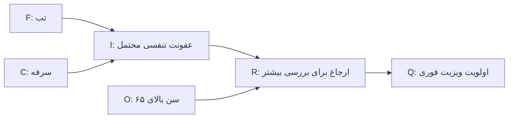

# جلسه ۲۳: جلسه حل تمرین ۲: منطق، MDP، مدل‌های احتمالاتی و یادگیری ماشین

> **درس:** مقدمه‌ای بر هوش مصنوعی و کاربرد آن در مهندسی پزشکی
> **مدت پیشنهادی:** ۶۰ تا ۹۰ دقیقه (حل تمرین) · **سطح:** مقدماتی
> **منابع این جلسه:** منبع ۱ (Russell & Norvig, 2016)، منبع ۲ (Erickson, 2021)، منبع ۱۰ (Liu, 2017)، منبع ۱۱ (محتوای مدرس)

---

## اهداف جلسه
در پایان این جلسه دانشجو می‌تواند:
1. یک زنجیره‌ی استنتاج روبه‌جلو (Forward Chaining) را روی پایگاه قاعده‌ی تازه اجرا کند و قاعده‌های مسدودشده را توجیه کند.
2. اعتبار یک استدلال را با جدول درستی (Truth Table) بسنجد و قاعده‌ی «ردّ مقدم» (Modus Tollens) را اجرا کند.
3. یک مرور بلمن (Bellman Sweep) را دستی حساب کند و اثر ضریب تنزیل $\gamma$ بر سیاست بهینه و سرعت همگرایی تکرار ارزش را تفسیر کند.
4. یک پسین بیزی (Posterior) را با کسر دقیق حساب کند، به زنجیره‌ی مارکوف (Markov Chain) و توزیع مانا (Stationary Distribution) عدد بدهد، ماتریس درهم‌ریختگی (Confusion Matrix) را به شش متریک تبدیل کند و میان حساسیت و PPV برای هدف‌های متفاوت انتخاب درست کند.

> [!IMPORTANT]
> این جلسه نظریه‌ی تازه ندارد؛ بازگشت تمرینی به جلسات ۱۷ تا ۲۲ است و جزو پوشش میان‌ترم دوم (جلسات ۱۷ تا ۲۶) شمرده می‌شود. پیش از بازکردن هر راه‌حل، خودتان تلاش کنید. راه‌حل مرجع کامل و خودآزمون‌شده در `code/session_23_solutions.py` نیز هست.

---

## ۱. ساختار تمرین‌ها
هشت تمرین در چهار گروه به‌علاوه‌ی یک نمونه‌سؤال ترکیبی:

| گروه | تمرین‌ها | مفاهیم (مرجع) |
|---|---|---|
| منطق و سیستم خبره | ۱، ۲ | استنتاج روبه‌جلو، جدول درستی، Modus Tollens (جلسه ۱۷) |
| MDP | ۳، ۴ | مرور بلمن، تکرار ارزش (Value Iteration)، نقش $\gamma$ (جلسه ۱۸) |
| مدل‌های احتمالاتی | ۵، ۶ | قاعده‌ی بیز، زنجیره‌ی مارکوف و توزیع مانا (جلسه ۲۰) |
| یادگیری ماشین | ۷ | ماتریس درهم‌ریختگی و شش متریک (جلسه ۲۱) |
| نمونه‌سؤال میان‌ترم دوم | ۸ | ترکیب هر چهار گروه |

همه‌ی عددهای راه‌حل‌ها از اجرای واقعی `code/session_23_solutions.py` گرفته شده‌اند؛ آن اسکریپت فقط از کتابخانه‌ی استاندارد پایتون استفاده می‌کند و در پایان با `assert` خودش را می‌آزماید.

## 🔬 پیوند با مهندسی پزشکی
- **قواعد و پروتکل‌ها:** زنجیره‌ی تمرین ۱ در مقیاس کوچک، همان منطق سیستم‌های پشتیبان تصمیم است: از مشاهده‌های خام به نتیجه‌ی عملیاتی.
- **تصمیم پی‌درپی:** تمرین‌های ۳ و ۴ همان دی‌ان‌ای مدل «پایش/درمان» جلسه ۱۸ هستند: انتخاب کنشِ امروز با ارزش حالت‌های فردا وزن می‌شود.
- **تفسیر آزمون:** تمرین ۵ می‌گوید حتی آزمون خوب با شیوع کم پسین کوچکی می‌دهد؛ تمرین ۷ همین زبان را به متریک‌های ارزیابی مدل وصل می‌کند.

> [!WARNING]
> همه‌ی اعداد و مثال‌ها ساختگی و آموزشی‌اند؛ هیچ‌کدام مبنای تصمیم بالینی یا تشخیصی قرار نمی‌گیرند.

## ✍️ فعالیت کلاسی / کارگاه
برای هر تمرین اول تلاش کنید، بعد راه‌حل را باز کنید. نمادها: اتم‌های منطق لاتین‌اند و معنی‌شان در خود تمرین آمده؛ در MDP، حالت‌ها $s_1$ (پایدار)، $s_2$ (بدحال) و $s_3$ (بهبودِ پایانی) و کنش‌ها $a_1$ (پایش)، $a_2$ (بستری پیشگیرانه) و $a_3$ (درمان مضاعف) هستند.

### تمرین ۱: استنتاج روبه‌جلو روی پایگاه قاعده‌ی جدید
اتم‌ها: $F$ = تب، $C$ = سرفه، $I$ = عفونت تنفسی محتمل، $O$ = سن بالاتر از ۶۵، $S$ = اشباع اکسیژن پایین، $D$ = درد هنگام تنفس، $R$ = ارجاع برای بررسی بیشتر، $Q$ = اولویت ویزیت فوری. قاعده‌ها و حقایق اولیه:

| قاعده | پیش‌فرض‌ها | نتیجه |
|---|---|---|
| R1 | F ، C | I |
| R2 | I ، O | R |
| R3 | I ، S | R |
| R4 | R | Q |
| R5 | D | I |

حقایق اولیه حافظه کاری: $F$ ، $C$ ، $O$.



۱. قاعده‌ها به چه ترتیب فعال می‌شوند و حافظه کاری نهایی چیست؟
۲. کدام قاعده‌ها هرگز فعال نمی‌شوند و چرا؟

<details>
<summary>راه‌حل کامل تمرین ۱</summary>

موتور استنتاج روبه‌جلو در هر دور قاعده‌ها را به‌ترتیب ثابت بررسی می‌کند و هر قاعده‌ای که همه‌ی پیش‌فرض‌هایش در حافظه کاری باشد، نتیجه‌اش را اضافه می‌کند. اجرای واقعی کد:

```text
گام 1 | R1 فعال شد: {C ، F} => I
گام 2 | R2 فعال شد: {I ، O} => R
گام 3 | R4 فعال شد: {R} => Q
حافظه کاری نهایی: C ، F ، I ، O ، Q ، R
قاعده‌های مسدود: R3 (پیش‌فرض S موجود نیست) ، R5 (پیش‌فرض D موجود نیست)
```

۱. زنجیره سه گام دارد: R1 چون $F$ و $C$ موجودند، $I$ می‌سازد؛ R2 چون $I$ تازه‌ساخته و $O$ موجودند، $R$ می‌سازد؛ R4 چون $R$ موجود است، $Q$ می‌سازد. نتیجه: زنجیره‌ی $F, C \Rightarrow I \Rightarrow R \Rightarrow Q$. ۲. R3 و R5 هرگز فعال نمی‌شوند: $S$ و $D$ هرگز وارد حافظه کاری نمی‌شوند (نتیجه‌شان یعنی $R$ و $I$ به‌هرحال از مسیر قاعده‌های دیگر به‌دست آمد). این موتور «روبه‌جلو» و داده‌محور است و با Backtracking جلسات CSP شباهتی ندارد: اینجا قاعده‌ها نتیجه می‌سازند، نه اینکه درخت جست‌وجو را عقب برویم.

</details>

### تمرین ۲: آزمون اعتبار استدلال با جدول درستی
ادعا: «از دو پیش‌فرض $I \rightarrow R$ و $\neg R$ نتیجه‌ی $\neg I$ الزاماً به‌دست می‌آید.» با جدول درستی (چهار حالت ممکن برای $I$ و $R$) این ادعا را بسنجید. سپس بگویید آیا از $\neg I$ می‌توان $\neg R$ نتیجه گرفت؟

<details>
<summary>راه‌حل کامل تمرین ۲</summary>

راستی‌آزمایی کد روی هر چهار ردیف (ردیف با `*` هر دو پیش‌فرض را برقرار می‌کند):

```text
* I=False R=False | I→R=True  ¬R=True  | ¬I=True
  I=False R=True  | I→R=True  ¬R=False | ¬I=True
  I=True  R=False | I→R=False ¬R=True  | ¬I=False
  I=True  R=True  | I→R=True  ¬R=False | ¬I=False
ردیف‌های برقرارکننده‌ی هر دو پیش‌فرض: 1 از 4
نتیجه: استدلال معتبر است (Modus Tollens)
```

تنها ردیفی که هر دو پیش‌فرض را برقرار می‌کند، ردیف $I=\text{F}$ و $R=\text{F}$ است و آنجا نتیجه‌ی $\neg I$ هم درست است؛ پس استدلال معتبر است — این همان قاعده‌ی Modus Tollens است. اما جهت برعکس («از $\neg I$ به $\neg R$») نامعتبر است: در ردیف دوم جدول بالا $I=\text{F}$ ولی $R=\text{T}$ است، یعنی پیش‌فرض برقرار و نتیجه نقض می‌شود (مغالطه‌ی «انکار مقدم»، Denying the Antecedent). نکته‌ی امتحانی: معتبر بودن یعنی «در همه‌ی ردیف‌هایی که پیش‌فرض‌ها درست‌اند، نتیجه هم درست است» — نه اینکه نتیجه همیشه درست باشد.

</details>

### تمرین ۳: MDP — یک مرور بلمن دستی و تکرار ارزش با γ = 0.5
همان مدل مینی‌پزشکی جلسه ۱۸ با احتمال‌های گذار زیر (پاداش هر گذار = منفی هزینه‌ی کنش، به‌علاوه‌ی $+10$ در گذار به بهبود؛ $s_3$ پایانی است و $V(s_3)=0$):

| حالت | کنش | $P(s_1)$ | $P(s_2)$ | $P(s_3)$ |
|---|---|---|---|---|
| $s_1$ پایدار | $a_1$ پایش (هزینه ۱) | 0.9 | 0.05 | 0.05 |
| $s_1$ پایدار | $a_2$ بستری پیشگیرانه (هزینه ۶) | 0.8 | 0.1 | 0.1 |
| $s_2$ بدحال | $a_1$ پایش (هزینه ۱) | 0.1 | 0.9 | 0.0 |
| $s_2$ بدحال | $a_3$ درمان مضاعف (هزینه ۵) | 0.4 | 0.3 | 0.3 |

۱. با $V_0(s)=0$ و $\gamma = 0.5$ هر چهار مقدار $Q(s,a)$ مرور اول را دستی حساب کنید و $V_1$ را بنویسید.
۲. تکرار ارزش را تا همگرایی اجرا کنید: $V^*$، $\pi^*$ و تعداد مرورها؟

<details>
<summary>راه‌حل کامل تمرین ۳</summary>

**بخش ۱ (دستی):** چون $V_0 = 0$ است، جمله‌ی $\gamma V_0$ صفر می‌شود و فقط پاداش‌ها می‌مانند:

$$Q(s_1, a_1) = 0.9(-1) + 0.05(-1) + 0.05(-1+10) = -0.5 \qquad Q(s_1, a_2) = 0.8(-6) + 0.1(-6) + 0.1(-6+10) = -5.0$$

$$Q(s_2, a_1) = 0.1(-1) + 0.9(-1) + 0.0 = -1.0 \qquad Q(s_2, a_3) = 0.4(-5) + 0.3(-5) + 0.3(-5+10) = -2.0$$

پس $V_1(s_1) = \max(-0.5, -5) = -0.5$ و $V_1(s_2) = \max(-1.0, -2.0) = -1.0$ — دقیقاً همان خروجی کد:

```text
Q(s1, a1) = -0.5000
Q(s1, a2) = -5.0000
Q(s2, a1) = -1.0000
Q(s2, a3) = -2.0000
V1(s1) = -0.5000 | V1(s2) = -1.0000
```

**بخش ۲ (اجرای کامل):** با $\gamma = 0.5$ سیاست حاکم در هر دو حالت «پایش» ($a_1$) می‌ماند و دستگاه بلمن دو معادله می‌شود:

$$V^*(s_1) = -0.5 + 0.45\,V^*(s_1) + 0.025\,V^*(s_2) \qquad V^*(s_2) = -1.0 + 0.05\,V^*(s_1) + 0.45\,V^*(s_2)$$

```text
تکرار ارزش کامل: همگرا پس از 33 مرور
  V*(s1) = -0.9959 | V*(s2) = -1.9087
  حل دقیق سیاست: V*(s1) = -240/241 = -0.9959 | V*(s2) = -460/241 = -1.9087
  π*: از s1 → a1 | از s2 → a1
```

تفسیر: با افق کوتاه ($\gamma = 0.5$) پاداش یک‌باره‌ی بهبود کم‌وزن می‌شود و کنش ارزان «پایش» در هر دو حالت برنده است — این همان پاسخ پرسش ۳ تکلیف جلسه ۱۸ است که اکنون با اجرا تأیید شد. عدد دقیق $-240/241$ و $-460/241$ را کد با کسر دقیق و قاعده‌ی کرمر از خود پارامترها می‌سازد.

</details>

### تمرین ۴: بازگشت به γ = 0.9 و مقایسه
۱. با همان مدل و $\gamma = 0.9$ تکرار ارزش را اجرا کنید: $V^*$، $\pi^*$ و تعداد مرورها؟
۲. مقایسه با تمرین ۳: کدام سیاست تغییر کرد و چرا؟ رابطه‌ی $\gamma$ با تعداد مرورها چیست؟

<details>
<summary>راه‌حل کامل تمرین ۴</summary>

```text
γ = 0.9 : همگرا پس از 130 مرور | V*(s1) = -26/7 = -3.7143 | V*(s2) = -32/7 = -4.5714
          π*: از s1 → a1 | از s2 → a3
γ = 0.5 : همگرا پس از 33 مرور | π*: (a1، a1)
```

۱. با $\gamma = 0.9$ سیاست بهینه همان جدول جلسه ۱۸ است: از پایدار «پایش» و از بدحال «درمان مضاعف»؛ مقادیر دقیق $-26/7$ و $-32/7$ هم با جدول جلسه ۱۸ یکی است. ۲. تفاوت دو اجرا درس اصلی است: با $\gamma = 0.9$ آینده سنگین‌تر وزن می‌گیرد و از بدحال، هزینه‌ی ۵ واحدی «درمان مضاعف» به‌خاطر ۳۰٪ شانس بهبود و ۴۰٪ بازگشت به پایداری می‌ارزد؛ با $\gamma = 0.5$ همان کنش نمی‌ارزد. درباره‌ی سرعت: عامل انقباض بلمن $\gamma$ است، پس هرچه $\gamma$ بزرگ‌تر، همگرایی کندتر (۱۳۰ مرور در برابر ۳۳ مرور).

</details>

### تمرین ۵: قاعده‌ی بیز با کسر دقیق و بیز زنجیره‌ای
آزمایشی فرضی: شیوع بیماری $P(D) = 1/25$، حساسیت $P(+ \mid D) = 19/20$ و نرخ مثبت کاذب $P(+ \mid \lnot D) = 1/20$ (ویژگی $19/20$).
۱. احتمال کل مثبت شدن آزمون $P(+)$ و پسین بعد از **یک** آزمون مثبت؟
۲. اگر آزمون دوم مستقل هم مثبت شود، پسین جدید؟ و درس این جهش چیست؟

<details>
<summary>راه‌حل کامل تمرین ۵</summary>

$$P(+) = P(+ \mid D)P(D) + P(+ \mid \lnot D)P(\lnot D) = \frac{19}{20}\cdot\frac{1}{25} + \frac{1}{20}\cdot\frac{24}{25} = \frac{43}{500} = 0.0860 \qquad P(D \mid +) = \frac{P(+ \mid D)P(D)}{P(+)} = \frac{19/500}{43/500} = \frac{19}{43} \approx 0.4419$$

خروجی واقعی کد (با کسر دقیق):

```text
P(+) = 43/500 = 0.0860
پسین بعد از یک آزمون مثبت: P(D|+) = 19/43 = 0.4419
بعد از آزمون دوم مستقل: P(+) = 77/172 = 0.4477 | P(D|++) = 361/385 = 0.9377
```

درس‌ها: (۱) با شیوع ۴٪، حتی آزمونی با حساسیت ۹۵٪ بعد از یک مثبت فقط به ۴۴٪ می‌رسد — ادامه‌ی همان پارادوکس پایه‌ی نرخ جلسه ۲۰ (آنجا با شیوع ۱٪ از $1/100$ به $1/12$ رسیدیم). (۲) در بیز زنجیره‌ای، پسین دیروز پیشین امروز می‌شود و آزمون مثبت دوم پسین را از $0.4419$ به $0.9377$ می‌رساند؛ شرط اعتبار این جهش، استقلال دو آزمون است (پرسش ۳ خودآزمون).

</details>

### تمرین ۶: زنجیره‌ی مارکوف و توزیع مانا
دستگاه آزمایشگاهی با دو حالت $\text{OK}$ (سالم) و $\text{BAD}$ (در حال خرابی)، ماتریس انتقال $\begin{pmatrix} 4/5 & 1/5 \\ 2/5 & 3/5 \end{pmatrix}$ (سطر اول: از سالم به …) و شروعِ قطعی از حالت سالم.
۱. توزیع حالت‌ها در گام‌های ۱ تا ۳؟
۲. توزیع مانا؟ و آیا به نقطه‌ی شروع بستگی دارد؟

<details>
<summary>راه‌حل کامل تمرین ۶</summary>

خروجی واقعی کد:

```text
گام  1: P(OK)=0.8000  P(BAD)=0.2000
گام  2: P(OK)=0.7200  P(BAD)=0.2800
گام  3: P(OK)=0.6880  P(BAD)=0.3120
گام 10: P(OK)=0.6667  P(BAD)=0.3333
توزیع مانا (تکرار ۶۰ گام): P(OK)=0.6667  P(BAD)=0.3333
```

دستی: گام ۱ یعنی $P(\text{OK}) = 4/5$؛ گام ۲: $P(\text{OK}) = \frac{4}{5}\cdot\frac{4}{5} + 0 \cdot \frac{2}{5} = \frac{18}{25}$؛ گام ۳: $\frac{18}{25}\cdot\frac{4}{5} + \frac{7}{25}\cdot\frac{2}{5} = \frac{86}{125}$.
توزیع مانا با فرمول بسته‌ی زنجیره‌ی دوحالته:

$$\pi(\text{OK}) = \frac{t(\text{BAD} \rightarrow \text{OK})}{t(\text{OK} \rightarrow \text{BAD}) + t(\text{BAD} \rightarrow \text{OK})} = \frac{2/5}{1/5 + 2/5} = \frac{2}{3} \approx 0.6667$$

به‌رغم شروعِ قطعی از سلامت، توزیع به $(2/3, 1/3)$ میل می‌کند و شروع «فراموش» می‌شود — همان ویژگی «بیماری فراموش‌شونده» جلسه ۲۰؛ حد بلندمدت به ساختار انتقال بستگی دارد نه به نقطه‌ی شروع.

</details>

### تمرین ۷: از ماتریس درهم‌ریختگی تا شش متریک
روی ۱۰۰ نمونه‌ی ساختگیِ آزمایشی، مدل طبقه‌بندی این ماتریس را داده است: $TP = 25$، $FN = 5$، $FP = 10$، $TN = 60$.
۱. هر شش متریک Accuracy، Sensitivity، Specificity، PPV، NPV و F1 را با کسر دقیق حساب کنید.
۲. برای «غربالگری» و برای «تأیید مرحله‌ی دوم» کدام متریک اولویت دارد؟

<details>
<summary>راه‌حل کامل تمرین ۷</summary>

خروجی واقعی کد (همه با کسر دقیق):

```text
Accuracy     = 17/20 = 0.8500
Sensitivity  = 5/6 = 0.8333
Specificity  = 6/7 = 0.8571
PPV          = 5/7 = 0.7143
NPV          = 12/13 = 0.9231
F1           = 10/13 = 0.7692
```

حساب دستی (نمونه): Sensitivity $= \frac{25}{25+5} = \frac{5}{6}$؛ Specificity $= \frac{60}{60+10} = \frac{6}{7}$؛ PPV $= \frac{25}{25+10} = \frac{5}{7}$؛ و $F_1 = \frac{2 \cdot PPV \cdot Sens}{PPV + Sens} = \frac{2 \cdot \frac{5}{7} \cdot \frac{5}{6}}{\frac{5}{7} + \frac{5}{6}} = \frac{50/42}{65/42} = \frac{10}{13}$.

۲. غربالگری: Sensitivity ($5/6$) چون FN یعنی بیمارِ ازدست‌رفته؛ تأیید مرحله‌ی دوم: PPV ($5/7$) چون مثبت‌های این مرحله باید واقعاً محتمل باشند. توجه: اینجا شیوع نمونه‌ها ۳۰٪ است و Accuracy=۰٫۸۵ گمراه‌کننده نیست؛ تله‌ی Accuracy جلسه ۲۱ در شیوع‌های خیلی پایین رخ می‌دهد.

</details>

### تمرین ۸: نمونه‌سؤال شبیه میان‌ترم دوم (۲۵ دقیقه، ۱۵ نمره)
**الف — منطق (۴ نمره):** با قاعده‌های $\{A\} \Rightarrow B$ و $\{A, B\} \Rightarrow C$ و $\{C\} \Rightarrow D$ و حقایق اولیه $\{A, B\}$: ترتیب فعال‌سازی و حافظه کاری نهایی؟
**ب — MDP (۵ نمره):** در مدل تمرین ۳ با $V_0 = 0$ و $\gamma = 0.5$ مقدار $Q(s_2, a_3)$ و $V_1(s_2)$ را حساب کنید.
**ج — بیز (۳ نمره):** در تمرین ۵، پسین بعد از یک آزمون مثبت؟
**د — متریک (۳ نمره):** در تمرین ۷ مقدار F1؟

<details>
<summary>راه‌حل کامل تمرین ۸ (نمونه‌پاسخ)</summary>

```text
الف (منطق): قاعده‌های فعال‌شده به‌ترتیب = R1 ، R2 ، R4 | طول زنجیره = 3 گام
ب (MDP): Q(s2, a3) در مرور اول با γ = 0.5 = -2.0000 | V1(s2) = -1.0000
ج (بیز): پسین بعد از یک آزمون مثبت = 19/43 = 0.4419
د (متریک): F1 = 10/13 = 0.7692
```

الف: دور اول $A, B$ موجودند، پس $\{A\} \Rightarrow B$ تکراری است (نتیجه در حافظه هست)، سپس $\{A,B\} \Rightarrow C$ و بعد $\{C\} \Rightarrow D$ فعال می‌شوند: زنجیره‌ی دوضلعی $A, B \Rightarrow C \Rightarrow D$. ب، ج و د عیناً نتایج تمرین‌های ۳، ۵ و ۷‌اند — پیام امتحانی: در میان‌ترم دوم همین چهار مهارت (زنجیره، مرور بلمن، پسین بیزی، متریک) را باید سریع و دقیق اجرا کنید.

</details>

## 💻 کد آموزشی
فایل `code/session_23_solutions.py` راه‌حل مرجع هر هشت تمرین است (فقط کتابخانه‌ی استاندارد):

```bash
python3 code/session_23_solutions.py
```

- بیز و مارکوف با `fractions.Fraction` محاسبه‌ی **دقیق** می‌شوند و تکرار ارزش با اعداد اعشاری قطعی؛ هیچ تصادفی در کار نیست و اجرای چندباره همان خروجی را می‌دهد.
- خودآزمایی پایانی: انتظارهای MDP با حل دقیق کرمر از خود پارامترها ساخته و متریک‌ها و پسین‌ها با برابری دقیق کسرها سنجیده می‌شوند.
- برای لو نرفتن پاسخ تمرین‌ها، فقط خط پایان موفق اینجا نمایش داده می‌شود؛ خروجی کامل هر تمرین داخل راه‌حل همان تمرین آمده است:

```text
ALL CHECKS PASSED
```

## 📘 واژه‌نامه

| واژه | معنی |
|---|---|
| Forward Chaining | استنتاج روبه‌جلو؛ از حقایق به سمت نتیجه‌های تازه |
| Modus Tollens | ردّ مقدم؛ از $\neg R$ و $I \rightarrow R$ به $\neg I$ می‌رسیم |
| Bellman Sweep | یک مرور کامل به‌روزرسانی $V$ با معادله‌ی بلمن |
| Value Iteration | تکرار ارزش؛ همگرایی به $V^*$ و سپس $\pi^*$ |
| Discount Factor | ضریب تنزیل $\gamma$؛ وزن آینده و عامل انقباض همگرایی |
| Stationary Distribution | توزیع مانا؛ حد بلندمدت زنجیره‌ی مارکوف |
| Confusion Matrix | جدول TP/FN/FP/TN پیش‌بینی در برابر واقعیت |
| Sensitivity / PPV | حساسیت (از میان بیماران) / ارزش اخباری مثبت (از میان مثبت‌ها) |

## ❓ پرسش‌های خودآزمون
1. در تمرین ۱ چرا R3 و R5 فعال نشدند، در حالی که نتیجه‌ی هر دو ($R$ و $I$) در حافظه کاری نهایی حاضر است؟
2. چرا در تمرین ۳ با $\gamma = 0.5$ از هر دو حالت «پایش» بهینه است ولی با $\gamma = 0.9$ از بدحال «درمان مضاعف»؟
3. جهش پسین تمرین ۵ از $0.4419$ به $0.9377$ به چه فرضی وابسته است؟ اگر آزمون دوم همان سیگنال اول را دوباره بخواند چه می‌شود؟
4. چرا در تمرین ۷ برای غربالگری Sensitivity و برای تأیید مرحله‌ی دوم PPV را انتخاب می‌کنید؟

> کلید پاسخ‌ها در بخش «راهنمای مدرس» انتهای فایل آمده است.

## 📝 تکلیف
1. `code/session_23_solutions.py` را اجرا کنید و خروجی هر هشت تمرین را با راه‌حل‌های این فایل یک‌به‌یک مقایسه کنید؛ هر مغایرتی را توضیح دهید.
2. ثابت `GAMMA_T4` را در اسکریپت از 0.9 به 0.99 تغییر دهید و دوباره اجرا کنید: $V^*$، $\pi^*$ و تعداد مرورهای تمرین ۴ چه شد؟ خودآزمایی این تمرین پارامتریک است (انتظارش را از خود پارامترها می‌سازد) و با این تغییر نمی‌شکند. *(کلید در راهنمای مدرس.)*
3. ماتریس جدید $TP = 30$، $FN = 10$، $FP = 5$، $TN = 55$ را **فقط با دست** حل کنید و شش متریک را به‌صورت کسر دقیق بنویسید. نیازی به تغییر کد نیست؛ توجه کنید خودآزمایی تمرین ۷ روی اعداد ثابت تمرین قفل است. *(کلید در راهنمای مدرس.)*

## 📚 مطالعه پیشنهادی
- Russell & Norvig (2016)، فصل ۷ (منطق و استنتاج)، فصل ۱۷ (MDP و تکرار ارزش) و فصل ۱۳–۱۴ (احتمال و استدلال احتمالاتی)
- Liu (2017)، فصل‌های مرتبط با ارزیابی مدل‌های طبقه‌بندی؛ مرور راه‌حل‌های خودتان از جلسات ۱۷ تا ۲۲ (اسکریپت‌های `code/session_17_logic_expert_system.py` و `code/session_21_ml_metrics.py` مرجع هر گروه‌اند)

---

## 🧭 راهنمای مدرس (از این عنوان تا انتها در نسخه دانشجو حذف شود)

**زمان‌بندی پیشنهادی برای ۹۰ دقیقه:** مرور ساختار گروه‌ها (۵) | تمرین ۱ و ۲ روی تخته (۱۵) | تمرین ۳: مرور دستی بلمن + اجرای کد (۲۰) | تمرین ۴: مقایسه‌ی γها (۱۰) | تمرین ۵ و ۶ گروهی (۱۵) | تمرین ۷ و متریک‌ها (۱۰) | نمونه‌سؤال تمرین ۸ (۱۰) | جمع‌بندی و تکلیف (۵)

**نسخه ۶۰ دقیقه‌ای:** مرور (۵) | تمرین ۳ جمعی روی تخته (۲۰) | تمرین ۷ (۱۰) | نمونه‌سؤال تمرین ۸ (۱۵) | تکلیف و جمع‌بندی (۱۰). تمرین‌های ۱، ۲، ۴، ۵ و ۶ به مطالعه‌ی فردی واگذار شوند — ساده‌ترند و راه‌حل کامل دارند.

**نکات اجرای جلسه حل تمرین:**
- نقش مدرس تسهیل‌گر است؛ پیش از باز کردن هر بخش تاشوی راه‌حل، دو سه دقیقه تلاش گروهی بگیرید.
- تمرین ۳ قلب جلسه است: مرور دستی را روی تخته بچینید و بعد خروجی کد را کنارش بگذارید؛ تطبیق $-0.5/-1.0$ دستی با چاپ کد لحظه‌ی «آها»ی جلسه است.
- در تمرین ۴، جدول دو‌سطری ۱۳۰ مرور (γ=0.9) و ۳۳ مرور (γ=0.5) را به بحث عامل انقباض وصل کنید؛ به سؤال کلاسی «اگر θ را سخت‌گیرانه‌تر کنیم چه می‌شود؟» اشاره کنید.
- در تمرین ۵ توقف کنید و قبل از نمایش پسین، از کلاس حدس بگیرید: «آزمون ۹۵٪ حساس، بعد از یک مثبت چند درصد؟» — حدس‌ها معمولاً بالای ۸۰٪ است و پاسخ ۴۴٪ اثر گذاشتنی دارد. تمرین ۸ را مثل آزمون بگیرید: زمان‌بندی واقعی و بدون جزوه؛ بارم پیشنهادی ۴+۵+۳+۳=۱۵ نمره.

**نکات فنی:**
- خروجی قطعی است (بیز/مارکوف با `Fraction`، تکرار ارزش با اعشار قطعی)؛ اجرای چندباره همان اعداد جدول‌های این فایل را می‌دهد.
- تعداد مرورها (۳۳، ۱۳۰ و در تکلیف ۲۸۱) به آستانه‌ی همگرایی $\theta = 10^{-10}$ وابسته است؛ تغییر θ عددها را عوض می‌کند — این خودش آزمایش کلاسی خوبی است.
- خودآزمایی MDP انتظارش را با حل کرمرِ کسر دقیق از خود پارامترها می‌سازد؛ پس تغییر `GAMMA_T4` (تکلیف ۲) اجرا را نمی‌شکند، ولی تغییر اعداد تمرین ۱، ۵، ۶ و ۷ طبعاً assert همان تمرین را می‌ایستاند (راه‌حل مرجع روی صورت تمرین قفل است). این جلسه و جلسه ۲۴ با هم، پوشش تمرینیِ میان‌ترم دوم را کامل می‌کنند.

**خروجی مورد انتظار جلسه:** هر دانشجو هر هشت تمرین را حل کرده باشد و در یک جمله بتواند بگوید «γ هم معنای افق تصمیم است هم سرعت همگرایی» و «پسین بدون پیشین و شیوع معنا ندارد».

### کلید تکلیف ۲ (اجرای واقعی اسکریپت با GAMMA_T4 = 0.99)
$V^*(s_1) = -18020/2281 \approx -7.9000$ و $V^*(s_2) = -16640/2281 \approx -7.2950$؛ همگرا پس از ۲۸۱ مرور؛ $\pi^*$ همچنان (پایش از پایدار، درمان مضاعف از بدحال). سازگار با کلید تکلیف جلسه ۱۸: هرچه آینده سنگین‌تر شود، ارزش‌ها منفی‌تر و همگرایی کندتر می‌شود ولی سیاست بهینه ثابت می‌ماند.

### کلید تکلیف ۳ (حساب دستی)
Accuracy $= 85/100 = 17/20$ · Sensitivity $= 30/40 = 3/4$ · Specificity $= 55/60 = 11/12$ · PPV $= 30/35 = 6/7$ · NPV $= 55/65 = 11/13$ · F1 $= \frac{2 \cdot (6/7)(3/4)}{(6/7)+(3/4)} = \frac{36/28}{45/28} = \frac{4}{5} = 0.8$.

### کلید پرسش‌های خودآزمون

<details>
<summary>نمایش کلید پاسخ</summary>

1. چون پیش‌فرض گم‌شده دارند: $S$ برای R3 و $D$ برای R5 هرگز وارد حافظه کاری نشدند. اینکه نتیجه‌ی آن‌ها از مسیر دیگر (R2 و R1) به‌دست آمده، ربطی به فعال‌شدن خود آن قاعده‌ها ندارد؛ موتور روبه‌جلو قاعده را وقتی فعال می‌کند که همه‌ی پیش‌فرض‌هایش حاضر باشند.
2. با $\gamma = 0.5$ پاداش دورِ بهبود ($+10$) به‌شدت تنزیل می‌شود و هزینه‌ی فوری ۵ واحدی «درمان مضاعف» جبران نمی‌شود؛ با $\gamma = 0.9$ آینده وزن بیشتری دارد و ۳۰٪ شانس بهبود به‌علاوه‌ی ۴۰٪ بازگشت به پایدار، ارزش موردانتظار بالاتری می‌سازد. $\gamma$ همان افق دید سیاست است.
3. به فرض استقلال دو آزمون با پیشین مشترک. اگر آزمون دوم همان سیگنال اول را بازخوانی کند (همبسته باشد)، جهش واقعی کوچک‌تر است و ما به پسین بلندپروازانه‌ی $0.9377$ بیش‌اعتماد می‌شویم — در عمل، تنوع شواهد مهم‌تر از تکرار یک شاهد است.
4. در غربالگری FN گران است (بیمار ازدست‌رفته) پس Sensitivity $= 5/6$ اولویت دارد و FP بعداً با آزمون قطعی‌تر فیلتر می‌شود؛ در تأیید مرحله‌ی دوم مثبت باید محتمل باشد، پس PPV $= 5/7$ معیار است. Specificity ($6/7$) برای کنترل هشدارهای اشتباه در جمعیت سالم مکمل هر دو است.

</details>
