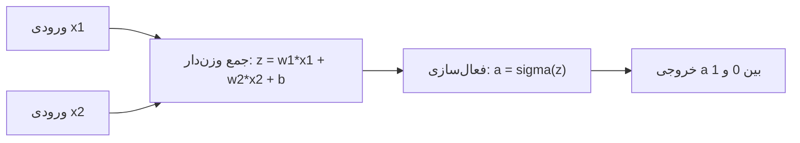
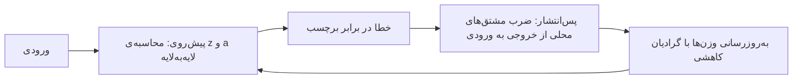
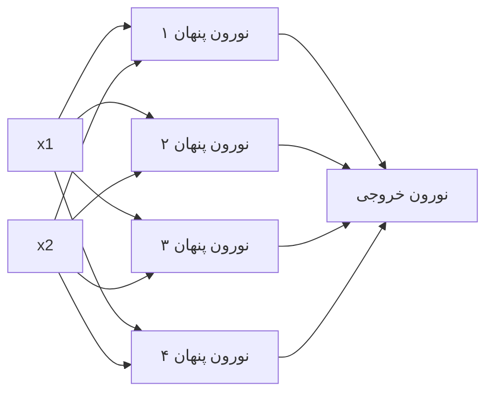

# جلسه ۲۴: شبکه‌های عصبی و یادگیری عمیق

> **درس:** مقدمه‌ای بر هوش مصنوعی و کاربرد آن در مهندسی پزشکی
> **مدت پیشنهادی:** ۶۰ تا ۹۰ دقیقه · **سطح:** مقدماتی
> **منابع این جلسه:** منبع ۱ (Russell & Norvig, 2016)، منبع ۲ (Erickson, 2021)، منبع ۱۰ (Liu, 2017)، منبع ۱۱ (محتوای مدرس)

---

## اهداف جلسه
در پایان این جلسه دانشجو می‌تواند:
1. نورون مصنوعی (Artificial Neuron) را با $z = \sum_i w_i x_i + b$ و $a = \sigma(z)$ مدل کند و خروجی آن را دستی حساب کند.
2. آموزش را کمینه‌سازی تابع خطا (Loss) با گرادیان کاهشی بداند و ایده‌ی پس‌انتشار خطا (Backpropagation) را با قاعده‌ی زنجیره‌ای روایت کند.
3. مشتق سیگموئید $\sigma'(z) = \sigma(z)(1 - \sigma(z))$ را حساب کند و پدیده‌ی گرادیان محو (Vanishing Gradient) و راه‌های مقابله با آن را توضیح دهد.
4. شبکه‌ی چندلایه‌ی کوچک را روی XOR آموزش دهد و CNN، RNN و Transformer را برحسب نوع داده‌ی مناسب تمیز دهد.

> [!IMPORTANT]
> این جلسه دو وعده‌ی قبلی دوره را ادا می‌کند: قاعده‌ی به‌روزرسانی جلسه ۱۱ ($\theta \leftarrow \theta - \alpha \nabla J(\theta)$) اینجا قلب آموزش شبکه می‌شود و هشدار بیش‌برازش جلسه ۲۱ دوباره برمی‌گردد. همه‌ی عددهای این فایل از اجرای واقعی `code/session_24_nn_from_scratch.py` گرفته شده‌اند؛ آن اسکریپت فقط از کتابخانه‌ی استاندارد پایتون استفاده می‌کند و در پایان با `assert` خودش را می‌آزماید.

## ۱. نورون مصنوعی: کوچک‌ترین واحد یادگیری
الهام از نورون زیستی است، اما حسابش ساده است: ورودی‌ها را وزن‌دار جمع کن، بایاس اضافه کن و از یک تابع فعال‌سازی (Activation Function) بگذران:

$$z = \sum_{i} w_i x_i + b \qquad a = \sigma(z) \qquad \sigma(z) = \frac{1}{1 + e^{-z}}$$

وزن‌ها (Weights) میزان تأثیر هر ورودی‌اند و بایاس (Bias) آستانه‌ی روشن‌شدن نورون؛ هر سه پارامترهای یادگرفتنی‌اند. جدول مقادیر از اجرای واقعی بخش ۱ اسکریپت:

```text
   z    |  sigma(z)  |  sigma'(z)
  ------+------------+-----------
   -4.0 |   0.0180    |   0.0177
   -2.0 |   0.1192    |   0.1050
    0.0 |   0.5000    |   0.2500
    2.0 |   0.8808    |   0.1050
    4.0 |   0.9820    |   0.0177
```

مشتق سیگموئید فرم بسته‌ی ساده‌ای دارد که در پس‌انتشار مدام استفاده می‌شود:

$$\sigma'(z) = \sigma(z)\,(1 - \sigma(z))$$

> [!NOTE]
> بیشینه‌ی $\sigma'$ فقط ۰٫۲۵ است و دقیقاً در $z = 0$ رخ می‌دهد؛ در دو سر (اشباع، Saturation) به صفر می‌لغزد: در $z = \pm 4$ دیگر فقط ۰٫۰۱۷۷ است. این دو واقعیت، مبنای «گرادیان محو» در بخش ۵ است.

چرا اصلاً غیرخطی؟ اگر فعال‌سازی را حذف کنیم، هر لایه فقط یک تبدیل خطی است و ترکیب چند تبدیل خطی باز هم یک تبدیل خطی است: شبکه‌ی چندلایه — هر چقدر هم عمیق — به یک مدل خطی ساده فرو می‌ریزد و «عمق» معنایش را از دست می‌دهد. غیرخطی بودن $\sigma$ است که به لایه‌ها قدرت ترکیب می‌دهد.



## ۲. آموزش: خطا، گرادیان کاهشی و پس‌انتشار
آموزش یعنی تنظیم وزن‌ها و بایاس تا خروجی به برچسب (Label) نزدیک شود. با خطای میانگین مربعات (Mean Squared Error) روی $N$ نمونه:

$$L = \frac{1}{N} \sum_{n=1}^{N} \frac{1}{2}\,(a_n - y_n)^2$$

و همان قاعده‌ی آشنای جلسه ۱۱ وزن‌ها را قدم‌به‌قدم اصلاح می‌کند (اینجا پارامترها وزن‌ها و بایاس‌اند):

$$w \leftarrow w - \alpha\, \frac{\partial L}{\partial w}$$

پس‌انتشار خطا (Backpropagation) نام دیگری برای قاعده‌ی زنجیره‌ای (Chain Rule) در برگشت است: در پیش‌روی مقادیر واسطه ذخیره می‌شوند و در برگشت، مشتق خطا نسبت به هر وزن از ضرب مشتق‌های محلیِ مسیر به‌دست می‌آید. برای وزنی در لایه‌ی اول:

$$\frac{\partial L}{\partial w_1} = \frac{\partial L}{\partial a} \cdot \frac{\partial a}{\partial z} \cdot \frac{\partial z}{\partial w_1}$$

عامل میانی همان $\sigma'(z)$ است و در شبکه‌ی عمیق این ضرب‌ها لایه‌به‌لایه تکرار می‌شوند — همین‌جا بذر گرادیان محو کاشته می‌شود.



> [!TIP]
> آموزش‌های این جلسه «دسته‌ی کامل» (Full-batch) است: گرادیان روی همه‌ی نمونه‌ها جمع و میانگین‌گیری می‌شود؛ نسخه‌های تصادفی و کوچک‌دسته در منابع مطرح‌اند.

## ۳. آزمایش ۱: یک نورون آموزش‌پذیر
داده‌ی ساختگی اسکریپت: ۸ نمونه‌ی دو-ویژگی که برچسب ۱ می‌گیرند اگر $x_1 + x_2 \geq 1.0$ باشد (صرفاً تمرینی و غیرتشخیصی). نورون با سه پارامتر ($w_1$، $w_2$ و $b$)، نرخ یادگیری ۲ و ۶۰۰۰ دوره (Epoch) آموزش می‌بیند؛ روند اجرای واقعی:

| epoch | loss | دقت |
|---|---|---|
| ۰ | ۰٫۱۱۸۹ | ۶/۸ |
| ۱۵۰۰ | ۰٫۰۳۰۶ | ۷/۸ |
| ۳۰۰۰ | ۰٫۰۲۶۴ | ۸/۸ |
| ۴۵۰۰ | ۰٫۰۲۳۷ | ۸/۸ |
| ۶۰۰۰ | ۰٫۰۲۱۵ | ۸/۸ |

دو مشاهده: (۱) دقت از دوره‌ی ۳۰۰۰ روی ۸/۸ می‌ماند ولی loss بعد از آن هم کم می‌شود — loss فقط دسته‌بندی نمی‌سازد، فاصله‌ی اطمینان پیش‌بینی‌ها را هم بهتر می‌کند. (۲) وزن‌های نهایی اجرای واقعی:

$$w_1 = 11.8320 \qquad w_2 = 12.2816 \qquad b = -11.8465$$

یعنی مرز تصمیم یادگرفته‌شده حدوداً $11.83\,x_1 + 12.28\,x_2 - 11.85 = 0$ است — تقریباً همان خط $x_1 + x_2 = 1$ که داده با آن ساخته شده بود. خروجی نهایی روی نمونه‌ها:

```text
    x=(0.2,0.3) -> z=-5.7956 -> a=0.0030 -> کلاس 0 | واقعی 0 ✓
    x=(0.4,0.6) -> z=+0.2553 -> a=0.5635 -> کلاس 1 | واقعی 1 ✓
    x=(0.1,0.8) -> z=-0.8380 -> a=0.3020 -> کلاس 0 | واقعی 0 ✓
    x=(0.7,0.2) -> z=-1.1078 -> a=0.2483 -> کلاس 0 | واقعی 0 ✓
    x=(0.8,0.8) -> z=+7.4444 -> a=0.9994 -> کلاس 1 | واقعی 1 ✓
    x=(0.9,0.5) -> z=+4.9431 -> a=0.9929 -> کلاس 1 | واقعی 1 ✓
    x=(0.3,0.4) -> z=-3.3842 -> a=0.0328 -> کلاس 0 | واقعی 0 ✓
    x=(0.6,0.9) -> z=+6.3062 -> a=0.9982 -> کلاس 1 | واقعی 1 ✓
  دقت نهایی روی همان داده: 8/8
```

## ۴. آزمایش ۲: XOR و شبکه‌ی چندلایه (MLP)
چرا XOR؟ چهار نقطه‌ی (۰، ۰) و (۱، ۱) کلاس ۰ و (۰، ۱) و (۱، ۰) کلاس ۱ دارند؛ هیچ خط مستقیمی این دو جفت را جدا نمی‌کند — مسئله خطی‌جداشدنی (Linearly Separable) نیست. نورون تکیِ بخش ۳ فقط مرز خطی می‌سازد؛ راه‌حل، لایه‌ی پنهان (Hidden Layer) است که ورودی را به بازنمایی (Representation) تازه‌ای می‌برد.

اسکریپت یک پرسپترون چندلایه (MLP) با ساختار ۲-۴-۱ می‌سازد: دو ورودی، چهار نورون پنهان سیگموئید و یک خروجی — مجموعاً ۱۷ پارامتر (۸ وزن و ۴ بایاس لایه‌ی پنهان، به‌علاوه‌ی ۴ وزن و ۱ بایاس لایه‌ی خروجی):



آموزش با گرادیان کاهشی کامل، نرخ یادگیری ۱٫۵ و ۸۰۰۰ دوره؛ منحنی خطای چاپ‌شده (طول میله = اندازه‌ی loss):

```text
  epoch     0 | loss = 0.1571 | ##############################
  epoch  1000 | loss = 0.0186 | ####
  epoch  2000 | loss = 0.0018 | #
  epoch  3000 | loss = 0.0009 | #
  epoch  4000 | loss = 0.0006 | #
  epoch  5000 | loss = 0.0004 | #
  epoch  6000 | loss = 0.0003 | #
  epoch  7000 | loss = 0.0003 | #
  epoch  8000 | loss = 0.0002 | #
```

پیش‌بینی نهایی شبکه روی چهار نقطه:

| ورودی | خروجی شبکه | کلاس پیش‌بینی | واقعیت |
|---|---|---|---|
| (۰، ۰) | ۰٫۰۱۴۱ | ۰ | ۰ |
| (۰، ۱) | ۰٫۹۷۸۶ | ۱ | ۱ |
| (۱، ۰) | ۰٫۹۷۸۴ | ۱ | ۱ |
| (۱، ۱) | ۰٫۰۲۶۲ | ۰ | ۰ |

دقت ۴ از ۴: با همان چرخه‌ی «پیش‌روی، خطا، پس‌انتشار»، شبکه یک تقریب‌زننده‌ی تابع غیرخطی شد.

> [!NOTE]
> وعده‌ی جلسه ۲۱ ادا شد: در این بازی‌گاه بیش‌برازش دیده نمی‌شود چون داده‌ی آزمون جدا نداریم و همه‌چیز قطعی است. در داده‌ی واقعی، ظرفیت بیشتر (مثلاً لایه‌ی پنهان بزرگ‌تر) بدون داده‌ی بیشتر یعنی خطر حفظ‌کردن نویز؛ فاصله‌ی «آموزش عالی، آزمون ضعیف» را همیشه روی داده‌ی جدا بسنجید.

## ۵. گرادیان محو: وقتی شبکه‌ی عمیق گوش نمی‌دهد
در پس‌انتشار، گرادیانِ لایه‌های اول از ضرب مشتق‌های همه‌ی لایه‌های بعدی می‌گذرد. چون $\sigma'(z) \leq 0.25$، هر لایه‌ی سیگموئید حداکثر یک‌چهارم گرادیان را عبور می‌دهد؛ پس از $L$ لایه چیزی حدود $0.25^L$ باقی می‌ماند. خروجی واقعی اسکریپت:

```text
   لایه‌ها | حاصل‌ضرب با sigmoid | حاصل‌ضرب با ReLU
     1     |       0.250000       |     1.000000
     2     |       0.062500       |     1.000000
     3     |       0.015625       |     1.000000
     4     |       0.003906       |     1.000000
     5     |       0.000977       |     1.000000
```

پس از فقط ۵ لایه از گرادیان حدود یک‌هزارم مانده است (۰٫۰۰۰۹۷۷ ≈ ۰٫۱٪): لایه‌های اول تقریباً یاد نمی‌گیرند — این همان گرادیان محو (Vanishing Gradient) است. راه‌های معمول مقابله:
- **فعال‌سازی جایگزین:** ReLU یعنی $\max(0, z)$؛ در ناحیه‌ی فعال مشتق دقیقاً ۱ است و ستون ReLU جدول بالا ثابت ۱٫۰۰۰۰۰۰ می‌ماند.
- **معماری‌های ویژه:** اتصال‌های میان‌بر و نرمال‌سازی که مسیر گرادیان را کوتاه می‌کنند (بحث منابع پیشرفته‌تر).
- **نکته‌ی امتحانی:** در اشباع ($z$ خیلی بزرگ یا خیلی کوچک) $\sigma'$ به صفر می‌لغزد و حاصل‌ضرب مشتق‌ها نمایی کوچک می‌شود؛ برای همین جدول بخش ۱ را تا $z = \pm 4$ کشیده‌ایم.

## ۶. از نورون به معماری‌های عمیق: CNN، RNN و Transformer
یادگیری عمیق (Deep Learning) یعنی همان نورون‌ها، اما در لایه‌های زیاد و با داده‌ی زیاد. سه خانواده‌ی پرکاربرد:

| معماری | داده‌ی مناسب | ایده‌ی مرکزی | مثال آموزشی پزشکی |
|---|---|---|---|
| CNN (شبکه‌ی کانولوشنی) | تصویر | فیلترهای کوچکِ مشترک که الگوی محلی را هر جا باشد می‌بینند | پردازش پچ‌های تصویر (جلسه ۲۶) |
| RNN (شبکه‌ی بازگشتی) | توالی زمانی | ساختار بازگشتی (Recurrence): خروجی گام قبل، ورودی گام بعد | روند سیگنال‌های بلند (جلسه ۲۵) |
| Transformer | توالی بلند و متن | مکانیزم توجه (Attention): هر عضو به همه‌ی اعضا نگاه می‌کند | خواندن گزارش‌های متنی (جلسه ۳) |

هر سه معماری از اجزای همین جلسه ساخته می‌شوند: جمع وزن‌دار، فعال‌سازی غیرخطی و پس‌انتشار. دو یادآوری امتحانی:
- **حذف غیرخطی یعنی فروپاشی به خطی:** در هر معماری، اگر فعال‌سازی غیرخطی را بردارید هرچقدر هم لایه بچینید، شبکه معادل یک تبدیل خطی می‌شود.
- **RNN برای توالی:** آنچه توالی زمانی را مدل می‌کند ساختار بازگشتی است، نه صرفاً عمق شبکه.

## 🔬 پیوند با مهندسی پزشکی
- **سیگنال:** مدل‌های بازگشتی (مثل RNN) برای خواندن روند طولانی سیگنال‌ها به کار می‌روند؛ مثلاً در پروژه‌های آموزشی، چیدن مراحل خواب از سیگنال شبانه‌ی پوشیدنی‌ها. جلسه ۲۵ همین سیگنال‌ها را ورودی می‌گیرد.
- **تصویر:** CNNها با فیلترهای مشترک روی پچ‌های تصویر، ستون فقری خط لوله‌های تصویر پزشکی‌اند؛ جلسه ۲۶ کانولوشن دستی را تمرین می‌کند.
- **متن:** Transformerها امروز پرکاربردترین ابزار خواندن گزارش و متن‌اند (پیش‌زمینه‌ی جلسه ۳).
- تأکید همیشگی: همه‌ی مثال‌ها آموزشی‌اند و هیچ‌کدام ابزار تشخیص یا تصمیم بالینی نیستند؛ اعتبارسنجی مدل‌های واقعی موضوع جلسه ۲۷ است.

## ✍️ فعالیت کلاسی / کارگاه
1. از جدول بخش ۱، تساوی $\sigma'(z) = \sigma(z)(1 - \sigma(z))$ را در ردیف $z = 2$ عددی وارسی کنید: حاصل‌ضرب ۰٫۸۸۰۸ در ۰٫۱۱۹۲ را حساب کنید و با ستون $\sigma'$ مقایسه کنید. *(پاسخ در راهنمای مدرس.)*
2. چهار نقطه‌ی XOR را روی کاغذ بکشید و با یک خط راست سعی کنید دو کلاس را جدا کنید. چرا نشد؟ توضیح دهید لایه‌ی پنهان چگونه راه را باز می‌کند.

## 💻 کد آموزشی
`code/session_24_nn_from_scratch.py` — فقط با کتابخانه‌ی استاندارد پایتون (`math` و `random`)، بدون NumPy، با seed ثابت ۲۰۲۴ و خروجی قطعی:
- بخش ۱: جدول $\sigma$ و $\sigma'$ و دموی گرادیان محو؛
- بخش ۲: آموزش نورون تکی روی ۸ نمونه‌ی دو-ویژگی (نرخ یادگیری ۲، ۶۰۰۰ دوره)؛
- بخش ۳: آموزش MLP ۲-۴-۱ روی XOR (نرخ یادگیری ۱٫۵، ۸۰۰۰ دوره) با منحنی خطای متنی؛
- خودآزمایی `assert` در پایان، از جمله اجرای دوباره‌ی XOR با نتیجه‌ی یکسان (تکرارپذیری با seed محلی).

اجرای واقعی:

```bash
python3 code/session_24_nn_from_scratch.py
```

برای لو نرفتن پاسخ‌ها فقط خط پایان موفق اینجا نمایش داده می‌شود؛ خروجی کامل هر بخش در متن همان بخش آمده است:

```text
ALL CHECKS PASSED
```

## 📘 واژه‌نامه

| واژه | معادل انگلیسی | تعریف کوتاه |
|---|---|---|
| نورون مصنوعی | Artificial Neuron | جمع وزن‌دار ورودی‌ها به‌علاوه‌ی بایاس، سپس فعال‌سازی |
| وزن / بایاس | Weight / Bias | پارامترهای یادگرفتنی نورون |
| تابع فعال‌سازی | Activation Function | غیرخطی‌سازِ خروجی نورون، مثل سیگموئید |
| سیگموئید | Sigmoid | $\sigma(z) = 1/(1 + e^{-z})$؛ مشتق آن حداکثر ۰٫۲۵ |
| خطا | Loss | عددی که آموزش می‌کاهد؛ اینجا میانگین مربعات |
| گرادیان کاهشی | Gradient Descent | قاعده‌ی $w \leftarrow w - \alpha\, \partial L / \partial w$ |
| پس‌انتشار | Backpropagation | حساب گرادیان لایه‌به‌لایه با قاعده‌ی زنجیره‌ای |
| گرادیان محو | Vanishing Gradient | کوچک‌شدن نمایی گرادیان در شبکه‌ی عمیق |
| لایه‌ی پنهان | Hidden Layer | لایه‌ی واسطه که بازنمایی تازه می‌سازد |
| دوره | Epoch | یک عبور کامل از کل داده‌ی آموزش |

## ❓ پرسش‌های خودآزمون
1. اگر از یک شبکه‌ی عمیق تابع فعال‌سازی غیرخطی را حذف کنیم چه می‌شود و چرا؟
2. از جدول بخش ۱: بیشینه‌ی $\sigma'$ کدام است و کجا رخ می‌دهد؟ حاصل‌ضرب مشتق‌ها در ۵ لایه‌ی سیگموئید چقدر می‌شود و این پدیده چه نام دارد؟
3. کدام معماری با ساختار بازگشتی (Recurrence) توالی‌های زمانی را مدل می‌کند؟
4. در آزمایش نورون، دقت از دوره‌ی ۳۰۰۰ روی ۸/۸ ماند ولی loss بعد از آن هم کم شد؛ این دو مشاهده چگونه با هم سازگارند؟

> کلید پاسخ‌ها در بخش «راهنمای مدرس» انتهای فایل آمده است.

## 📝 تکلیف
1. `code/session_24_nn_from_scratch.py` را دو بار اجرا کنید و مطمئن شوید خروجی‌ها یک‌به‌یک یکسان‌اند؛ سپس جدول‌های این فایل را با خروجی خودتان مقایسه کنید.
2. در تعریف `train_xor` مقدار پیش‌فرض `hidden` را از ۴ به ۳ و سپس ۶ تغییر دهید و هر بار اجرا کنید: loss نهایی و دقت چه شد؟ آیا شبکه‌ی بزرگ‌تر لزوماً «بهتر» است؟ *(کلید در راهنمای مدرس.)*
3. با دست حساب کنید: نورونی با ورودی‌های $x = (1.0,\ 2.0)$، وزن‌های $w = (0.5,\ -0.3)$ و بایاس $b = 0.2$؛ مقدار $z$، $\sigma(z)$ و $\sigma'(z)$ تا چهار رقم اعشار. *(کلید در راهنمای مدرس.)*

## 📚 مطالعه پیشنهادی
- Russell & Norvig (2016)، فصل ۱۸ (یادگیری از نمونه‌ها؛ بخش شبکه‌های عصبی)
- Erickson و همکاران (2021)، فصل‌های مرتبط با یادگیری عمیق در پزشکی؛ Liu (2017)، فصل‌های مرتبط با شبکه‌های عصبی
- مرور جلسه ۱۱ (گرادیان کاهشی) و جلسه ۲۱ (متریک‌ها و بیش‌برازش) — پیش‌نیاز مستقیم این جلسه

---

## 🧭 راهنمای مدرس (از این عنوان تا انتها در نسخه دانشجو حذف شود)

**زمان‌بندی پیشنهادی برای ۹۰ دقیقه:** مرور جلسه ۱۱ و ۲۱ و انگیزه (۵) | نورون و سیگموئید (۱۵) | آموزش: خطا، گرادیان کاهشی، پس‌انتشار (۱۵) | اجرای کد: آزمایش نورون (۱۰) | XOR و MLP (۱۵) | گرادیان محو (۱۵) | معماری‌ها (۱۰) | فعالیت و جمع‌بندی (۵)

**نسخه ۶۰ دقیقه‌ای:** مرور (۵) | نورون و آموزش فشرده (۱۵) | اجرای کد: نورون و XOR (۱۵) | گرادیان محو (۱۰) | معماری‌ها (۱۰) | جمع‌بندی و تکلیف (۵)

**نکات تدریس:**
- ریاضی جلسه را از نورون شروع کنید نه از شبکه: سه پارامتر و یک $\sigma$ تا دقت ۸/۸ می‌رسد؛ بعد پرسش «چرا XOR شکست می‌خورد؟» انگیزه‌ی لایه‌ی پنهان می‌شود.
- قاعده‌ی $\theta \leftarrow \theta - \alpha \nabla J(\theta)$ جلسه ۱۱ را روی تخته دوباره بنویسید؛ تفاوت فقط این است که گرادیان این‌جا از پس‌انتشار می‌آید و پارامترها وزن‌ها هستند.
- دموی گرادیان محو را عدد‌به‌عدد بخوانید (۰٫۲۵، ۰٫۰۶۲۵، ۰٫۰۱۵۶۲۵ و …) و بگذارید دانشجو الگوی نمایی را خودش ببیند؛ بعد ReLU را به‌عنوان «مشتق ۱ در ناحیه‌ی فعال» معرفی کنید.
- جدول معماری‌ها را به جلسه‌های ۲۵ و ۲۶ وصل کنید تا جلسه‌های بعدی غریبه نباشند.
- در این محیط اجرا NumPy نصب نیست؛ اسکریپت عمداً std-only نوشته شده و **کاملاً اجرا و تأیید شده است**.

**خروجی مورد انتظار جلسه:** دانشجو بتواند خروجی یک نورون را دستی حساب کند، بگوید چرا XOR بدون لایه‌ی پنهان حل نمی‌شود و گرادیان محو را با عدد توضیح دهد و بگوید ReLU چه می‌کند.

### خروجی تأییدشده‌ی `code/session_24_nn_from_scratch.py` (اجرای واقعی، seed ثابت ۲۰۲۴)
- جدول σ: در $z = 0$ داریم $\sigma = 0.5000$ و $\sigma' = 0.2500$؛ در $z = -4$ و $z = 4$: $\sigma = 0.0180$ و $0.9820$ و $\sigma' = 0.0177$. بیشینه‌ی σ′ برابر ۰٫۲۵ در z = ۰.
- گرادیان محو: حاصل‌ضرب با sigmoid برای ۱ تا ۵ لایه به‌ترتیب ۰٫۲۵۰۰۰۰، ۰٫۰۶۲۵۰۰، ۰٫۰۱۵۶۲۵، ۰٫۰۰۳۹۰۶ و ۰٫۰۰۰۹۷۷؛ با ReLU همیشه ۱٫۰۰۰۰۰۰.
- نورون: دوره‌های ۰، ۱۵۰۰، ۳۰۰۰، ۴۵۰۰ و ۶۰۰۰ → loss به‌ترتیب ۰٫۱۱۸۹، ۰٫۰۳۰۶، ۰٫۰۲۶۴، ۰٫۰۲۳۷ و ۰٫۰۲۱۵ و دقت ۶/۸، ۷/۸، ۸/۸، ۸/۸ و ۸/۸؛ وزن‌های نهایی w1 = ۱۱٫۸۳۲۰، w2 = ۱۲٫۲۸۱۶ و b = −۱۱٫۸۴۶۵؛ مرز تصمیم +11.83*x1 +12.28*x2 -11.85 = 0؛ دقت نهایی ۸/۸.
- XOR: loss از ۰٫۱۵۷۱ به ۰٫۰۰۰۲ می‌رسد (نقاط منحنی: ۰٫۱۵۷۱، ۰٫۰۱۸۶، ۰٫۰۰۱۸، ۰٫۰۰۰۹، ۰٫۰۰۰۶، ۰٫۰۰۰۴، ۰٫۰۰۰۳، ۰٫۰۰۰۳، ۰٫۰۰۰۲)؛ خروجی نهایی روی چهار نقطه ۰٫۰۱۴۱، ۰٫۹۷۸۶، ۰٫۹۷۸۴ و ۰٫۰۲۶۲؛ دقت ۴ از ۴.
- خودآزمایی‌ها: σ(0) = ۰٫۵، بیشینه‌ی σ′ = ۰٫۲۵، loss نهایی نورون < ۰٫۰۵، loss نهایی XOR < ۰٫۰۲، دقت ۴/۴ و تکرارپذیری دو اجرا — همگی OK؛ خط پایانی `ALL CHECKS PASSED`.

### کلید فعالیت ۱
۰٫۸۸۰۸ × ۰٫۱۱۹۲ = ۰٫۱۰۴۹۹ ≈ ۰٫۱۰۵۰ — دقیقاً مقدار ستون $\sigma'$ در ردیف z = ۲٫۰ جدول بخش ۱ (اختلاف فقط به‌خاطر گردکردن جدول است).

### کلید فعالیت ۲
هیچ خط راستی چهار نقطه‌ی XOR را جدا نمی‌کند (خطی‌جداشدنی نیست). لایه‌ی پنهان ورودی را به فضایی می‌برد که در آن جداپذیر می‌شود؛ همان چیزی که آزمایش ۲ کد نشان داد (دقت ۴ از ۴).

### کلید تکلیف ۲ (اجرای واقعی اسکریپت با hidden = 3 و hidden = 6)
- hidden = ۳: همگرا شد؛ loss نهایی ۰٫۰۰۰۳ و دقت ۴ از ۴ (loss اولیه ۰٫۱۵۹۴).
- hidden = ۶: همگرا شد؛ loss نهایی ۰٫۰۰۰۲ و دقت ۴ از ۴ (loss اولیه ۰٫۱۳۸۶).
- درس: در این مسئله‌ی کوچک و قطعی، ظرفیت بیشتر فقط همگرایی را کمی تمیزتر می‌کند و خودآزمایی‌ها با هر دو مقدار پاس می‌شوند؛ «بهتر» بودن شبکه‌ی بزرگ‌تر را باید روی داده‌ی آزمون جدا سنجید (پیوند با بیش‌برازش جلسه ۲۱).

### کلید تکلیف ۳ (حساب دستی)
$z = 0.5(1.0) + (-0.3)(2.0) + 0.2 = 0.1$؛ سپس $\sigma(0.1) = 1/(1 + e^{-0.1}) \approx 0.5250$ و $\sigma'(0.1) = 0.5250 \times 0.4750 \approx 0.2494$ — نزدیک به بیشینه‌ی ۰٫۲۵، چون z نزدیک صفر است.

### کلید پرسش‌های خودآزمون

<details>
<summary>نمایش کلید پاسخ</summary>

1. هر لایه تبدیل خطی می‌شود و ترکیب تبدیل‌های خطی باز هم خطی است؛ پس شبکه‌ی هرچقدر هم عمیق معادل یک مدل خطی ساده می‌شود و توان مدل‌سازی تقریب‌های غیرخطی از دست می‌رود.
2. بیشینه‌ی $\sigma'$ برابر ۰٫۲۵ است و در $z = 0$ رخ می‌دهد؛ در ۵ لایه‌ی سیگموئید حاصل‌ضرب $0.25^5 \approx 0.000977$ می‌شود (حدود یک‌هزارم) — گرادیان محو؛ با ReLU ستون جدول ثابت ۱٫۰۰۰۰۰۰ می‌ماند.
3. RNN (شبکه‌ی بازگشتی): حلقه‌ی بازگشتی، خروجی گام قبل را به گام بعد می‌دهد و برای همین برای توالی‌های زمانی ساخته شده است.
4. دقت فقط تعداد پیش‌بینی‌های درستِ آستانه‌گذاری‌شده را می‌شمارد و از دوره‌ی ۳۰۰۰ همه‌ی ۸ نمونه درست‌اند؛ اما loss همچنان فاصله‌ی اطمینان را بهتر می‌کند (خروجی‌ها به ۰ و ۱ نزدیک‌تر می‌شوند)، پس کاهش آن ادامه دارد.

</details>
