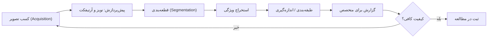

# جلسه ۲۶: هوش مصنوعی در تصاویر پزشکی

> **درس:** مقدمهای بر هوش مصنوعی و کاربرد آن در مهندسی پزشکی
> **مدت پیشنهادی:** ۶۰ تا ۹۰ دقیقه · **سطح:** مقدماتی
> **منابع این جلسه:** منبع ۲ (Erickson, 2021)، منبع ۹ (Peng et al., 2010)، منبع ۱۱ (محتوای مدرس)

> [!IMPORTANT]
> همه‌ی مثال‌ها و تصاویر این جلسه **آموزشی و غیرتشخیصی** هستند: داده‌ی واقعی بیمار در کار نیست، اسکریپت جلسه فقط روی تصاویر ساختگی اجرا می‌شود و هیچ خروجی‌ای مبنای تشخیص یا تصمیم بالینی نیست.

## اهداف جلسه
در پایان این جلسه دانشجو می‌تواند:
1. تصویر پزشکی را به‌عنوان یک ماتریس عددی توصیف کند و چهار مدال اصلی (Modality) (MRI، CT، X-ray، اولتراسوند) را مقایسه کند.
2. خط لوله‌ی استاندارد پردازش تصویر پزشکی (کسب → پیش‌پردازش → قطعه‌بندی → طبقه‌بندی → گزارش) را شرح دهد.
3. کانولوشن دوبعدی (2D Convolution) را با دست اجرا کند و نقش کرنل (Kernel) را توضیح دهد.
4. آستانه‌گذاری اوتسو (Otsu) و برچسب‌گذاری اجزای همبند (Connected Components) را توضیح دهد.
5. دست‌کم سه محدودیت جدی AI در تصویر پزشکی (جابه‌جایی داده، هزینه‌ی برچسب‌گذاری، تعمیم‌پذیری) را با مثال توضیح دهد.

---

## ۱. تصویر، ماتریسی از اعداد است

به کامپیوتر که می‌گویید «تصویر»، آن یک ماتریس بزرگ از اعداد می‌بیند: هر پیکسل (Pixel) یک شدت روشنایی ۰ تا ۲۵۵. پس «دیدن» برای الگوریتم یعنی «محاسبه روی ماتریس». تصویر پزشکی همین است، فقط معنای عدد مهم‌تر است: همان عدد ممکن است تراکم بافت باشد، یا سرعت جریان خون. کل جلسه ۲۴ (شبکه‌های عصبی) روی همین ماتریس‌های عددی کار می‌کند؛ امروز ابزارهای کلاسیکِ قبل از شبکه‌های عصبی را می‌بینیم — چون هنوز در هر سیستم واقعی، قبل از شبکه، این گام‌ها اجرا می‌شوند.

## ۲. چهار مدال تصویربرداری در یک نگاه

جدول مقایسه‌ای **کیفی** (بدون اعداد؛ برای جزئیات فیزیکی به منبع ۲ مراجعه کنید):

| مدال | فیزیک underlying | نقاط قوت | محدودیت‌ها |
|---|---|---|---|
| MRI | میدان مغناطیسی و رزونانس مغناطیسی | بدون پرتو یونیزه؛ جزئیات عالی بافت نرم | گران، زمان‌بر، حساس به حرکت بیمار |
| CT | پرتو ایکس و بازسازی حجمی | سریع؛ عالی برای استخوان و وضعیت‌های حاد | دوز تابش یونیزه |
| X-ray | پرتو ایکس پروجکشنی | ارزان، سریع، همه‌جا در دسترس | هم‌پوشانی ساختارها روی هم |
| Ultrasound | بازتاب امواج صوت | بی‌خطر، بی‌درنگ، متحرک | وابسته به مهارت اپراتور؛ پنجره‌ی اکوستیک محدود |

نکته‌ی AI: هر مدال «ظاهر» متفاوتی دارد؛ مدلی که فقط روی CT آموزش دیده، روی MRI بی‌معناست. این مقدمه‌ی بحث تعمیم‌پذیری بخش ۷ است.

## ۳. خط لوله‌ی پردازش تصویر پزشکی

> [!NOTE]
> «گزارش برای متخصص» — نه «تشخیص». در همه‌ی کاربردهای این درس، خروجی مدل ورودیِ تصمیم انسان است؛ این مرز را از جلسه ۱ تا ۲۷ نگه می‌داریم.

## ۴. کانولوشن: موتور همه‌ی فیلترها

فیلتر کردن تصویر یعنی به‌هم‌ریختن مقدار هر پیکسل با همسایه‌هایش با یک الگوی ثابت به نام **کرنل (Kernel)**. کرنل ۳×۳ را روی هر پیکسل می‌گذاریم، ضرب‌های متناظر را جمع می‌کنیم:

$$G[i,j] = \sum_{u=-1}^{1}\sum_{v=-1}^{1} K[u,v] \cdot I[i+u,\ j+v]$$

ساده‌ترین کرنل، میانگین‌گیر است که تصویر را نرم می‌کند:

$$K_{\text{box}} = \frac{1}{9}\begin{bmatrix} 1 & 1 & 1 \\ 1 & 1 & 1 \\ 1 & 1 & 1 \end{bmatrix}$$

برای یافتن لبه، از مشتق استفاده می‌کنیم؛ کرنل‌های سوبل (Sobel) مشتق افقی و عمودی را تخمین می‌زنند:

$$S_x = \begin{bmatrix} -1 & 0 & +1 \\ -2 & 0 & +2 \\ -1 & 0 & +1 \end{bmatrix} \qquad S_y = \begin{bmatrix} -1 & -2 & -1 \\ 0 & 0 & 0 \\ +1 & +2 & +1 \end{bmatrix} \qquad \big|\nabla I\big| = \sqrt{G_x^2 + G_y^2}$$

قاعده‌ی طلایی که در کد دیدید: **اول هموار کن، بعد مشتق بگیر** — وگرنه مشتق، نویز را بزرگ می‌کند نه لبه را. در اسکریپت این جلسه، کانولوشن با دست و با حلقه‌های پایتون نوشته شده تا مکانیک آن را ببینید (در کتابخانه‌های واقعی همین عملیات به‌صورت بهینه و برداری اجرا می‌شود).

## ۵. قطعه‌بندی: از پیکسل به شیء

قطعه‌بندی (Segmentation) یعنی جدا کردن «جسم» از «پس‌زمینه». ساده‌ترین راه: آستانه‌گذاری — پیکسل‌های روشن‌تر از یک عدد ۱ و بقیه ۰. اما آن عدد را از کجا بیاوریم؟ روش اوتسو (Otsu) آستانه را خودکار انتخاب می‌کند: آستانه‌ای که واریانس بین‌دوکلاس را بیشینه کند:

$$\sigma_B^2(t) = w_0(t)\, w_1(t)\, \big[\mu_0(t) - \mu_1(t)\big]^2$$

که $w_0$ و $w_1$ سهم پیکسل‌های دو طرف آستانه و $\mu_0$ و $\mu_1$ میانگین شدت هر کلاس است. بعد از ماسک دودویی، اجزای همبند (Connected Components) را با جست‌وجوی سطح‌اول (همان BFS جلسه ۵!) برچسب می‌زنیم و برای هر جسم مساحت، مرکز، میانگین شدت و فشردگی حساب می‌کنیم.

در اجرای واقعی اسکریپت روی صحنه‌ی ساختگی ۴۸×۴۸ (دو دایره‌ی تیزمرز + یک لکه‌ی پخش‌شده): میانگین شدت پس از فیلتر میانگین‌گیر حفظ شد (۵۱٫۲۰ → ۵۱٫۲۰)؛ ۲۴۵ پیکسل (۰٫۱۰۶ تصویر) گرادیان بالای آستانه داشتند؛ آستانه‌ی اوتسو ۹۲ انتخاب شد (۲۷۵ پیکسل = ۰٫۱۱۹ بالای آن) و ۳ جسم پیدا شد:

| جسم | مساحت (px) | مرکز (y، x) | میانگین شدت | محیط (px) | فشردگی |
|---|---|---|---|---|---|
| ۱ | ۱۵۶ | ۱۴٫۰، ۱۶٫۰ | ۱۶۶٫۵ | ۳۶ | ۱٫۵۱۳ |
| ۲ | ۷۴ | ۳۱٫۹، ۱۲٫۸ | ۱۰۴٫۲ | ۲۶ | ۱٫۳۷۶ |
| ۳ | ۴۵ | ۳۴٫۰، ۳۶٫۰ | ۱۴۵٫۶ | ۲۰ | ۱٫۴۱۴ |

نکته‌ی صادقانه: فشردگی اینجا $4\pi A/P^2$ با محیطِ شمرده‌شده‌ی پیکسلی است؛ در تصویر گسسته حتی دیسک کامل عدد حدود ۱٫۵ می‌گیرد (نه ۱ پیوسته) — پس فقط مقایسه‌ی نسبی اجسام معنا دارد. اندازه‌گیری دیجیتال ≠ ریاضی پیوسته.

## ۶. طبقه‌بند نزدیک‌ترین مرکز

طبقه‌بند نزدیک‌ترین مرکز (Nearest Centroid) از هر کلاس یک «مرکز وزنی» (میانگین ویژگی‌ها) می‌سازد و هر نمونه‌ی جدید را به نزدیک‌ترین مرکز می‌دهد:

$$\hat{y}(f) = \arg\min_{c \in \{\text{round},\ \text{diffuse}\}} \lVert f - \mu_c \rVert_2$$

اسکریپت، ۶۴ تصویر ساختگی ۳۲×۳۲ می‌سازد: ۴۸ تصویر آموزش (۲۴ «دایره‌ی تیزمرز» + ۲۴ «لکه‌ی پخش‌شده») و ۱۶ تصویر آزمون (۸+۸). دو ویژگی: چگالی لبه (سهم پیکسل‌های گرادیان‌بالا) و کنتراست اوج. نتیجه‌ی اجرای واقعی:

| مرکز کلاس | چگالی لبه | کنتراست اوج |
|---|---|---|
| دایره‌ی تیزمرز | ۰٫۱۲۶۳ | ۱۶۴٫۴ |
| لکه‌ی پخش‌شده | ۰٫۰۰۰۵ | ۱۰۶٫۵ |

روی ۱۶ نمونه‌ی آزمون: TP=۸، FP=۰، FN=۰، TN=۸ → دقت ۱٫۰۰۰. وقتی مدل را روی بزرگ‌ترین جسم صحنه‌ی بخش A اعمال کردیم، ویژگی‌ها (۰٫۲۹۶۸، ۱۷۱٫۰) با فاصله‌های ۶٫۶۴۸ و ۶۴٫۴۵۹، کلاس «دایره» را پیش‌بینی کرد — چون آن جسم واقعاً دایره بود و برچسب حقیقت زمینی هم همین بود.

> [!WARNING]
> دقت ۱٫۰۰۰ اینجا ارزش «مثال آموزشی» دارد نه «نتیجه‌ی علمی»: کلاس‌ها را خودِ ما با فاصله‌ی روشن ساخته‌ایم. در داده‌ی واقعی، چنین جدایی استثناست نه قاعده — دقیقاً به همین دلیل ادعای عملکرد بالینی از این مثال‌ها گرفته نمی‌شود.

## ۷. محدودیت‌هایی که باید جدی بگیرید

- **جابه‌جایی داده (Dataset Shift):** مدل روی اسکنر یک بیمارستان آموزش دیده و روی اسکنر بیمارستان دیگر (یا پروتکل دیگر) افت می‌کند؛ «ظاهر» تصویر عوض می‌شود، نه فقط بیمارها.
- **هزینه‌ی برچسب‌گذاری (Annotation Cost):** برچسب تصویر پزشکی را متخصص میدهد؛ ساعت‌های کار متخصص گران‌ترین جزء هر پروژه است و برچسب ناهم‌قول (بین دو متخصص) نویز ورودی مدل است.
- **تعمیم‌پذیری (Generalisation):** دقت بالای مجموعه‌ی آزمونِ «از همان توزیع» تضمینی برای جمعیت جدید نیست؛ اعتبارسنجی بیرونی (مجموعه‌ی کاملاً جدا) استاندارد پژوهش است — بحث جلسه ۲۷.
- **قطعه‌بندی ناقص:** اگر قطعه‌بندی خطا کند، همه‌ی ویژگی‌های بعدی خطا می‌خورند؛ خطا در ابتدای خط لوله پخش می‌شود.

---

## 🔬 پیوند با مهندسی پزشکی

- **مطالعه‌ی اندازه‌گیری (نه تشخیص):** در یک مطالعه‌ی آموزشی فرضی، می‌خواهیم از تصاویر میکروسکوپیِ ساختگی «تعداد و توزیع اندازه‌ی ذرات» را استخراج کنیم؛ خط لوله‌ی امروز (فیلتر → آستانه → اجزای همبند → ویژگی) دقیقاً همین کار را می‌کند. خروجی، یک جدول آماری برای پژوهش است، نه یک نتیجه‌ی بالینی.
- **چرا همچنان کلاسیک؟** در تجهیزات بالینی محدود منابع (سرعت، حافظه)، فیلتر کلاسیک هنوز خط اول است؛ شبکه‌ی عصبی معمولاً بعد از پیش‌پردازش وارد می‌شود.
- تأکید: همه‌ی موارد آموزشی و غیرتشخیصی‌اند.

## ✍️ فعالیت کلاسی / کارگاه

1. کانولوشن با دست: ردیف `(10, 20, 40, 20, 10)` را با کرنل یک‌بعدی $(\tfrac{1}{3}, \tfrac{1}{3}, \tfrac{1}{3})$ فیلتر کنید (مرز را کپی بگیرید). *(کلید در راهنمای مدرس.)*
2. از جدول اجزای بخش ۵ حدس بزنید کدام جسم «لکه‌ی پخش‌شده» است و کدام دو «دایره»؛ کدام ویژگی بیشتر کمک کرد؟
3. چرا در کد، سوبل روی تصویر هموارشده اعمال شد و نه روی تصویر خام؟ با عدد جدول بخش ۶ توضیح دهید.

## 💻 کد آموزشی

`code/session_26_medical_imaging.py` — **فقط کتابخانه استاندارد پایتون** (بدون numpy/sklearn/matplotlib)، با seed ثابت و خروجی قطعی؛ همه‌ی اعداد این فایل از اجرای واقعی همین اسکریپت است:

- **بخش A:** کانولوشن دوبعدی دست‌ساز (میانگین‌گیر و سوبل با مرز تکراری)، آستانه‌گذاری اوتسو، اجزای همبند با BFS و نمایش ASCII تصویر/لبه/ماسک.
- **بخش B:** ساخت ۴۸ تصویر آموزش و ۱۶ تصویر آزمون (۶۴ تصویر در مجموع) از دو کلاس، استخراج دو ویژگی، طبقه‌بند نزدیک‌ترین مرکز و ارزیابی.

اجرا: `python3 code/session_26_medical_imaging.py` (در Colab هم بدون نصب اجرا می‌شود). برای تمرین بیشتر، در Colab می‌توانید همین خط لوله را روی دیتاست `sklearn.datasets.load_digits` (۸×۸، همراه scikit-learn) پیاده کنید — نسخه‌ی ارسالی عمداً std-only است.

## 📘 واژهنامه

| واژه | معادل انگلیسی | تعریف کوتاه |
|---|---|---|
| پیکسل | Pixel | کوچک‌ترین خانه‌ی تصویر با یک شدت عددی |
| کرنل | Kernel | ماتریس کوچک ضرایب فیلتر |
| کانولوشن | Convolution | عمل جمعِ ضرب کرنل با همسایه‌ها |
| سوبل | Sobel | جفت کرنل تخمین مشتق افقی/عمودی |
| قطعه‌بندی | Segmentation | جدا کردن جسم از پس‌زمینه |
| آستانه‌گذاری | Thresholding | دودویی کردن تصویر با یک عدد |
| اوتسو | Otsu | انتخاب خودکار آستانه با واریانس بین‌کلاس |
| اجزای همبند | Connected Components | گروه‌بندی پیکسل‌های متصل (BFS) |
| نزدیک‌ترین مرکز | Nearest Centroid | طبقه‌بندی با فاصله تا میانگین کلاس |
| جابه‌جایی داده | Dataset Shift | تغییر توزیع داده بین آموزش و استفاده |
| تعمیم‌پذیری | Generalisation | عملکرد روی داده‌ی ندیده‌ی واقعی |

## ❓ پرسشهای خودآزمون

1. چرا «اول هموارسازی، بعد مشتق»؟ اگر برعکس انجام شود چه می‌شود؟
2. روش اوتسو چه کمیت را بیشینه می‌کند و بر فرض چه چیزی کار خوب می‌کند؟
3. جابه‌جایی داده (Dataset Shift) را با یک مثال تصویری توضیح دهید.
4. چرا دقت ۱٫۰۰۰ روی داده‌ی ساختگی، ادعای علمی برای دنیای واقعی نمی‌سازد؟

> کلید پاسخ‌ها در بخش «راهنمای مدرس» انتهای فایل آمده است.

## 📝 تکلیف

1. اسکریپت را اجرا کنید و جدول اجزای همبند را گزارش دهید؛ توضیح دهید چرا میانگین شدت پس از فیلتر میانگین‌گیر تغییر نکرد (راهنمایی: جمع ضرایب کرنل و مرز تکراری).
2. `EDGE_T` را در کد از ۱۲۰ به ۶۰ و سپس ۲۰۰ تغییر دهید؛ چگالی لبه‌ی هر بار چند شد؟ در چند جمله توضیح دهید چرا آستانه‌ی ثابت، «نقطه‌ی کار» (Operating Point) نامیده می‌شود.
3. `TEST_SEED` را به عدد دیگری تغییر دهید و دقت طبقه‌بند را دوباره گزارش کنید؛ با مفهوم تعمیم‌پذیری بخش ۷ وصل کنید.

## 📚 مطالعه پیشنهادی

- منبع ۲ (Erickson, 2021) — فصل‌های تصویربرداری و AI (در سطح منبع)
- منبع ۹ (Peng et al., 2010) — مرور AI در مهندسی پزشکی و انفورماتیک (در سطح منبع)
- منبع وب آزاد: مقاله‌ی اصلی N. Otsu (1979)، A Threshold Selection Method from Gray-Level Histograms
- منبع وب آزاد: مستندات رسمی scikit-learn — `load_digits` (برای تمرین Colab)

---

## 🧭 راهنمای مدرس (از این عنوان تا انتها در نسخه دانشجو حذف شود)

**زمان‌بندی ۹۰ دقیقه:** تصویر به‌عنوان ماتریس و مدال‌ها (۱۵) | خط لوله (۱۰) | کانولوشن با دست (۲۰) | قطعه‌بندی و اوتسو (۱۵) | اجرای کد و طبقه‌بند (۱۵) | محدودیت‌ها و بحث (۱۰) | فعالیت و جمع‌بندی (۵).

**نسخه ۶۰ دقیقه:** بخش ۱ و ۲ فشرده (۱۲)، بخش ۳ و ۴ کامل (۲۲)، بخش ۵ با اجرای کد (۱۲)، بخش ۶ (۸)، فعالیت ۱ (۴)، تکلیف (۲). بخش ۷ به بحث کوتاه تبدیل شود.

**نکات تدریس:**
- کانولوشن را حتماً با دست روی تخته اجرا کنید (فعالیت ۱)؛ همین یک مثال، مفهوم شبکه‌های کانولوشنی جلسه ۲۴ را برای همیشه می‌نشاند.
- روی خطای «قطعه‌بندی بد → ویژگی بد» تأکید کنید: خطا در خط لوله پخش می‌شود؛ این درس در جلسه ۲۷ (اعتبارسنجی) دوباره می‌آید.
- کد std-only و قطعی است و در همین محیط تألیف **کاملاً اجرا و تأیید شده**؛ دوبار اجرا خروجی یکسان می‌دهد.
- اگر وقت داشتید، جدول اجزای همبند را با «چه ویژگی‌ای کدام جسم را لو می‌دهد» بحث کنید: شدت ۱۰۴٫۲ برای لکه‌ی پخش‌شده در برابر ۱۶۶٫۵ و ۱۴۵٫۶ برای دو دایره.

**خروجی مورد انتظار جلسه:** دانشجو کانولوشن ۳×۳ را با دست اجرا کند، بگوید اوتسو چه می‌کند و سه محدودیت بخش ۷ را با جمله‌ی خودش بگوید.

### خروجی تأییدشده‌ی `code/session_26_medical_imaging.py` (اجرای واقعی، seed ثابت)
- صحنه ۴۸×۴۸ با ۳ جسم؛ میانگین شدت پس از فیلتر: ۵۱٫۲۰ → ۵۱٫۲۰.
- لبه‌ها (سوبل روی هموارشده، آستانه ۱۲۰): ۲۴۵ پیکسل = ۰٫۱۰۶ تصویر.
- اوتسو: آستانه ۹۲؛ ۲۷۵ پیکسل = ۰٫۱۱۹ بالای آستانه؛ ۳ جزء همبند (مساحت ≥ ۵).
- جدول اجزا: (۱۵۶، مرکز ۱۴٫۰/۱۶٫۰، شدت ۱۶۶٫۵، محیط ۳۶، فشردگی ۱٫۵۱۳) · (۷۴، ۳۱٫۹/۱۲٫۸، ۱۰۴٫۲، ۲۶، ۱٫۳۷۶) · (۴۵، ۳۴٫۰/۳۶٫۰، ۱۴۵٫۶، ۲۰، ۱٫۴۱۴).
- طبقه‌بند: مراکز (چگالی لبه، کنتراست اوج) — دایره (۰٫۱۲۶۳، ۱۶۴٫۴) و لکه‌ی پخش (۰٫۰۰۰۵، ۱۰۶٫۵)؛ آزمون ۱۶ نمونه: TP=۸، FP=۰، FN=۰، TN=۸، دقت ۱٫۰۰۰.
- اعمال روی بزرگ‌ترین جسم صحنه: ویژگی‌های (۰٫۲۹۶۸، ۱۷۱٫۰)، فاصله‌ها ۶٫۶۴۸ و ۶۴٫۴۵۹ → پیش‌بینی «دایره» (درست).

### کلید فعالیت ۱
با مرز کپی‌شده، خروجی هر پیکسل میانگین خودش و دو همسایه است: پیکسل ۰ = (۱۰+۱۰+۲۰)/۳ ≈ ۱۳٫۳ · پیکسل ۱ = (۱۰+۲۰+۴۰)/۳ ≈ ۲۳٫۳ · پیکسل ۲ = (۲۰+۴۰+۲۰)/۳ ≈ ۲۶٫۷ · پیکسل ۳ ≈ ۲۳٫۳ · پیکسل ۴ ≈ ۱۳٫۳. خروجی: (۱۳٫۳، ۲۳٫۳، ۲۶٫۷، ۲۳٫۳، ۱۳٫۳) — اوج از ۴۰ به ۲۶٫۷ افت کرد: همان حذف فرکانس بالا.

### کلید پرسشهای خودآزمون

نمایش کلید پاسخ

1. مشتق، نویز پهن‌باند را هم تقویت می‌کند؛ هموارسازی اول انرژی نویز را می‌کاهد تا پاسخ مشتق به لبه‌های واقعی بچسبد. برعکسش یعنی شمار پیکسل‌های «لبه» توسط نویز تعیین شود، نه توسط اجسام واقعی.
2. واریانس بین‌دوکلاس $\sigma_B^2$ را بیشینه می‌کند؛ فرض ضمنی: هیستوگرام دوقله‌ای با تفکیک معقول. اگر پس‌زمینه و جسم هم‌شدت باشند، اوتسو هم گمراه می‌شود.
3. مثال: مدل روی تصاویر CT با پروتکل و اسکنر بیمارستان A آموزش دیده؛ روی اسکنر B با نویز و شدت متفاوت، توزیع ورودی عوض شده و عملکرد می‌افتد — بدون این‌که «بیماران» فرق ماهوی کرده باشند.
4. چون کلاس‌ها را خودِ ما با جدایی آشکار ساختیم؛ در داده‌ی واقعی هم‌پوشانی، نویز برچسب و جابه‌جایی داده هست. دقت بالا روی داده‌ی دست‌ساز فقط درست‌کار بودن کد را نشان می‌دهد، نه ارزش بالینی را.

### کلید فعالیت ۲
جسم ۲ (شدت ۱۰۴٫۲، مرکز ۳۱٫۹/۱۲٫۸) لکه‌ی پخش‌شده است: کم‌شدت‌تر و بزرگ‌تر از دایره‌ی کوچک (۴۵ px) اما با فشردگی مشابه اجسام دیگر؛ در نمایش ASCII هم سایه‌ی محو دارد. دو جسم دیگر با شدت ۱۶۶٫۵ و ۱۴۵٫۶ و مرز تیز، دایره‌ها هستند. ویژگی تعیین‌کننده: ترکیب «میانگین شدت + چگالی لبه» (همان دو ویژگی طبقه‌بند).

### کلید فعالیت ۳
چون سوبل مشتق است و مشتقِ نویز، نویز است. هموارسازی اول، نوسان‌های تصادفی را میانگین می‌کند تا پاسخ مشتق به لبه‌های واقعی بچسبد؛ برای همین چگالی لبه‌ی کلاس پخش‌شده در جدول بخش ۶ تقریباً صفر است (۰٫۰۰۰۵) و کلاس دایره ۰٫۱۲۶۳ — تفکیک، مرهون همین ترتیب «اول هموار، بعد مشتق» است. اگر بدون هموارسازی اجرا شود، نویزِ پس‌زمینه خودش پیکسل‌های گرادیان‌بالا می‌سازد و این تفکیک از بین می‌رود (این حالت در اسکریپت ارسالی محاسبه نمی‌شود؛ در تکلیف ۲ می‌توانید با تغییر ترتیب گام‌ها آزمایشش کنید).
