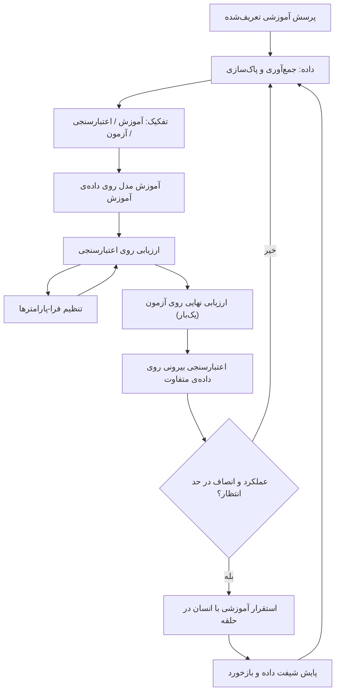

# جلسه ۲۷: سایر کاربردهای AI در مهندسی پزشکی؛ اخلاق و اعتبارسنجی

> **درس:** مقدمه‌ای بر هوش مصنوعی و کاربرد آن در مهندسی پزشکی
> **مدت پیشنهادی:** ۶۰ تا ۹۰ دقیقه · **سطح:** مقدماتی
> **منابع این جلسه:** منبع ۲ (Erickson, 2021)، منبع ۴ (Khang, 2024)، منبع ۵ (Sharma et al., 2023)، منبع ۶ (Khang, 2023)، منبع ۷ (Bagherpour et al., 2024)، منبع ۸ (Guo et al., 2023)، منبع ۱۱ (محتوای مدرس)

> [!WARNING]
> **این جلسه آموزشی و غیرتشخیصی است.** هیچ مثال، کد یا عدد این جلسه مبنای تصمیم بالینی درباره بیمار واقعی نیست. بحث اخلاق، پیش‌شرط حرفه‌ای هر کاربرد هوش مصنوعی (AI) در سلامت است، نه پیوستِ اختیاری آن.

---

## اهداف جلسه
در پایان این جلسه دانشجو می‌تواند:
1. دست‌کم چهار نوع سوگیری (Bias) در داده و مدل را با مثال پزشکی از هم تشخیص دهد.
2. چرخه‌ی اعتبارسنجی (Validation) شامل تفکیک آموزش/اعتبارسنجی/آزمون، اعتبارسنجی متقابل (Cross-Validation) و اعتبارسنجی بیرونی (External Validation) را توضیح دهد و جاهای خطر شیفت داده (Dataset Shift) و نشت داده (Leakage) را نام ببرد.
3. دو معیار انصاف (Fairness) — شکاف فرصت برابر (Equal-Opportunity Gap) و شکاف برابری جمعیتی (Demographic-Parity Gap) — را تعریف و از خروجی واقعی کد تفسیر کند.
4. الزام‌های حریم خصوصی (Privacy)، رضایت (Consent) و مسئولیت بالینی با «انسان در حلقه» (Human-in-the-Loop) را در دو جمله برای یک ابزار آموزشی فهرست کند.

## ۱. سایر کاربردها در یک نگاه

جلسات قبل روی سیگنال و تصویر تمرکز داشتند؛ دامنه‌ی AI در مهندسی پزشکی بزرگ‌تر است:

| حوزه | مثال کاربرد آموزشی | منبع درس |
|---|---|---|
| مهندسی بافت (Tissue Engineering) و بازسازی ارگان | پیش‌بینی خواص داربست (Scaffold) یا رشد سلول با مدل یادگیری ماشین | منبع ۵ و منبع ۷ و منبع ۸ |
| پزشکی دقیق و اینترنت اشیا (IoT) | ترکیب داده‌های پایش مستمر بیمار برای شخصی‌سازی آموزشی | منبع ۶ |
| رباتیک پزشکی | ربات‌های جراحی کمکی، توان‌بخشی و حمل‌ونقل آزمایشگاهی | منبع ۴ |
| پردازش داده‌های پزشکی عمومی | خلاصه‌سازی مستندات و پشتیبانی تصمیم آموزشی | منبع ۲ |

> [!NOTE]
> همه‌ی این حوزه‌ها یک سرنوشت مشترک دارند: قبل از هر چیز، سؤال «چقدر می‌توانیم به این سیستم اعتماد کنیم؟» — و پاسخ آن دو واژه دارد: **اعتبارسنجی** و **اخلاق**. بقیه‌ی جلسه همین دو واژه است.

## ۲. انواع سوگیری: از داده تا تصمیم

سوگیری یعنی خطای سیستماتیک (نه تصادفی) که به گروهی از نمونه‌ها زیان می‌رساند. پنج نوع پرتکرار در کاربردهای پزشکی:

| نوع سوگیری | تعریف کوتاه | مثال آموزشی |
|---|---|---|
| نمونه‌برداری (Sampling) | زیرگروهی در داده‌ی آموزش کم‌نمایی یا پرنمایی شده است | داده از فقط یک بیمارستان جمع شده |
| اندازه‌گیری (Measurement) | کیفیت سنسور یا نحوه‌ی ثبت بین زیرگروه‌ها متفاوت است | دستگاه ضبط قدیمی‌تر نویز بیشتری دارد |
| برچسب‌گذاری (Label) | برچسب واقعیت (Ground Truth) خودش خطای سیستماتیک دارد | برچسب از گزارش یک متخصص خاص نوشته شده |
| تاریخی (Historical) | الگوهای ناعادلانه‌ی گذشته در داده منجمد می‌شود | اولویت‌دهی گذشته به گروهی خاص در ارجاع |
| تأیید (Confirmation) | توسعه‌دهنده فقط سناریوهای موفق را می‌بیند و گزارش می‌کند | فقط نمونه‌های درست‌پیش‌بینی نمایش داده می‌شود |

نکته‌ی امتحانی: سوگیری همیشه «دقت کل را کم» نمی‌کند؛ ممکن است دقت کل بالا بماند اما **شکاف عملکرد بین زیرگروه‌ها** بزرگ شود. به همین دلیل در بخش ۵، کنار Accuracy کل، متریک انصاف را جداگانه می‌خوانیم.

## ۳. روش‌شناسی اعتبارسنجی

### ۳-۱. سه ظرف داده: آموزش، اعتبارسنجی، آزمون

| ظرف | نقش | چه چیزی با آن تصمیم می‌گیریم؟ |
|---|---|---|
| آموزش (Training) | یادگیری پارامترهای مدل (وزن‌ها، آستانه‌ها) | — |
| اعتبارسنجی (Validation) | مقایسه‌ی مدل‌ها و تنظیم فرا-پارامترها (مثل `max_depth` جلسه ۲۲) | انتخاب مدل |
| آزمون (Test) | یک ارزیابی نهایی، فقط یک‌بار در انتها | گزارش عملکرد واقعی |

### ۳-۲. اعتبارسنجی متقابل و بیرونی

- **اعتبارسنجی متقابل (Cross-Validation):** داده را به $k$ تکه می‌کنیم؛ $k-1$ تکه آموزش و یک تکه اعتبارسنجی، و این را $k$ بار می‌چرخانیم. میانگین و پراکندگی نتایج، برآورد پایدارتری از عملکرد می‌دهد تا یک تفکیک شانسی.
- **اعتبارسنجی بیرونی (External Validation):** ارزیابی روی داده از جمعیت/مرکز/زمانِ متفاوت. مدلی که فقط روی داده‌ی «خانه» خوب است، هنوز عمومیت‌پذیر (Generalizable) نشده است.



### ۳-۳. دو دام مرگبار: شیفت و نشت

- **شیفت داده (Dataset Shift):** توزیع داده‌ی بعد از آموزش عوض می‌شود — شیفت متغیر ورودی (Covariate Shift)، شیفت شیوع (Prior Shift) یا شیفت مفهوم (Concept Shift: رابطه‌ی ویژگی→برچسب عوض می‌شود). مثال آموزشی: ورود یک دستگاه سنسور جدید به بخش.
- **نشت داده (Leakage):** اطلاعاتی از مجموعه‌ی آزمون (یا از آینده) بی‌اجازه وارد آموزش شود. کلاسیک‌ترین شکل پزشکی: تفکیک تصادفی نمونه‌ها وقتی چند رکورد از **همان بیمار** در هر دو ظرف است — تفکیک باید بیمار-محور باشد.

### ۳-۴. انصاف به‌عنوان بخشی از اعتبارسنجی

دو معیار این جلسه (روی زیرگروه‌های $A$ و $B$؛ $\hat{y}$ پیش‌بینی است):

$$Gap_{EO} = \left| TPR_{A} - TPR_{B} \right|$$

$$Gap_{DP} = \left| P(\hat{y}=1 \mid A) - P(\hat{y}=1 \mid B) \right|$$

- **شکاف فرصت برابر (EO):** تفاوت حساسیت (شناسایی درست بیماران) بین زیرگروه‌ها؛ برای کاربرد غربالگری حیاتی است.
- **شکاف برابری جمعیتی (DP):** تفاوت نرخ «مثبت اعلام‌شده» بین زیرگروه‌ها.
- هیچ معیاری «انصاف کامل» را نمی‌سنجد؛ هرکدام یک لنز است. در کد این جلسه می‌بینیم که می‌توان DP را تقریباً صفر و EO را بزرگ داشت.

## ۴. اخلاق: حریم خصوصی، رضایت و مسئولیت بالینی

### ۴-۱. حریم خصوصی و رضایت

- **کمینه‌سازی داده:** فقط ویژگی‌های لازم برای پرسش آموزشی؛ بدون شناسه‌های مستقیم. **ناشناس‌سازی (Anonymization)** و **نام‌گزاری مستعار (Pseudonymization)** ابزار است، نه تضمین کامل.
- **رضایت آگاهانه (Informed Consent):** «برای چه منظوری، توسط چه کسی، تا کجا» روشن باشد؛ استفاده‌ی ثانویه از داده به رضایت جدید نیاز دارد و ناتوان‌سازی از مشارکت باید ممکن باشد.
- **پیامد عملی برای این درس:** به همین دلیل تکلیف و پروژه فقط با داده ساختگی یا دیتاست عمومی آموزشی کار می‌کند (سند پروژه، بخش «قواعد و محدودیت‌ها»).

### ۴-۲. مسئولیت بالینی و انسان در حلقه

- مسئولیت نهایی تصمیم با متخصص انسانی است؛ مدل یک **دستیار** است، نه تصمیم‌گیر.
- **انسان در حلقه (Human-in-the-Loop):** خروجی مدل با مرور انسانی ترکیب می‌شود؛ آستانه‌ها و ترجیحات بالینی قابل تنظیم و مستندند.
- شفافیت: محدودیت‌ها، داده‌ی آموزش و نتایج اعتبارسنجی باید قابل‌مشاهده باشند؛ «جعبه‌سیاه و بی‌پاسخ» مجاز نیست.
- در پروژه‌ی گروهی این درس، بحث مسئولانه درباره‌ی کاربرد پزشکی در ردیف «گزارش و ارائه» و شفاف‌سازی استفاده از ابزار AI و سهم اعضا در ردیف «کار گروهی و مسئولیت‌پذیری» سنجیده می‌شود (سند پروژه، جدول نمره‌دهی).

> [!IMPORTANT]
> قانون طلایی این جلسه: **همه‌ی چیزهایی که امروز می‌سازیم آموزشی و غیرتشخیصی‌اند.** خروجی هیچ اسکریپت یا نوت‌بوک این درس نباید درباره‌ی بیمار واقعی تفسیر شود؛ این مرز، همان پیام «مسئولیت بالینی» است که در مقیاس واقعی نیز برقرار می‌ماند.

## ۵. مشاهده‌ی سوگیری به‌صورت عددی: اجرای کد جلسه

اسکریپت `code/session_27_ethics_fairness.py` (فقط کتابخانه‌ی استاندارد پایتون؛ بدون `numpy` و `sklearn`) سناریوی ساختگی زیر را اجرا می‌کند:

- ۳۶۰ نمونه ساختگی در دو زیرگروه: **گروه A** با ۲۴۰ نمونه (شیوع بیمار ۴۰٪، نویز کم با $\sigma=0.12$) و **گروه B** با ۱۲۰ نمونه (شیوع ۲۵٪، نویز بیشتر با $\sigma=0.22$).
- یک طبقه‌بند آستانه‌ای (Threshold Classifier) روی «امتیاز خطر» فقط با داده‌ی آموزش آموزش می‌بیند (آستانه‌ای که دقت متوازن را بیشینه می‌کند) و تفکیک آموزش/آزمون (~۳۰٪) با شناسه‌ی پایدار نمونه‌ها انجام می‌شود تا نتیجه نسبت به ترتیب داده‌ها قطعی باشد.

**خروجی واقعی اجرای اسکریپت (seed ثابت):**

| شاخص | مقدار |
|---|---|
| نمونه‌های آموزش / آزمون | ۲۵۰ / ۱۱۰ |
| آستانه‌ی آموخته‌شده (دقت متوازن آموزش) | ۰٫۴۴۹ (۰٫۸۰۳) |
| **Accuracy کل** | **۰٫۷۹۱** |
| گروه A: تعداد / بیمار / Acc / TPR / نرخ انتخاب | ۷۵ / ۳۰ / ۰٫۸۵۳ / ۰٫۹۶۷ / ۰٫۵۲۰ |
| گروه B: تعداد / بیمار / Acc / TPR / نرخ انتخاب | ۳۵ / ۱۰ / ۰٫۶۵۷ / ۰٫۸۰۰ / ۰٫۵۱۴ |
| شکاف دقت (Accuracy Gap) | ۰٫۱۹۶ |
| **شکاف فرصت برابر (EO Gap)** | **۰٫۱۶۷** |
| شکاف برابری جمعیتی (DP Gap) | ۰٫۰۰۶ |

```bash
python3 code/session_27_ethics_fairness.py
```

سه درس از همین جدول:

1. **دقت کل گمراه می‌کند:** Accuracy کل ۰٫۷۹۱ «قابل‌قبول» به‌نظر می‌رسد، اما دقت گروه B فقط ۰٫۶۵۷ است — شکاف ۰٫۱۹۶ یعنی نزدیک ۲۰ واحد درصد عقب‌ماندگی.
2. **هر معیار انصاف یک لنز است:** شکاف DP تقریباً صفر (۰٫۰۰۶) است اما EO ۰٫۱۶۷؛ مدل «به‌طور میانگین به اندازه‌ی برابر مثبت اعلام می‌کند» ولی در کشف درست بیماران گروه B (TPR = ۰٫۸۰۰ در برابر ۰٫۹۶۷) ضعیف‌تر است. با تکیه فقط روی DP، سوگیری پنهان می‌ماند.
3. **کم‌نمایی، عدم‌قطعیت می‌آورد:** گروه B در آزمون فقط ۳۵ نمونه (۱۰ بیمار) دارد؛ برآورد متریک‌هایش شکننده‌تر است — نکته‌ای که در گزارش‌دهی واقعی باید ذکر شود.

پل به جلسه ۲۸: همین چرخه‌ی «آموزش → ارزیابی → انصاف → اخلاق» جمع‌بندی ماژول‌های ۱۷ تا ۲۶ را در میان‌ترم دوم می‌بیند.

## 🔬 پیوند با مهندسی پزشکی

- **صحنه‌ی آموزشی ما:** یک ابزار غربالگری فرضی روی داده‌ی ساختگی که زیرگروه B در آن سنسور نویزی‌تر و سهم کمتری از داده دارد — الگویی که در استقرار واقعیِ ابزارهای سلامت هم دیده می‌شود و پیش از انتشار باید گزارش شود.
- **ترجمه به مهندسی:** ماتریس درهم‌ریختگی و متریک‌های جلسه ۲۱ را **به‌ازای هر زیرگروه** گزارش کنید؛ گزارش‌دهیِ «فقط کل» سوگیری را پنهان می‌کند.
- تأکید دوباره: داده و خروجی این جلسه صرفاً آموزشی و غیرتشخیصی‌اند.

## ✍️ فعالیت کلاسی / کارگاه

1. اسکریپت جلسه را اجرا کنید و جدول بخش ۵ را با اعداد **خودتان** کامل کنید.
2. گروه‌های دو نفره: یکی از شما «مدافع مدل» است و دیگری «بازرس اخلاق»؛ از روی جدول بخش ۵، دو استدلال مخالف بنویسید.
3. در چرخه‌ی اعتبارسنجی بخش ۳، اگر سنسور بخش در وسط پروژه عوض شود، کدام پیکان دیاگرام از نو فعال می‌شود و چرا؟

## 💻 کد آموزشی

- `code/session_27_ethics_fairness.py` — ساخت داده‌ی ساختگی دو زیرگروه، آموزش طبقه‌بند آستانه‌ای، گزارش Accuracy کل، متریک‌های هر زیرگروه، شکاف EO و شکاف DP، و خودآزمون `assert` (قطعی با seed ثابت و مستقل از ترتیب داده‌ها).
- پیش‌زمینه متریک‌ها: `code/session_21_ml_metrics.py` و جلسه ۲۱؛ خط لوله‌ی ML: `code/session_22_sklearn_workshop.py` و جلسه ۲۲.

## 📘 واژهنامه

| واژه | معادل انگلیسی | تعریف کوتاه |
|---|---|---|
| سوگیری | Bias | خطای سیستماتیک در داده یا مدل |
| اعتبارسنجی متقابل | Cross-Validation | چرخاندن $k$ تکه‌ی داده برای برآورد پایدارتر |
| اعتبارسنجی بیرونی | External Validation | ارزیابی روی داده‌ی مرکز/جمعیت/زمانِ متفاوت |
| شیفت داده | Dataset Shift | تغییر توزیع داده نسبت به زمان آموزش |
| نشت داده | Leakage | ورود اطلاع آزمون/آینده به آموزش |
| شکاف فرصت برابر | Equal-Opportunity Gap | اختلاف حساسیت (TPR) زیرگروه‌ها |
| شکاف برابری جمعیتی | Demographic-Parity Gap | اختلاف نرخ پیش‌بینی مثبت زیرگروه‌ها |
| ناشناس‌سازی | Anonymization | حذف/تبدیل شناسه‌های مستقیم فرد |
| رضایت آگاهانه | Informed Consent | اجازه‌ی آگاهانه و هدفمند فرد برای استفاده از داده |
| انسان در حلقه | Human-in-the-Loop | مرور و تأیید نهایی انسانی روی تصمیم مدل |

## ❓ پرسشهای خودآزمون

1. سوگیری نمونه‌برداری و سوگیری اندازه‌گیری را با یک مثال از هم جدا کنید.
2. اگر اعتبارسنجی متقابل نتیجه‌ی خوبی داده، چرا هنوز به اعتبارسنجی بیرونی نیاز داریم؟
3. در اجرای کد جلسه، شکاف DP تقریباً صفر (۰٫۰۰۶) اما شکاف EO بزرگ (۰٫۱۶۷) است. این یعنی چه و کدام معیار برای غربالگری مهم‌تر است؟
4. نشت داده در تفکیک بیمار-محور یعنی چه؟ یک مثال بسازید.
5. نقش «انسان در حلقه» را برای یک ابزار آموزشی غیرتشخیصی در دو جمله توضیح دهید.

> کلید پاسخ‌ها در بخش «راهنمای مدرس» انتهای فایل آمده است.

## 📝 تکلیف

1. اسکریپت `code/session_27_ethics_fairness.py` را اجرا و جدول بخش ۵ را کامل کنید؛ سپس نویز گروه B را از ۰٫۲۲ به ۰٫۱۲ (هم‌نویز با گروه A) تغییر دهید و گزارش دهید کدام شکاف‌ها کم شد و آیا Accuracy کل عوض شد.
2. در ۱۵۰ تا ۲۰۰ کلمه بنویسید: اگر بنا بود داده‌ی آموزشی این ابزار از رکوردهای واقعی جمع شود، سه الزام حریم خصوصی و رضایت کدام‌ها بودند؟
3. برای «ابزار غربالگری فرضی» یک طرح اعتبارسنجی ۵ خطی بنویسید: تفکیک، معیار کل، معیار زیرگروه، سناریوی شیفت داده، و نقش انسان در حلقه.

## 📚 مطالعه پیشنهادی

- منبع ۲ (Erickson, 2021) — فصل‌های مرتبط با ارزیابی و پیاده‌سازی AI پزشکی (منبع ۲)
- منبع ۴ (Khang, 2024) — رباتیک و ابزارهای تشخیصی-کمکی (منبع ۴)
- منبع ۵ (Sharma et al., 2023)، منبع ۷ (Bagherpour et al., 2024)، منبع ۸ (Guo et al., 2023) — یادگیری ماشین در مهندسی بافت و بازسازی (منابع ۵، ۷، ۸)
- منبع وب آزاد: راهنمای اخلاق و حکمرانی هوش مصنوعی سلامت سازمان جهانی بهداشت (WHO) — برای بحث حریم خصوصی و مسئولیت
- مرور دوباره جلسه ۲۱ (متریک‌ها) و جلسه ۲۲ (خط لوله scikit-learn) پیش از میان‌ترم

---

## 🧭 راهنمای مدرس (از این عنوان تا انتها در نسخه دانشجو حذف شود)

**این جلسه، جمع‌بندی مفهومی «اعتماد به سیستم» است: سوگیری + اعتبارسنجی + اخلاق.** بخش ۵ با اعداد واقعی اجرای اسکریپت کار می‌کند؛ اسکریپت در محیط تألیف اجرا و خروجی بالا ثبت شده است.

### برنامه جلسه (۹۰ دقیقه)

| زمان | فعالیت |
|---|---|
| ۵ دقیقه | سایر کاربردها (بخش ۱): هر حوزه یک جمله؛ پیوند با منابع ۴ تا ۸ |
| ۱۵ دقیقه | انواع سوگیری (بخش ۲): مثال‌ها را از کلاس بگیرید |
| ۲۰ دقیقه | روش‌شناسی اعتبارسنجی (بخش ۳): چرخه را روی تخته بکشید؛ سؤال شیفت/نشت را بپرسید |
| ۲۰ دقیقه | اخلاق (بخش ۴): بحث رضایت و مسئولیت؛ نقش‌آفرینی کوتاه |
| ۲۰ دقیقه | کار با کد (بخش ۵): اجرای زنده، جدول‌کشی و تفسیر شکاف‌ها |
| ۱۰ دقیقه | فعالیت ۳ و جمع‌بندی؛ اعلام تکلیف |

### نسخه ۶۰ دقیقه‌ای

سایر کاربردها (۵) | سوگیری‌ها (۱۰) | اعتبارسنجی و شیفت/نشت (۱۵) | اخلاق (۱۰) | اجرای کد و تفسیر جدول (۱۵) | تکلیف (۵). فعالیت‌های ۲ و ۳ به تکلیف منتقل شود.

### نکات تدریس

- **عددهای بخش ۵ واقعی‌اند:** خروجی اجرای دوباره‌ی اسکریپت در محیط تألیف یکسان بوده (seed ثابت) و جدول را می‌توانید زنده تأیید کنید. اگر دانشجو عددهای متفاوت دید، یعنی اسکریپت را تغییر داده است.
- بحث طلایی کلاس: «چرا DP تقریباً صفر است؟» پاسخ کوتاه — نرخ انتخاب هر دو گروه به‌طور تقریبی برابر درآمده (۰٫۵۲۰ در برابر ۰٫۵۱۴) چون اشتباهات دو نوعِ گروه B (از دست دادن بیمار و مثبت کاذب) همدیگر را جبران کرده‌اند؛ اما حساسیت گروه B پایین است. این «جبران‌شدگی» دقیقاً دلیل نیاز به چند معیار انصاف است.
- از دانشجو نپرسید «مدل چقدر بد است؟» — بپرسید «گزارش کدام متریک این بدی را پنهان می‌کرد؟».
- مرز غیرتشخیصی را هر بار که مثال پزشکی می‌آید، با یک جمله تکرار کنید.

**خروجی مورد انتظار جلسه:** هر دانشجو جدول اعداد را تفسیر کند و بتواند بگوید «کدام معیار چه چیزی را نشان داد و چه چیزی را پنهان کرد».

### کلید فعالیت و پرسش‌های خودآزمون

<details>
<summary>نمایش کلید پاسخ</summary>

**فعالیت ۳:** پیکان «داده → تفکیک → آموزش → ارزیابی» از نو فعال می‌شود؛ تغییر سنسور یعنی تغییر توزیع ورودی (شیفت متغیر ورودی)، پس داده باید دوباره جمع/پاک‌سازی و کل چرخه اعتبارسنجی تکرار شود.

1. نمونه‌برداری: زیرگروه در داده کم/زیاد آمده (مثال: فقط یک بیمارستان). اندازه‌گیری: خود ثبتِ سیگنال/ویژگی بین گروه‌ها متفاوت است (مثال: دستگاه قدیمی‌ترِ نویزی‌تر برای گروه B).
2. اعتبارسنجی متقابل فقط روی همان توزیع و همان جمعیت چرخ می‌خورد؛ عمومیت‌پذیری به داده‌ی متفاوت (مرکز/جمعیت/زمان دیگر) نیاز دارد و شیفت داده را آشکار می‌کند.
3. نرخ مثبت‌شدن دو زیرگروه تقریباً برابر است (۰٫۵۲۰ و ۰٫۵۱۴) اما حساسیت گروه B پایین‌تر است (۰٫۸۰۰ در برابر ۰٫۹۶۷). برای غربالگری، EO (حساسیت) مهم‌تر است؛ فقط نگاه به DP سوگیری را پنهان می‌کند.
4. اینکه رکوردهای یک بیمار هم‌زمان در آموزش و آزمون باشند؛ مدل «شکل» همان بیمار را دیده و عملکرد آزمون خوش‌بینانه می‌شود. درمان: تفکیک بیمار-محور، نه رکورد-محور.
5. مدل پیشنهاد می‌دهد، انسان بررسی و تصمیم می‌گیرد و تصمیم مستند می‌شود؛ چون خروجی آموزشی/غیرتشخیصی است، هیچ اقدامی بدون مرور انسانی معتبر نیست.

</details>
