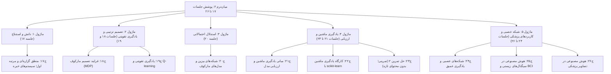

# جلسه ۲۸: میان‌ترم دوم / ارزیابی میان‌دوره‌ای دوم (پوشش جلسات ۱۷ تا ۲۶)

> **درس:** مقدمه‌ای بر هوش مصنوعی و کاربرد آن در مهندسی پزشکی
> **مدت پیشنهادی:** ۶۰ تا ۹۰ دقیقه · **سطح:** مقدماتی
> **منابع این جلسه:** منبع ۱ (Russell & Norvig, 2016)، منبع ۲ (Erickson, 2021)، منبع ۱۰ (Liu, 2017)، منبع ۱۱ (محتوای مدرس)

> [!IMPORTANT]
> **دامنه‌ی این میان‌ترم، جلسات ۱۷ تا ۲۶ است.** جلسه ۱۶ خودش میان‌ترم اول (پوشش جلسات ۱ تا ۱۵) بود و **در این آزمون پوشش داده نمی‌شود**؛ مطالب آن فقط به‌عنوان پیش‌نیاز خوانده می‌شود. این سؤال‌ها **نمونه** هستند؛ سؤال‌های واقعی لزوماً از همین قالب و اعداد استفاده نمی‌کنند اما دامنه و سطح دشواری مشابه خواهد بود.

---

## اهداف جلسه
در پایان این جلسه دانشجو می‌تواند:
1. نقشه مفهومی نیم‌ساله دوم (جلسات ۱۷ تا ۲۶) را بازتولید کند و پیوند منطق، تصمیم، احتمال، یادگیری ماشین و کاربردها را توضیح دهد.
2. مفاهیم کلیدی هر جلسه را در جدول مرور بشناسد و خود را بسنجد.
3. با حل ۱۸ سؤال نمونه (۱۲ چندگزینه‌ای + ۵ تشریحی کوتاه + ۱ تحلیلی) خلأهای یادگیری را پیش از آزمون پیدا کند.
4. سؤال‌های تحلیلی را با استدلال گام‌به‌گام و محاسبه‌ی دقیق پاسخ دهد.

## ۱. نقشه مفهومی ماژول‌های ۱۷ تا ۲۶

نیم‌ساله دوم پنج ماژول دارد:

سه نکته برای مرور:

- **جلسه ۱۶ میان‌ترم اول بود و در دامنه نیست**؛ اگر سؤالی از جست‌وجو، A*، CSP یا Minimax دیدید، مربوط به میان‌ترم اول است. دامنه‌ی این آزمون دقیقاً جلسات ۱۷ تا ۲۶ است.
- **جلسه ۲۳ (حل تمرین ۲)** تمرینی است و محتوای تازه ندارد؛ سؤال از آن یعنی تسلط عملی بر مفاهیم جلسات ۱۷ تا ۲۲.
- سنگین‌ترین ماژول‌ها از نظر مفهوم تازه، **ماژول ۴ (یادگیری ماشین و ارزیابی)** و **ماژول ۵ (شبکه عصبی و کاربردها)** هستند؛ مرور را از آنجا شروع کنید.

## ۲. مرور فشرده موضوعات جلسات ۱۷ تا ۲۶

| جلسه | موضوع | «حتماً بلد باش» |
|---|---|---|
| ۱۷ | منطق گزاره‌ای و مرتبه اول؛ سیستم‌های خبره | جدول درستی (Truth Table)؛ مقدمات پذیرفته (Modus Ponens)؛ مجزا (Resolution)؛ سه جزء سیستم خبره و حلقه استنتاج روبه‌جلو |
| ۱۸ | فرایند تصمیم مارکوف (MDP) | چهارجانبه‌ی حالت/اقدام/گذار/پاداش؛ ضریب تخفیف $\gamma$؛ معادله بهنگام‌سازی ارزش و ایده تکرار ارزش (Value Iteration) |
| ۱۹ | یادگیری تقویتی و Q-learning | تفاوت یادگیری از مدل در برابر تعامل؛ جدول Q؛ سیاست $\epsilon$-حریص (ε-greedy)؛ کاوش در برابر بهره‌گیری |
| ۲۰ | شبکه‌های بیزین و مدل‌های مارکوف | قاعده بیز؛ استقلال شرطی و ساده‌سازی؛ ویژگی مارکوف و زنجیره‌ی مارکوف |
| ۲۱ | مبانی یادگیری ماشین و ارزیابی | تفکیک آموزش/آزمون؛ بیش‌برازش/کم‌برازش؛ حساسیت (Sensitivity)، ویژگی (Specificity)، F1، منحنی ROC و سطح زیر آن (AUC) |
| ۲۲ | کارگاه scikit-learn | `train_test_split`، `random_state`، `stratify`؛ مقایسه سه مدل؛ تشخیص و درمان بیش‌برازش با `max_depth` |
| ۲۳ | حل تمرین ۲ | جلسه تمرینی؛ اشکال رایج خودتان را مرور کنید |
| ۲۴ | شبکه‌های عصبی و یادگیری عمیق | نورون $\sigma\!\left(\sum_i w_i x_i + b\right)$؛ پس‌انتشار (Backpropagation)؛ گرادیان محو؛ جایگاه CNN/RNN/Transformer |
| ۲۵ | سیگنال‌های زیستی و BCI | خط لوله فیلتر → استخراج ویژگی → طبقه‌بند؛ چرخه‌ی رابط مغز–رایانه (BCI) |
| ۲۶ | تصاویر پزشکی | فیلتر کانولوشن (Convolution)؛ آستانه‌گذاری و قطعه‌بندی (Segmentation)؛ طبقه‌بندی تصویر و محدودیت‌ها |

## ۳. سؤال‌های چندگزینه‌ای نمونه (۱۲ سؤال)

**۱. (جلسه ۱۷ — منطق و سیستم‌های خبره)** کدام گزاره درباره قاعده «مقدمات پذیرفته» (Modus Ponens) درست است؟

- الف) از $P \rightarrow Q$ و $\neg P$ نتیجه $\neg Q$ می‌گیرد
- ب) از $P \rightarrow Q$ و $P$ نتیجه $Q$ می‌گیرد
- ج) از $P \lor Q$ و $P$ نتیجه $\neg Q$ می‌گیرد
- د) از $Q \rightarrow P$ و $P$ نتیجه $Q$ می‌گیرد

**۲. (جلسه ۱۷ — منطق و سیستم‌های خبره)** سه جزء اصلی یک سیستم خبره (Expert System) کدام‌اند؟

- الف) پایگاه قاعده، حافظه کاری، موتور استنتاج
- ب) داده، مدل، متریک
- ج) صف، پشته، مجموعه بازدیدشده
- د) رمزگذار، رمزگشا، لایه پنهان

**۳. (جلسه ۱۸ — فرایند تصمیم مارکوف (MDP))** «سیاست» (Policy) در MDP چیست؟

- الف) تابعی که به هر حالت یک عدد ارزش می‌دهد
- ب) نگاشتی از حالت‌ها به اقدام‌ها (یا توزیعی روی آن‌ها)
- ج) توزیع احتمال گذار بین حالت‌ها
- د) مجموع پاداش‌های تخفیف‌یافته از ابتدا تا انتها

**۴. (جلسه ۱۹ — یادگیری تقویتی و Q-learning)** سیاست $\epsilon$-حریص (ε-greedy) چه می‌کند؟

- الف) با احتمال $\epsilon$ اقدام تصادفی می‌کند تا کاوش حفظ شود
- ب) نرخ یادگیری را تنظیم می‌کند
- ج) ضریب تخفیف را تغییر می‌دهد
- د) احتمال پایان قسمت (Episode) را کنترل می‌کند

**۵. (جلسه ۲۰ — شبکه‌های بیزین و مدل‌های مارکوف)** صورت صحیح قاعده بیز کدام است؟

- الف) $P(H \mid E) = \dfrac{P(E \mid H)\, P(H)}{P(E)}$
- ب) $P(H \mid E) = \dfrac{P(E \mid H)}{P(H)}$
- ج) $P(H \mid E) = \dfrac{P(H)}{P(E)}$
- د) $P(H \mid E) = P(E \land H)$

**۶. (جلسه ۲۰ — شبکه‌های بیزین و مدل‌های مارکوف)** «ویژگی مارکوف» یعنی:

- الف) حالت آینده به کل تاریخچه وابسته است
- ب) حالت آینده فقط به حالت فعلی وابسته است، نه به تاریخچه
- ج) همه‌ی گذارها قطعی‌اند
- د) مشاهدات متوالی مستقل‌اند

**۷. (جلسه ۲۱ — مبانی یادگیری ماشین و ارزیابی مدل)** فرمول حساسیت (Sensitivity) کدام است؟

- الف) $TN/(TN+FP)$
- ب) $TP/(TP+FP)$
- ج) $TP/(TP+FN)$
- د) $TP+TN$ تقسیم بر همه‌ی نمونه‌ها

**۸. (جلسه ۲۱ — مبانی یادگیری ماشین و ارزیابی مدل)** Accuracy روی داده‌ی آموزش نزدیک ۱٫۰۰ و روی داده‌ی آزمون به‌طور محسوس پایین‌تر است. این نشانه چیست؟

- الف) کم‌برازش (Underfitting)
- ب) بیش‌برازش (Overfitting)
- ج) شیفت داده
- د) خطای برچسب

**۹. (جلسه ۲۲ — کارگاه یادگیری ماشین با scikit-learn)** پارامتر `stratify=y` در `train_test_split` چه می‌کند؟

- الف) نسبت کلاس‌ها را در هر دو تفکیک حفظ می‌کند
- ب) تکرارپذیری اعداد تصادفی را تضمین می‌کند
- ج) ویژگی‌ها را استاندارد می‌کند
- د) تعداد همسایه‌های مدل را مشخص می‌کند

**۱۰. (جلسه ۲۴ — شبکه‌های عصبی و یادگیری عمیق)** اگر تابع فعال‌سازی غیرخطی از یک شبکه عمیق حذف شود چه می‌شود؟

- الف) کل شبکه به ترکیبی خطی فرو می‌کاهد
- ب) دقت شبکه بهتر می‌شود
- ج) همگرایی سریع‌تر می‌شود
- د) چیزی عوض نمی‌شود

**۱۱. (جلسه ۲۴ — شبکه‌های عصبی و یادگیری عمیق)** در جدول معماری‌های جلسه ۲۴، کدام معماری با ساختار بازگشتی (Recurrence) توالی‌های زمانی را مدل می‌کند؟

- الف) CNN
- ب) RNN
- ج) U-Net
- د) درخت تصمیم

**۱۲. (جلسه ۲۵ و ۲۶ — سیگنال‌های زیستی و BCI؛ تصاویر پزشکی)** در هر دو خط لوله‌ی سیگنال زیستی و تصویر پزشکی، پیش از طبقه‌بند معمولاً چه مرحله‌ای می‌آید؟

- الف) حذف طبقه‌بندی‌کننده از خط لوله
- ب) پیش‌پردازش/فیلتر و استخراج ویژگی یا قطعه‌بندی
- ج) افزودن عمدی نویز
- د) حذف برچسب‌های واقعیت

## ۴. سؤال‌های تشریحی نمونه (۶ سؤال؛ سؤال ۶ تحلیلی)

**۱. (جلسه ۱۷ — منطق و سیستم‌های خبره)** برای یک «یادآور بررسی تداخل دارویی آموزشی» سه قاعده اگر–آنگاه بنویسید، سه جزء سیستم خبره را در همین مثال معرفی کنید و حلقه استنتاج روبه‌جلو (Forward Chaining) را توضیح دهید. (این یادآور فقط «بررسی» را یادآوری می‌کند و تصمیم نهایی با داروساز است.)

**۲. (جلسه ۱۸ و ۱۹ — فرایند تصمیم مارکوف (MDP)؛ یادگیری تقویتی و Q-learning)** تفاوت حل MDP با مدل معلوم و یادگیری تقویتی را توضیح دهید؛ معادله به‌روزرسانی Q-learning را بنویسید و نقش $\gamma$ و سیاست $\epsilon$-حریص را بگویید.

**۳. (جلسه ۲۰ — شبکه‌های بیزین و مدل‌های مارکوف)** بیماری‌ای شیوع ۲٪ دارد. آزمونی حساسیت ۹۰٪ و نرخ مثبت کاذب ۱۰٪ دارد. برای فردی با نتیجه مثبت، احتمال پسین (PPV) را با قاعده بیز حساب کنید و بگویید چرا این عدد از شهود اکثر افراد کمتر است.

**۴. (جلسه ۲۱ و ۲۲ — مبانی یادگیری ماشین و ارزیابی مدل؛ کارگاه scikit-learn)** ماتریس درهم‌ریختگی یک مدل روی ۲۰۰ نمونه چنین است: TP=40، FN=10، FP=5، TN=145.

- الف) Accuracy، حساسیت، ویژگی و F1 را حساب کنید.
- ب) اگر هدف «غربالگری آموزشی» باشد، کدام متریک مهم‌تر است و چرا؟

**۵. (جلسه ۲۵ و ۲۶ — سیگنال‌های زیستی و BCI؛ تصاویر پزشکی)** دو خط لوله «طبقه‌بندی سیگنال ساختگی قلب» و «طبقه‌بندی تصویر پزشکی» را مرحله‌به‌مرحله مقایسه کنید و بگویید چرا در این درس از داده‌ی ساختگی/عمومی آموزشی استفاده می‌کنیم.

**۶. (جلسه ۲۴ — شبکه‌های عصبی و یادگیری عمیق؛ تحلیلی)** یک نورون با ورودی‌های $x = (1.0,\ 0.5,\ 2.0)$، وزن‌های $w = (0.3,\ -0.4,\ 0.6)$ و بایاس $b = 0.1$ در نظر بگیرید؛ فعال‌سازی سیگموئید است.

- الف) پیش‌فعال‌سازی $z$ و خروجی $\sigma(z)$ را تا سه رقم اعشار حساب کنید.
- ب) اگر آستانه تصمیم ۰٫۵ باشد، مدل چه کلاسی اعلام می‌کند؟
- ج) مشتق $\sigma'(z) = \sigma(z)\,(1-\sigma(z))$ را حساب کنید و توضیح دهید چرا کوچک‌شدن همین مشتق در اشباع، «گرادیان محو» می‌سازد.

> [!NOTE]
> همه مثال‌های این جلسه (یادآور تداخل دارویی، داده‌های ساختگی آزمایشگاهی و سیگنال‌های ساختگی) آموزشی و غیرتشخیصی‌اند و نباید برای تصمیم بالینی درباره بیمار واقعی به کار روند.

## ۵. کلید پاسخ سؤال‌های نمونه

کلید پاسخ سؤال‌های چندگزینه‌ای

| سؤال | ۱ | ۲ | ۳ | ۴ | ۵ | ۶ | ۷ | ۸ | ۹ | ۱۰ | ۱۱ | ۱۲ |
|---|---|---|---|---|---|---|---|---|---|---|---|---|
| پاسخ | ب | الف | ب | الف | الف | ب | ج | ب | الف | الف | ب | ب |

توضیح‌های کوتاه موارد پرخطا:

- **سؤال ۱:** گزینه الف خطای «انکار مقدمات» (Denying the Antecedent) است و د وارونه‌سازی همستان (Converse)؛ فقط «ب» تعریف Modus Ponens است.
- **سؤال ۳:** «ارزش» (Value Function) عدد می‌دهد، «گذار» احتمال است، «بازده» جمع پاداش‌ها؛ سیاست، نگاشت حالت→اقدام است.
- **سؤال ۵:** گزینه د خودِ احتمال اشتراک است نه شرطی؛ بیز، درست‌بینی $P(E \mid H)$ را با پیشین $P(H)$ و شاهد $P(E)$ ترکیب می‌کند.
- **سؤال ۷:** گزینه الف ویژگی (Specificity)، ب دقت مثبت (PPV) و د دقت کل (Accuracy) است.
- **سؤال ۱۱:** U-Net معماری تصویری/قطعه‌بندی است و CNN توالی ندارد؛ ساختار بازگشتی مختص RNN است.

کلید پاسخ سؤال‌های تشریحی

**۱. یادآور بررسی تداخل دارویی (آموزشی):** قاعده‌ها مثلاً: «اگر داروی ضدانعقاد و مسکن ضدالتهاب هم‌زمان در دستور باشد → یادآور بررسی تداخل»، «اگر دوز از سقف تعریف‌شده بیشتر شد → یادآور بررسی دوز»، «اگر حساسیت ثبت‌شده با داروی جدید همسان شد → یادآور بررسی حساسیت». پایگاه قاعده همین قواعد اگر–آنگاه است؛ حافظه کاری حقایق فعلی نسخه بیمار (آموزشی) را نگه می‌دارد؛ موتور استنتاج هر دور، پیش‌مقدمات را با حقایق تطبیق می‌دهد، قاعده برقرار را اجرا و نتیجه را به حافظه کاری می‌افزاید تا قاعده جدیدی فعال نشود. تصمیم نهایی همیشه با داروساز است.

**۲. MDP در برابر Q-learning:** در MDP با مدل معلوم، توزیع گذار و پاداش‌ها را می‌دانیم و با تکرار ارزش مستقیم سیاست بهینه را می‌سازیم؛ در یادگیری تقویتی مدل را نداریم و با تعامل (قسمت‌ها و پاداش‌ها) جدول Q را نزدیک مقدار بهینه می‌کنیم. معادله به‌روزرسانی:

$$Q(s,a) \leftarrow Q(s,a) + \alpha \left[ r + \gamma \max_{a'} Q(s',a') - Q(s,a) \right]$$

$\gamma$ (بین ۰ و ۱) وزن آینده را تنظیم می‌کند: نزدیک ۱ = درنگری، نزدیک ۰ = کوتاه‌بین. سیاست $\epsilon$-حریص با احتمال $\epsilon$ کاوش تصادفی می‌کند تا جدول Q مقادیر دیده‌نشده را قفل نکند و با احتمال $1-\epsilon$ بهترین اقدام فعلی را می‌گیرد.

**۳. محاسبه بیزی:**

$$P(H \mid E) = \frac{0{,}90 \times 0{,}02}{0{,}90 \times 0{,}02 + 0{,}10 \times 0{,}98} = \frac{0{,}018}{0{,}116} \approx 0{,}155$$

یعنی حدود ۱۵٫۵ درصد. چون بیماری نادر است، «بیماران واقعیِ کم‌شمار» در برابر «سالم‌های بسیارِ با مثبت کاذب» تقریباً رقیب می‌شوند؛ شهودِ معمول فقط حساسیت را می‌بیند و پیشین (Prior) را نادیده می‌گیرد.

**۴. ماتریس درهم‌ریختگی:**

- الف) Accuracy $= (40+145)/200 = 0{,}925$؛ حساسیت $= 40/50 = 0{,}800$؛ ویژگی $= 145/150 \approx 0{,}967$؛ دقت مثبت $= 40/45 \approx 0{,}889$؛ $F1 = 2 \times 0{,}889 \times 0{,}800 / (0{,}889 + 0{,}800) \approx 0{,}842$.
- ب) برای غربالگری، حساسیت مهم‌تر است؛ FN یعنی نادیده‌گرفتن مورد نیازمند پیگیری، همان تحلیل هزینه خطای جلسه ۲۱.

**۵. مقایسه دو خط لوله:** هر دو با پیش‌پردازش شروع می‌شوند (فیلتر سیگنال در برابر نرمال‌سازی/فیلتر تصویر)، سپس «استخراج ویژگی» (مثل فاصله RR) در برابر «قطعه‌بندی/کش ویژگی تصویری» و در پایان طبقه‌بند (در کارگاه این درس: طبقه‌بند آستانه‌ای یا مدل scikit-learn). تفاوت اصلی در ساختار داده است: توالی زمانی در برابر ماتریس مکانی. استفاده از داده ساختگی/عمومی، هم به‌دلیل قواعد حریم خصوصی و رضایت جلسه ۲۷ است و هم چون خروجی ما صرفاً آموزشی و غیرتشخیصی است.

**۶. نورون و سیگموئید:**

- الف) $z = 0{,}3(1) + (-0{,}4)(0{,}5) + 0{,}6(2) + 0{,}1 = 0{,}3 - 0{,}2 + 1{,}2 + 0{,}1 = 1{,}4$ و $\sigma(1{,}4) = 1/(1+e^{-1{,}4}) \approx 0{,}802$.
- ب) چون $0{,}802 \ge 0{,}5$، کلاس ۱ اعلام می‌شود.
- ج) $\sigma'(1{,}4) = 0{,}802 \times 0{,}198 \approx 0{,}159$. در اشباع (z خیلی بزرگ یا خیلی کوچک) سیگموئید به ۰ یا ۱ می‌چسبد و مشتق به صفر می‌رود؛ پس گرادیانِ پس‌انتشار در لایه‌های پشتی به‌طور نمایی کوچک می‌شود و یادگیری لایه‌های اولیه تقریباً متوقف می‌شود — تعریف گرادیان محو (Vanishing Gradient) که جلسه ۲۴ با راه‌های معمول (فعال‌سازی‌های جایگزین، معماری‌های ویژه) بحث شد.

## ۶. بارم پیشنهادی میان‌ترم دوم (از ۲۰ نمره)

| بخش | شرح | تعداد | نمره هر مورد | جمع |
|---|---|---|---|---|
| الف | چندگزینه‌ای (پوشش کل جلسات ۱۷ تا ۲۶) | ۱۲ | ۰٫۵ | ۶ |
| ب | تشریحی کوتاه (سؤال‌های ۱ تا ۵) | ۵ | ۲ | ۱۰ |
| ج | تشریحی تحلیلی (سؤال نورون و سیگموئید) | ۱ | ۴ | ۴ |
| — | جمع کل (۱۸ سؤال) | | | ۲۰ |

> [!TIP]
> سهم‌بندی پیشنهادی است؛ مدرس می‌تواند وزن ماژول ۴ و ۵ را بر تمرکز کلاس تغییر دهد. در آزمون واقعی، دامنه چندگزینه‌ای همه جلسات ۱۷ تا ۲۶ است (جلسه ۱۶ در دامنه نیست) و سؤال‌های تشریحی معمولاً از منطق، MDP/Q-learning، بیز، ارزیابی ML و شبکه عصبی انتخاب می‌شوند.

## 📚 مطالعه پیشنهادی

- مرور جدول بخش ۲ و نقشه مفهومی بخش ۱؛ از هر جلسه فقط «حتماً بلد باش» را مرور کنید
- Russell & Norvig (2016) — فصل‌های منطق و استدلال، تصمیم ترتیبی و یادگیری (منبع ۱)
- مرور تکلیف حل‌شده جلسه ۲۳ و کدهای آموزشی جلسات ۱۷ تا ۲۶ در پوشه `code/`
- مرور `code/session_27_ethics_fairness.py` برای پرسش‌های انصاف و اعتبارسنجی (پیوند جلسه ۲۷)

---

## 🧭 راهنمای مدرس (از این عنوان تا انتها در نسخه دانشجو حذف شود)

**این جلسه، جلسه مرور است؛ آزمون واقعی در همان جلسه یا جلسه بعدی برگزار می‌شود.** دامنه را در ابتدای جلسه صریح اعلام کنید: **جلسات ۱۷ تا ۲۶؛ جلسه ۱۶ خودش میان‌ترم اول بود و شامل نمی‌شود.**

### برنامه جلسه مرور (۹۰ دقیقه)

| زمان | فعالیت |
|---|---|
| ۱۰ دقیقه | نقشه مفهومی بخش ۱؛ هر دانشجو یک جلسه را در یک جمله تعریف کند |
| ۱۵ دقیقه | مرور ماژول ۱ و ۲ (جلسات ۱۷ تا ۱۹): مقایسه استنتاج منطقی، تکرار ارزش و Q-learning روی تخته |
| ۱۵ دقیقه | مرور ماژول ۳ و ۴ (جلسات ۲۰ تا ۲۳): بیز با مثال سؤال ۳ تشریحی؛ متریک‌های جلسه ۲۱ |
| ۱۵ دقیقه | مرور ماژول ۵ (جلسات ۲۴ تا ۲۶): نورون، گرادیان محو، خط لوله سیگنال و تصویر |
| ۲۵ دقیقه | حل سؤال‌های نمونه گروهی؛ هر گروه یک سؤال تشریحی را روی تخته حل کند |
| ۱۰ دقیقه | جمع‌بندی، اعلام دامنه و بارم؛ پاسخ پرسش‌های پرتکرار |

### نسخه ۶۰ دقیقه‌ای

نقشه مفهومی (۵) | مرور جلسات ۱۷ تا ۲۰ (۱۵) | مرور جلسات ۲۱ تا ۲۶ (۱۵) | حل سؤال‌های چندگزینه‌ای در کلاس (۱۵) | جمع‌بندی و اعلام بارم (۱۰). سؤال‌های تشریحی به تمرین خانگی منتقل شوند.

### نکات مدیریت کلاس و آزمون

- سؤال‌های نمونه را **قبل از** اعلام بارم خودشان حل کنند؛ کلید را در پایان نمایش دهید.
- سؤال ۳ تشریحی (بیز) را روی تخته مرحله‌به‌مرحله حل کنید: پیشین، شاهد، جمع، تقسیم؛ عدد نهایی ≈ ۰٫۱۵۵ است — موضوع بحث را به «تنبیه‌ناپذیری شهود» گره بزنید.
- سؤال ۶ تحلیلی: $z=1{,}4$، خروجی ≈ ۰٫۸۰۲ و مشتق ≈ ۰٫۱۵۹؛ خطای رایج، جا انداختن بایاس یا اشتباه علامت $-0{,}4 \times 0{,}5$ است.
- یادآوری کنید عدد‌های سؤال‌های محاسباتی، ورودی‌های صورت سؤال‌اند (نه یافته‌های واقعی) و همه مثال‌های پزشکی این جلسه آموزشی و غیرتشخیصی‌اند.
- اشکال رایج را از برگه‌های جلسه ۲۳ بخوانید؛ همان‌ها بهترین سوخت مرور این جلسه‌اند.
- اگر پرسش جمعی داشتید، به جلسه‌های مرجع ارجاع دهید (مثلاً قاعده مجزا → جلسه ۱۷؛ F1 و ROC → جلسه ۲۱؛ stratify → جلسه ۲۲؛ گرادیان محو → جلسه ۲۴).

**خروجی مورد انتظار جلسه:** هر دانشجو نقشه پنج‌ماژولی را در یک جمله توصیف کند، دست‌کم سه سؤال نمونه را درست حل کند و دامنه ۱۷ تا ۲۶ را بداند.
