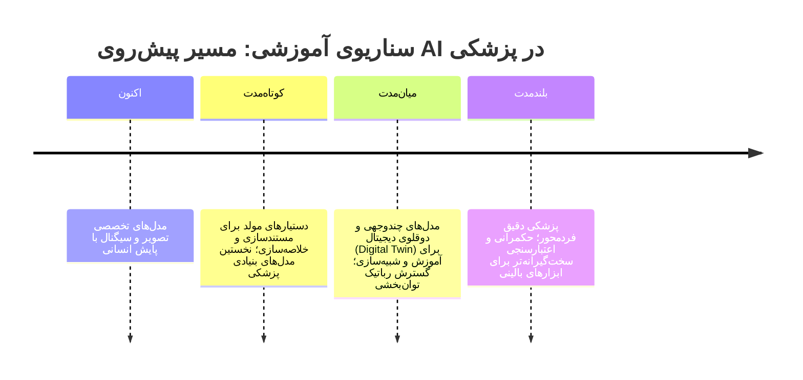

# جلسه ۲۹: آینده هوش مصنوعی در پزشکی و ارائه پروژه‌ها

> **درس:** مقدمه‌ای بر هوش مصنوعی و کاربرد آن در مهندسی پزشکی
> **مدت پیشنهادی:** ۶۰ تا ۹۰ دقیقه · **سطح:** مقدماتی
> **منابع این جلسه:** منبع ۲ (Erickson, 2021)، منبع ۴ (Khang, 2024)، منبع ۶ (Khang, 2023)، منبع ۱۱ (محتوای مدرس)

> [!NOTE]
> این جلسه دو نیمه دارد: **روندهای آینده** (بحث مفهومی، بدون پیش‌بینی عددی) و **ارائه‌ی پروژه‌های گروهی** بر اساس `project/project-brief.md`. همه‌ی بحث‌های پزشکی این جلسه آموزشی و غیرتشخیصی‌اند.

---

## اهداف جلسه
در پایان این جلسه دانشجو می‌تواند:
1. سه روند کلیدی آینده — مدل‌های بنیادی پزشکی (Medical Foundation Models)، هوش مصنوعی مولد (Generative AI) و رباتیک (Robotics) — را با یک مثال و یک محدودیت برای هرکدام توضیح دهد.
2. چالش‌های مشترک این روندها (اعتبارسنجی، حریم خصوصی، انسان در حلقه) را به مفاهیم جلسه ۲۷ پیوند بزند.
3. پروژه گروهی خود را طبق چک‌لیست ارائه درس ارائه کند و از سند پروژه (`project/project-brief.md`) دفاع کند.
4. مسیر ۲۹ جلسه‌ی درس را در یک جمع‌بندی بازتولید کند و گام‌های یادگیری بعدی خود را نام ببرد.

## ۱. روندهای آینده در یک نگاه

بحث این بخش کیفی است؛ هدف، ساختن زبان و چارچوب است، نه پیش‌بینی تاریخ‌دار.

### ۱-۱. مدل‌های بنیادی پزشکی (Medical Foundation Models)

مدل‌های بزرگِ عمومی که با حجم عظیم داده آموزش دیده‌اند و سپس با **تنظیم دقیق** (Fine-tuning) به وظایف تخصصی (تصویر، سیگنال، متن بالینی) وصل می‌شوند. وعده: کاهش نیاز به داده‌ی تخصصی برای هر وظیفه. محدودیت‌ها: هزینه آموزش، خطای سیستماتیک داده‌ی آموزش (سوگیری‌های جلسه ۲۷) و سخت‌تر شدن تفسیرپذیری.

### ۱-۲. هوش مصنوعی مولد (Generative AI)

مدل‌هایی که متن، تصویر یا ساختار می‌سازند؛ در پزشکی بیشتر برای **مستندسازی، خلاصه‌سازی و آموزش** طرح می‌شوند (منبع ۲). دو ریسک همیشگی: **توهم (Hallucination)** — پاسخ غیرواقعی با لحن مطمئن (از جلسه ۲ و ۳ یاد داریم) — و **حریم خصوصی داده‌ی ورودی** (از جلسه ۲۷). قاعده‌ی کلاس ما: خروجی مولد فقط با مرور انسانی و منبع‌دهی وارد کار آموزشی می‌شود.

### ۱-۳. رباتیک (Robotics)

ربات‌های جراحی کمکی، توان‌بخشی، لجستیک بیمارستانی و اتوماسیون آزمایشگاه (منبع ۴ و منبع ۶). الگوی مشترک با بقیه‌ی درس: حس‌گر → ادراک → تصمیم (اغلب ترکیبی از منطق/یادگیری) → عمل. مرز مسئولیت: هر اقدام مؤثر بر بیمار، مجوز و پایش انسانی می‌خواهد.

| روند | امضای اصلی | بزرگ‌ترین محدودیت | جلسه مرتبط |
|---|---|---|---|
| مدل بنیادی پزشکی | عمومیت‌پذیری بین وظایف | سوگیری و اعتبارسنجی | ۲۱، ۲۷ |
| AI مولد | تولید محتوا و مستندسازی | توهم و حریم خصوصی | ۳، ۲۷ |
| رباتیک | تصمیم و عمل در دنیای فیزیکی | ایمنی و مسئولیت | جلسه ۲؛ منبع ۴ |

## ۲. خط زمانی سناریوی آموزشی

> [!TIP]
> این خط زمانی یک **سناریوی آموزشی** برای مرتب‌کردن مفاهیم است (روایت تصویری، نه پیش‌بینی قطعی و تاریخ‌دار). آنچه تغییر نمی‌کند: هر دوره‌ای که باشیم، چرخه‌ی اعتبارسنجی و اخلاق جلسه ۲۷ برقرار است.

نکته‌ی امتحانی: در همه‌ی دوره‌ها سه سؤال ثابت است — «داده از کجا آمده؟»، «عملکرد روی هر زیرگروه چقدر است؟»، «چه کسی مسئول است؟».

## ۳. ارائه پروژه‌ها: چک‌لیست و اجرا

ارائه‌ی نهایی طبق `project/project-brief.md` انجام می‌شود (تیم ۲ تا ۳ نفره؛ گزارش ۴ تا ۶ صفحه؛ ارائه ۵ تا ۸ دقیقه + پرسش و پاسخ — همان‌جا مشخص شده). چک‌لیست قبل از ارائه:

| # | آیتم چک‌لیست | ملاک (از سند پروژه) |
|---|---|---|
| ۱ | مسئله روشن و واقع‌گرایانه؛ ورودی/خروجی/معیار موفقیت مشخص | معیار «تعریف مسئله» در روبریک |
| ۲ | کد اجرا می‌شود و آفلاین است؛ بدون داده‌ی واقعی بیمار | قواعد و محدودیت‌های سند پروژه |
| ۳ | متریک ارزیابی متناسب (نه فقط Accuracy) و ارقام گزارش‌شده | معیار «ارزیابی» در روبریک |
| ۴ | کد خوانا، مستند و کوتاه؛ seed ثابت و تکرارپذیر | معیار «کیفیت کد» در روبریک |
| ۵ | گزارش شامل تعریف مسئله، داده، روش، ارزیابی، محدودیت‌ها و بحث مسئولانه | خروجی‌های پروژه (گزارش ۴ تا ۶ صفحه) |
| ۶ | شفافیت استفاده از ابزار AI در یک بخش کوتاه | قواعد سند پروژه |
| ۷ | برچسب «آموزشی و غیرتشخیصی» روی اسلاید، کد و گزارش | هشدار سند پروژه |
| ۸ | سهم شفاف اعضای تیم | معیار «کار گروهی و مسئولیت‌پذیری» |

> [!WARNING]
> **هیچ پروژه‌ای در این درس ابزار تشخیص نیست.** ارائه‌ای که خروجی خود را «تشخیص» یا «پیش‌آگهی بالینی» معرفی کند، طبق سند پروژه و جلسه ۲۷ نمره‌ی «مسئولیت‌پذیری» را از دست می‌دهد.

## ۴. جمع‌بندی درس: مسیر ۲۹ جلسه

مسیر درس را می‌توان در چهار حرکت دید: **صورت‌بندی مسئله → تصمیم و احتمال → یادگیری → کاربرد مسئولانه.**

| مرحله | جلسات | فایل‌های مرجع |
|---|---|---|
| مبانی و آمادگی | ۱ تا ۴ | `session_01_intro_to_ai.md` تا `session_04_python_workshop.md` |
| حل مسئله با جست‌وجو و بهینه‌سازی | ۵ تا ۱۵ | `session_05_search_bfs_dfs.md` تا `session_15_adversarial_minimax.md` |
| میان‌ترم اول | ۱۶ | `session_16_midterm_1.md` |
| دانش، تصمیم و احتمال | ۱۷ تا ۲۰ | `session_17_logic_expert_systems.md` تا `session_20_bayesian_markov.md` |
| یادگیری ماشین و شبکه عصبی | ۲۱ تا ۲۴ | `session_21_ml_basics_evaluation.md` تا `session_24_neural_networks_deep_learning.md` |
| کاربردها و اخلاق | ۲۵ تا ۲۷ | `session_25_ai_biosignals_bci.md` تا `session_27_ai_bme_ethics_validation.md` |
| میان‌ترم دوم و پایان | ۲۸ و ۲۹ | `session_28_midterm_2.md` و همین جلسه |

پنج پلنگِ طلایی که با خود از این درس ببرید:

1. **صورت‌بندی قبل از الگوریتم:** مسئله، حالت‌ها، معیار موفقیت و محیط را اول تعریف کنید (جلسات ۲، ۵، ۱۸).
2. **تکرارپذیری:** seed ثابت، تفکیک مشخص، گزارش کامل (جلسات ۲۱ و ۲۲).
3. **ارزیابی صادقانه:** متریک متناسب با هزینه‌ی خطا و گزارش زیرگروه‌محور (جلسات ۲۱ و ۲۷).
4. **اخلاق به‌عنوان الزام، نه پیوست:** حریم خصوصی، رضایت، انسان در حلقه (جلسه ۲۷).
5. **سادگی اجرایی:** اجرای آفلاین با ابزار سبک؛ پیچیدگی بی‌دلیل دشمن کلاس است (کل طراحی درس).

## 🔬 پیوند با مهندسی پزشکی

- **سناریوی بحث کلاس:** تصور کنید نسخه‌ی «آینده» ابزار غربالگری جلسه ۲۷ با یک مدل بنیادی و گزارش‌گیری مولد ساخته شود — کدام گام‌های اعتبارسنجی و کدام الزام اخلاقی همچنان لازم می‌مانند؟ (پاسخ مورد انتظار: همه؛ فقط ابزارها تغییر می‌کنند.)
- **نقشه‌ی شغلی:** مهندس پزشکیِ آینده احتمالاً «مصرف‌کننده‌ی انتقادی» این فناوری‌هاست: صاحب چرخه‌ی اعتبارسنجی، مترجم متریک‌ها برای تیم درمان و نگهبانِ مرز غیرتشخیصی.
- همه‌ی مثال‌های این جلسه آموزشی و غیرتشخیصی‌اند.

## ✍️ فعالیت کلاسی / کارگاه

1. **ارائه‌ی پروژه‌ها:** هر گروه طبق چک‌لیست بخش ۳ ارائه می‌دهد؛ مخاطبان با جدول روبریک سند پروژه نمره‌ی تمرینی می‌دهند.
2. برای ارائه‌ی گروه قبل، **دو پرسش** بنویسید: یکی فنی (روش/ارزیابی) و یکی اخلاقی/مسئولانه.
3. در پایان، هر دانشجو «پنج پلنگ طلایی» بخش ۴ را با مثال خودش در یک جمله بازنویسی می‌کند.

## 📘 واژهنامه

| واژه | معادل انگلیسی | تعریف کوتاه |
|---|---|---|
| مدل بنیادی | Foundation Model | مدل بزرگ پیش‌آموزش‌دیده که به وظایف تخصصی تنظیم می‌شود |
| تنظیم دقیق | Fine-tuning | آموزش بیشتر یک مدل آماده روی داده‌ی وظیفه‌ی هدف |
| هوش مصنوعی مولد | Generative AI | مدل سازنده‌ی متن/تصویر/ساختار به‌جای فقط طبقه‌بندی |
| توهم | Hallucination | تولید پاسخ غیرواقعی با لحن مطمئن |
| دوقلوی دیجیتال | Digital Twin | شبیه‌سازی رایانشی از یک موجودیت (بیمار/دستگاه/فرایند) |
| چندوجهی | Multimodal | مدل با چند نوع ورودی هم‌زمان (تصویر، متن، سیگنال) |
| روبریک | Rubric | جدول معیار نمره‌دهی با وزن مشخص |

## ❓ پرسشهای خودآزمون

1. تفاوت اصلی یک «مدل تخصصی» با یک «مدل بنیادی پزشکی» چیست؟
2. دو ریسک اصلی AI مولد در کار پزشکی-آموزشی را نام ببرید و هرکدام را به یک جلسه از این درس پیوند بزنید.
3. سه مورد از چک‌لیست ارائه‌ی پروژه را انتخاب کنید و بگویید عدم رعایت هرکدام دقیقاً کدام بخش روبریک را می‌سوزاند.
4. در سناریوی خط زمانی بخش ۲، کدام سؤال‌ها «ثابت»‌اند؟ چرا اعتبارسنجی و اخلاق از دوره به دوره باقی می‌مانند؟

> کلید پاسخ‌ها در بخش «راهنمای مدرس» انتهای فایل آمده است.

## 📝 تکلیف و گام‌های بعدی

1. نسخه نهایی کد و گزارش پروژه را مطابق `project/project-brief.md` تحویل دهید و ارائه را دو بار با زمان‌سنج (۵ تا ۸ دقیقه) تمرین کنید.
2. یک صفحه «نگاه به آینده» بنویسید: پروژه‌ی شما در سناریوی مدل‌های بنیادی چه می‌شود؟ کدام بخش تغییر می‌کند و کدام نمی‌شود؟
3. گام‌های بعدی یادگیری: منبع وب آزاد دوره‌های آنلاین یادگیری ماشین و بینایی رایانه؛ خواندن مستندات scikit-learn؛ ادامه با درس‌های پیشرفته‌تر پردازش سیگنال/تصویر و اخلاق زیست‌فناوری.

## 📚 مطالعه پیشنهادی

- منبع ۲ (Erickson, 2021) — فصل‌های پایانی درباره چشم‌انداز و پیاده‌سازی AI پزشکی (منبع ۲)
- منبع ۴ (Khang, 2024) — فصل‌های آینده‌نگر درباره رباتیک و سلامت فناوری‌بالا (منبع ۴)
- منبع ۶ (Khang, 2023) — پزشکی دقیق مبتنی بر AI و IoT (منبع ۶)
- منبع وب آزاد: گزارش‌های چشم‌انداز AI در سلامت سازمان جهانی بهداشت — فقط برای بحث مفهومی
- مرور دوباره `project/project-brief.md` پیش از ارائه

---

## 🧭 راهنمای مدرس (از این عنوان تا انتها در نسخه دانشجو حذف شود)

**جلسه‌ی پایان: نیمه‌ی اول «بحث آینده»، نیمه‌ی دوم «ارائه‌ی پروژه‌ها».** اگر تعداد گروه‌ها زیاد است، ارائه‌ها را بین این جلسه و زمان‌بندی جایگزین خودتان تقسیم کنید؛ چک‌لیست بخش ۳ ملاک مشترک است.

### برنامه جلسه (۹۰ دقیقه)

| زمان | فعالیت |
|---|---|
| ۵ دقیقه | معرفی روندها (بخش ۱): هر روند یک مثال و یک محدودیت |
| ۱۰ دقیقه | بحث خط زمانی (بخش ۲): سناریو را روی تخته تصحیح کنید؛ سؤال‌های ثابت را استخراج کنید |
| ۱۰ دقیقه | توضیح چک‌لیست ارائه (بخش ۳) و یادآوری روبریک سند پروژه |
| ۵۵ دقیقه | ارائه‌ی گروه‌ها + پرسش و پاسخ (تعداد گروه × زمان سند پروژه) |
| ۷ دقیقه | جمع‌بندی درس (بخش ۴): پنج پلنگ طلایی و مرور مسیر |
| ۳ دقیقه | اعلام تکلیف و خداحافظی |

### نسخه ۶۰ دقیقه‌ای

روندها و خط زمانی (۱۵) | چک‌لیست (۵) | ارائه‌ی گروه‌ها با زمان کوتاه‌تر (۳۰) | جمع‌بندی (۷) | تکلیف (۳). بحث خط زمانی به تکلیف نوشتاری منتقل شود.

### نکات تدریس

- **روندها را عددی نکنید:** درباره‌ی تاریخ دقیق یا آمار بازار بحث نکنید؛ قاب پرسش‌های ثابت (داده، عملکرد زیرگروه‌ها، مسئولیت) بحث را غنی نگه می‌دارد.
- هنگام ارائه‌ها، با چک‌لیست امتیاز بدهید و هر گروه یک «بهترین جمله» و یک «بهترین اصلاح» بگیرد.
- به جلسه ۱۶ ارجاع دهید که میان‌ترم اول بود؛ مسیر جمع‌بندی این جلسه از میان‌ترم دوم (جلسه ۲۸) عبور می‌کند.
- همه‌ی مثال‌ها آموزشی و غیرتشخیصی‌اند؛ این را در آخرین دقیقه‌ی کلاس هم تکرار کنید.

**خروجی مورد انتظار جلسه:** ارائه‌ی کامل هر گروه طبق چک‌لیست، تحویل کد/گزارش نهایی، و یک جمله‌ی جمع‌بندی از هر دانشجو.

### کلید پرسش‌های خودآزمون

نمایش کلید پاسخ

1. مدل تخصصی برای یک وظیفه/داده‌ی خاص آموزش می‌بیند؛ مدل بنیادی روی حجم عظیم داده‌ی عمومی پیش‌آموزش می‌شود و با تنظیم دقیق به وظایف تخصصی وصل می‌شود — عمومیت‌پذیری بیشتر، اما ریسک سوگیری و تفسیرپذیری سخت‌تر.
2. توهم (پیوند به جلسه ۲ و ۳: پاسخ غیرواقعی مطمئن) و حریم خصوصی/رضایت داده‌ی ورودی (پیوند به جلسه ۲۷: کمینه‌سازی داده و رضایت هدفمند). ریسک سوم قابل‌ذکر: وابستگی بی‌مرور انسانی — ناقض «انسان در حلقه».
3. مثال‌ها: رعایت «متریک متناسب و ارقام گزارش‌شده» → معیار «ارزیابی» روبریک؛ «شفافیت استفاده از ابزار AI» → معیار «کار گروهی و مسئولیت‌پذیری»؛ «برچسب غیرتشخیصی» → مسئولیت‌پذیری و هشدار سند پروژه. (هر ترکیب درستی پذیرفته است؛ ملاک، تناظر آیتم↔روبریک است.)
4. «داده از کجا آمده؟»، «عملکرد روی هر زیرگروه؟»، «مسئول کیست؟» — چون به ماهیت سیستم‌های اطلاعاتی و مسئولیت حرفه‌ای مربوط‌اند، نه به فناوریِ یک دوره خاص؛ ابزار عوض می‌شود، چرخه‌ی اعتبارسنجی و اخلاق نمی‌شود.

